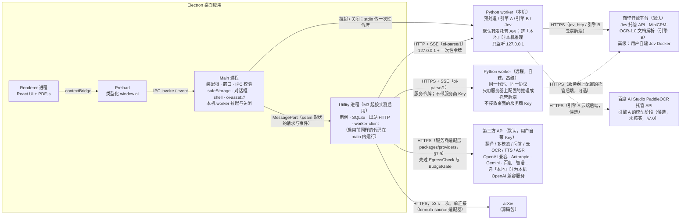
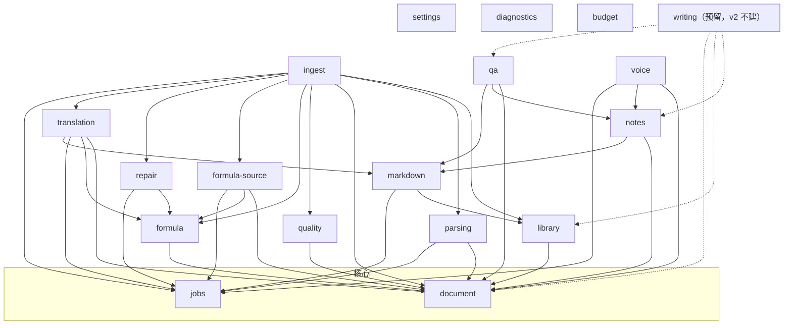
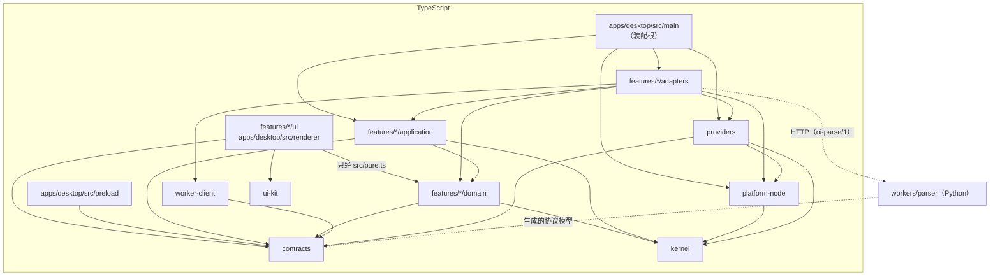
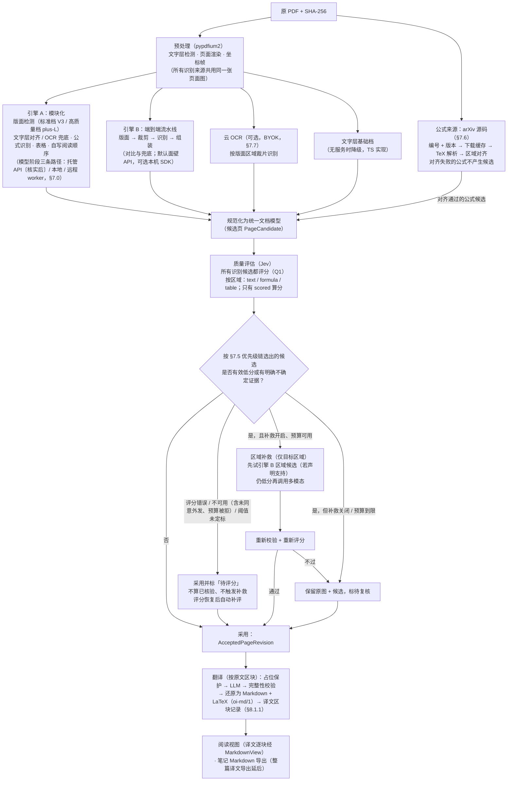
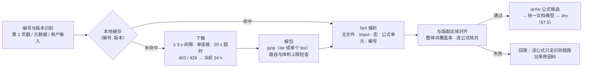

# open-immerse v2 架构规格（ARCHITECTURE）

状态：v0.5，规格基线（唯一真相源之一）。日期：2026-10-30（Asia/Shanghai）。Q1–Q12 已全部由 Wisdom 于 2026-10-30 决定，本文已按决定修改（结论汇总见 §16 与[差异清单](./docs/v2-gap-and-changes.md) §6）。v0.3 并入 Wisdom 2026-10-30 17:32 批准的 Markdown 阅读方案（Loom，[docs/design/md-reader.md](./docs/design/md-reader.md)）：新增 `markdown` 切片（§4.5），译文改为按区块存 Markdown（§8.1.1）；同日并入 Loom 对译文区块四项风险的结论（§8.1.1，§16）；同日 18:37 并入 Jev 远程默认面壁开放平台（§7.4），18:44 并入「API 优先」原则（§7.0），19:11 并入 Wisdom 对四项风险的决定（数据外发同意对话框、引擎 A 三条路径、问答同时支持多模态与纯文本模型、M0 API 实测延后；§2.5、§4.2、§7.0、§7.3、§7.4、§16），19:30 把外发同意改为按服务商询问并加入「外发前询问」开关（§7.0 第 6 条）。Wisdom 2026-10-30 19:57 批准按[架构评审](./docs/reviews/2026-10-30-architecture-review.md)修改；v0.4 改 P0 四项并删除 G17：新增无界面的编排切片 `ingest` 与预算切片 `budget`（§2.5、§4.2、§4.3），main 与 utility 进程的固定职责（§1），所有付费调用先预留（§7.8），译文中未核验公式的裁图表示（§8.1.1），CI 门禁（§13）。v0.5 改评审的 P1 项，并按 Wisdom 2026-10-30 19:45、19:46 的要求新增服务商适配层：外发同意的措辞统一（§7.0 第 6 条），外发检查端口 `EgressCheck` 与远程 worker 不接收桌面的服务商 Key（§1、§7.0、§10.1），删除已被取代的旧表述（§7.4、§16），存储与协议的版本升级规则（§8.4、§10.4），Electron 加固（§9），服务商适配层 `packages/providers`（§7.9），开发者本机的 Key 注入（§15.4）。
同级规格：[PRD.md](./PRD.md)（做什么）、[RULES.md](./RULES.md)（怎么协作）。视觉与交互：[DESIGN.md](./DESIGN.md)、[docs/design-principles.md](./docs/design-principles.md)，**两份均待 Loom 产出**；本文只规定 UI 代码放在哪、依赖谁，不规定长什么样。
本文与 `docs/architecture/0x_*_草案.md` 冲突时以本文为准，差异逐条列在 [docs/v2-gap-and-changes.md](./docs/v2-gap-and-changes.md)。本文中的目录、接口、协议均为**拟议设计**，M1 起按本文落地；落地前不代表已存在。

---

## 0. 设计目标

按优先级：

1. **可维护**：任何一个文件都能在一屏内看懂它为什么存在；改一个功能只动一个切片。
2. **可并行开发**：多个 Agent / 人同时改不同模块，不在同一文件上冲突；冲突面只剩「契约」和「装配」两处，且这两处由规则约束为小改动。
3. **可验证**：每个模块能在不启动 Electron、不加载模型、不联网的情况下独立测试。
4. **正确优先**：公式、来源、版本、费用相关的规则写在纯领域代码里，由程序校验，不靠提示词。
5. **可替换**：引擎、模型、服务商、存储都在端口（port）后面；换实现不改调用方。

## 1. 进程拓扑



- **Renderer** 只做展示与交互：React 组件、PDF.js 渲染、裁图显示。不碰文件系统、SQLite、密钥、Python 进程、网络 API。
- **Preload** 只暴露由契约生成的类型化命令与事件订阅，不暴露 `ipcRenderer`、任意通道、`fs`、`shell`。
- **Main** 是装配根（composition root），不写业务规则。下列职责固定在 main，因为对应的 Electron 能力只在 main 提供（`safeStorage`、`dialog`、`protocol` 只在 main；`shell` 只在 main 与非沙箱 renderer；`utilityProcess` 是只带 Node.js 与 MessagePort 的子进程，stdin 只能是 `ignore`；依据 Electron 文档 `docs/api/*.md` 的 Process 标注，2026-10-30 查阅 main 分支，M1 按锁定版本复核）：
  - 窗口、菜单、preload；IPC 发送方校验与 schema 校验（§9）；
  - `SecretStore` 的唯一实现（`safeStorage`，§8.3）；
  - 系统对话框（`path-picker`）、`shell.openExternal` 与「在文件管理器中显示」（`external-opener`）；
  - `oi-asset://` 协议处理器（§9）；
  - 本机 worker 的拉起与关闭（`worker-supervisor`），一次性令牌由 main 生成、经 stdin 传给 worker。
- **Utility 进程**：可以搬出 main 的部分是用例（domain + application）、SQLite 仓储、出站 HTTP 的服务商适配层（`packages/providers`，§7.9）、`worker-client`、文件资产，以及 `.md` 文件的读取、扫描与监视。M1–M2 这些仍在 main 内装配运行；M3 起若长任务影响 main 的响应（以实测为准，阈值待定标），把这一组整体搬到 Electron `utilityProcess`，main 只转发 seam 形状的请求与事件（§2.4 的普通数据规则保证它们可以跨进程）。M1 起目录与端口就按这条边界放：可搬迁的代码只经端口使用 main 的能力（`SecretStore` 授权、`PathPicker`、`ExternalOpener`、资产路径解析），搬迁时换的是这些端口的注入方式（同进程调用改为 MessagePort 代理），不改用例，也不改适配器的业务逻辑。
- **密钥明文只在 main 的内存里。** utility 里的适配器要发带凭据的请求时，经 MessagePort 向 main 要「本次调用」的授权：main 核对目标主机与该服务商配置里登记的主机一致，再返回请求头的值；适配器只用于这一次请求，不缓存、不写日志、不放进任务记录。契约测试：同一适配器发两次请求，向 main 要两次授权；目标主机与登记不符时 main 拒绝。
- **资产**：`oi-asset://` 的处理器在 main；资产登记表在 SQLite（随用例搬到 utility）。utility 启用后，main 收到请求时经 MessagePort 用 `assetId` 换取登记的路径与允许的根目录，再自己做真实路径检查（§9）。

| 组件 | M1–M2 | utility 启用后 |
| --- | --- | --- |
| 窗口、preload、IPC 校验、`SecretStore`（`safeStorage`）、对话框、`shell`、`oi-asset://` 处理器、`worker-supervisor` | main | main（不搬） |
| 用例（全部切片的 domain + application）、SQLite 仓储、服务商适配层（`packages/providers`）、`worker-client`、文件资产、`.md` 读取 / 扫描 / 监视 | main | utility |
- **Python worker**：无状态计算服务。不写用户文献库、不决定采用版本、不持久化用户的第三方 API 密钥（本机 worker 由 main 拉起、只监听 127.0.0.1；它转发托管 API 时，面壁 API Key 等凭据由 main 按次授权，随作业请求头经回环地址传入，worker 只在内存中使用，不落盘、不进日志、不进产物。远程 worker 一律不接收桌面的服务商 Key，只用服务器上自己配置的后端，§10.1）。本机与远程运行同一份代码、同一协议（Q7）。
- **API 优先**（Wisdom 2026-10-30 18:44，§7.0）：每个由模型提供的能力，有托管 API 时默认用托管 API；「本地」是同一接口后面的一等选项，用户在设置里按能力选「本地 / API」。
- **外发检查**（架构评审 P1-2，§7.0 第 6 条）：任何连接发出前，由 `contracts` 的 `EgressCheck` 端口按「服务商 + 能力 + 目的主机」判定能否发送。回环地址之外的主机一律算外发，包括标为「本地」但不在回环地址上的服务，以及远程 worker 本身。
- **质量评估一律经 worker**（Q9）：桌面端只通过 `oi-parse/1` 的 `evaluate` 作业请求评分，无论 Jev 在本机推理、在远程 worker 所在服务器推理，还是由 worker 转发给面壁 API / 用户 Docker 服务。桌面端没有第二条评分通路（§7.4）。

## 2. 分层

| 层 | 放什么 | 可以依赖 | 禁止依赖 |
| --- | --- | --- | --- |
| **domain** | 实体、值对象、纯规则（公式占位校验、阅读顺序几何、锚点匹配、状态转换、预算计算） | `contracts`、`kernel`、本切片 domain | Node 内置模块、Electron、React、DOM、PDF.js、数据库驱动、HTTP、任何厂商 SDK、其他切片的 domain |
| **application** | 用例（use case）、端口接口（ports）、编排、事务边界 | 本切片 domain、`contracts`、`kernel`、其他切片的**公开入口** `index.ts` | 任何 adapters、ui、Electron、Node IO |
| **adapters** | 端口实现：SQLite 仓储、文件资产、服务商端口实现（经 `providers`）、worker 客户端、IPC 处理器 | 本切片 application（实现其 ports）与 domain、`platform-node`、`providers`（只经 `@oi/providers` 入口，§7.9）、`contracts`、`kernel` | ui、其他切片的 adapters；服务商的主机名、请求格式、鉴权头（只在 `providers`，F-18） |
| **ui** | React 组件、hooks、视图模型；通过 `window.oi` 调命令、订阅事件 | 本切片的展示 seam `src/pure.ts`（纯函数与类型，§2.4）、`contracts`、`ui-kit`、React、PDF.js（仅 reader 切片） | 本切片 domain / application 的内部文件、adapters、`platform-node`、Electron、Node 内置模块、其他切片的 ui |
| **workers**（Python） | 预处理、引擎、质量评估的计算 | worker 内部分层（§10.3）与生成的协议模型 | 任何 TS 代码、用户文献库、桌面数据目录 |

**装配**只发生在 `apps/desktop/src/main/`（TS）和 `workers/parser/oi_worker/__main__.py`（Python）。只有装配根可以同时看到 application 与 adapters。

### 2.1 UI 与业务核心解耦（Q3，Wisdom 2026-10-30 原文）

以下为原文，任何人不得删改或弱化；执行细则与交接模板见 [RULES.md](./RULES.md) §8，CI 规则见 §13 的 G13–G16。所有涉及 UI 或 core 的交接指令都必须引用本节与 RULES §8。

> UI 与业务核心解耦（functional core, imperative shell）。改 UI 不得改变核心行为，也不得让核心测试失败。
>
> - core module：业务规则。deep module，接口小，实现藏在里面。
> - seam：核心对外的接口。穿过 seam 的只有普通数据（输入、结果、错误），没有组件、DOM、事件对象、路由类型。
> - UI adapter：把用户操作翻译成对 seam 的一次调用，再把结果画出来。业务规则不写在组件里。
> - dependency rule：UI 依赖 core。core 不 import UI、框架组件、DOM、路由、样式。
>
> 执行规则：
>
> 1. 校验、计价、状态转移、权限、失败条件只写在 core。
> 2. 改 UI（布局、文案、组件、交互）时，默认不改 core 文件。
> 3. 现有 seam 不够用时先停下来说明缺什么，不要为了迁就页面去加参数、改返回形状。
> 4. 核心测试直接调用 seam，不渲染 UI。这是完成标准。
> 5. 做完说明：改了哪些 UI 文件，core 是否没动，核心测试是否通过。

### 2.2 调研依据

调研时间 2026-10-30。下表只列与本约束直接相关的要点；「落到本项目」一栏是本文据此做出的具体规定。

| 来源 | 要点 | 落到本项目 |
| --- | --- | --- |
| Gary Bernhardt，[Functional Core, Imperative Shell](https://www.destroyallsoftware.com/screencasts/catalog/functional-core-imperative-shell)（2012） | 纯函数核心被一层命令式外壳包住，外壳负责输入输出、数据库、网络，依据核心算出的值行动；核心很容易测，常常不需要 test double；外壳的条件分支很少 | 规则写在 domain（纯函数）；adapters 与 `ipc-handlers.ts` 只做转接、不写业务分支（F-02）；core 测试用 `testing/` 里的 fake 端口即可，不需要 mock 框架 |
| Gary Bernhardt，[Boundaries](https://www.destroyallsoftware.com/talks/boundaries)（SCNA 2012） | 用简单值（而不是复杂对象）作为组件与子系统之间的边界 | seam 只传普通数据（§2.4 第 1 条） |
| Alistair Cockburn，[Hexagonal Architecture](https://alistair.cockburn.us/hexagonal-architecture/) | 应用应能同样被用户、程序、自动测试、批处理驱动，并能脱离真实设备与数据库独立开发测试；业务逻辑渗入 UI 后无法自动测试、无法换驱动方；「新加一层并承诺不放业务逻辑」若**没有检测违规的机制**，几年后又会塞满业务逻辑；端口按「目的」划分，一个端口可插多个适配器（GUI、测试夹具、批处理） | UI 与 core 测试是同一个 seam 的两个驱动方适配器；执行规则 4 就是「检测违规的机制」，并由 G16 自动检查；SQLite、HTTP、worker 是被驱动方适配器，经 application 端口接入 |
| Mark Seemann，[Functional architecture is Ports and Adapters](https://blog.ploeh.dk/2016/03/18/functional-architecture-is-ports-and-adapters/)（2016） | 纯函数在中心、不纯代码推到系统边缘，在组合根装配；在面向对象代码里维持这种结构「像推石头上山」，稍不留神就滑回去 | 只靠评审守不住，边界必须由机器检查（G13–G16）；不纯的实现只在 `apps/desktop/src/main/` 装配根注入 |
| John Ousterhout，[A Philosophy of Software Design](https://web.stanford.edu/~ouster/cgi-bin/aposd.php) 第 4–5 章 | 最好的模块是「深」的：功能强、接口远比实现简单；接口复杂而功能少的「浅模块」是红旗；信息隐藏让修改实现不波及调用方。第 2 版专门讨论了与 Clean Code 在方法长度上的分歧 | 每个切片只有一个用例 seam（`src/index.ts`）和一个展示 seam（`src/pure.ts`）；一个用户操作对应一次 seam 调用；为迁就页面加参数等于把实现细节泄漏到接口（执行规则 3）。§6 的行数上限保留不变，但只用来拆 seam **背后**的实现，不得把一个 seam 拆成一串浅函数 |
| Electron 官方文档：[Process Model](https://www.electronjs.org/docs/latest/tutorial/process-model)、[Context Isolation](https://www.electronjs.org/docs/latest/tutorial/context-isolation)、[IPC](https://www.electronjs.org/docs/latest/tutorial/ipc)、[Security](https://www.electronjs.org/docs/latest/tutorial/security) | renderer 按 Web 标准运行、默认不能用 Node；preload 经 `contextBridge` 暴露 API，**不要**直接暴露 `ipcRenderer.send`，应每个 IPC 消息一个方法；`contextBridge` 不能传自定义原型与 Symbol；IPC 用结构化克隆，DOM 对象不能序列化；`handle` 中抛出的错误到 renderer 只剩 `message`；utility 进程适合 CPU 密集或易崩溃的组件；要校验每条 IPC 消息的发送方 | 跨进程 seam = `contracts/src/ipc/<feature>.ts` 生成的 `window.oi.<feature>.<command>`，一条命令一个方法；seam 类型必须能结构化克隆（这也是「普通数据」的机器判据）；错误作为 `Result` 数据返回，不靠异常穿越 IPC；core 不依赖 renderer，可在 main 或 utility 进程运行 |
| [dependency-cruiser 规则参考](https://github.com/sverweij/dependency-cruiser/blob/main/doc/rules-reference.md) | `forbidden` 规则按 `path` / `pathNot` 正则匹配；`$1` 组匹配可表达「同一切片」；`reachable` 检查传递依赖；`dependencyTypes` 可区分 `type-only` 导入（需开启 `tsPreCompilationDeps`） | G13、G15、G16 的写法（§13）；type-only 导入也算依赖，core 不能 `import type` React 类型 |
| [eslint-plugin-boundaries](https://github.com/javierbrea/eslint-plugin-boundaries) | 把文件归类为元素类型，按「默认禁止 + 白名单」声明元素间与外部包的依赖，在编辑器里即时报错 | M1 评估作为编辑器内即时反馈；CI 的权威检查仍是 dependency-cruiser，两者规则从同一份元素定义生成，避免漂移 |
| [Bulletproof React：项目结构](https://github.com/alan2207/bulletproof-react/blob/master/docs/project-structure.md) | 按 feature 组织；禁止跨 feature import（`import/no-restricted-paths`），在应用层组合；代码单向流动 shared → features → app | 与 §3 的功能切片、§5.3 的插槽组合一致 |
| VS Code：[Source Code Organization](https://github.com/microsoft/vscode/wiki/Source-Code-Organization) 与仓库 [`eslint.config.js`](https://github.com/microsoft/vscode/blob/main/eslint.config.js)（查阅提交 `3ee7c48`） | 核心分 `base` / `platform` / `editor` / `workbench` / `code` 层；每层内按目标环境分 `common`（只用基础 JS API）/ `browser`（DOM）/ `node` / `electron-*`，各自只能用规定的下层；每个 contribution 只从**单个文件**暴露内部 API，不得伸进别人的内部；服务经构造函数注入；用自定义 ESLint 规则 `local/code-layering` 与 `local/code-import-patterns` 检查，配置旁注明「Do not relax these rules」（该提交中两条规则为 warn 级） | core 对应 VS Code 的 `common`：core 的 tsconfig 不含 DOM 与 Node 类型（G14）；每个切片单入口 seam；依赖注入只在装配根；本项目把同类规则设为 error 级，CI 失败而非提醒 |
| Cursor：[Keeping the Cursor app stable](https://cursor.com/blog/app-stability)（2026-04-21） | 桌面应用建立在 VS Code 与 Electron 之上，是多进程架构：renderer 进程承载编辑器与 agents 窗口，utility 进程承载扩展、存储与 agent 功能；renderer 崩溃最严重；跨进程的超大消息与内存问题强相关，已对其埋点；扩展放在独立进程隔离 | 重计算不放 renderer（§1 utility 进程与 worker）；seam 消息不带大块数据，页面图、PDF、音频只传 `assetId`（§2.4 第 4 条）；IPC 载荷超过阈值记诊断事件（§11）。Cursor 内部代码分层**未见公开资料**，本文不据此推断 |

### 2.3 术语落到代码

| 约束中的术语 | 本项目落点 | 对应的层 |
| --- | --- | --- |
| **core module** | `packages/features/*/src/domain/**`（纯规则）与 `application/**`（用例编排、端口接口）；Python 侧的纯规则模块（`engines/reading_order/`、`engines/e2e_b/mapping.py`、`quality/batching.py`） | domain、application |
| **seam** | 用例 seam：`packages/features/<f>/src/index.ts`（用例工厂、输入 / 结果 / 错误类型）；展示 seam：`src/pure.ts`（可打包进 renderer 的纯函数与类型）；跨进程 seam：`contracts/src/ipc/<f>.ts` 及由它生成的 `window.oi.<f>.*` | 契约（`contracts`）与切片公开入口 |
| **UI adapter** | `packages/features/*/src/ui/**`、`apps/desktop/src/renderer/**` | ui |
| **imperative shell**（被驱动方适配器与装配） | `features/*/src/adapters/**`（其中 `ipc-handlers.ts` 是驱动方：IPC → seam）、`platform-node`、`worker-client`、`apps/desktop/src/main/**`、生成的 preload；worker 的 `api/`、`jobs/`、`runtime/` 与模型推理 | adapters、workers |
| **dependency rule** | UI → seam → core；shell → core（实现端口）；core 只依赖 `contracts`、`kernel`、本切片内部与其他切片的 seam | §5.1 |

说明：application 用例经端口调用外界，严格说不是纯函数。本项目把**规则**放在 domain（纯），application 只做编排与事务边界；两者合称 core，都不得碰 UI。执行规则 1 的五类规则（校验、计价、状态转移、权限、失败条件）一律落在 domain，§2.5 逐切片列出。

### 2.4 seam 的形状规则

1. **只有普通数据**：字符串、数字、布尔、`null`、数组、普通对象、品牌化 ID（运行时仍是字符串）。不传类实例、函数、DOM 节点、React 元素、事件对象、路由对象、`AbortSignal`、`Error` 实例。判据：值能被结构化克隆且克隆后语义不变。
2. **错误是数据**：返回 `Result<T, E>`，`E` 是带 `code` 的判别联合，字段只有普通数据；用例不向 seam 外抛异常。
3. **一个用户操作 = 一次 seam 调用**：长任务立即返回 `jobId`，进度经 `jobs` 事件推送；取消是另一次调用 `jobs.cancel({ jobId })`。
4. **大数据不过 seam**：页面图、PDF、音频、裁图只传 `assetId`，由受控协议 `oi-asset://` 取用（§9）。
5. **不含展示信息**：输入不带文案、颜色、像素布局；结果不带可直接注入的 HTML。显示决策（例如公式显示原图还是 LaTeX）以枚举值返回，由 UI 决定怎么画。
6. **小而深**：每个切片一个 `index.ts`、一个 `pure.ts`，导出清单登记在切片 `README.md`。新增或修改导出按执行规则 3 处理：先停下说明缺什么，再单独提 seam PR（契约先行，RULES §3），合入后再做 UI。
7. **renderer 只用两种 seam**：`pure.ts`（同进程纯函数，例如滚动跟随的几何计算）与 `window.oi`（跨进程命令）。renderer 不直接调用 application 用例。

### 2.5 与 5 层、18 个切片的映射

Q3 的要求是映射到 5 层与 14 个切片；Q4 决定新增 `formula-source` 切片，Markdown 阅读方案（Wisdom 2026-10-30 17:32）新增 `markdown` 切片，架构评审（Wisdom 2026-10-30 19:57 批准）新增编排切片 `ingest` 与预算切片 `budget`，共 18 个；`writing` 为预留位（§4.4，v2 不建）。下表「core」列给出执行规则 1 的五类规则所在文件；CI 规则用通配路径覆盖全部切片，新增切片只要遵守 §3.1 模板即自动受约束。

| 切片 | core：规则所在（校验 / 计价 / 状态转移 / 权限 / 失败条件） | seam | UI adapter | shell 适配器 |
| --- | --- | --- | --- | --- |
| `ingest` | `ingest-policy`（状态转移：由已保存的候选、评估记录、采用版本、译文区块算出下一步——解析、取源码候选、评分、公式决定、补救、采用、翻译或停止；失败条件：预算被拒、未同意外发、服务不可用时停在哪一步、记什么原因） | `openDocument`（打开 PDF 的唯一用户入口）、`resumeIngest`（启动时与评分恢复后续跑） | 无（进度由 reader 经 `jobs` 事件显示） | 无（只调用其他切片的 seam） |
| `library` | `document-identity`（校验：哈希身份）、`library-record`（校验：元数据） | `importPdf`（由 `ingest` 调用，不是 IPC 命令）、`listLibrary`、`updateProgress`、`getBibliographicRecords`（§4.4 预留） | `ui/library-list.tsx` | `sqlite-library-repository`、文件资产 |
| `document` | `accepted-revision`（失败条件）、`adopt-policy`（状态转移、权限：compare 与 adopt）、`source-audit`（失败条件） | `adoptPage`、`compareCandidates`、`getAcceptedRevision` | 无（由 reader 渲染） | `sqlite-document-repository` |
| `parsing` | `engine-capabilities`、`layout-profile`（权限：高质量档是否可选，Q10）、`text-layer/*` | `submitParse`、`getParseCapabilities` | 无（状态显示在 reader） | `worker-parse-gateway`、`text-layer-engine`、`cloud-ocr-provider`（经 `providers`，§7.9） |
| `jobs` | `job-state-machine`（状态转移）、`idempotency`（失败条件：能否重发） | `cancelJob`、`listJobs`、事件 `onJobEvent` | 无 | `sqlite-job-store` |
| `formula` | `formula-policy`（失败条件：候选优先级链，§7.5）、`charset-check`、`equation-number`、`render-equivalence`（校验） | `decideFormula`；`pure.ts`：`formulaDisplayMode` | 无（`reader/ui/formula-view.tsx` 渲染） | `katex-renderer` |
| `formula-source` | `arxiv-id`（校验）、`fetch-policy`（状态转移：限流与冷却）、`archive-limits`、`align-policy`（失败条件） | `resolveArxivSource`、`alignSource` | 无（来源标注由 reader 显示，开关在 settings） | `arxiv-http-client`、`sqlite-source-cache`、`node-gunzip` |
| `quality` | `evaluation-status`（状态转移：verdict 规范化）、`scoring-coverage`（失败条件：未评分不得算已核验，Q1）、`low-score-routing`、`deployment-recommendation`（Q9） | `evaluateRegions`；`pure.ts`：`recommendEvaluatorDeployment` | 无（设置页属于 settings） | `worker-quality-evaluator` |
| `repair` | `repair-plan`（权限：是否允许补救）、`repair-limits`（失败条件） | `runRepair` | 无（入口在 reader） | `llm-multimodal-provider`（经 `providers`） |
| `budget` | `budget-ledger`（计价：预留、结算、释放）、`budget-limits`（失败条件：金额上限，以及按「服务商 + 能力」的请求数 / 页数 / token 上限）、`price-book`（计价：单价已知或未知，未知不记为 0） | `getBudgetStatus`、`setBudgetLimits`；其他切片只经 `contracts` 的 `BudgetGate` 端口使用（装配根注入，§7.8） | 无（预算设置页在 settings，经 `window.oi.budget.*`） | `sqlite-ledger-store` |
| `translation` | `placeholder`、`integrity-check`（校验、失败条件）、`markdown-restore`（校验：占位还原后公式与片段表一致）、`block-scope`（哪些块是翻译块）、`block-status`（状态转移：success / failed / retranslating）、`adopted-version`（采用哪个版本）、`cache-key`（含公式决定摘要） | `translatePage`、`retranslateBlock`、`getBlocks`、`polishTranslation`、事件 `onBlockChanged` | 无（译文由 reader 渲染） | `llm-translation-provider`（经 `providers`）、`sqlite-translation-store` |
| `markdown` | `html-policy`（校验：原始 HTML 一律屏蔽）、`math-syntax`（失败条件：不可信命令、超长公式）、`link-resolve`（失败条件：not_found / ambiguous / outside_vault）、`vault-path-policy`（权限：越界、符号链接）、`vault-limits`（失败条件：文件数、单文件大小）、`watch-debounce`（状态转移）、`nav-history`（状态转移）、`write-capability`（权限：v2 恒为只读） | `render`、`openFile`、`openVault`、`readFile`、`listRecent`、`close`、`getCapabilities`、事件 `onFileEvent`；`pure.ts`：`renderMarkdown`、`navigate` | `ui/md-file-page.tsx`、`ui/vault-page.tsx`、`file-tree`、`outline-panel`、`reload-toast`、`editor-slot`；共享渲染组件在 `ui-kit/src/markdown/`（§4.5.4） | `node-md-file-reader`、`node-vault-scanner`、`node-file-watcher`、`sqlite-md-recent-store`、`vault-asset-registrar` |
| `reader` | `pairing`、`scroll-sync`、`viewport-mapping`（纯几何，经 `pure.ts` 在 renderer 运行） | `pure.ts` | `pdf-page-canvas`、`readout-pane`（译文块交给 ui-kit 的 `MarkdownView`）、`formula-view`、`selection-toolbar` | 无（数据经 `window.oi`） |
| `notes` | `anchor-match`（失败条件：无法唯一重定位）、`note`（校验）、`markdown-export` | `createNote`、`reanchorNotes`、`exportNotes`、`getNotesByIds`（§4.4 预留）；读笔记时随结果返回正文的 `MdDocument` | `ui/notes-panel.tsx`（正文交给 `MarkdownView`） | `sqlite-notes-repository` |
| `qa` | `context-selection`、`citation`（失败条件：引用必须可定位） | `ask`；回答事件带已闭合块的 `MdBlock[]` 与未闭合尾部文本（§4.5.4） | `ui/ask-panel.tsx`（回答交给 `MarkdownView`） | `llm-chat-provider`（经 `providers`） |
| `voice` | `speech-script`、`audio-segment`（校验：段落必须带锚点） | `generateNarration`、`transcribeNote` | `ui/narration-player.tsx`、`ui/voice-note-recorder.tsx` | TTS / ASR 适配器 |
| `settings` | `provider-config-validate`（校验）、`translation-fallback`（权限，Q11）、`backend-choice`（每个模型能力的「本地 / API」默认值与切换，API 优先，§7.0；Q9）、`egress-consent`（权限：按服务商的数据外发同意、追加告知、「外发前询问」开关，§7.0 第 6 条）、`egress-destination`（权限：目的主机是否算外发，服务商身份按（服务商, 主机）判定，§7.0 第 6 条） | `saveProvider`、`testConnection`、`setBackendChoice`、`answerEgressConsent`、`setEgressPromptEnabled`、`listEgressDestinations`、`listProviderPresets`；`EgressCheck` 端口的实现（装配根注入，不是 IPC 命令） | `ui/settings-pages/*` | `safe-storage-secret-store`、`providers-catalog` |
| `diagnostics` | `redaction-rules`（校验）、`retention`（失败条件：超限删除） | `exportBundle` | `ui/diagnostics-page.tsx` | `file-logger` |
| `writing`（预留，v2 不建） | 引用必须解析到锚点（复用 `qa/citation` 规则） | §4.4 草案 | — | — |

### 2.6 示例 seam

```ts
// packages/features/translation/src/index.ts —— 拟议 seam（用例 seam）
import type { BlockId, DocumentId, PageRevisionId, JobId, Result } from '@oi/contracts';

export type TranslatePageInput = Readonly<{
  documentId: DocumentId;
  revisionId: PageRevisionId;      // 以采用版本为准；版本过期会返回 revision_stale
  targetLang: 'zh-CN';
}>;
export type TranslatePageAccepted = Readonly<{
  jobId: JobId;                    // 长任务：进度走 jobs 事件
  reusedBlocks: number;            // 命中缓存、不再请求的块数
  queuedBlocks: number;
}>;
export type TranslatePageError =
  | Readonly<{ code: 'provider_not_configured' }>
  | Readonly<{ code: 'budget_exhausted'; reservedMinor: number; limitMinor: number }>
  | Readonly<{ code: 'revision_stale'; currentRevisionId: PageRevisionId }>;

export interface TranslationSeam {
  translatePage(input: TranslatePageInput): Promise<Result<TranslatePageAccepted, TranslatePageError>>;
  // 译文区块（§8.1.1）：每块带 core 已解析好的 MdDocument，reader 不再解析 Markdown
  getBlocks(input: Readonly<{ documentId: DocumentId; revisionId: PageRevisionId; sourceBlockIds?: readonly BlockId[] }>):
    Promise<Result<readonly TranslationBlockView[], GetBlocksError>>;
  // Ok 只表示「已受理」，不表示重译成功；状态变化只经 onBlockChanged 推送（§8.1.1）
  retranslateBlock(input: Readonly<{ documentId: DocumentId; revisionId: PageRevisionId; sourceBlockId: BlockId }>):
    Promise<Result<Readonly<{ version: number }>, RetranslateBlockError>>;
}
// 事件 translation.onBlockChanged → TranslationBlockChanged
// TranslationBlockView = {                       （类型在 contracts，§4.1；显示规则见 §8.1.1）
//   display: 'current' | 'retranslating' | 'previous_with_failure' | 'never_succeeded' | 'pending';
//   shown: StoredTranslationBlock | null;   // 要显示的 success 版本
//   latest: StoredTranslationBlock;         // 最新版本：状态与 failureKind 取自这里
//   doc: MdDocument | null }                // shown.markdown 的解析结果
// TranslationBlockChanged = { documentId; revisionId; sourceBlockId; status; version; failureKind }（普通数据，§8.1.1）
// GetBlocksError = { code: 'revision_stale'; currentRevisionId: PageRevisionId }
// RetranslateBlockError = TranslatePageError
//   | { code: 'block_not_translatable' }   // 表格、图、独立公式不是翻译块（§8.1.1）
//   | { code: 'already_retranslating'; version: number }
export declare function createTranslationSeam(deps: TranslationDeps): TranslationSeam; // deps 只含端口，由装配根注入
```

```ts
// packages/features/quality/src/pure.ts —— 拟议 seam（展示 seam，纯函数，可在 renderer 运行）
export type HardwareProfile = Readonly<{
  os: 'windows' | 'macos' | 'linux';
  arch: 'x64' | 'arm64';
  totalMemoryGB: number;
  unifiedMemory: boolean;          // Apple Silicon 为 true
  gpus: ReadonlyArray<Readonly<{ vendor: 'nvidia' | 'amd' | 'intel' | 'apple' | 'other'; vramGB: number | null }>>;
}>;
export type DeploymentAdvice = Readonly<{
  recommended: 'api' | 'local';    // 设置主选项「本地 / API」（API 优先，§7.0）；高级自建选项不参与推荐
  meetsOfficialHardware: boolean;  // 「本地」是否达到 Jev 官方硬件下限（§7.4），只用于标注可行性
  platformDocumented: boolean;     // 官方文档是否覆盖该平台（Windows 未覆盖）
  reason: 'api-first' | 'no-api-local-capable' | 'no-api-below-minimum';
}>;
// hostedApiAvailable：该能力有可用托管 API，且用户没有关掉 API 来源、没有拒绝数据外发
export declare function recommendEvaluatorDeployment(hw: HardwareProfile, hostedApiAvailable: boolean): DeploymentAdvice;
```

```ts
// packages/features/quality/test/core/deployment-recommendation.test.ts —— core 测试：只调 seam，不渲染 UI
import { expect, it } from 'vitest';
import { recommendEvaluatorDeployment } from '../../src/pure';

it('recommends the hosted API even when the machine meets the local minimum (API-first)', () => {
  const advice = recommendEvaluatorDeployment(
    { os: 'windows', arch: 'x64', totalMemoryGB: 32, unifiedMemory: false, gpus: [{ vendor: 'nvidia', vramGB: 12 }] },
    true,
  );
  expect(advice).toMatchObject({
    recommended: 'api', reason: 'api-first', meetsOfficialHardware: true, platformDocumented: false,
  });
});
```

对应的 UI adapter（设置页）只做三件事：取硬件画像 → 调一次 `recommendEvaluatorDeployment` → 画出推荐项、「本地」的可行性标注与「随时可改」的选择；保存时调一次 `window.oi.settings.setBackendChoice({ capability: 'quality', choice })`。推荐规则改动只发生在 `quality/domain`，设置页的布局、文案改动不触碰它。

## 3. 目录结构

pnpm workspace + Python `uv` 项目。下面每个目录都是**可以独立测试、独立认领**的单位。

```text
open-immerse-v2/
├─ PRD.md  ARCHITECTURE.md  RULES.md
├─ DESIGN.md                          # 待 Loom 产出
├─ docs/
│  ├─ design-principles.md            # 待 Loom 产出
│  ├─ design/                         # Loom 的功能级设计文档（md-reader.md、wireframe-vault.svg）
│  ├─ v1-review.md  v2-gap-and-changes.md
│  ├─ adr/                            # 架构决策记录：NNNN-标题.md
│  ├─ acceptance/                     # AC / QM 到测试用例的映射
│  └─ architecture/                   # 早期草案（历史输入，非权威）
├─ apps/
│  └─ desktop/
│     ├─ src/main/                    # 装配根、IPC 路由、窗口、安全、worker 监管
│     ├─ src/preload/                 # 由契约生成的 window.oi
│     ├─ src/renderer/                # 应用外壳：路由、布局插槽、全局 Provider
│     └─ e2e/                         # Playwright Electron 冒烟测试
├─ packages/
│  ├─ contracts/                      # 公共类型包（唯一跨进程 / 跨语言类型来源）
│  ├─ kernel/                         # 最小运行时无关原语：Result、AppError、Logger 接口、Clock、Id
│  ├─ platform-node/                  # Node 侧基础设施：SQLite、文件资产、safeStorage、HTTP 客户端、日志落盘
│  ├─ worker-client/                  # oi-parse/1 的 TS 客户端（本机 / 远程共用）
│  ├─ providers/                      # 服务商适配层：注册表、按 API 格式的适配器、鉴权方式、契约测试套件（§7.9）
│  ├─ ui-kit/                         # 设计令牌与基础组件（按 Loom 的 DESIGN.md 实现）；markdown/ 为共享 MarkdownView（§4.5.4）
│  └─ features/                       # 按功能切片，见 §4
│     ├─ ingest/                   # 无界面的流水线编排（§4.2）
│     ├─ library/  document/  parsing/  jobs/  budget/
│     ├─ formula/  formula-source/  quality/  repair/  translation/
│     ├─ markdown/  reader/  notes/  qa/  voice/
│     └─ settings/  diagnostics/       # writing/ 为预留位，v2 不建目录（§4.4）
├─ workers/
│  └─ parser/                         # Python worker（uv 项目），见 §10.3
├─ fixtures/
│  ├─ protocol/                       # TS 与 Python 共用的协议样例（合法 / 非法；含 provider-errors/、versions/）
│  ├─ providers/                      # 各服务商的契约测试样例（合成数据，不含真实 Key 与论文页面，§7.9.7）
│  └─ corpus/                         # 基准论文清单（只存清单与 sha256，不存 PDF）
└─ tools/
   ├─ check-file-size/                # 行数门禁
   ├─ check-hotspots/                 # 热点文件登记校验
   └─ codegen/                        # 契约 → JSON Schema → Python 模型
```

### 3.1 每个功能切片的内部结构（统一模板）

```text
packages/features/<name>/
├─ package.json            # 名称 @oi/feature-<name>；依赖声明即依赖许可
├─ README.md               # 一段话职责 + 公开 API + 所有者 + 热点文件
├─ src/
│  ├─ index.ts             # 用例 seam：用例工厂与输入 / 结果 / 错误类型（§2.4）
│  ├─ pure.ts              # 展示 seam：只转导出 domain 的纯函数与类型，可打包进 renderer
│  ├─ domain/              # 纯规则；一个概念一个文件
│  ├─ application/
│  │  ├─ ports/            # 每个端口一个文件（接口 + 简短契约注释）
│  │  └─ use-cases/        # 每个用例一个文件
│  ├─ adapters/            # 每个端口实现一个文件；ipc-handlers.ts 只做参数→用例的转接
│  ├─ ui/                  # 每个组件一个文件；hooks/ 与 view-models/ 分开
│  └─ testing/             # 本切片对外提供的 fake 与契约测试套件
├─ migrations/             # 本切片拥有的 SQLite 表迁移：NNNN_<描述>.sql
└─ test/
   ├─ core/                # core 测试：只 import index.ts / pure.ts / src/testing，Node 环境，不渲染 UI（G16）
   ├─ adapters/            # 端口实现的契约测试
   └─ ui/                  # 组件测试：只依赖 fake 的 window.oi，不断言业务规则
```

切片之间只通过 `index.ts` 交互；UI 之间不互相 import，由应用外壳通过「插槽」组合（§5.3）。

## 4. 模块清单与单文件职责

下表规定每个切片**应有哪些文件、每个文件只负责什么**。实现时可以增加文件，但新增文件同样只能有一个职责；不得把表中两个职责合进一个文件。

### 4.1 公共包

| 包 / 文件 | 唯一职责 |
| --- | --- |
| `contracts/src/ids.ts` | 品牌化 ID 类型（DocumentId、PageRevisionId、BlockId、JobId…）与构造校验 |
| `contracts/src/geometry.ts` | `NormalizedBBox`、`CoordinateFrame`、六元矩阵类型 |
| `contracts/src/document.ts` | `ContentBlock`、`AcceptedPageRevision`、`SourceAudit` |
| `contracts/src/formula.ts` | `FormulaCandidate`、`FormulaDecision` |
| `contracts/src/evaluation.ts` | `EvaluationResult`（scored / error / unavailable / not-run） |
| `contracts/src/translation.ts` | `StoredTranslationBlock`（译文区块记录，取代草案 02 的 `TranslationRecord`，§8.1.1；含裁图位置 `crops`）、`TranslationBlockView`、`TranslationBlockChanged`、受保护片段表（每个公式片段带显示决定，`source-crop` 时带 `assetId`） |
| `contracts/src/markdown.ts` | `MdDocument`、`MdBlock`、`MdInline`、`MdHeading`、`MdImageRef`、`MdFormulaCrop`（未核验公式的裁图节点，只出现在译文的 `MdDocument` 里，§8.1.1）、`ResolvedLink`、`VaultTree`、`MdFileEvent`、`MdCapabilities`、`MdError`；预留的 `WriteFileInput` / `WriteFileResult` / `MdEdit`（§4.5.7）。形状以 [Loom 方案](./docs/design/md-reader.md) §3.3 为起点 |
| `contracts/src/latex-policy.ts` | KaTeX 安全选项的**唯一一份**常量（`KATEX_SAFE_OPTIONS`）、单个公式字符上限、不可信命令清单；只有数据，不 import `katex`。`formula`、`markdown`、`ui-kit` 都从这里读（§4.5.5） |
| `contracts/src/anchor.ts` | `ContentAnchor`（笔记、问答、语音共用；写作预留，§4.4） |
| `contracts/src/citation.ts` | `Citation`（锚点 + 文献引用元数据：标题、作者、年份、DOI / arXiv 编号与版本、页、块）；问答与笔记导出共用，写作预留 |
| `contracts/src/jobs.ts` | 任务种类、状态、事件 |
| `contracts/src/provider-config.ts` | `ProviderConfig`（`vendorId`、API 格式、Base URL、模型与能力标记、`secretRef`；不含密钥） |
| `contracts/src/provider.ts` | 服务商中立类型：`ApiFormat`（品牌化字符串）、`ModelCapabilities`、`ModelPreset`、`ProviderDescriptor`、`ChatRequest` / `ChatChunk`、`OcrRequest` / `OcrResult`、`ProviderFailure`、`ProviderAuthorizer`（§7.9） |
| `contracts/src/egress.ts` | `EgressCheck` 端口与 `EgressDecision`（`allow` / `ask` / `refused`）（§7.0 第 6 条） |
| `contracts/src/budget.ts` | `BudgetGate` 端口（`reserve` / `settle` / `release`）、`ReserveRequest`、`Reservation`、`UsageReport`、`BudgetRefusal`、worker 作业的额度信封 `BudgetEnvelope`（§7.8） |
| `contracts/src/errors.ts` | 错误码枚举与 `{code, message, retryable}` 形状 |
| `contracts/src/diag-events.ts` | 诊断事件名与字段白名单 |
| `contracts/src/ipc/<feature>.ts` | 一个切片一个文件：该切片的 IPC 命令与事件定义 |
| `contracts/src/worker/*.ts` | `oi-parse/1` 协议消息（§10） |
| `kernel/src/result.ts` | `Result<T, E>` |
| `kernel/src/app-error.ts` | 错误基类与类型守卫 |
| `kernel/src/logger.ts` | `Logger` 接口（无实现） |
| `kernel/src/clock.ts`、`id.ts` | 可注入的时间与 ID 生成 |
| `platform-node/src/sqlite/connection.ts` | 打开数据库、WAL、单写者 |
| `platform-node/src/sqlite/migrate.ts` | 汇总各切片 `migrations/` 并按（切片, 版本）执行 |
| `platform-node/src/assets/file-asset-store.ts` | 暂存 → 校验摘要 → 提交引用 |
| `platform-node/src/secrets/safe-storage-secret-store.ts` | Electron `safeStorage` 加密存取 |
| `platform-node/src/http/http-client.ts` | 超时、有界重试、取消、按幂等性决定能否重发 |
| `platform-node/src/http/redact.ts` | 请求 / 响应日志脱敏；URL 查询参数 `access_token`、`key`、`client_id`、`client_secret` 一律打码（§7.9.5） |
| `platform-node/src/logging/file-logger.ts` | JSON 行日志落盘、按天滚动、总量上限 |
| `worker-client/src/client.ts` | 提交、查询、取消、取产物；只对 main 拉起的回环 worker 附 `OI-Provider-Authorization`，其他地址拒绝附带（§10.1） |
| `worker-client/src/sse.ts` | SSE 订阅与断线续传 |
| `worker-client/src/supervisor-protocol.ts` | 健康检查、能力协商、协议版本检查（支持的主版本范围常量，§10.4） |
| `providers/src/index.ts` | 唯一入口：`createChatTransport`、`createOcrTransport`、`listPresets`；不导出格式的内部文件 |
| `providers/src/registry/registry.ts` | 汇总 `vendors/*` 并校验：能力标记是该格式所支持能力的子集、Base URL 的主机在 `allowedHosts` 里、`devEnvVars` 已在 §15.4 登记 |
| `providers/src/registry/vendors/<vendor>.ts` | 一家服务商一个文件，只有数据：端点与格式、`allowedHosts`、鉴权方式与密钥槽、预置模型与能力标记、开发用环境变量名、未核实项 |
| `providers/src/formats/<format>/request.ts`、`response.ts`、`stream.ts`、`errors.ts` | 一种 API 格式一个目录：中立请求 → 线上请求体；响应 → 中立结果与用量；流式解析；HTTP 状态与厂商错误体 → `ProviderFailure` |
| `providers/src/auth/<scheme>.ts` | 一种鉴权方式一个文件（`bearer`、`x-api-key`、`x-goog-api-key`、`baidu-access-token`）：向 main 要本次调用的请求头值，自己不读密钥 |
| `providers/src/transports.ts` | `ChatTransport`、`OcrTransport`：发送要求 `Reservation`，连接前调 `EgressCheck`，经 `platform-node/http` 发出 |
| `providers/src/testing/` | 按能力的共享契约测试套件（§7.9.7） |
| `ui-kit/src/markdown/markdown-view.tsx` | 遍历 `MdDocument` 的块并分派给下面的组件；不解析字符串、不做业务判断（§4.5.4） |
| `ui-kit/src/markdown/math.tsx` | `MathInline` / `MathBlock`：用 `contracts` 的 `KATEX_SAFE_OPTIONS` 调 KaTeX；抛错时显示原始 LaTeX + 错误标记；只挂载 KaTeX 生成的 DOM |
| `ui-kit/src/markdown/code-block.tsx`、`md-image.tsx`、`md-link.tsx`、`blocked-html.tsx`、`md-table.tsx` | 各渲染一种节点；`md-link` 只把 `ResolvedLink` 回调给宿主，不自己导航 |

`kernel` 有文件白名单；新增文件需要 ADR。**不存在** `utils`、`helpers`、`common`、`shared/state` 这类目录。

### 4.2 功能切片

| 切片 | 职责（一句话） | 关键文件（每个文件单一职责） |
| --- | --- | --- |
| `ingest` | 流水线编排：一次用户动作「打开 PDF」按 §7.1 依次调用其他切片的 seam；没有界面，没有自己的表 | `domain/ingest-policy.ts`（纯函数：输入是候选、评估记录、公式决定、采用版本、译文区块，以及本次预算与同意的结果；输出下一步：解析、取源码候选、评分、公式决定、补救、采用、翻译、停止，带停止原因；不调用网络）· `domain/ingest-steps.ts`（步骤与原因码的类型）· `application/use-cases/open-document.ts`（入库 → 提交解析 → 取源码候选 → 评分 → 公式决定 → 必要时补救并重新评分 → 采用 → 按块翻译；每一步只调对方的 `index.ts`）· `application/use-cases/resume-ingest.ts`（应用启动、评分服务恢复、预算或同意状态变化后，从已保存的事实重新算下一步续跑；`quality` 的 `reevaluate-pending` 由它触发）。进度与取消用 `jobs` 的任务（种类 `ingest`）；下一步总是由 `ingest-policy` 从已保存的事实重新算出，所以 `ingest` 不建表，重启后重算即可续跑 |
| `library` | 文献导入、身份（SHA-256）、元数据、列表、阅读进度 | `domain/document-identity.ts`（哈希身份与去重规则）· `domain/library-record.ts`（元数据校验）· `application/use-cases/import-pdf.ts` · `application/use-cases/list-library.ts` · `application/use-cases/update-progress.ts` · `application/use-cases/get-bibliographic-records.ts`（按 ID 批量只读，写作预留，§4.4） · `application/ports/library-repository.ts` · `adapters/sqlite-library-repository.ts` · `ui/library-list.tsx`。不做 v1 数据迁移（Q8），没有 v1 导入器 |
| `document` | 统一文档模型：解析运行、候选页、采用版本、来源审计、坐标帧 | `domain/accepted-revision.ts`（采用不变式）· `domain/source-audit.ts`（missing / duplicates）· `domain/coordinate-frame.ts`（矩阵与换算）· `domain/block-id.ts`（稳定块号）· `domain/adopt-policy.ts`（compare 与 adopt 区分）· `application/use-cases/adopt-page.ts`（乐观锁原子切换）· `application/ports/document-repository.ts` · `adapters/sqlite-document-repository.ts` |
| `parsing` | 解析任务编排、引擎选择、文字层基础档、云 OCR 识别来源 | `domain/engine-capabilities.ts` · `domain/layout-profile.ts`（标准档 / 高质量档；高质量档只在基准证明后开放，Q10）· `domain/text-layer/`（阅读顺序、栏判定、跨页续接、页眉页脚剔除、字形清洗；每条规则一个文件，自 v1 移植）· `application/use-cases/submit-parse.ts` · `application/ports/parse-gateway.ts` · `application/ports/ocr-provider.ts`（云 OCR，§7.7）· `adapters/worker-parse-gateway.ts` · `adapters/text-layer-engine.ts`（pdfjs-dist 提取 → domain 规则）· `adapters/cloud-ocr-provider.ts`（`OcrProvider` 的唯一实现，经 `@oi/providers` 的 `OcrTransport`；百度、智谱等服务商只在注册表里，§7.9） |
| `jobs` | 持久任务记录、状态机、重启恢复、事件流 | `domain/job-state-machine.ts` · `domain/idempotency.ts` · `application/use-cases/resume-jobs.ts` · `application/ports/job-store.ts` · `adapters/sqlite-job-store.ts` |
| `formula` | 公式候选、校验、显示决策、兜底顺序 | `domain/formula-policy.ts`（候选优先级链与换层判据，§7.5）· `domain/charset-check.ts` · `domain/equation-number.ts` · `domain/render-equivalence.ts` · `domain/crop-geometry.ts`（裁图外扩与 18px 参考字号） · `application/use-cases/decide-formula.ts` · `application/ports/latex-renderer.ts` · `adapters/katex-renderer.ts`（安全配置见 §7.6） |
| `formula-source` | arXiv 源码校准公式：编号与版本识别、源码下载缓存、TeX 解析、与版面区域对齐、对齐失败回落（Q4，§7.6） | `domain/arxiv-id.ts` · `domain/fetch-policy.ts`（间隔、超时、冷却）· `domain/archive-limits.ts`（解包安全上限）· `domain/tar-reader.ts`（纯 tar 读取，gunzip 经端口注入）· `domain/tex-units.ts`（TeX → 公式单元）· `domain/macro-table.ts`（导言区宏 → KaTeX 宏，带展开上限）· `domain/source-align.ts`（词序列对齐与覆盖率）· `domain/align-policy.ts`（逐公式核对与回落判定）· `application/use-cases/resolve-arxiv-source.ts` · `application/use-cases/align-source.ts` · `application/ports/arxiv-source-client.ts` · `application/ports/source-cache.ts` · `application/ports/gunzip.ts` · `adapters/arxiv-http-client.ts` · `adapters/node-gunzip.ts` · `adapters/sqlite-source-cache.ts` |
| `quality` | 质量评估端口、结果规范化、全路径评分不变式、部署推荐 | `domain/evaluation-status.ts`（verdict → 规范状态）· `domain/scoring-coverage.ts`（每个识别候选必须有评估记录，Q1）· `domain/low-score-routing.ts`（阈值按类别与 `evaluatorVersion`）· `domain/deployment-recommendation.ts`（Jev 的「本地 / API」推荐与本地可行性标注，API 优先，Q9）· `application/ports/quality-evaluator.ts` · `application/use-cases/evaluate-regions.ts` · `application/use-cases/reevaluate-pending.ts`（评分服务恢复后补评；由 `ingest` 的 `resume-ingest` 调用）· `adapters/worker-quality-evaluator.ts`（唯一实现：经 worker-client 提交 `evaluate` 作业） |
| `repair` | 低分 / 不确定区域的多模态补救：只产出新的识别候选，重新评分由 `ingest` 调 `quality` 完成 | `domain/repair-plan.ts` · `domain/repair-limits.ts`（次数、并发、超时上限）· `application/use-cases/run-repair.ts` · `application/ports/multimodal-provider.ts` · `adapters/llm-multimodal-provider.ts`（经 `@oi/providers` 的 `ChatTransport`，要求模型有 `chat` 与 `vision` 标记，§7.9.3） |
| `budget` | 预算账本：所有付费调用的预留、结算、释放；金额上限与单价未知时的请求数 / 页数 / token 上限（§7.8） | `domain/budget-ledger.ts`（预留 / 结算 / 释放；已预留 + 已结算达到上限即拒绝）· `domain/budget-limits.ts`（预算模式、金额上限、按「服务商 + 能力」的请求数 / 页数 / token 上限）· `domain/default-caps.ts`（默认受限预算与各科目的占位次数类上限，§7.8 第 4 条）· `domain/price-book.ts`（单价来自用户配置；未知时金额记「未知」，不记为 0，不参与金额累加）· `domain/envelope.ts`（worker 作业的额度信封：最多请求数，含拆批与重试）· `application/use-cases/reserve.ts` · `settle.ts` · `release.ts` · `get-budget-status.ts` · `set-budget-limits.ts` · `application/ports/ledger-store.ts` · `adapters/sqlite-ledger-store.ts`（表前缀 `bud_`） |
| `translation` | 自然语言翻译、占位保护、完整性校验、Markdown 还原、译文区块记录（D6，§8.1.1）、润色、缓存 | `domain/placeholder.ts`（抽取与恢复）· `domain/integrity-check.ts`（公式占位 / 数字 / 引用）· `domain/markdown-restore.ts`（占位还原为 `$…$` / `$$…$$`、模型文字中的 `$`、`<`、`[[` 转义、还原后公式与片段表逐个比对）· `domain/block-scope.ts`（按块类型判定是否为翻译块，§8.1.1）· `domain/block-status.ts`（success / failed / retranslating 状态转移）· `domain/adopted-version.ts`（显示哪个版本）· `domain/cache-key.ts`（§8.1.1 的键组成与公式决定摘要 `formulaDigest`）· `domain/segmenter.ts` · `application/use-cases/translate-page.ts` · `application/use-cases/retranslate-block.ts` · `application/use-cases/get-blocks.ts`（经 `markdown` 的 seam 解析出 `MdDocument`）· `application/use-cases/polish-translation.ts` · `application/ports/translation-provider.ts` · `application/ports/translation-store.ts` · `adapters/sqlite-translation-store.ts`（表前缀 `tr_`）· `adapters/llm-translation-provider.ts`（经 `@oi/providers` 的 `ChatTransport`；服务商只在注册表里，§7.9） |
| `markdown` | Markdown 解析为块级 AST、公式与 HTML 安全规则、单个 `.md` 与文件夹（笔记库）只读阅读、wikilink 与相对链接解析、文件监视、编辑接口预留（§4.5） | 文件清单见 §4.5.2 |
| `reader` | PDF 显示、页面虚拟化、对照跳转、裁图显示（仅 renderer） | `domain/pairing.ts`（块配对与跟随；译文块按 `sourceBlockId` 对齐）· `domain/scroll-sync.ts` · `domain/viewport-mapping.ts` · `ui/pdf-page-canvas.tsx` · `ui/page-virtualizer.ts` · `ui/readout-pane.tsx`（每个译文块一个 ui-kit `MarkdownView`，按块状态显示）· `ui/formula-view.tsx` · `ui/selection-toolbar.tsx` · `ui/hooks/use-document-session.ts` |
| `notes` | 笔记、锚点、重锚定、导入导出 | `domain/anchor-match.ts`（重锚定打分）· `domain/note.ts` · `domain/markdown-export.ts` · `application/use-cases/create-note.ts` · `application/use-cases/reanchor-notes.ts` · `application/use-cases/get-notes-by-ids.ts`（按 ID 批量只读，写作预留，§4.4） · `adapters/sqlite-notes-repository.ts` · `ui/notes-panel.tsx`（正文用 ui-kit `MarkdownView`） |
| `qa` | 论文问答、上下文选取、引用 | `domain/context-selection.ts`（按 `ChatCapabilities.acceptsImages` 决定上下文只含文本，还是文本加区域裁图，§7.3）· `domain/citation.ts` · `application/use-cases/ask.ts`（流式回答经 `markdown` 的 seam 切分为已闭合块与未闭合尾部）· `application/ports/chat-provider.ts`（多模态模型与纯文本 LLM 共用一个端口，Wisdom 2026-10-30 19:11）· `adapters/llm-chat-provider.ts`（经 `@oi/providers` 的 `ChatTransport`；API 与本机 OpenAI 兼容服务共用，`acceptsImages` 取自模型的 `vision` 标记）· `ui/ask-panel.tsx`（回答用 ui-kit `MarkdownView`） |
| `voice` | TTS 朗读 / 讲解、ASR 语音笔记 | `domain/speech-script.ts` · `domain/audio-segment.ts` · `application/ports/tts-port.ts` · `application/ports/asr-port.ts` · `application/use-cases/generate-narration.ts` · `application/use-cases/transcribe-note.ts` |
| `settings` | 非密钥设置、provider 配置、密钥引用绑定（预算上限的规则与存储在 `budget`，设置页只经 `window.oi.budget.*` 读写） | `domain/provider-config-validate.ts` · `domain/translation-fallback.ts`（未配置翻译时借用多模态服务翻译：默认关，开启须确认「会消耗多模态额度」，费用计入多模态预算；Q11）· `domain/backend-choice.ts`（每个模型能力的「本地 / API」选择：有托管 API 时默认「API」，本地是同一接口后的一等选项，高级自建选项与推荐值的关系；覆盖 Jev、引擎 A 模型阶段、引擎 B、多模态、翻译、问答、TTS / ASR；API 优先，§7.0；Q9，§7.4）· `domain/egress-consent.ts`（按服务商记录数据外发同意：每个服务商一条记录，含已告知并同意的能力集合与时间；判断要不要弹对话框、对话框列哪些能力（首次列出全部、之后只列新增）；「外发前询问」开关（默认开，只能由用户在设置里关闭）；生成「数据去向」列表；未同意的能力对该服务商的请求为 0；Wisdom 2026-10-30 19:11、19:30，§7.0 第 6 条）· `domain/egress-destination.ts`（目的主机分类：回环地址与用户标为「本机可信」的主机不算外发，其余都算；服务商身份按（`vendorId`, 主机）判定，主机不在该服务商的 `allowedHosts` 里就按新服务商处理；架构评审 P1-2）· `application/use-cases/check-egress.ts`（`EgressCheck` 的实现，由装配根注入到业务切片、`providers` 与 `worker-client`）· `application/use-cases/list-provider-presets.ts` · `application/ports/provider-catalog.ts` · `adapters/providers-catalog.ts`（经 `@oi/providers` 列出注册表里的服务商与模型）· `application/use-cases/save-provider.ts` · `application/use-cases/test-connection.ts` · `application/ports/secret-store.ts` · `ui/settings-pages/*.tsx`（一页一个文件） |
| `diagnostics` | 诊断事件记录、诊断包导出、脱敏 | `domain/redaction-rules.ts`（自 v1 移植）· `domain/retention.ts`（保留天数与体积上限）· `application/use-cases/export-bundle.ts` · `ui/diagnostics-page.tsx` |

### 4.3 切片之间的依赖（允许的方向）



- 箭头表示「可以 import 对方的 `index.ts`」。图上没有的边一律禁止，CI 用 dependency-cruiser 按此矩阵检查。虚线是 `writing` 的预留边（§4.4），v2 不进 dependency-cruiser 矩阵。
- `formula-source` 依赖 `formula` 的公开核对函数（字符集、编号、可渲染性），而不是反过来：`formula` 只从 `document` 读取候选，不知道候选来自 arXiv 还是引擎。
- `ingest` 是唯一同时看得到 `library`、`parsing`、`document`、`quality`、`formula`、`formula-source`、`repair`、`translation`、`jobs` 的切片，只做编排；分支规则写在 `ingest/domain/ingest-policy.ts`。任何切片都不依赖 `ingest`。编排不放进 `jobs`（它只管任务状态机）、`document`（它不依赖任何切片）、装配根（F-02）或 UI（§2.1）。`repair` 不再依赖 `quality`：补救只产出候选，重新评分由 `ingest` 调用。
- `document` 与 `jobs` 不依赖任何其他切片。`settings`、`diagnostics`、`budget` 不被业务切片 import：业务切片通过端口拿到配置、日志器、外发检查（`contracts` 的 `EgressCheck`，§7.0 第 6 条）与预算闸门（`contracts` 的 `BudgetGate`，§7.8），由装配根注入。`packages/providers` 不是切片，只被切片的 adapters 与装配根使用（§7.9.2）。
- `markdown`（§4.5）被 `translation`、`notes`、`qa` 依赖：它们在 core 里调用 `markdown` 的 seam 把正文解析成 `MdDocument`，随自己的 seam 结果一起返回，UI 拿到的已经是解析好的普通数据。`markdown` 依赖 `library`（只用于「链接指向库内 PDF」的匹配，Markdown 文件本身不进文献库，D5）与 `jobs`（大文件夹扫描可取消）；它不依赖 `document`、`formula`：KaTeX 安全选项来自 `contracts/src/latex-policy.ts`，不经 `formula` 的 seam。
- `reader` 只有 ui 与纯 domain，不出现在图中：它通过 `window.oi` 调用其他切片的 IPC 命令，不 import 其他切片。译文块的 `MdDocument` 由 `translation.getBlocks` 返回，reader 不 import `markdown`。
- 新增一条边需要 ADR，并在同一个 PR 里更新本图与 dependency-cruiser 配置。`ingest` 的九条边与删除 `repair → quality` 在 M1 建立 `docs/adr/` 时登记（§16）。

### 4.4 预留切片 `writing`（Q5）

决定：写作辅助（带引用的大纲、段落草稿）移出 v2 实现范围，但架构提前设计好。v2 **不建** `packages/features/writing/` 目录、不写代码；v2 要做的是保证下面列出的数据与 seam 已经存在且有测试（PRD AC-27），后续阶段按本节直接落地，不需要改动已有切片的形状。

**位置**：`packages/features/writing/`，结构同 §3.1 模板；UI 放入外壳预留的插槽 `writing.main`、`writing.side`（v2 只登记插槽名，不注册组件）；IPC 通道名 `writing.*` 与 SQLite 表前缀 `wr_` 在命名登记中保留，v2 不得被其他切片占用。

**依赖的数据模型**（全部由 v2 已有切片提供）：

| 数据 | 来源 | 写作的用途 | v2 必须保证 |
| --- | --- | --- | --- |
| 笔记 `Note` | `notes` | 写作素材 | 稳定 ID；含 `ContentAnchor`、原文引文、用户正文、标签；seam 提供 `getNotesByIds`（批量只读） |
| 引用 `Citation` | `contracts/src/citation.ts` | 段落里的出处 | 能解析到（文献、采用版本、页、块）；无法定位时为「未核对」，不冒充已核对 |
| 文献引用元数据 | `library` | 参考文献列表 | 标题、作者、年份、DOI、arXiv 编号与版本（版本来自 `formula-source` 的识别结果）；seam 提供 `getBibliographicRecords` |
| 采用版本的原文块 | `document` | 引文核对 | `getAcceptedRevision` 返回块文本、页、bbox |
| 问答回答 | `qa` | 可选素材 | 回答带 `Citation`；问答会话持久化（PRD S8） |

**seam 草案**（只含普通数据，遵守 §2.4）：

```ts
// packages/features/writing/src/index.ts —— 预留草案，v2 不实现
export type DraftOutlineInput = Readonly<{
  topic: string;
  noteIds: readonly NoteId[];
  documentIds: readonly DocumentId[];
  targetLang: 'zh-CN' | 'en';
}>;
export type DraftParagraphInput = Readonly<{ outlineId: OutlineId; sectionIndex: number; style: 'academic' | 'plain' }>;
export type DraftClaim = Readonly<{ text: string; citations: readonly Citation[]; unsourced: boolean }>;
export type WritingError =
  | Readonly<{ code: 'no_sources' }>
  | Readonly<{ code: 'citation_unresolved'; claimIndex: number }>
  | Readonly<{ code: 'provider_not_configured' }>
  | Readonly<{ code: 'budget_exhausted'; reservedMinor: number; limitMinor: number }>;

export interface WritingSeam {
  draftOutline(input: DraftOutlineInput): Promise<Result<{ jobId: JobId }, WritingError>>;
  draftParagraph(input: DraftParagraphInput): Promise<Result<{ jobId: JobId }, WritingError>>;
  exportDraft(input: Readonly<{ draftId: DraftId; format: 'markdown' | 'bibtex' }>): Promise<Result<{ assetId: AssetId }, WritingError>>;
}
// pure.ts：verifyClaims(claims: readonly DraftClaim[]): readonly ClaimCheck[] —— 每条论断要么带可定位引用，要么显式 unsourced
```

**扩展点**：

1. 插槽 `writing.main` / `writing.side`（外壳登记名）。
2. 端口复用：模型调用复用 `qa` 的 `ChatProvider` 端口；费用经 `contracts` 的 `BudgetGate` 由 `budget` 切片预留与结算（§7.8），不另写计价。
3. 引用核对复用 `qa/domain/citation.ts`（经 `qa` 的 seam 导出），写作不复制规则。
4. 导出以 `notes/domain/markdown-export.ts` 的引用格式为基础；BibTeX 在写作阶段新增。
5. 依赖方向：`writing` 只读依赖 `notes`、`library`、`document`、`qa` 的 seam；任何切片不得依赖 `writing`（§4.3 虚线）。

### 4.5 Markdown 阅读（`markdown` 切片）

决定：Wisdom 2026-10-30 17:32 批准 Loom 的 Markdown 阅读方案，并入 v2 M0–M8。方案原文（含页面地图、组件、逐屏规格、线框图）在 [docs/design/md-reader.md](./docs/design/md-reader.md)，界面细节以该文为准；本节只规定切片、seam、规则落点、安全与存储。验收是 PRD AC-30–AC-56（对应方案的 MD-01–MD-26 与 Loom 2026-10-30 补充的 MD-27），译文区块另有 AC-57、AC-58，里程碑见 PRD §8。

#### 4.5.1 已定事项与落点

| 方案编号 | 决定 | 本文落点 |
| --- | --- | --- |
| D1 | 应用内一个共享渲染组件 `MarkdownView`，笔记、译文、问答回答、`.md` 阅读器四处共用 | `ui-kit/src/markdown/`（§4.1、§4.5.4）；解析在 core，UI 只拿 `MdDocument` |
| D2 | 公式用 KaTeX，和 `formula` 用**同一份**安全选项；渲染失败显示原始 LaTeX 加错误标记，不留空白 | `contracts/src/latex-policy.ts`（§4.5.5）。方案原文写的是 `throwOnError:false`，规格统一用公式闸门的 `throwOnError:true`，由组件捕获异常后显示原文，用户看到的效果相同 |
| D3 | `.md` 阅读器只读；文件在外部被改后自动重载，保留滚动位置 | `domain/watch-debounce.ts`、事件 `markdown.onFileEvent` |
| D4 | 文件夹即笔记库：文件树、`[[wikilink]]`、`![[img]]`、`[[x#标题]]`；链接在 core 解析好再给 UI | `domain/link-resolve.ts`、`domain/vault-path-policy.ts` |
| D5 | `.md` 不进 PDF 文献库，是独立入口，只能链接到库内 PDF | 边 `markdown → library`（只读查询）；`lib_` 表不变 |
| D6 | 译文按原文区块结构化存储，正文字段是 Markdown；整篇导出延后 | §8.1.1；`translation` 切片（§4.2） |
| D7 | v2 只读，但预留编辑接口 | §4.5.7 |

#### 4.5.2 切片文件

结构同 §3.1 模板。表中每个文件一个职责；单文件仍受 §6 上限约束，解析器因此拆成块级、行内、公式语法、wikilink 语法四个文件。

| 位置 | 文件 | 唯一职责 |
| --- | --- | --- |
| domain | `parse/block-parse.ts` | 文本 → `MdBlock[]`，每个节点带源码区间 `src` |
| domain | `parse/inline-parse.ts` | 行内节点 `MdInline[]` |
| domain | `parse/math-syntax.ts` | `$…$` / `$$…$$` 的识别：代码块、行内代码、链接目标里的 `$` 不算公式；没有配对的 `$` 或 `$$` 是普通文字；行内公式不跨行。规则移植自 v1 `lib/markdown-render.js:148-396`（[v1 审查](./docs/v1-review.md) §4.21） |
| domain | `parse/wikilink-syntax.ts` | `[[x]]`、`[[x\|别名]]`、`[[x#标题]]`、`![[img]]` 的语法；只识别，不查目标 |
| domain | `html-policy.ts` | 原始 HTML（含 `<script>`、`<iframe>`、`on*` 属性）一律变成 `html_blocked` 节点；core 不产生任何 HTML 字符串 |
| domain | `math-policy.ts` | 按 `latex-policy` 判定：超长或含不可信命令的公式节点标 `blocked`，UI 不调用 KaTeX |
| domain | `heading-slug.ts` | 标题 ID 生成（同名标题去重），供大纲与 `[[x#标题]]` 使用 |
| domain | `link-resolve.ts` | 链接解析：wikilink 按文件名匹配，同名多个时取最短路径，并列则 `ambiguous`；相对路径、`#标题` 锚点；`http` / `https` / `mailto` 是外部链接；其他协议一律判失效 |
| domain | `vault-path-policy.ts` | 越界判定：规范化后不在库根内、绝对路径、真实路径在库外的符号链接 → `outside_vault`；默认忽略 `.git`、`.obsidian`、`node_modules` |
| domain | `vault-limits.ts` | 文件数确认阈值、单文件大小上限与截断（§4.5.6） |
| domain | `tree-order.ts` | 文件树排序与显示名（文件名 / 标题）；UI 不排序 |
| domain | `watch-debounce.ts` | 文件事件去抖、重命名合并、按 `revision` 判断是否需要重载 |
| domain | `nav-history.ts` | 后退 / 前进栈（纯函数，经 `pure.ts` 给 UI） |
| domain | `source-span.ts` | 源码区间、`serialize`、`sliceSource`；保证 `serialize(parse(t)) === t`（D7） |
| domain | `streaming-split.ts` | 流式文本切成「已闭合块 + 未闭合尾部」，未闭合的 `$$` 不当公式（问答，AC-47） |
| domain | `write-capability.ts` | 写入能力判定：没有注入写入端口时恒为只读，写入请求返回 `write_disabled` |
| application | `use-cases/open-file.ts`、`open-vault.ts`、`read-file.ts`、`get-vault-tree.ts`、`list-recent.ts`、`close.ts`、`get-capabilities.ts`、`open-external.ts`、`reveal-in-folder.ts`、`write-file.ts` | 每个命令一个用例；`write-file.ts` 在 v2 恒返回 `write_disabled` |
| application | `ports/md-file-reader.ts`、`vault-scanner.ts`、`file-watcher.ts`、`recent-store.ts`、`asset-registrar.ts`、`path-picker.ts`、`external-opener.ts`、`md-file-writer.ts` | 每个端口一个文件。`path-picker`（系统打开对话框）与 `external-opener`（系统浏览器、文件管理器）由 `apps/desktop/src/main/` 实现并注入，因为 Electron 只能出现在 desktop 包内（G5 `electron-only-in-desktop`）；`md-file-writer` 在 v2 不注入 |
| adapters | `ipc-handlers.ts`、`node-md-file-reader.ts`、`node-vault-scanner.ts`、`node-file-watcher.ts`、`sqlite-md-recent-store.ts`、`vault-asset-registrar.ts` | 读文件（大小检查、UTF-8 解码）、扫描目录（`lstat`，不跟随指向库外的链接，分批报告进度，可取消）、监视（Node `fs.watch` 或 chokidar，M2 选型）、最近列表（表前缀 `md_`）、把库内图片登记为只读外部资产。**没有**写入适配器 |
| ui | `md-file-page.tsx`、`vault-page.tsx`、`file-tree.tsx`、`outline-panel.tsx`、`reload-toast.tsx`、`editor-slot.tsx`、`external-link-dialog.tsx`、`hooks/use-vault-session.ts` | 只画 seam 给的数据。`file-tree` 是虚拟列表；`editor-slot` 在 `canWrite:false` 时渲染为空 |

#### 4.5.3 seam

用例 seam（`index.ts`）与跨进程命令（`contracts/src/ipc/markdown.ts`）。数据形状以方案 §3.3 为起点，落在 `contracts/src/markdown.ts`；每条命令返回 `Result`，错误码 `not_found`、`not_markdown`、`too_large`、`outside_vault`、`permission_denied`、`vault_too_big`、`decode_failed`。

| 命令 / 导出 | 输入 → 输出 | core 规则 |
| --- | --- | --- |
| `markdown.render` | `{ text, context: 'note' \| 'translation' \| 'answer' }` → `MdDocument` | 解析、HTML 屏蔽、公式抽取与判定；`translation` 上下文按 `oi-md/1` 方言解析（不认 wikilink 与图片，§8.1.1） |
| `markdown.openFile` | `{}`（main 弹对话框）、`{ recentId }` 或 `{ dropped: true }`（拖入，见下）→ `{ source, doc }` | 扩展名、大小、编码 |
| `markdown.openVault` | `{}` 或 `{ recentId }`，`confirmLarge?` → `{ vaultId, jobId }` | 扫描是长任务（§2.4 第 3 条）：先计数，超过阈值以 `vault_too_big { approxCount }` 结束，用户确认后带 `confirmLarge:true` 重开；进度与取消走 `jobs` |
| `markdown.getVaultTree` | `{ vaultId }` → `VaultTree` | 扫描完成后取树；排序、显示名、忽略目录在 core |
| `markdown.readFile` | `{ source }` → `MdDocument` | 链接解析、越界检查、库内 PDF 匹配（经 `library` 的 seam 按文件名或 SHA-256 查询） |
| `markdown.listRecent` / `close` / `getCapabilities` | 见方案 §3.3 | `close` 停止监视；`getCapabilities` 在 v2 恒为 `{ canWrite:false }` |
| `markdown.openExternal` | `{ url }` → `void` | 规格补充：UI 确认后调用；main 再次只放行 `http` / `https` / `mailto`，交给系统浏览器 |
| `markdown.revealInFolder` | `{ fileId }` → `void` | 规格补充：「在文件管理器中显示」，由 main 执行 |
| 事件 `markdown.onFileEvent` | → `MdFileEvent` | 去抖后推送（§4.5.6） |
| （预留）`markdown.writeFile` | `WriteFileInput` → `WriteFileResult` | v2 只有类型，不注册（§4.5.7） |
| `index.ts` 另导出给其他切片 | `renderMarkdown(text, context)`、`extractMath(text)`、`splitStreaming(text)` | `translation` 用前两个做完整性复核与 `getBlocks`；`notes` 用第一个；`qa` 用第三个 |
| `pure.ts` | `renderMarkdown`、`navigate(history, action)`、`sliceSource` | 只给本切片 UI 与测试；其他切片的 UI 不调用 Markdown 解析（§4.5.4） |

规格对方案 §3.3 形状的调整（都是加字段或加命令，不改已有字段）：

1. 公式节点（块级 `math`、行内 `math`）加可选字段 `blocked?: 'untrusted_command' | 'too_long'`，判定在 core。
2. `ResolvedLink` 的 `broken.reason` 加 `'unsupported_scheme'`（`file:`、`javascript:`、`data:` 等）。
3. `openVault` 改为返回 `{ vaultId, jobId }`，树由 `getVaultTree` 取，以符合「长任务立即返回 jobId」。
4. 新增 `openExternal`、`revealInFolder` 两条命令，承接方案「危险」与「低频」两类操作。
5. seam 不返回绝对路径（§9）：面包屑用库内相对路径；单个文件只显示文件名与所在文件夹名。
6. 拖入：preload 用 Electron 的 `webUtils.getPathForFile` 取路径，直接随 `openFile` 发给 main，不写入 renderer 状态；main 按 `md-file-reader` 的规则重新校验。该 API 的可用性随锁定的 Electron 版本核实（M2）。

#### 4.5.4 谁解析、谁渲染

规则：**UI 不解析 Markdown，也不调用 Markdown 解析库**。解析在 core 完成，UI 拿到的永远是 `MdDocument`（或其中的块），交给 `ui-kit/src/markdown/markdown-view.tsx` 画出来。共享组件放 `ui-kit` 而不是 `features/markdown/src/ui`，因为切片 UI 不能互相 import（F-05、G15），而笔记、译文、问答都要用它。

| 场景 | 谁调用解析 | UI 拿到什么 | 里程碑 |
| --- | --- | --- | --- |
| 单个 `.md`、笔记库 | `markdown` 用例 `readFile` | `MdDocument` | M2（单文件）、M3（笔记库） |
| 译文 | `translation` 用例 `getBlocks`：读出 `StoredTranslationBlock`，经 `markdown` 的 seam 解析要显示的 `success` 版本的 `markdown` 字段，再按 `crops` 插入裁图节点（§8.1.1） | 每块 `{ display, shown, latest, doc }`；reader 按 `sourceBlockId` 对齐，按 `display` 选样式 | M4 |
| 笔记 | `notes` 用例读笔记时解析正文 | 笔记 + `MdDocument` | M5 |
| 问答回答 | `qa` 用例在流式输出时调用 `splitStreaming` | 事件载荷：新闭合的 `MdBlock[]` + 未闭合尾部文本（UI 按原文样式显示）；结束时给完整 `MdDocument` | M5 |

- `MdDocument` 不落库，按需解析；解析结果可在进程内按 `cacheKey`（译文）或 `revision`（文件）缓存。
- KaTeX 只能在 `ui-kit/src/markdown/math.tsx` 与 `formula/adapters/katex-renderer.ts` 两处 import；`reader/ui/formula-view.tsx` 显示 LaTeX 时也用 ui-kit 的 `MathBlock`（ESLint `no-restricted-imports`，G2）。
- Markdown 解析库（markdown-it 或 micromark / mdast，均为 MIT，M2 选型，选型条件是能给出源码位置以支持 §4.5.7 的往返）只能出现在 `features/markdown/src/domain/parse/`。该库纯 JS、不碰 DOM 与 Node，在 dependency-cruiser 的 domain 第三方白名单中登记。

#### 4.5.5 安全

| 风险 | 规则 | 落点 |
| --- | --- | --- |
| 公式里的可执行内容 | 唯一一份选项：`throwOnError: true`、`trust: false`、`strict: 'ignore'`、`output: 'html'`、`maxSize: 20`、`maxExpand: 1000`；单个公式 ≤ 8000 字符；不可信命令清单 `\href`、`\url`、`\includegraphics`、`\htmlClass`、`\htmlId`、`\htmlStyle`、`\htmlData`。命中清单或超长的公式由 core 标 `blocked`，UI 显示原文与错误标记，不调用 KaTeX；KaTeX 输出含错误色时同样按失败处理 | `contracts/src/latex-policy.ts`；`markdown/domain/math-policy.ts`；`formula/domain/render-equivalence.ts`。v1 有两份不一致的选项（`lib/formula-katex.js:24-32` 为 `throwOnError:true`，`lib/markdown-render.js:16-24` 为 `false`），v2 合为一份 |
| 文件里的 HTML | 一律 `html_blocked`，按文字显示并标「已屏蔽 HTML」；renderer 全局 ESLint `react/no-danger` 为 error，0 处 `dangerouslySetInnerHTML` | `html-policy.ts`、G2 |
| 图片 | 相对路径与 `![[img]]` 由 core 解析到库内文件，经 `vault-asset-registrar` 登记为只读外部资产，UI 只拿 `assetId`、经 `oi-asset://` 取；协议处理器取文件时**再查一次**真实路径仍在库内且是图片类型；远程图片不加载（`remote_blocked`）；renderer 中不出现 `file://` | §9 |
| 链接 | 外部链接只放行 `http` / `https` / `mailto`，先确认（显示完整 URL）再由 main 交给系统浏览器；应用内不导航（§9 的导航禁令） | `link-resolve.ts`、`open-external.ts` |
| 路径穿越 | `../` 越界、绝对路径、真实路径在库外的符号链接返回 `outside_vault`，且不读取内容 | `vault-path-policy.ts`；扫描用 `lstat` |
| 误扫大目录 | 先计数，超过阈值确认；忽略 `.git`、`.obsidian`、`node_modules`；可取消 | `vault-limits.ts`、`jobs` |
| 超大文件、病态输入 | 单文件超过上限只解析前一部分并标 `truncated`；core 测试含病态输入的超时用例（沿用 v1 `tests/helpers/render-guard.mjs` 的思路：在子线程渲染、超时即失败）。解析若明显拖慢 main，按 §1 把 markdown 用例迁到 utility 进程 | `vault-limits.ts`、§12 |
| 隐私 | seam 不返回绝对路径；最近列表的绝对路径只存本机 `md_recent`，不进日志、不进诊断包；日志只记 `FileId`、文件数、耗时 | §8.2、§11 |
| 写用户文件 | v2 不写、不删、不改名任何 `.md`；任何功能不得以「保存」「导出」等名义写入用户笔记库（应用自有数据目录除外） | §4.5.7、RULES N-18 |

#### 4.5.6 待定标参数

下列数值来自 Loom 方案的建议，**均未实测**。定标前按建议值实现并在设置里可调；定标结果写入 `docs/acceptance/`，再回填本表与 PRD。

| 参数 | 方案建议值 | 状态 | 关联 |
| --- | --- | --- | --- |
| 文件事件去抖 | 300 ms | 待定标（M2：用常见编辑器的「原子替换保存」实测） | `watch-debounce.ts` |
| 外部修改到界面更新 | ≤ 1 秒 | 待定标 | PRD QM-15、AC-36 |
| 笔记库文件数确认阈值 | 1 万个 | 待定标 | `vault-limits.ts`、AC-37 |
| 1 万个文件的扫描时长（8 GB 基准机） | 方案未给 | 待定标 | PRD QM-16、AC-44 |
| 单文件大小上限（超过即截断） | 5 MB | 待定标；还要保证 `MdDocument` 不超过 §11 的 IPC 载荷阈值 | `vault-limits.ts`；方案 §4.3 的 `too_large` 错态 |
| 每个文档的公式数 / 公式总字符预算 | v1 问答为 30 个 / 4000 字符（`lib/markdown-render.js:13-14`），方案未提 | 待定：`.md` 文件不宜沿用，问答是否沿用 M5 前定 | `math-policy.ts` |
| 非 UTF-8 编码（如 GBK） | 方案只说「编码检测」 | 待定：v2 先只支持 UTF-8（含 BOM），其他返回 `decode_failed` | `node-md-file-reader.ts` |

#### 4.5.7 编辑接口预留（D7）

- **v2 就要产出**：所有块与行内节点带 `src` 区间（UTF-16 偏移）；`serialize(parse(t)) === t` 对语料与随机生成文本成立（属性测试，fast-check，MIT）；`pure.ts` 导出 `sliceSource`。
- **只定义、不实现**：契约里有 `WriteFileInput`（含 `baseRevision` 乐观并发与基于区间的 `edits`）、`WriteFileResult`、`MdFileWriter` 端口、`MdCapabilities`，并有契约测试。v2 preload 不暴露 `writeFile`，main 不注册处理器，装配根不注入 `MdFileWriter`，`write-file` 用例返回 `write_disabled`。
- **机器检查**：ESLint 对 `features/markdown/src/adapters/**` 禁止从 `fs` / `fs/promises` 导入 `writeFile`、`appendFile`、`rename`、`unlink`、`rm`、`mkdir`、`copyFile`、`createWriteStream`（G2）；preload 生成物中出现 `writeFile` 即失败（G7 的生成物检查）。
- **UI**：`EditorSlot` 存在且 v2 渲染为空；不出现编辑按钮或快捷键。
- **以后做编辑**：另立项；seam 形状不变，只新增写入适配器、注入端口、把 `canWrite` 置真。

#### 4.5.8 不在 v2 内

全文搜索、反向链接、块引用 `^id`、嵌入笔记 / 嵌入 PDF 页、Mermaid、front-matter 属性面板、标签、整篇「导出译文为 .md」、编辑与保存、关系图谱、Obsidian 插件语法（callout 先按引用块显示）。清单与理由见 PRD §3.2。

## 5. 依赖方向与禁止事项

### 5.1 层间依赖图



只允许箭头方向。反方向（例如 domain → application、application → adapters、ui → application、platform-node → features、providers → features）一律禁止。ui 到 domain 的箭头只能经过本切片的 `src/pure.ts`（§2.4），不得 import domain 内部文件。

### 5.2 禁止事项（CI 强制或评审一票否决）

| 编号 | 禁止 | 为什么（v1 证据见 §14） | 怎么拦 |
| --- | --- | --- | --- |
| F-01 | **多功能堆一个文件**：一个文件同时含状态管理、数据获取、渲染、持久化中的两种以上 | v1 `pdf/viewer.js` 同时管 UI、翻译调度、存储、公式、arXiv、测试钩子 | 行数门禁 + 评审清单 + 文件职责注册表（`README.md`） |
| F-02 | **巨型入口**：入口 / 装配文件写业务分支 | v1 `init()` 155 行、`onKey()` 243 行、`translateWholeDocument()` 611 行 | 入口文件硬上限 150 行；入口只允许 import、构造、注册 |
| F-03 | **跨层反向依赖**：domain 依赖 IO；application 依赖 adapters；ui 依赖 application / adapters | v1 `lib/pdf-blocks.js` 把 DOM 裁图混进块规则 | dependency-cruiser 规则 `layer-direction` |
| F-04 | 跨切片 import 内部文件（绕过 `index.ts`） | 内部改动会波及别的切片，并行开发冲突 | dependency-cruiser 规则 `no-cross-feature-internals` |
| F-05 | 切片 UI 互相 import | v1 阅读器与笔记、问答、文献库面板互相调用，改一处牵动全部 | dependency-cruiser + 插槽组合 |
| F-06 | 模块级可变状态（顶层 `let`、可变单例） | v1 `viewer.js` 有 154 个顶层 `let` | ESLint `no-restricted-syntax`（顶层 let）；状态放进用例或 React 状态 |
| F-07 | `utils` / `helpers` / `common` 等垃圾桶目录 | 职责不明的文件会无限增长 | 目录名黑名单检查 |
| F-08 | 测试读取源码字符串做断言 | v1 有 77 个测试 `readFileSync` 读 `viewer.js` 等源码断言；任何重构都打碎测试 | ESLint 测试目录规则：禁止 `readFileSync` 读 `src/` |
| F-09 | renderer 直接做 IO（文件、SQLite、网络 API、子进程） | 安全与可测性 | Electron 沙箱 + dependency-cruiser + ESLint `no-restricted-imports` |
| F-10 | 密钥进入 renderer、日志、任务 JSON、诊断包、仓库 | 安全 | 类型（`ProviderConfig` 只有 `secretRef`）+ 脱敏 + gitleaks + AC-09 测试 |
| F-11 | 手改生成文件（契约生成的 JSON Schema、Python 模型、preload API） | 两份定义漂移 | CI 重新生成并 `git diff --exit-code` |
| F-12 | `any`、`@ts-ignore`、`eslint-disable` 无理由 | 绕过类型与规则 | ESLint：必须带说明；`@ts-expect-error` 需描述 |
| F-13 | 引擎 / 模型 / 服务商名写死在 domain 或 application | 可替换性 | 名称只出现在 adapters、`packages/providers` 的注册表与配置 |
| F-14 | core（domain、application、seam、`contracts`、`kernel`）import UI、React、框架组件、DOM、路由、样式，包括 type-only 导入 | Q3 约束（§2.1）；v1 `lib/pdf-blocks.js` 把 DOM 裁图混进块规则 | G13、G14 |
| F-15 | 业务规则（校验、计价、状态转移、权限、失败条件）写在组件、hooks 或 `ipc-handlers.ts` 里 | Q3 执行规则 1；v1 `viewer.js` 中状态判定与渲染写在同一组函数（§14.2 第 4 条） | 评审清单（RULES §5）+ G16：规则必须有经 seam 的 core 测试 |
| F-16 | UI 任务里改 core 文件；为迁就页面改 seam 参数或返回形状 | Q3 执行规则 2、3 | 评审清单（RULES §5 第 11 条）+ UI–core 交接说明（RULES §8.4）；同一切片的 UI 与 core 可以在一个 PR 里，seam 的类型变更先单独合入（RULES §3 契约先行） |
| F-17 | 流水线编排（按顺序调用多个切片的 seam、按结果分支）写在 UI、hooks、装配根、`jobs` 或某个业务切片里 | 架构评审 P0-1：没有归属的编排会落进装配根或 UI hook，回到 v1 `translateWholeDocument()` 的写法 | 只在 `ingest`（§4.2）；G5 `feature-dependency-matrix` 只给 `ingest` 这些边；F-02 |
| F-18 | 服务商细节（主机名、请求体格式、鉴权头、错误码表）写在切片里；为一家服务商新建切片适配器 | 服务商会越来越多（Wisdom 2026-10-30 19:45、19:46）；格式代码散在各切片，会重复实现鉴权、重试、用量与错误映射，新增一家要改多处 | 只在 `packages/providers`（§7.9）；G5 `providers-boundary`；G2 检查切片代码中不出现注册表登记的服务商主机名 |

### 5.3 UI 组合：插槽而不是互相 import

- 应用外壳（`apps/desktop/src/renderer/`）定义布局插槽：`reader.main`、`reader.side`、`toolbar.document`、`settings.pages`；Markdown 阅读另用 `markdown.main`（单文件与笔记库标签页）与 `home.recent`（首页最近列表中的本地 Markdown 组）。「文件 → 打开文件… / 打开文件夹…」菜单由 main 注册，按扩展名分流到 `ingest.openDocument`（PDF）或 `markdown.openFile`。
- 每个切片的 `ui/index.ts` 导出 `contributions`（要放进哪个插槽、用哪个组件、排序权重）。外壳的 `slots.ts` 只是一个注册数组，**一行一个切片**，因此多人同时加入口只会各加一行。
- 切片间 UI 交互通过类型化事件总线（`contracts/src/ui-events.ts` 定义事件名与载荷），例如 reader 发出 `selection.changed`，notes 订阅。

## 6. 文件与函数大小

统计口径：物理行数（含空行与注释）。生成文件、协议样例、迁移 SQL、锁文件不计，但必须在 `tools/check-file-size/allowlist.json` 里登记路径模式与理由。

| 对象 | 建议上限 | 硬上限（CI 失败） |
| --- | --- | --- |
| 普通源文件（`.ts` / `.tsx` / `.py`） | 400 行 | **600 行** |
| 入口与装配文件（`main/index.ts`、`composition-root.ts`、`preload/index.ts`、`renderer/main.tsx`、`oi_worker/__main__.py`） | 100 行 | **150 行** |
| React 组件文件 | 250 行 | 400 行 |
| 测试文件 | 600 行 | 800 行 |
| 函数 / 方法 | 50 行 | **80 行**（ESLint `max-lines-per-function` / ruff `PLR0915` 等价配置） |
| 圈复杂度 | 10 | **15** |
| 函数参数 | 3 个 | 4 个（更多用对象参数） |

- 超过建议上限时，PR 描述必须写明「为什么不拆」；超过硬上限 CI 直接失败。
- 豁免只能通过 ADR 加入 allowlist，并写**到期里程碑**；到期未拆 CI 失败。
- 行数达标不等于职责单一：评审仍按 RULES.md 的评审清单检查职责数量与依赖扇出。

## 7. 引擎抽象接口

以下接口是本项目的**拟议契约**，不是 Paddle、MiniCPM 或任何上游已有 API。上游模型名称与能力的核实结论见 [docs/v2-gap-and-changes.md](./docs/v2-gap-and-changes.md) §2；接口刻意不含模型名。

### 7.0 模型能力的默认来源：API 优先（Wisdom 2026-10-30 18:44）

决定：开发与最终用户一视同仁，凡是由模型提供的能力（Jev 评分、引擎 B / MiniCPM-OCR、版面、多模态、OCR、翻译，以及同样依赖模型的文本问答与 TTS / ASR），有托管 API 时默认用托管 API，把对用户硬件的要求降到最低。本地部署仍是一等选项：有部署文档、用户可在设置中选（「本地 / API」）、与 API 走同一个接口，想自建的用户可以自建。

规则：

1. **默认 API。** 每个模型能力在设置里有一个「本地 / API」选择（`settings/domain/backend-choice.ts`）。该能力有可用的托管 API 时，默认值与推荐值都是「API」；没有托管 API 时，默认在 worker 上运行（本机或用户的远程 worker）。
2. **本地是一等选项。** 两种来源实现同一个端口或同一种 worker 作业，都有契约测试与部署文档（`docs/deploy/<能力>.md`，随该能力的实现里程碑交付）。切换只影响之后的请求；结果记录来源（`ParseRun` 的后端、`evaluatorVersion`、provider id）。「高级」只放用户自建的远程服务，「本地」不放进「高级」，也不隐藏。
3. **按硬件推荐。** 硬件画像只做两件事：给「本地」标可行性（达到官方要求 / 不在官方要求内 / 官方文档未覆盖该平台），以及在没有托管 API 或用户拒绝数据外发时，决定推荐本地还是降级。规则是纯函数，Jev 的规则见 §7.4，其他能力随各自里程碑补齐；补齐前「本地」标「硬件要求未评估」。
4. **没有 Key、拒绝外发或 API 不可用时**，不静默改用另一个付费服务，也不静默改成本地，按下表最后一列降级，界面提示去填 Key 或改选本地。
5. **密钥。** 最终用户的 Key 只存本机安全存储（§8.3）。开发与测试用的 Key 只以环境变量提供：云端 Agent 经 Cursor Secrets 注入，开发者本机由开发者自己设置（§15.4）；变量名先登记在 §15.4 再使用；仓库不放、也不读取 `.env` 文件。CI 不调用付费 API（§12）。
6. **数据外发同意（Wisdom 2026-10-30 19:11 批准；19:30 改为按服务商）。** 规则全部在 `settings/domain/egress-consent.ts` 与 `egress-destination.ts`；发请求的一方经装配根注入的 `EgressCheck` 端口在连接前检查（业务切片不 import `settings`，§5）。
   - **按服务商问一次。** 某个服务商第一次要收到数据前，弹一个对话框，列出当前选定把数据发给它的**全部**能力，每项写明会发什么（区域裁图、候选文本、我们渲染的页面图、待翻译文本或问答上下文），并写明不上传原 PDF。例：面壁开放平台一个对话框，列出 Jev 评分与引擎 B 文档解析。用户对整个对话框同意或拒绝。
   - **新增能力要追加告知。** 已同意的服务商，之后又有能力要把数据发给它（例如用户把另一项能力改选到这家），该能力第一次请求前再弹一次，只列新增的能力。同意范围只覆盖对话框里列出过的能力。
   - **拒绝或未作答。** 只影响这一个服务商、只影响对话框里列出的能力：这些能力对该服务商的请求为 0，结果记 `unavailable`（原因码 `consent_required`），按下表最后一列降级，并提示可改选「本地」；被拒的能力也不改发给别的服务商。其他服务商上已同意的能力照常请求；追加告知被拒时，此前已同意的能力不受影响。对话框弹出后、用户作答之前，按「未作答」处理。
   - **「外发前询问」开关。** 设置里有一个开关，默认开（弹对话框）。只有用户在设置里亲自操作才会关闭；新安装、升级、恢复默认都不会关闭它。关闭后不再弹对话框，请求照常发送。无论开关状态，设置里都显示「数据去向」列表：每个服务商、发给它的能力、每项的状态（已同意 / 询问已关闭 / 已拒绝）。重新打开开关后，没有在对话框里同意过的「服务商 + 能力」，下次使用前照常询问（按架构评审 P1-1，Wisdom 2026-10-30 20:57 确认保留）。
   - **统一检查端口与目的主机（架构评审 P1-2）。** 发请求的一方在连接之前调用 `contracts/src/egress.ts` 的 `EgressCheck.check({ vendorId, capability, host })`，返回 `allow`、`ask` 或 `refused`；实现是 `settings` 的 `check-egress` 用例，由装配根注入。调用点有三处：`ingest` 提交会让 worker 调用托管后端的作业之前；`packages/providers` 的传输层连接之前（§7.9.5）；`worker-client` 连接远程 worker 之前。目的主机的判定：回环地址（`127.0.0.0/8`、`::1`；`localhost` 按解析结果判断）不算外发；用户在设置里标为「本机可信」的主机（这个选项保留，默认没有；Wisdom 2026-10-30 20:57）不算外发；其余一律算外发，包括标为「本地」但地址不是回环的服务，以及远程 worker 本身。服务商身份是（`vendorId`, 主机）：主机不在该服务商登记的 `allowedHosts` 里，就按一个新服务商处理，重新询问。返回 `ask` 时这次不发请求，对话框排队等用户作答，这次请求按「未作答」记 `consent_required`，已做的预留随即释放（§7.8）。验收 PRD AC-65。
   - 只发区域裁图、候选文本或我们渲染的页面图，不上传原 PDF，保证所有来源共用一个坐标帧（Q6）。对话框的布局与开关在设置里的位置由 Loom 定（DESIGN.md 待 Loom 产出）。
7. **开发机。** Windows，32 GB 内存，NVIDIA RTX 4070 12 GB（Wisdom 2026-10-30 17:56 告知配置，18:44 告知系统）。开发以 API 路径为准。API 路径的真实调用实测（§7.4「开发机」）已由 Wisdom 2026-10-30 19:11 决定延后，在 PRD M0 中记为「待执行」，不阻塞规格文档。某个模型在开发机上部署不了，或者官方文档没有覆盖 Windows 时，开发机上的本地部署标「不要求 / 未核实」，不作为开发前提；规格中的本地选项照常保留，由契约测试与达到官方要求的机器（有的话）验证。

| 能力 | 默认：API（服务商） | 本地选项（同一接口） | 开发机（Windows）本地部署 | 没有可用 API 时 |
| --- | --- | --- | --- | --- |
| Jev 质量评分 | 面壁开放平台 `MiniCPM-OCR-Jev`（§7.4「面壁 API」） | worker `local_engine`：llama.cpp CUDA 构建首选，Ollama 备选，macOS 走 Metal | **不要求 / 未核实**：官方部署文档只覆盖 Linux + NVIDIA 与 macOS（§7.4「开发机」） | 记 `unavailable`，标「待评分」，不触发补救（PRD AC-05） |
| 引擎 B（MiniCPM-OCR 1.0） | 面壁开放平台文档解析 `MiniCPM-OCR-1.0`（§7.1） | worker 内 SDK（`ppdoclayout3_torch`） | **不要求 / 未核实**：上游只写了 Linux vLLM（RTX 5090 32 GB）与 macOS ARM64 llama.cpp 两个验证环境 | 不运行引擎 B，只用引擎 A 或文字层基础档 |
| 引擎 A 的模型阶段（版面、公式识别、OCR 兜底、表格） | 三条路径都保留、都可在设置中选（Wisdom 2026-10-30 19:11）：托管 API（核实通过后）、本地部署、租用的 Linux 远程 worker（「高级」里的远程 worker，跑同一份 worker 代码与 `paddle_local` 后端）；M3 开工前由 Wisdom 定最终选择（默认值与开发用的路径）。托管 API 的**候选**是百度 AI Studio 的 PaddleOCR 托管 API（异步任务，PP-StructureV3 / PaddleOCR-VL-1.5 / PP-OCRv5，Bearer access token）。异步文档的示例只取每页的 Markdown，没有写区域框字段；能否返回我们需要的区域框与公式 LaTeX、版本能否锁定、托管版面模型对应哪个档位（Q10）、价格与每日页数配额都**未核实**（差异清单 §2.4.1）；M3 开工前核实，不合用就不出现在选项里。阅读顺序与文字层对齐仍由我们自己的代码完成，不用托管流水线给出的顺序 | worker 内 PaddleOCR / PaddleX（`engine-a` extra） | **不要求 / 未实测**：Paddle 3.3 有官方 Windows GPU 包（CUDA 11.8 / 12.6 / 12.9，要求 GPU 计算能力高于 7.5），PaddleOCR 整条流水线在 Windows 上未实测。开发用哪条路径（托管 API / 开发机本地 / 租用的 Linux 远程 worker）随 M3 前的最终选择一起定 | 文字层基础档（Q2） |
| 多模态补救 | 用户自带 Key 的多模态服务（经服务商适配层，§7.9：OpenAI 兼容、Anthropic、Gemini、千帆、智谱等；不预选，用户在设置里从全部服务商中选） | 本机 OpenAI 兼容服务（例如 Ollama、llama.cpp server 加用户自选的视觉模型） | 不要求 | 不补救，未核验公式保留原图（PRD AC-04、AC-05） |
| 云 OCR（额外识别来源，§7.7） | 百度 OCR、智谱 GLM-OCR（用户自带 Key，经服务商适配层，§7.9） | 本身就是 API；对应的本地能力是引擎 A 的 OCR 兜底 | — | 不请求（PRD AC-18） |
| 翻译 | 用户自带 Key 的对话模型（经服务商适配层，§7.9；不预选，用户在设置里从全部服务商中选） | 本机 OpenAI 兼容服务 | 不要求 | 不翻译，显示原文并提示去配置；可按 Q11 借用多模态（默认关） |
| 文本问答（`qa` 的 `ChatProvider`；Wisdom 2026-10-30 19:11 确认纳入） | 用户自带 Key 的对话服务（经服务商适配层，§7.9；不预选，用户在设置里从全部服务商中选）；多模态模型与纯文本 LLM 都可以选，走同一个端口（§7.3） | 本机 OpenAI 兼容服务（同样可以是多模态或纯文本模型） | 不要求 | 功能不可用，提示去配置 |
| TTS / ASR | 用户自带 Key 的服务（M7 选型） | 本机服务，同一端口（模型 M7 选型） | 不要求 | 功能不可用，提示去配置 |

### 7.1 总体流水线



流水线约束（上游核实结论见差异清单 §2）：

- **编排归属**：上图从入库到翻译的整条流水线由 `ingest` 切片编排（§4.2、§4.3）：`ingest/domain/ingest-policy.ts` 按已保存的事实算出下一步，`open-document` / `resume-ingest` 依次调用各切片的 seam。各切片只做自己那一步，不调用下一步。
- **预算闸门**：图中每个发往外部服务商的模型调用（引擎 A 的托管 API、引擎 B 文档解析、云 OCR、Jev 评分、多模态补救、翻译）发出前都经 `BudgetGate` 预留，被拒时按 §7.8 的规则处理：Jev 记 `unavailable`（原因码 `budget`）并标「待评分」，不触发补救，不改用别的服务商。

- **当前选型**（只写在 adapters 与配置里，F-13）：引擎 A = 版面模型 + PP-FormulaNet 系列 + PaddleOCR 兜底 + 自写阅读顺序；引擎 B = MiniCPM-OCR 1.0（默认来源是面壁文档解析 API，见下条；「本地」用官方 SDK `minicpm-ocr`，版面后端用 `ppdoclayout3_torch`，不依赖 PaddlePaddle）；各能力的默认来源见 §7.0；质量评估 = MiniCPM-OCR Jev（部署见 §7.4）。按 Q1，MiniCPM-OCR 1.0 与 Jev 照用：锁定上游提交、SDK 版本与权重 sha256，记入 `EngineCapabilities.models[]` 与每次 `ParseRun`，M6 开工前复核一次。
- **引擎 B 的云端来源（Wisdom 2026-10-30 18:37、18:44）**：引擎 B 默认用面壁开放平台的 MiniCPM-OCR-1.0 文档解析 API，本机 SDK 是同一接口后的「本地」选项。文档解析 API（`POST https://api.modelbest.ai/v1/document-parse`，Bearer `MODELBEST_API_KEY`，与 Jev 共用同一个面壁 Key；[文档](https://platform.modelbest.ai/console/docs/api/document-parse)，2026-10-30 查阅，页面标注更新于 2026-10-27）。第一次使用前须确认数据外发；可在设置中改选「本地」（PRD §3.3；验收 AC-60）。引擎 B 什么时候运行不变：仍是对比与兜底。
  - 输入是预处理渲染好的页面图（同步接口，`image` 用 data URI），**不上传原 PDF**，所有来源仍共用同一张页面图与 `CoordinateFrame`（Q6）。
  - 请求带 `upright: false`（平台默认 `true`，会自适应旋转并把坐标改到旋转后的页面上），让坐标直接落在我们的页面图上；页面方向由预处理负责。
  - 输出的 `ocr.blocks[]`（`order`、`label`、`bbox` / `regions`，像素坐标、左上原点，相对 `image_width` / `image_height`）经 `engines/e2e_b/mapping.py` 转成候选页，与本机 SDK 走同一套映射。防御：若仍返回 `rotation.applied = true`，按 `total_angle`（逆时针为正）换回我们的页面坐标，换算不了的页不产生候选；`image_width` / `image_height` 与我们发出的图不一致时同样不产生候选。块的 `status` 不是 `ok`（`failed` / `skipped_no_vlm` / `skipped_seal`）时只保留版面框，不产生文字候选。
  - 错误处理沿用 §7.4「面壁 API」表，差别两处：413（`too_large`）表示单张图过大，没有批可拆，不重试，记 `error/too_large`；409 只出现在异步作业的幂等键冲突，v2 不用异步作业。5xx 时把响应头 `X-Request-Id` 记入诊断事件（它不是凭据）。
  - `EngineId` 仍是 `e2e-b`；`ParseRun` 记录后端（`sdk-local` / `modelbest-api`）与返回的模型名。产出的候选照常送 Jev 评分（Q1）。
  - 平台显示限时免费；长期价格**未核实**。计价不写死：按平台返回的用量记账，单价来自用户配置，否则记「未知」（PRD QM-10）。
  - 托管 API 背后的版本与流水线是否与锁定的 SDK（`1269e4f`，版面用 PP-DocLayoutV3）一致**未核实**，对比视图按「版面可能同源」标注。文档页自己声明「描述的是已实现的契约，不证明生产部署或线上连通」，真实可用性在 M6 冒烟时确认（PRD M6）。
- **引擎 A 的版面档位（Q10）**：标准档 = PP-DocLayoutV3，M3 起步即用；基准集另跑 PP-DocLayout_plus-L 对照。plus-L 若在阅读顺序与版面指标上「明显更好」（判据待基准定标，PRD QM-13），作为「高质量档」在设置中供用户选择；否则不开放。档位是配置值，记入 `ParseRun`，切换只影响新的解析，不改已采用版本。
- **版面同源**：B 的 SDK 固定使用 PP-DocLayoutV3，阅读顺序也来自它，而不是来自 OCR 模型。A 用标准档（V3）时，A/B 的版面判断同源：对比视图必须标注「版面同源」，A/B 一致不能作为互相印证的证据。A 用高质量档（plus-L）时不同源，但 plus-L 不输出阅读顺序，顺序完全由自写算法给出。
- **页面图（Q6）**：预处理统一用 pypdfium2 渲染页面图并生成 `CoordinateFrame`；所有识别来源使用同一张图。B 以图片输入 SDK，不安装其 `pdf` extra（该 extra 依赖 PyMuPDF）。PyMuPDF 禁止引入（AGPL，与本项目 Apache-2.0 许可证政策冲突，RULES §1.5）。
- **全路径评分（Q1）**：所有产出识别结果的路径——引擎 A、引擎 B、云 OCR（百度、智谱等）、arXiv 源码对齐、多模态补救——产出的候选都必须经过 Jev 评分，结果写入候选的 `EvaluationResult`。`quality/domain/scoring-coverage.ts` 是唯一判定处：没有评估记录的识别候选不能进入采用版本；评分服务错误或不可用时，记录为 `error` / `unavailable` 并标「待评分」，可以采用用于阅读，但不算已核验、不触发补救，评分恢复后由 `reevaluate-pending` 自动补评。文字层基础档的文字直接取自 PDF 文字层，不是识别结果，不在此列；但其公式区域不产生 LaTeX 候选，只显示原页裁图。
- **低分再补**：只有经 §7.5 优先级链选出、且有效低分（`scored` 且低于该类别、该 `evaluatorVersion` 的阈值）或有明确不确定证据的区域才进入多模态补救；补救结果是新的识别候选，同样重新校验、重新评分。
- **补救时序**：某区域的补救必须在该区域进入采用版本**之前**完成；已采用区域的翻译可以与其他区域的补救并行，但同一区域不能先用未核验内容翻译。
- **评分错误不是低分**：评分错误、未配置、未运行、阈值未定标的区域不进入补救（PRD AC-05）；公式仍按 `formula-policy` 默认显示原页裁图。

### 7.2 Python 侧引擎接口（worker 内部）

```python
# workers/parser/oi_worker/engines/base.py —— 拟议
from typing import Protocol, Iterable
from oi_worker.protocol import (PageInput, PageCandidate, EngineCapabilities,
                                LayoutRegion, FormulaCandidate, TextSpan, CancelToken,
                                EvalItem, EvalOutcome)

class DocumentEngine(Protocol):
    """一个引擎 = 把一页预处理产物变成候选页。A、B 都实现它。"""
    def capabilities(self) -> EngineCapabilities: ...
    def parse_page(self, page: PageInput, cancel: CancelToken) -> PageCandidate: ...

# 引擎 A 由以下可替换部件组合，每个部件一个文件、一个实现类：
class LayoutDetector(Protocol):
    def detect(self, page: PageInput) -> list[LayoutRegion]: ...
class TextExtractor(Protocol):          # 文字层对齐优先，OCR 兜底
    def extract(self, page: PageInput, regions: list[LayoutRegion]) -> list[TextSpan]: ...
class FormulaRecognizer(Protocol):
    def recognize(self, page: PageInput, regions: list[LayoutRegion]) -> list[FormulaCandidate]: ...
class TableRecognizer(Protocol):
    def recognize(self, page: PageInput, regions: list[LayoutRegion]) -> list[LayoutRegion]: ...
class ReadingOrderer(Protocol):         # 自写算法；版本号进入产物
    version: str
    def order(self, regions: list[LayoutRegion]) -> list[str]: ...

# 质量评估后端（§7.4、Q9）：本机推理与远程 HTTP 两种实现，对 api/ 暴露同一个接口
class QualityEvaluatorBackend(Protocol):
    max_batch: int                      # Jev 为 64
    def describe(self) -> EvaluatorDescriptor: ...   # 部署方式、模型版本、渲染环境、template_md5 → evaluatorVersion
    def evaluate(self, items: list[EvalItem]) -> list[EvalOutcome]: ...
    # EvalItem: 原区域图 + 候选文本 + 类别（text / formula / table）+ 可选渲染图
    # EvalOutcome: 上游原始 verdict 与原始分，原样返回；规范化在 TS 的 quality/domain 完成
```

### 7.3 TS 侧端口（application 层）

```ts
// 拟议契约；类型来自 @oi/contracts
interface ParseGateway {                       // features/parsing/application/ports
  capabilities(target: ExecutionTarget): Promise<EngineCapabilities[]>;
  submit(cmd: ParseCommand): Promise<{ jobId: JobId }>;
  events(jobId: JobId, afterEventId?: string): AsyncIterable<ParseEvent>;
  cancel(jobId: JobId): Promise<CancelReceipt>;
  fetchCandidate(ref: ArtifactRef): Promise<PageCandidate>;
}
interface QualityEvaluator {                   // features/quality/application/ports；唯一实现 worker-quality-evaluator
  evaluate(input: RegionEvaluationInput): Promise<EvaluationResult>; // 非 scored 状态不得带分数；带 evaluatorVersion
}
interface OcrProvider {                        // features/parsing/application/ports（云 OCR，§7.7）
  capabilities(): OcrCapabilities;             // 行级坐标、是否识别公式、单次图片上限、计费单位
  recognize(input: OcrRegionInput): Promise<OcrRegionCandidate>; // 输入版面区域裁片；输出是候选，必须送评（Q1）
}
interface MultimodalRepairProvider {           // features/repair/application/ports
  estimate(input: RepairInput): Promise<CostEstimate | 'unknown'>;
  repair(input: RepairInput, signal: AbortSignal): Promise<RepairResult>; // 只收目标区域裁片 + 必要上下文
}
interface TranslationProvider {                // features/translation/application/ports
  capabilities(): TranslationCapabilities;     // 是否流式、是否支持幂等、上下文长度
  translate(input: TranslationInput, signal: AbortSignal): AsyncIterable<TranslationChunk>;
}
interface ChatProvider {                       // features/qa/application/ports；多模态模型与纯文本 LLM 共用（Wisdom 2026-10-30 19:11）
  capabilities(): ChatCapabilities;            // acceptsImages（= 所选模型的 vision 标记，§7.9.3）、是否流式、上下文长度
  ask(input: ChatInput, signal: AbortSignal): AsyncIterable<ChatChunk>; // 只有 acceptsImages 为真时 ChatInput 才带图片部分
}
interface LatexRenderer { check(latex: string): RenderCheck }   // 只证明语法可渲染，不证明正确
interface BudgetGate {                         // contracts/src/budget.ts；budget 切片实现，装配根注入到每个发起付费调用的切片（§7.8）
  reserve(req: ReserveRequest): Promise<Result<Reservation, BudgetRefusal>>; // 发请求之前；req 含服务商、能力、jobId 与请求数 / 页数 / token 估计
  settle(id: ReservationId, usage: UsageReport): Promise<void>;           // 按服务商返回的用量结算，没用完的部分释放
  release(id: ReservationId): Promise<void>;                              // 请求没有发出（取消、同意被拒、本地校验失败）
}
// BudgetRefusal = { code: 'budget_exhausted'; account; limitKind: 'amount' | 'requests' | 'pages' | 'tokens' }
//               | { code: 'budget_cap_unset'; account }   // 受限预算下，单价未知又没有设请求数 / 页数 / token 上限
```

规则：

- `EngineId` 是配置值（如 `modular-a`、`e2e-b`、`text-layer`），模型名、权重版本记在 `EngineCapabilities.models[]` 与每次 `ParseRun` 中。
- 引擎不支持区域级解析时必须在 `capabilities` 里声明；用例据此拒绝或显示「需整页运行」及估算费用，不能隐式扩大收费范围。
- 质量评估的 `error` / `unavailable` / `not-run` 不得触发补救（AC-05）。
- 上游 verdict 的规范化只在 `quality/domain/evaluation-status.ts` 做，上游原值保存在 `providerVerdict`。以 Jev 为例：`scored` → `scored`（带 `rawScore`）；`precheck_reject` → `error/invalid_candidate`；`render_error` → `error/render_failed`；`missing_original_image` → `error/missing_image`；`encode_error` → `error/encode_failed`；`forward_error` → `error/service_failed`；其他任何值 → `error/unknown_verdict`。上游返回的 0.0 / -1.0 占位分一律丢弃。HTTP 层的失败先由适配器映射为 `contracts/src/provider.ts` 的 `ProviderFailure`（TS 侧在 `packages/providers` 的 `formats/<format>/errors.ts`，worker 侧在 `quality/http_errors.py`，§7.9.5），再在这里规范化：`auth`、`quota` → `unavailable`（原因码同名），其余 → `error/<kind>`；同样不带分数、不触发补救。
- 阈值按（类别, `evaluatorVersion`）分别定标；`evaluatorVersion` 包含模型版本、部署方式、推理后端与量化档、渲染环境。上游默认阈值 0.5 不使用（PRD QM-05）。某个 `evaluatorVersion` 尚无定标阈值时，分数照常记录，但 `low-score-routing` 返回「未定标」，不触发补救。
- 所有发往外部服务商的模型调用（不只补救与翻译）发出前都经 `BudgetGate.reserve`；规则见 §7.8。
- 问答的 `ChatProvider` 不区分「多模态」与「纯文本」两种实现：同一个适配器，差别只在 `acceptsImages`。这个值就是所选模型的 `vision` 能力标记（§7.9.3），来自注册表的预置信息或用户添加模型时的明确选择，不靠探测猜；不确定时按 `false` 处理。`qa/domain/context-selection.ts` 据此组上下文：纯文本模型只收原文、译文、已核验 LaTeX 与图表题注，图、表、未核验公式以「题注 + 区域编号」代替并注明「图像未提供给模型」；多模态模型另收这些区域的裁图（只发裁图，不上传原 PDF；同样受 §7.0 第 6 条的外发同意约束）。两种模型的回答走同一条引用定位规则（PRD AC-15）。
- `OcrProvider`、`MultimodalRepairProvider`、`TranslationProvider`、`ChatProvider` 各只有一个适配器，经 `@oi/providers` 发请求；换服务商、加服务商只动注册表（§7.9.4），不新增切片适配器（F-18）。

### 7.4 质量评估的部署（Q9）

决定（Q9，Wisdom 2026-10-30）：设置主选项是「本地 / API」，默认「API」，Jev 的 API 服务商是面壁开放平台（模型 `MiniCPM-OCR-Jev`，见下文「面壁 API」）。「本地」是同一个 `evaluate` 作业接口后的一等选项，llama.cpp CUDA 构建首选；自建远程 worker 与自建 Jev Docker 在「高级」里。硬件画像只用来给「本地」标可行性，不决定默认值；用户随时可改。开发机是 Windows + 32 GB 内存 + RTX 4070 12 GB，开发走 API 路径；开发机上的本地 Jev 标「不要求 / 未核实」（见本节末「开发机」）。

**worker 接口对两种部署一致。** 桌面端只有一个适配器 `quality/adapters/worker-quality-evaluator.ts`：经 `worker-client` 向 worker 提交 `POST /v1/jobs`（`kind: "evaluate"`），请求与产物使用同一份 schema（`contracts/src/worker/evaluate.ts`）。本机与远程的差别只在 worker 地址、鉴权与能否接收桌面的服务商 Key（§10.1），与解析作业完全相同。worker 内部由 `quality/backends/` 选择后端，两种后端实现同一个 `QualityEvaluatorBackend`（§7.2）：

| 设置中的选择 | 请求发往 | worker 内后端 | 分数可比性 | 硬件（官方说法） |
| --- | --- | --- | --- | --- |
| 本地 | 本机 worker（`127.0.0.1`） | `local_engine`：本机推理引擎（llama.cpp CUDA 构建首选，Ollama 备选；macOS 走 Metal）+ Jev 评分服务层 | 排序稳定，绝对值与 Docker / 面壁 API 可能不同；渲染图由 worker 自备，分数不能与官方数值比较，必须单独定标 | NVIDIA ≥ 8 GB 显存，或 Apple M 系列 ≥ 16 GB 统一内存 |
| API（默认；服务商：面壁开放平台） | 本机 worker（Key 由 main 按次授权，经回环地址随作业传入）；远程 worker 只在服务器自己配置了面壁后端时可用 | `jev_http`：面壁开放平台托管 API（OpenAI 兼容 `POST /v1/chat/completions`，图片用 `data:image/png;base64,` 形式） | 服务端渲染；上游说云 API 与 Docker 一致、可与官方数值比较（本 PR 未实测） | 本机无要求；需要面壁 API Key；价格**未核实** |
| 高级：自建远程 worker | 远程 worker | `local_engine`（在服务器上推理，可用 vLLM / SGLang） | 同「本地」，按服务器环境单独定标 | vLLM ≥ 12 GB、SGLang ≥ 16 GB、llama.cpp / Ollama ≥ 8 GB 显存 |
| 高级：自建 Docker 服务 | 本机或远程 worker | `jev_http`（图片**不带**前缀） | 与面壁 API 一致 | Linux + NVIDIA ≥ 12 GB、驱动 ≥ 535 |

- 本机 worker 只做转发时不加载任何模型，只装基础依赖；基础安装体积**未实测**，M1 统计。
- `jev_http` 统一处理面壁 API 与 Docker 两种请求形态（图片前缀、端点），由契约测试覆盖两种形态。面壁 API Key 只由 main 按次授权，经回环地址随本机 worker 的作业请求头传入（§10.1）。远程 worker 不接收桌面的 Key；它若在服务器上配置了面壁 API 等托管后端，Key 由服务器自己管理，`GET /v1/capabilities` 报出该后端的服务商与主机，桌面把它列入「数据去向」并按 §7.0 第 6 条询问（架构评审 P1-3）。
- 两种后端都把上游 verdict 与原始分原样放进产物；规范化只在 TS 的 `quality/domain/evaluation-status.ts` 做（§7.3），本机与远程走同一条规范化路径。

**推荐规则**（`quality/domain/deployment-recommendation.ts`，纯函数，示例见 §2.6；按 §7.0 的 API 优先）：

1. 托管 API 可用（Jev 有面壁 API；只有用户关掉 API 来源或拒绝数据外发时才算不可用）→ 推荐「API」（`api-first`），不论硬件。
2. 同时给「本地」标可行性：Apple Silicon 且统一内存 ≥ 16 GB，或 NVIDIA 独显且显存 ≥ 8 GB → `meetsOfficialHardware = true`。Jev 官方部署文档只覆盖 Linux + NVIDIA 与 macOS，Windows 上 `platformDocumented = false`，界面注明「官方文档未覆盖 Windows」。
3. 托管 API 不可用时：达到官方要求 → 推荐「本地」（`no-api-local-capable`）；没达到 → 仍给出「本地」并注明「不在官方硬件要求内」（`no-api-below-minimum`），评分多半为「待评分」。
4. 推荐值只是默认，用户随时可改。选择「本地」但未达官方下限时，界面注明「不在官方硬件要求内，速度与可用性未核实」，仍允许尝试。选择「API」但还没填 Key 时，评分记为 `unavailable`、标「待评分」，不触发补救（PRD AC-05），界面提示去填 Key。
5. 本机模式启用前必须通过官方启动自检与参考样例比对（上游说明：只有启动自检能确认后端可用；参考样例三项分数与参考值相差 0.02 以内为正常，见 MiniCPM-OCR `1269e4f` 的 `docs/llamacpp_deploy_jev_en.md:326`）。不通过则不启用本机模式，保留原来的选择并提示原因。

硬件画像来源：main 进程提供操作系统、架构、总内存；GPU 厂商与显存由 worker `runtime/` 设备探测，经 `GET /v1/capabilities` 返回。画像只含普通数据，交给纯函数判断。

**切换的语义**：

- 切换只影响之后提交的 `evaluate` 作业；在途作业按原部署完成。
- 每条 `EvaluationResult` 带 `evaluatorVersion`；切换部署即产生新的 `evaluatorVersion`，旧结果保留原版本、不改写。
- 新 `evaluatorVersion` 没有定标阈值时只记分、不路由（§7.3），不触发补救。
- 适配器在健康检查时记录 Docker API 返回的 `template_md5` 与本机渲染环境指纹；指纹变化视为新的 `evaluatorVersion`，旧阈值不再适用。
- 适配器按 64 项分批；单次请求失败只影响该批，按下文「面壁 API」的 HTTP 错误表记为 `error` 或 `unavailable`（Docker 服务同表），不扩大为整页失败。

**面壁 API（`jev_http` 的默认远程形态）。** 依据：[面壁开放平台文档](https://platform.modelbest.ai/console/docs/api/ocr-jev)（2026-10-30 查阅，页面标注更新于 2026-10-29），与上游仓库的 `docs/minicpm_ocr_jev_api_en.md`（`1269e4f`）一致。

| 项 | 契约 | 适配器的处理 |
| --- | --- | --- |
| 端点 | `POST {base}/chat/completions`，OpenAI 兼容；`GET {base}/models` 列出 Key 可用的模型 | 国际站 `base = https://api.modelbest.ai/v1`（文档写明）。国内站 platform.modelbest.cn 的控制台模型列表能看到 `MiniCPM-OCR-Jev`，上游仓库文档写的是 `https://api.modelbest.cn/v1`，但国内 API base URL **未核实**。base URL 做成配置项，两个站点各自预置，国内站标「未核实」 |
| 鉴权 | `Authorization: Bearer <Key>` | 见下文「Key」 |
| 模型 | `model: "MiniCPM-OCR-Jev"`，区分大小写；响应里的 `model` 可能是小写 | 请求固定写这个名；`testConnection` 先调 `/models` 确认列表里有它 |
| 请求体 | `messages` 里放原区域图（`image_url`，Base64 / data URI）和候选文本；顶层 `minicpm_ocr_jev{ mode, category, threshold, candidates, items }`；`stream: false` | 批量时 `items` 与 `messages` 都放同样的图和文本（`messages` 为空会返回 400 `moderation_invalid_input`）；图片一律用 `data:image/png;base64,` 形式（两份文档都接受） |
| `mode` | `score` / `score_best` / `score_best_batch` | v2 只用 `score`（每个候选单独评分，批量用 `items`）。选哪个候选由 core 的 §7.5 优先级链决定，不交给 `score_best*`：后者在全部失败时也会返回 `best_index: 0`。契约类型覆盖三种模式，契约测试覆盖三种的请求形态 |
| `category` | `text` / `formula` / `table`（表格要 HTML） | 由区域类别映射；表格候选先转成 HTML |
| `threshold` | 只影响 `summary`，不改原始分 | 不依赖；只取每项的 `verdict` 与 `prob_yes`（§7.3） |
| 上限 | 单请求 ≤ 64 项（`score` 数 `items`，选择模式数全部候选）；不支持 SSE | `quality/batching.py` 按 64 分批；`stream` 恒为 `false` |
| 响应 | `choices[0].message.content` 是 JSON 字符串，要再解析一次；`results[i]` 对应 `items[i]`；`usage.prompt_tokens` 在顶层 | 解析失败的整批记 `error/service_failed`；用量记入预算账本 |
| HTTP 错误 | 400 / 422 请求错；401 / 403 Key 或权限；402 额度或计费；404 端点或模型；413 过大；429 限流；5xx 服务端 | 先映射为 `ProviderFailure`（§7.9.5；worker 侧映射在 `quality/http_errors.py`，与 TS 侧共用 `fixtures/protocol/provider-errors/` 的样例）：400 / 422 → `invalid_request`；404 → `invalid_request`（`vendorCode` 记 `not_found`）；401 / 403 → `auth`；402 → `quota`；413 → `too_large`；429 → `rate_limited`（`retryAfterMs` 取自响应）；5xx（含用量无效时的 502）→ `service_failed`；超时 → `timeout`。处理：`invalid_request`、`auth`、`quota` 不重试；`auth`、`quota` 整批记 `unavailable`（原因码同名）并提示用户；`invalid_request` 记 `error/invalid_request`；`too_large` 拆半重试；`rate_limited` 按 `retryAfterMs` 退避；`service_failed` 与 `timeout` 有限次退避重试，重试用尽记 `error/<kind>`；响应头 `X-Request-Id` 记入 `requestId` 与诊断事件。每次重试都是新的计费调用，从作业的额度信封里扣一次请求（§7.8），信封用完即停；部分失败只重试失败项 |

- **Key**：环境变量名 `MODELBEST_API_KEY`（登记在 §15.4）。开发与测试只从环境变量读取（云端 Agent 由 Cursor Secrets 注入，开发者本机见 §15.4）；CI 不调用付费 API，不需要它；应用里由用户在设置中填写，存入本机安全存储（`safeStorage`，§8.3），`ProviderConfig` 只存 `secretRef`。Key 绝不进仓库、fixtures、录制的响应、日志、任务 JSON、诊断包（RULES N-05、PRD AC-09、AC-59）。调用真实服务的测试只在该变量存在时运行，默认跳过；契约测试用去掉 `Authorization` 与图片内容的录制样例。
- **同一个 Key 两处用**：面壁的 Jev 与 MiniCPM-OCR-1.0 文档解析（§7.1 引擎 B 云端来源）用同一个平台 Key，设置里是一个「面壁开放平台」服务商、一个 `secretRef`。
- **数据外发同意**：按 §7.0 第 6 条，面壁开放平台只弹一个对话框（19:30 起按服务商），列出当前选定发往面壁的全部能力——默认就是 Jev 评分（区域裁图与候选文本）与引擎 B 文档解析（页面图）；某一项改选「本地」时就不列它，之后再改回 API 时按「追加告知」只问这一项。同意后才发请求；拒绝或未作答时列出能力的请求数为 0，按 §7.0 降级，并提示可改选「本地」。「外发前询问」开关被用户关闭时不弹对话框，设置里的「数据去向」列表仍显示面壁及其能力。
- **价格**：Jev 在平台上没有标价，**未核实**；不写死单价，按 `usage` 的 token 数记账，单价来自用户配置，否则记「未知」（PRD QM-10）。
- `evaluatorVersion` 记部署方式 `modelbest-api`、模型名与 base URL 所属站点；国内站与国际站分别定标，分数不混用。

**开发机。** 配置：Windows，32 GB 内存，NVIDIA RTX 4070 12 GB 独显（Wisdom 2026-10-30 17:56 告知配置，18:44 告知系统）；Windows 版本、驱动与 CUDA 版本未告知。按推荐规则第 1 条，它被推荐「API」；「本地」标「达到显存下限，但官方文档未覆盖 Windows」。按 §7.0 第 7 条，开发走面壁 API；开发机上的本地 Jev **不要求 / 未核实**，不作为任何里程碑的前提。

对照官方文档（MiniCPM-OCR `1269e4f`），12 GB 显存是否满足 Jev 要求取决于后端；即使显存满足，Windows 也不在官方 CUDA 路线的平台里：

| 后端 | 官方显存下限 | 其他官方要求 | 平台（官方） | 12 GB 是否满足 | 开发机（Windows） |
| --- | --- | --- | --- | --- | --- |
| llama.cpp（GGUF，CUDA 构建 `-DGGML_CUDA=ON`） | ≥ 8 GB | 驱动 ≥ 535；CUDA Toolkit ≥ 12.0（Linux） | Linux + NVIDIA / macOS | 满足；F16 语言模型 3.78 GB，另有 `mmproj` | 官方未覆盖 Windows：**未核实** |
| Ollama（GGUF，自带 GPU 运行时） | ≥ 8 GB | 驱动 ≥ 535；不需要 CUDA Toolkit | Linux + NVIDIA / macOS（安装说明另给了 Windows 下载链接） | 满足 | 有 Windows 下载链接，但 Jev 在 Windows 上的部署说明没有：**未核实** |
| vLLM | ≥ 12 GB | 驱动 ≥ 535 | 仅 Linux + NVIDIA | 名义上恰好等于下限；扣除桌面显示等占用后的可用显存是否 ≥ 12 GB **未核实** | 不可用（仅 Linux；WSL2 文档未提） |
| 官方 Docker（渲染 + 评分） | ≥ 12 GB | 驱动 ≥ 535；NVIDIA Container Toolkit | Linux + NVIDIA | 同 vLLM，**未核实** | 不可用（同上） |
| SGLang | ≥ 16 GB | 驱动 ≥ 535；系统级 CUDA Toolkit | 仅 Linux + NVIDIA | 不满足，不用 | 不可用 |

出处：`docs/llamacpp_deploy_jev_en.md:34-36`、`:101`；`docs/ollama_deploy_jev_en.md:34-36`、`:64-65`；`docs/vllm_deploy_jev_en.md:30-31`；`docs/minicpm_ocr_jev_tutorial_en.md:17-18`；`docs/SKILL_jev_en.md:31`、`:86-91`、`:116`；`docs/sglang_deploy_jev_en.md:30`。文档写的是「GB」，没有说明是 GB 还是 GiB。

「本地」选项的 CUDA 路线：首选 llama.cpp 的 CUDA 构建，与上表第一行的 GGUF 路线一致；Ollama 作备选。两者用的是同一个推理实现，上游提醒不能互相验证。vLLM 只有在系统是 Linux、且实测可用显存 ≥ 12 GB 时才作对照。

M0 的开发机验证（结果写入差异清单 §7，PRD §8 M0 退出条件）：

- **API 路径（延后，待执行；Wisdom 2026-10-30 19:11）。** 现在不跑，不阻塞规格文档；在 Cursor Secrets 注入了 `MODELBEST_API_KEY` 后执行：在该环境里，经 `jev_http` 对面壁 API 跑上游参考样例（单项与 `items` 批量各一次），记录所用站点、三项分数及其与上游参考值的差值、耗时与 `usage`；国内站 base URL 同时试一次并记录结果。
- **可选：本地路径。** 有意愿时按下列步骤试，不通过不阻塞任何里程碑，只把开发机的本地 Jev 记为「不要求 / 未核实」：① 记录 Windows 版本、驱动与 CUDA 版本，以及空闲时 `nvidia-smi` 的总显存与可用显存；② 按选定后端启动 Jev，通过官方启动自检；③ 参考样例三项分数与参考值相差 0.02 以内（`docs/llamacpp_deploy_jev_en.md:326`）；④ 记录峰值显存与单批（64 项）耗时。

「本地」选项本身由契约测试（假后端）与启动自检门槛（推荐规则第 5 条）保证；有达到官方要求的机器（如 Linux + NVIDIA）时，在那台机器上做真实推理验证并记录，没有就在设置中标「未经本项目实测」。

**macOS 与 Windows 的本机渲染。** 上游「渲染 + 评分」服务依赖 `apt-get` 固定字体环境，只支持 Linux；macOS 只能跑纯评分服务、由调用方提供渲染图。桌面的两个目标平台都不是 Linux，所以本机模式下由 worker 的 `quality/render/` 自己把候选文本渲染成图，渲染器与字体包版本固定并写入 `evaluatorVersion`。具体渲染实现 M6 选定，这是本机模式最大的实现风险。

### 7.5 公式候选优先级链（Q1、Q4）

`formula/domain/formula-policy.ts` 按以下顺序为每个公式区域选择要采用的候选。每一步的候选都必须已有评估记录（§7.1「全路径评分」）：

1. **arXiv 源码候选**：对齐通过（§7.6），程序核对（位置、字符集、编号、可渲染）通过，且 Jev `scored` 不低于阈值 → 采用为「已核验 LaTeX（来源：arXiv 源码）」。
2. **识别候选**（引擎 A、引擎 B、云 OCR）：程序核对通过且 Jev 不低于阈值 → 采用为已核验 LaTeX。多个候选都通过时按（评分、来源权重）排序，来源权重是配置值，由基准定标。
3. **补救**：选出的候选有效低分或有明确不确定证据，且补救开启、预算可用 → 多模态补救；补救结果重新核对、重新评分，通过则采用。
4. **其余情况** → 显示原页裁图，保留全部候选供查看与复制；评分不可用的标「待评分」。

arXiv 候选不因「来自源码」而免评分或免核对：源码版本可能与 PDF 不一致，对齐也可能错位。arXiv 候选低分时直接进入第 2 步；补救的对象是区域，不是某个来源。

### 7.6 公式来源模块 `formula-source`（Q4）

决定：做，arXiv 源码校准公式进入 M0–M8（PRD §8：M4 交付模块，M6 接入评分与优先级链）。v1 已有完整实现，可复用的规则与测试见 [v1 审查](./docs/v1-review.md) §4.17。



| 子能力 | 规则（domain，纯函数） | 实现（adapters） | v1 来源（`96f1dfe`） |
| --- | --- | --- | --- |
| 编号与版本识别 | 新格式 `NNNN.NNNNN` 与旧格式 `archive/NNNNNNN`，可带 `vN`；来源优先级：第 1 页 arXiv 戳 → PDF 元数据与文件名 → 用户输入。没有版本时取最新版并标「版本未知」：对齐门槛不放松，逐公式核对决定是否采用，界面注明来源版本未确认 | — | `lib/arxiv-id.js:5-8`、`:34-49`、`:84-113` |
| 下载 | 两次请求间隔 ≥ 3 s、同一时刻单连接、超时 20 s；403 / 429 进入 24 h 冷却并持久化；离线、超时、HTTP 错误、解包失败各有原因码；不得为绕过限流使用多连接或多机 | `arxiv-http-client.ts` 经 `platform-node/http`；端点沿用 v1 的 `https://arxiv.org/src/<编号><版本>`，是否改用 arXiv 为程序访问推荐的 `export.arxiv.org` **未核实**，M4 开工前确认 | `background/arxiv-source.js:8-10`、`:17-24`、`:178`、`:237-267` |
| 缓存 | 源码缓存键 =（编号, 版本）；对齐结果另存，键 =（编号, 版本, PDF sha256, 对齐算法版本）；二次打开不下载、不重算；「只有 PDF、没有源码」也缓存，避免重复请求；清缓存不清冷却记录 | `sqlite-source-cache.ts`（表前缀 `fsrc_`）+ 文件资产 | `background/arxiv-source.js:26-33`、`:312-339`、`:378-384`；`lib/formula-arxiv-gate.js:31-45` |
| 解包 | 只接受 gzip（tar 或单个 tex）；拒绝路径穿越、绝对路径、符号链接与硬链接、设备文件；文件数 ≤ 2000、解压后 ≤ 50 MB、单个资源 ≤ 30 MB；只写缓存目录 | `node-gunzip.ts`（Node `zlib`，带解压输出上限）；tar 读取是 domain 纯函数 `tar-reader.ts`（与 v1 相同，gunzip 注入），不引入新依赖 | `lib/arxiv-src-unpack.js:18`、`:262-302` |
| TeX 解析 | 找主文件；跟随 `\input` / `\include`（只在包内、有深度上限）；数学环境与 `$…$`、`\[…\]` 抽成公式单元，带行内 / 行间、编号、所在节；导言区 `\newcommand` / `\def` 转成 KaTeX `macros`，展开次数受 `maxExpand` 限制 | — | `lib/latex-units.js:6-18`、`:40-75`、`:145-163` |
| 与版面区域对齐 | n-gram 锚点分段的词序列对齐；整体词覆盖率 < 0.85 则整篇不用源码；逐公式核对：位置（落在版面公式区域内）、字符集、编号、可渲染，任一不过则该公式回落 | — | `lib/source-align.js:7-13`、`:17`；`lib/formula-tiers/arxiv.js:35-75`；`lib/formula-arxiv-gate.js:18-30` |
| KaTeX 安全渲染 | `throwOnError: true`、`trust: false`、`maxSize: 20`、`maxExpand: 1000`、单个公式 ≤ 8000 字符；`\href`、`\url`、`\includegraphics`、`\html*` 一律判为不可渲染（KaTeX 在 `trust: false` 下不抛错，而是用错误色绘制，所以必须显式检查）；显示时只挂载 KaTeX 生成的 DOM，不把 HTML 字符串赋给节点 | `formula/adapters/katex-renderer.ts`（核对）与 ui-kit 的 `MathInline` / `MathBlock`（显示；`reader/ui/formula-view.tsx` 与 `MarkdownView` 都用它）共用 `contracts/src/latex-policy.ts` 的同一份选项常量（§4.5.5） | `lib/formula-katex.js:1-30`、`:40-77` |
| 回落 | 对齐失败、版本不符、超时、冷却中、解包被拒、KaTeX 不可渲染、Jev 低分：只让该公式（或整篇）回到识别链路，记录原因码；不弹错、不打断阅读 | — | `lib/formula-tiers/arxiv.js:66-75` |

- **使用条款**：arXiv API 使用条款允许为个人使用或研究检索、存储、使用 e-print 内容，禁止在自己的服务器上存储并对外提供（[Terms of Use for arXiv APIs](https://info.arxiv.org/help/api/tou.html)，2026-10-30 查阅）。因此源码只缓存在用户本机：不上传远程 worker、不进诊断包、不随导出分发；导出的 Markdown 只含采用的公式 LaTeX。
- **速率**：同一条款对旧版 API 的限制是「每三秒不超过一次请求、同一时间单连接，适用于用户控制的全部机器」。源码下载不在该条列举范围内，本项目仍按同一口径执行（v1 同为 3 s）。
- **分层**：判断「现在能不能发请求」的规则在 `domain/fetch-policy.ts`，用可注入时钟测试；网络、文件与 SQLite 属于 shell。

### 7.7 云 OCR 识别来源（Q1）

用户可以配置第三方云 OCR（自带密钥）作为额外的识别来源。它本身就是 API；按 §7.0，它仍是可选的额外来源，不替代引擎 A 的 OCR 兜底（后者的默认来源见 §7.0 表）。输入是版面区域裁片（版面来自引擎 A 或文字层基础档），输出是文字候选；坐标沿用我们自己的版面区域，不依赖服务商返回的坐标做定位。候选与引擎 A / B 一样进入统一文档模型，并且必须送 Jev 评分（§7.1）。

| 服务 | 官方文档（2026-10-30 查阅） | 已从文档确认 | 未核实 |
| --- | --- | --- | --- |
| 百度智能云「通用文字识别（高精度含位置版）」 | [文档](https://cloud.baidu.com/doc/OCR/s/tk3h7y2aq) | `POST https://aip.baidubce.com/rest/2.0/ocr/v1/accurate`；`access_token` 放在 URL 查询参数，由 `POST https://aip.baidubce.com/oauth/2.0/token`（`grant_type=client_credentials`）用 API Key 与 Secret Key 换取，有效期 30 天，换取与缓存只在 main（§7.9.5）；图片 / URL / PDF / OFD 四选一，base64 + urlencode 后 ≤ 10 MB；返回 `words_result[].words` 与行级 `location`（左上原点）；可选单字位置、行置信度、段落 | 学术公式（LaTeX）识别能力；计价与免费额度的当前值；百度新的「API Key」鉴权方式用于 OCR 时的请求头写法 |
| 智谱 GLM-OCR 文档解析 | [API 参考](https://docs.bigmodel.cn/api-reference/%E6%A8%A1%E5%9E%8B-api/%E6%96%87%E6%A1%A3%E8%A7%A3%E6%9E%90)、[模型介绍](https://docs.bigmodel.cn/cn/guide/models/vlm/glm-ocr) | `POST https://open.bigmodel.cn/api/paas/v4/layout_parsing`，`Authorization` 鉴权（OpenAPI 定义为 Bearer），`model: "glm-ocr"`；PDF / JPG / PNG，单图 ≤ 10 MB、PDF ≤ 50 MB、≤ 100 页；返回 `md_results`、`layout_details[].bbox_2d` / `label` / `content` 与 `usage` | 公式输出格式与质量；官方宣称的 OmniDocBench V1.5 94.62 分（官方自测）；价格稳定性；指南示例的 `Authorization` 不带 `Bearer` 前缀，哪种写法被接受 |
| 智谱 OCR 服务 | [文档](https://docs.bigmodel.cn/cn/guide/tools/zhipu-ocr) | `POST https://open.bigmodel.cn/api/paas/v4/files/ocr`，`tool_type` 目前只有 `hand_write`（手写体）；返回行级 `location` 与 `words` | 是否适用于印刷体论文；v2 只登记、默认不接入 |

- 计价不写死：适配器上报计费单位（次 / 页 / token），单价来自用户配置，否则记「未知」（PRD QM-10）；每次调用都先经 `BudgetGate` 预留（§7.8）。
- 两家都只是 `packages/providers` 注册表里的记录（格式 `baidu-ocr`、`zhipu-layout-parsing`）；`parsing` 只有一个 `cloud-ocr-provider` 适配器（§7.9）。
- M6 接入前按当时的官方文档逐字段复核；与本表不符时先更新本表与差异清单 §7，再写适配器（RULES §7）。

### 7.8 预算闸门：所有付费调用先预留（架构评审 P0-3）

API 优先之后，Jev 与引擎 B 是默认就会出网的路径，单价又都未核实（差异清单 §7）。所以预算不能只管补救：

1. **范围。** 每个发往外部服务商的模型调用，发出前都经 `BudgetGate.reserve`，预留成功才发：Jev 首评与每次重试、引擎 B 文档解析、引擎 A 的托管 API（核实通过后）、云 OCR、多模态补救、翻译（含 Q11 借用多模态）、问答、TTS、ASR。不在范围内的只有两类：目的主机是本机回环地址的「本地」服务（不花钱），以及 arXiv 源码下载（免费，由 `formula-source/domain/fetch-policy.ts` 限流）。
2. **科目。** 账本按「服务商 + 能力」记用量。Q11 借用多模态翻译记在多模态科目（PRD AC-29）。
3. **两种上限口径。** 单价已知时按金额：某科目或总额的「已预留 + 已结算」达到上限即拒绝。单价未知时按用户设置的请求数、页数或 token 上限；界面上的金额仍显示「未知」，不显示 0，未知金额也不加进金额合计，所以金额上限管不到这些调用，由次数类上限管。
4. **未设上限。** 受限预算模式下，单价未知、又没有为该科目设次数类上限时，`reserve` 返回 `budget_cap_unset`，请求为 0，界面提示去填单价或上限。「不设金额上限」模式下预留照常记录（用于显示用量），不因金额拒绝。**默认值（Wisdom 2026-10-30 20:57）：** 新安装与恢复默认时是受限预算模式；每个付费科目带一个保守的占位次数类上限（按该科目的计费单位取请求数、页数或 token），所以开箱既不会出现 `budget_cap_unset`，也不会不设上限地发出付费请求。占位值只在 `budget/domain/default-caps.ts` 一处，界面标「占位」；具体数字随 M1 的 `budget` 实现 PR 提出、经 Wisdom 批准后合入，M0 实测后定标，实现者不自行定数字（RULES N-14）。升级不改用户已选的模式与上限。
5. **被拒之后。** 各能力的结果：
   - Jev：`unavailable`（原因码 `budget`），标「待评分」，不触发补救（PRD AC-05），不改用别的服务商；预算恢复后由 `ingest` 的 `resume-ingest` 补评。
   - 引擎 B、引擎 A 托管 API、云 OCR：该来源这一页不产生候选，记原因码 `budget`；其他来源照常。
   - 补救：不补救，保留原图与候选，标待复核（§7.1）。
   - 翻译：块进入 `waiting-budget`，seam 返回 `budget_exhausted`（§2.6）。
   - 问答、TTS、ASR：返回 `budget_exhausted`，不发请求。
6. **经 worker 的作业。** `evaluate` 作业与走托管后端的 `parse` 作业，由桌面在提交前按作业的上限预留一个额度信封（`BudgetEnvelope`：最多请求数，含拆批与重试；有 token 估计时另带 token 上限），随作业提交（§10.2）。worker 只在信封内发上游请求，拆批与每次重试都算一次请求；信封用完即停，剩下的项记 `unavailable`（原因码 `budget`）。每次上游调用的用量随 SSE 事件与产物返回，桌面据此结算，没用完的部分释放。worker 不持有账本。
7. **超时与重启。** 不支持幂等的请求超时后不自动重发（PRD AC-07），这次预留按「已发出」结算，不释放。应用重启时，未结算的预留按对应任务的状态结算或释放（`jobs` 记录）。
8. **规则只在一处。** 计价、预留、上限只在 `budget/domain`；其他切片只调用 `BudgetGate`，自己不算钱（F-15）。

### 7.9 服务商适配层（Wisdom 2026-10-30 19:45、19:46）

决定：支持所有主流 API 格式——OpenAI 兼容、Anthropic Claude Messages、Google Gemini、百度（千帆 / 文心、百度 OCR、PaddleOCR）、智谱（GLM 与 GLM-OCR）、面壁（Jev、MiniCPM-OCR），以及已在范围内的 OCR API。新增一家服务商 = 一个适配器（格式已有时不需要）+ 一条注册表记录，核心零改动。每个模型带能力标记（chat、vision、ocr、scoring、streaming）；每个适配器有契约测试。验收 PRD AC-64。

#### 7.9.1 格式与服务商分开

- **格式**（API format）是线上的请求与响应形状：端点路径、请求体、流式协议、用量字段、错误体。适配器按格式写，一种格式一份代码。
- **服务商**（vendor）是一家公司的一个接入点：Base URL、允许的主机、鉴权方式、预置模型与能力标记、计费单位。服务商按注册表记录写，只有数据，没有逻辑。
- 很多服务商共用一种格式。OpenAI 兼容格式 `openai-chat` 同时服务 OpenAI、智谱 GLM、百度千帆 v2、Gemini 的 OpenAI 兼容端点，以及本机的 Ollama 与 llama.cpp server；面壁 Jev 也是 OpenAI 兼容形态，但它的评分请求体特殊，在 worker 侧实现（§7.4）。所以「新增一家」多数时候只加一条注册表记录。

#### 7.9.2 包与目录

新包 `packages/providers`，属于 shell 层（§2）：依赖 `contracts`、`kernel`、`platform-node`；不依赖任何切片、Electron、React。只有切片的 adapters 与装配根经 `@oi/providers` 入口使用它（G5 `providers-boundary`）。utility 进程启用后它随适配器一起搬（§1），密钥明文仍只在 main。

```text
packages/providers/
├─ src/
│  ├─ index.ts                  # 唯一入口：createChatTransport、createOcrTransport、listPresets
│  ├─ registry/
│  │  ├─ registry.ts            # 汇总 vendors/*，测试与启动时校验（7.9.4）
│  │  └─ vendors/<vendor>.ts    # 一家一个文件，只有数据
│  ├─ formats/<format>/         # 一种格式一个目录
│  │  ├─ request.ts             # 中立请求 → 线上请求体
│  │  ├─ response.ts            # 响应 → 中立结果与用量
│  │  ├─ stream.ts              # 流式解析（格式不支持流式时没有这个文件）
│  │  └─ errors.ts              # HTTP 状态与错误体 → ProviderFailure
│  ├─ auth/<scheme>.ts          # bearer / x-api-key / x-goog-api-key / baidu-access-token
│  ├─ transports.ts             # ChatTransport、OcrTransport：要求 Reservation、调 EgressCheck、发送
│  └─ testing/                  # 按能力的共享契约测试套件（7.9.7）
└─ test/
```

`ApiFormat` 在 `contracts` 里是品牌化字符串，格式清单只在 `providers` 里登记，所以新增格式不改 `contracts`。worker 侧的格式（Jev、面壁文档解析、AI Studio PaddleOCR）实现在 worker 的 `backends/` 里（§10.3）；注册表同样登记这些服务商，桌面经 `ProviderDescriptor` 把选中的服务商告诉本机 worker（§10.2）。

#### 7.9.3 能力标记

```ts
// packages/contracts/src/provider.ts —— 拟议
type ModelCapabilities = Readonly<{
  chat: boolean;        // 文本对话 / 生成
  vision: boolean;      // 对话请求里可以带图片
  ocr: boolean;         // 专用识别接口：输入图片，输出文字与位置
  scoring: boolean;     // 质量评分（目前只有 Jev）
  streaming: boolean;   // 支持流式返回
}>;
type ModelPreset = Readonly<{
  modelId: string;
  displayName?: string;
  capabilities: ModelCapabilities;
  billingUnit: 'token' | 'request' | 'page' | 'unknown';
  contextTokens?: number;
}>;
```

- 标记按（服务商, 模型）给，不按服务商给：同一家既有纯文本模型也有视觉模型。OCR 专用模型是 `ocr: true`、`vision: false`，它不是能带图的对话模型。
- 来源只有两个：注册表预置，或用户添加模型时逐项勾选。不探测，不猜；未知一律按 `false`。
- 注册表校验：模型的标记必须是该格式所支持能力的子集（例如 `baidu-ocr` 格式只支持 `ocr`）。
- 各能力要求的标记：翻译要 `chat`；多模态补救要 `chat` 与 `vision`；问答要 `chat`，`acceptsImages` 就是 `vision`（§7.3）；云 OCR 要 `ocr`；Jev 要 `scoring`。设置页只列出满足要求的模型。
- 强制点在传输层：`vision` 为 `false` 却带了图片部分时，直接返回 `invalid_request`，请求为 0；`streaming` 为 `false` 时改发非流式请求，结果作为一个块交给调用方，调用方的代码不变。

#### 7.9.4 新增服务商

| 情况 | 要改的 | 不改的 |
| --- | --- | --- |
| 格式已有（多数情况，例如又一家 OpenAI 兼容服务） | 一个 `registry/vendors/<vendor>.ts`；`fixtures/providers/<vendor>/`；需要 `@live` 冒烟时在 §15.4 登记变量名 | `contracts`、所有切片、装配根、preload、设置页 |
| 新格式 | 另加一个 `formats/<format>/`；鉴权方式没有时加一个 `auth/<scheme>.ts` | 同上 |
| worker 侧的新格式 | worker 加一个 `backends/<format>.py` 与 `fixtures/protocol/` 样例 | 协议（`ProviderDescriptor` 已带 `format`） |
| 新的能力种类（例如 TTS） | 要改 `contracts`：新的中立请求类型与能力标记，按契约先行（RULES §3） | — |

- 设置页经 `settings` 的 `listProviderPresets` 列出注册表里的服务商与模型（端口 `provider-catalog`，实现 `settings/adapters/providers-catalog.ts`），所以加一条注册表记录，设置页自动出现，不改 UI。
- 用户也可以在设置里添加「自定义服务商」：选一个已有格式，填 Base URL、模型名，勾选能力标记。它的 Base URL 主机就是它的 `allowedHosts`；同样经过外发同意（§7.0 第 6 条）与预算（§7.8）。
- `registry.ts` 在测试与启动时校验：每条记录的 Base URL 主机都在 `allowedHosts` 里；`devEnvVars` 与 §15.4 的表一致；`unverified` 不为空的服务商在设置里标「未核实」。
- M4 退出条件：一个样例 PR 新增一家假的 OpenAI 兼容服务商，改动只落在 `packages/providers/src/registry/vendors/**` 与 `fixtures/providers/**`，全部门禁通过（PRD AC-64）。

注册表记录示例（字段是拟议；未核实项照实写进 `unverified`）：

```ts
// packages/providers/src/registry/vendors/zhipu.ts —— 拟议
export default defineVendor({
  vendorId: 'zhipu',
  displayName: '智谱开放平台',
  endpoints: {
    chat: { format: 'openai-chat', baseUrl: 'https://open.bigmodel.cn/api/paas/v4' },
    ocr: { format: 'zhipu-layout-parsing', baseUrl: 'https://open.bigmodel.cn/api/paas/v4' },
  },
  allowedHosts: ['open.bigmodel.cn'],
  auth: { scheme: 'bearer', secretSlot: 'apiKey' },
  models: [
    { modelId: 'glm-ocr', endpoint: 'ocr', billingUnit: 'unknown',
      capabilities: { chat: false, vision: false, ocr: true, scoring: false, streaming: false } },
    // 对话模型清单与价格在 M5 实现时按当时的官方文档填写
  ],
  devEnvVars: { apiKey: 'ZHIPU_API_KEY' },
  verifiedAt: '2026-10-30',
  unverified: ['layout_parsing 的 Authorization 是否带 Bearer 前缀'],
});
```

#### 7.9.5 规则

1. **鉴权。** 适配器不读密钥。鉴权方式（`auth/<scheme>.ts`）每次请求向 main 要请求头的值：`ProviderAuthorizer.authorize({ vendorId, host, slot })`；main 核对 `host` 在该服务商的 `allowedHosts` 里才返回（§1）。Key 只放请求头，不放 URL：Gemini 用 `x-goog-api-key` 请求头，不用 `?key=` 查询参数。唯一的例外是百度 OCR 的 `access_token`（官方文档给的是查询参数写法）：用 API Key 与 Secret Key 换取 token 的请求由 main 发出，这两个值不出 main；token 只缓存在 main 的内存里，到期（`expires_in`）前重新换取；带 token 的完整 URL 不进日志，`platform-node/src/http/redact.ts` 对查询参数 `access_token`、`key`、`client_id`、`client_secret` 一律打码。
2. **错误。** 每种格式的 `errors.ts` 把 HTTP 状态与厂商错误体映射为 `ProviderFailure`，只在这一处映射；规范化见 §7.3。重试只在本次预留与额度信封之内（§7.8）；不支持幂等的请求超时后不重发（PRD AC-07）。
3. **用量。** 响应里的用量（token、页数、次数）交给 `BudgetGate.settle`；服务商没有返回的用量记「未知」，不估成 0。
4. **预留与外发检查。** 传输层的 `send` 必须带 `Reservation` 参数，缺了编译不过；预留由用例先做，因为被拒之后怎么降级是用例的事（§7.8 第 5 条）。传输层在连接之前调用 `EgressCheck`；结果不是 `allow` 时不连接，并释放这次预留。
5. **流式。** 每种格式有自己的流式解析器：OpenAI 兼容是 SSE、以 `data: [DONE]` 结束；Anthropic 是带事件名的 SSE；Gemini 是 `:streamGenerateContent?alt=sse`。流中途断开记 `service_failed`，已收到的部分不当作完整结果。
6. **能力闸门。** 见 7.9.3；闸门在传输层，切片不必各自检查。
7. **本地。** 「本地」就是一个 `openai-chat` 格式、Base URL 在回环地址上的服务商（Ollama、llama.cpp server），没有单独的本地适配器。它不算外发（§7.0 第 6 条），不花钱，也不经预算（§7.8 第 1 条）。

中立类型（`contracts/src/provider.ts`，拟议）：

```ts
type ProviderDescriptor = Readonly<{     // 非密钥；随本机 worker 的作业发送（§10.2）
  vendorId: string; format: ApiFormat; baseUrl: string; modelId: string;
  capabilities: ModelCapabilities; credentialSlot: string;
}>;
type ChatPart =
  | Readonly<{ type: 'text'; text: string }>
  | Readonly<{ type: 'image'; assetId: AssetId; mediaType: 'image/png' | 'image/jpeg' }>;
type ChatRequest = Readonly<{
  messages: ReadonlyArray<Readonly<{ role: 'system' | 'user' | 'assistant'; parts: readonly ChatPart[] }>>;
  maxOutputTokens: number;
  stream: boolean;
}>;
type ChatChunk = Readonly<{ textDelta: string; done: boolean; usage?: UsageReport }>;
type ProviderFailure = Readonly<{
  kind: 'auth' | 'quota' | 'rate_limited' | 'invalid_request' | 'too_large' | 'service_failed' | 'timeout';
  retryable: boolean;
  retryAfterMs: number | null;
  httpStatus: number | null;
  vendorCode: string | null;     // 厂商错误码原值，例如 Anthropic 的 request_too_large、AI Studio 的 12002
  requestId: string | null;      // 厂商返回的请求 ID，只进诊断事件
}>;
interface ProviderAuthorizer {     // main 实现（§1）
  authorize(req: Readonly<{ vendorId: string; host: string; slot: string }>):
    Promise<Result<Readonly<Record<string, string>>, 'host_not_allowed' | 'secret_missing'>>;
}
// OcrRequest / OcrResult：区域裁片（assetId）→ 行文字与行框（相对裁片）；字段 M6 按 §7.7 定
```

#### 7.9.6 格式与服务商

2026-10-30 查阅各家官方文档，没有做真实调用（PRD M0 的真实调用实测已延后）。完整的核实记录（含每个页面的更新日期）在差异清单 §2.10。

| 格式 | 服务商（注册表记录） | 已从文档确认 | 未核实 |
| --- | --- | --- | --- |
| `openai-chat` | OpenAI（[Chat Completions](https://platform.openai.com/docs/api-reference/chat/create)）；智谱 GLM（[对话补全](https://docs.bigmodel.cn/api-reference/%E6%A8%A1%E5%9E%8B-api/%E5%AF%B9%E8%AF%9D%E8%A1%A5%E5%85%A8)）；百度千帆 v2（[视觉理解](https://cloud.baidu.com/doc/qianfan-api/s/rm7u7qdiq)）；Gemini 的 OpenAI 兼容端点（[文档](https://ai.google.dev/gemini-api/docs/openai)）；本机 Ollama / llama.cpp server | OpenAI：`POST https://api.openai.com/v1/chat/completions`，`Authorization: Bearer`；图片用 `image_url`（URL 或 data URI）；流式是 SSE，以 `data: [DONE]` 结束，设 `stream_options.include_usage` 时结束前多一个用量块。智谱：`POST https://open.bigmodel.cn/api/paas/v4/chat/completions`，Bearer，流式同样以 `[DONE]` 结束。千帆 v2：`POST https://qianfan.baidubce.com/v2/chat/completions`，`Authorization: Bearer` 加千帆 API Key（形如 `bce-v3/…`）；`image_url` 收 URL 或 data URI，单图 ≤ 10 MB；错误体 `{code, message, type}`；响应头带 `X-Ratelimit-*`。Gemini 兼容端点的 Base URL 是 `https://generativelanguage.googleapis.com/v1beta/openai/` | 千帆：`detail` 只对 ERNIE 4.5 有效、`stream_options.include_usage` 只有部分模型支持，逐模型清单未核实；千帆文本生成页的当前地址未核实（以视觉理解页为准）；Gemini 兼容端点与原生端点在用量与错误体上的差异未核实 |
| `anthropic-messages` | Anthropic（[Messages](https://docs.claude.com/en/api/messages)、[概览](https://docs.claude.com/en/api/overview)） | `POST https://api.anthropic.com/v1/messages`；`Authorization: Bearer`（`x-api-key` 是仍受支持的旧写法）；必须带 `anthropic-version` 请求头（文档示例 `2026-10-21`）；未限定工作区的 Key 还要带 `anthropic-workspace-id`；图片块 `source.type: "base64"` 加 `media_type`；流式事件 `message_start`、`content_block_delta`、`message_delta`、`message_stop`；用量 `input_tokens` / `output_tokens`；过大返回 413 `request_too_large`；响应头 `request-id` | 锁定哪个 `anthropic-version`（实现时按当时文档定，写进注册表）；用户的 Key 是否限定工作区由用户配置 |
| `gemini-generate-content` | Google Gemini API（[generateContent](https://ai.google.dev/api/generate-content)、[API Key](https://ai.google.dev/gemini-api/docs/api-key)） | `POST https://generativelanguage.googleapis.com/v1beta/models/{model}:generateContent`；流式 `:streamGenerateContent?alt=sse`；请求头 `x-goog-api-key`；图片 `inline_data { mime_type, data }`；用量 `usageMetadata.promptTokenCount` / `candidatesTokenCount`。Key 页面写明：2026-05-28 起新建的是鉴权 Key，未加限制的标准 Key 会被拒绝；闲置的未限制 Key 自 2026-05-07 起被封 | 默认用原生格式，OpenAI 兼容端点保留为备选（Wisdom 2026-10-30 20:57）；Interactions API（`/v1beta/interactions`）v2 不用 |
| `baidu-ocr` | 百度智能云文字识别（[高精度含位置版](https://cloud.baidu.com/doc/OCR/s/tk3h7y2aq)、[接口说明](https://cloud.baidu.com/doc/OCR/s/7kibizyfm)、[鉴权](https://ai.baidu.com/ai-doc/REFERENCE/Ck3dwjhhu)） | `POST https://aip.baidubce.com/rest/2.0/ocr/v1/accurate`（或 `accurate_basic`），表单字段 `image` 为 base64 后再 urlencode；`access_token` 放查询参数，由 `POST https://aip.baidubce.com/oauth/2.0/token`（`grant_type=client_credentials`，`client_id` 为 API Key、`client_secret` 为 Secret Key）换取，有效期 30 天（`expires_in`）；鉴权失败返回 `invalid_client` | 百度鉴权文档列出三种方式（access_token、API Key、AK/SK 签名），API Key 方式覆盖 OCR，但它用于 OCR 时的请求头写法未核实；现在用 access_token，API Key 方式核实后再加入（Wisdom 2026-10-30 20:57） |
| `zhipu-layout-parsing` | 智谱 GLM-OCR（[文档解析](https://docs.bigmodel.cn/api-reference/%E6%A8%A1%E5%9E%8B-api/%E6%96%87%E6%A1%A3%E8%A7%A3%E6%9E%90)） | `POST https://open.bigmodel.cn/api/paas/v4/layout_parsing`，`model: "glm-ocr"`；单图 ≤ 10 MB，PDF ≤ 50 MB、≤ 100 页（§7.7） | OpenAPI 定义为 Bearer，指南示例的 `Authorization` 不带 `Bearer` 前缀：哪种写法被接受未核实 |
| `modelbest-jev`（worker 侧） | 面壁开放平台 Jev（§7.4「面壁 API」） | `POST https://api.modelbest.ai/v1/chat/completions`，Bearer | 见 §7.4 |
| `modelbest-document-parse`（worker 侧） | 面壁开放平台 MiniCPM-OCR-1.0 文档解析（§7.1 引擎 B） | `POST https://api.modelbest.ai/v1/document-parse`，Bearer | 见 §7.1 |
| `paddleocr-aistudio-jobs`（worker 侧，候选） | 百度 AI Studio PaddleOCR（[文档](https://ai.baidu.com/ai-doc/AISTUDIO/fml7mozw5)） | `POST https://paddleocr.aistudio-app.com/api/v2/ocr/jobs` 提交，`GET /api/v2/ocr/jobs/{jobId}` 查询 `state` 与 `resultUrl.jsonUrl`；`Authorization: bearer`；模型 PP-OCRv5、PP-StructureV3、PaddleOCR-VL、PaddleOCR-VL-1.5；错误 12001（每日页数上限，403）、12002（429） | 区域框与公式 LaTeX 是否返回、版本锁定、价格（§7.0 引擎 A 行，差异清单 §2.4.1） |

TTS / ASR 的格式在 M7 选型时加入本表。

#### 7.9.7 契约测试

- `packages/providers/src/testing/` 按能力提供共享套件：`chat`、`vision`、`streaming`、`ocr`、`errors`、`auth`、`budget-egress`。每个格式适配器跑它支持的能力对应的套件；每条注册表记录至少跑 `auth` 与 `errors`。
- 样例放在 `fixtures/providers/<vendor>/`：请求体与响应体（含流式分块与各类错误体），由官方文档的示例改写，**全部是合成数据**：假 Key 用固定的测试前缀（登记在 gitleaks allowlist），图片用合成图，不用真实论文页面。每个目录的 `README.md` 记来源文档链接与查阅日期。
- 必测项：
  - `vision: false` 时带图请求的请求数为 0；`streaming: false` 时退化为一个块；
  - 每类 HTTP 错误映射到正确的 `ProviderFailure`；
  - Key 不出现在 URL 里（百度 `access_token` 例外，且日志里被打码）；
  - 没有 `Reservation` 不能发送（类型测试）；`EgressCheck` 返回 `ask` 或 `refused` 时连接数为 0，且预留被释放；
  - 主机不在 `allowedHosts` 里时 main 拒绝授权。
- 调用真实服务的 `@live` 冒烟只在对应环境变量存在时运行，按 RULES §4 的 `@paid` 对待；CI 不跑。
- worker 侧格式的样例在 `fixtures/protocol/`，TS 与 Python 两侧都跑（§12）。

#### 7.9.8 默认值（Wisdom 2026-10-30 20:57）

- 服务商不预选：翻译、多模态补救、问答、云 OCR，设置里列出注册表中满足该能力要求的全部服务商，不预选，由用户选；没选之前该能力按 §7.0 表最后一列降级。Jev 与引擎 B 的 API 服务商仍是面壁开放平台（Q9、§7.0），不受这条影响。
- Gemini：注册表默认用原生格式 `gemini-generate-content`；OpenAI 兼容端点（`openai-chat`）作为同一服务商的备选端点保留，用户可以改选。两种格式都实现，差别只在注册表。
- 百度 OCR：现在用 access_token（7.9.5 第 1 条）；API Key 方式在它用于 OCR 时的请求头写法核实后，作为新的 `auth/<scheme>.ts` 加入，不改格式适配器。
- 预置模型清单与价格在实现时按当时的官方文档填写，并在注册表记录里写 `verifiedAt`；单价未核实的按 §7.8 的次数类上限管。

## 8. 数据模型与存储

### 8.1 权威数据

结构化 JSON 文档模型是权威；Markdown / LaTeX 是导出投影。核心类型沿用 [草案 02](./docs/architecture/02_数据协议与高精度规格迁移_草案.md) §3–§9 的 `ContentBlock`、`AcceptedPageRevision`、`FormulaCandidate`、`FormulaDecision`、`EvaluationResult`、`ContentAnchor`、`CoordinateFrame`，落入 `contracts`；草案 02 的 `TranslationRecord` 由 `StoredTranslationBlock` 取代（§8.1.1）。坐标统一为「CropBox 经旋转后的可见页面，左上原点，0–1 归一化」。

唯一的例外是译文正文：每个译文区块的 `markdown` 字段以 Markdown 存储（D6）。这只是**区块内**的显示格式；块号、顺序、坐标、公式决策仍由 JSON 模型给出，译文通过 `sourceBlockId` 挂在采用版本的块上。

#### 8.1.1 译文区块记录（D6）

决定（Wisdom 2026-10-30 17:27，17:32 修订；Loom 方案 D6 以 2026-10-30 再次确认的版本为准）：译文**按段落分块**存储，不存成整篇 `.md`，也不按整页存。每个原文段落级文本块的每个译文版本一条记录：分块单位就是采用版本中带稳定块号的文本块。正文字段是 Markdown，其余是结构化字段。左右对照、点击互跳、单块重译、缓存都以这个块为单位。`translatePage` 只是按页提交任务的入口，结果仍然按块落库。

**哪些块是翻译块**（Loom 2026-10-30 结论；`block-scope.ts` 是唯一判定处，PRD AC-58）：

| 块类型 | 是否翻译块 | 显示 |
| --- | --- | --- |
| 正文段落、标题、图表题注、脚注、列表项、引用块 | 是 | 译文栏显示该块的 `markdown` |
| 表格、图 | 否 | 原文裁图；只有它们的题注是翻译块 |
| 独立公式 | 否 | 走公式回退链（§7.5），不进翻译 |

列表项、引用块、标题的层级与标记由 JSON 模型的块类型给出，`markdown` 只存块内文字，不带 `- `、`> `、`#` 这类标记（见写入流程第 3 步）。

```ts
// packages/contracts/src/translation.ts —— 拟议；字段以方案 §3.3.2 为起点
type StoredTranslationBlock = Readonly<{
  documentId: DocumentId;
  revisionId: PageRevisionId;            // 规格补充：绑定采用版本；重解析后内容不变的块按 cacheKey 复用
  sourceBlockId: BlockId;                // 对齐键：左右对照、点击互跳、滚动同步
  blockKind: 'paragraph' | 'heading' | 'caption' | 'footnote' | 'list_item' | 'quote'; // 规格补充；进缓存键
  version: number;                       // 同一区块的译文版本号，重译 +1
  status: 'success' | 'failed' | 'retranslating';
  failureKind: 'check_failed' | 'network' | 'model_error' | null; // 规格补充；只有 failed 才有值，供「重译未成功」的原因提示
  markdown: string | null;               // 只有 success 才有值；只含已核验公式的 LaTeX，不含未核验公式
  crops: readonly FormulaCropRef[];      // 架构评审 P0-4：未核验（source-crop）公式在 markdown 中的位置；没有时为空数组
  formatVersion: 'oi-md/1';
  model: Readonly<{ providerId: string; modelId: string }>;
  targetLang: 'zh-CN';                   // 规格补充
  cacheKey: string;
  formulaDigest: string;                 // 规格补充：写入时的公式决定摘要，读取时与当前比对（见「缓存键」）
  check: Readonly<{ result: 'passed' | 'failed' | 'not_run'; codes: readonly string[] }>;
  updatedAt: string;                     // ISO 8601
}>;
type FormulaCropRef = Readonly<{
  fragmentId: string;                    // 受保护片段表里的公式片段
  at: number;                            // 在 markdown 中的插入位置（UTF-16 偏移，转义与还原完成后计算）
  display: 'inline' | 'block';
  assetId: AssetId;                      // 当前采用版本的裁图；内容哈希已计入 formulaDigest
}>;
```

**方言 `oi-md/1`**：CommonMark + GFM 表格与删除线 + `$…$` / `$$…$$` 公式；不含 HTML、wikilink、图片。图、表、公式本身是单独的区块，不进译文文字。

**未核验公式的裁图（架构评审 P0-4，Wisdom 2026-10-30 19:57 批准；在建立 `contracts/src/translation.ts` 之前定死）**：

- `markdown` 字符串里只出现已核验公式（显示决定 `verified-latex`）的 `$…$` / `$$…$$`。未核验公式（`source-crop`）不把候选 LaTeX 写进去冒充已核验，也不在 Markdown 里发明图片或占位语法；`oi-md/1` 仍然不含图片与 HTML。
- 片段表保存每个公式片段的显示决定，`source-crop` 时带当前采用版本的裁图 `assetId`。裁图在块里的位置记在记录的 `crops` 字段（`at` 是 `markdown` 中的插入位置）。
- `getBlocks` 在 core 里生成每块的 `MdDocument`：先经 `markdown` 的 seam 解析 `markdown`，再在每个 `at` 处插入 `MdFormulaCrop` 节点（`{ type: 'formula_crop', display, assetId, fragmentId }`，源码区间是 `at` 处的零长度区间）。已核验公式是普通的 math 节点。reader 只渲染这个文档，裁图经 ui-kit 的裁图组件与 `oi-asset://` 显示；行内裁图的尺寸与基线对齐等视觉由 Loom 定（DESIGN.md 待 Loom 产出）。
- 这是 `oi-md/1` 的一部分，不是以后的方言升级：缓存键里的 `formatVersion` 不因此改变。`formulaDigest` 继续覆盖显示决定与裁图内容哈希（「缓存键」一节）。

**写入流程**（全部在 `translation` core，顺序固定）：

1. 抽取：原文区块 → 占位文本（`⟦fN⟧`）+ 受保护片段表（公式、编号、引用；每个公式片段带当前采用版本的显示决定，`source-crop` 时带裁图 `assetId`，见「缓存键」）+ 公式决定摘要 `formulaDigest`（v1 审查 §4.9）。
2. 完整性校验 `integrity-check.ts`：占位符的数量、顺序、对应关系与原文 100% 一致，数字与引用一致（AC-03）。不过 → 写一条 `failed` 记录，`failureKind = 'check_failed'`，`markdown` 为 `null`，`check.codes` 记原因。请求本身失败（网络、超时）记 `network`，服务商返回错误或无法解析的输出记 `model_error`，同样不写 `markdown`。
3. 还原 `markdown-restore.ts`：先用 CommonMark 的反斜杠转义处理模型文字中的 `$`、`<`、`&`、`[[`，以及行首的 `#`、`>`、`-`、`+`、`*`、`数字.` / `数字)`（模型生成的 HTML 因此只会显示为文字，块内文字也不会被解析成标题、列表或引用），再还原占位符：`verified-latex` 片段还原为片段表里的 LaTeX，行内写 `$…$`，行间写独占一行的 `$$…$$`；`source-crop` 片段不写任何字符，只在 `crops` 里记下 `fragmentId`、行内 / 行间、`assetId` 与插入位置 `at`（整串拼好之后计算）。顺序不能反：先还原再转义会把公式里的符号也转义掉。
4. 复核：经 `markdown` 的 seam 调 `extractMath(markdown)`，得到的公式序列必须与片段表中 `verified-latex` 片段逐个相等（`source-crop` 片段的 LaTeX 出现 0 次）；`crops` 的个数等于 `source-crop` 片段数，`at` 按片段顺序不减、在 `[0, markdown.length]` 内，且落在可插入行内节点的位置（不在代码、链接目标或公式内部）；`renderMarkdown(markdown, 'translation')` 不得出现 `html_blocked` 节点。任一不过 → `failed`（`math_mismatch` / `crop_position` / `html_leak`）。
5. 通过 → `success`，写入 `markdown`，`check.result = 'passed'`。存储与读出逐字节一致（AC-48）。

**状态与显示版本**（`block-status.ts`、`adopted-version.ts`）：

- 重译时先写一条新版本 `retranslating`，旧的 `success` 版本照常显示；新版本结束后转为 `success` 或 `failed`。状态转移只在 core。同一块已有 `retranslating` 版本时，`retranslateBlock` 返回 `already_retranslating`，不排第二个任务。
- `retranslateBlock` 的 `Result` 只表示受理与否。每次状态转移后 core 发 `translation.onBlockChanged`（`{ documentId, revisionId, sourceBlockId, status, version, failureKind }`，普通数据）；UI 收到后用 `getBlocks({ sourceBlockIds: [id] })` 取该块。UI 不根据调用返回、计时或任务事件推断块状态（RULES §5 第 13 项）。
- 显示规则（`adopted-version.ts`）：有 `success` 版本就显示最新的 `success`；没有时显示最新版本（`failed` 显示原文 + 「翻译未通过校验」+「重译」，`retranslating` 显示骨架）。
- 重译失败（最新版本 `failed`，但还有更早的 `success`）时的界面，按 Loom 2026-10-30 结论（PRD AC-56，对应 MD-27）：
  - 正文照常显示上一版 `success`；块左侧 2px 标记线，颜色用 `--oi-reader-warn`；块末一行次要文字「重译未成功，仍显示上一版 · 重试」。
  - 「重试」是次级文字按钮，调 `retranslateBlock`；悬停显示原因，取自 `failureKind`：校验未通过 / 网络 / 模型错误。规格补充（待 Loom 确认）：键盘聚焦到「重试」时同样显示原因。
  - 不弹 toast、弹窗或全局横幅。
  - 重试期间提示行显示「正在重译…」，「重试」禁用；成功后标记线与提示行消失，显示新版本；再次失败回到上面的样子。
  - 从未成功的块：显示原文 + 「翻译未通过校验」+「重译」。
  - 无障碍：提示行 `role="status"`；「重试」可用键盘聚焦，焦点环用 `--oi-reader-focus`；状态不只靠颜色区分（标记线之外还有提示文字）。两个 Token 由 Loom 定义（DESIGN.md，待 Loom 产出）。
  - 以上是 reader UI 的样式；「显示哪个版本、要不要失败提示」由 core 判定：`getBlocks` 每块返回 `display`（`current` 正常、`retranslating` 显示上一版并提示「正在重译…」、`previous_with_failure` 重译失败仍显示上一版、`never_succeeded` 从未成功、`pending` 没有可显示的版本且正在翻译，显示骨架），UI 只按它选样式。

**缓存键**（`cache-key.ts`）= 下列字段规范化后的 SHA-256：

| 字段 | 为什么在键里 |
| --- | --- |
| `formatVersion`（`oi-md/1`） | 方言变了，旧正文不能直接用 |
| 占位协议版本与公式切块版本 | v1 事故教训：缺这两项会显示旧公式（v1 审查 §4.18） |
| 原文区块占位文本的哈希 | 原文变了就重译 |
| 区块类型 `blockKind` | 规格补充：标题、列表项等的提示词或还原可能不同；重解析把段落改判为列表项时不能复用 |
| 公式决定摘要 `formulaDigest` | 取代原先键里的「受保护片段表哈希」。片段表哈希只覆盖 LaTeX 字符串，覆盖不了「LaTeX 不变、显示决定变了」这类变化，论证见[差异清单](./docs/v2-gap-and-changes.md) §6.2.1 |
| `providerId`、`modelId`、目标语言 | 换模型或语言就重译 |
| 提示词模板版本、润色开关 | 翻译方式变了就重译 |

`formulaDigest` = 本块受保护片段按出现顺序规范化后的 SHA-256。每个片段取「还原时实际写进 `markdown` 或决定显示方式」的全部内容：

- 公式片段：行内 / 行间；当前采用版本的显示决定（`verified-latex` / `source-crop`）；`verified-latex` 时为规范化后的 LaTeX 字节，`source-crop` 时为裁图资产的内容哈希。
- 编号、引用片段：原文字节。
- 另含占位协议版本与公式切块版本。
- **不含** `decisionId`、候选 ID、候选来源、评分与评估器版本、`revisionId`：它们变了而上面各项不变时，写进 `markdown` 的字节不变，放进来只会让重解析白白重译。

规则：

- **进提示词的每一项都要进键。** v2 的提示词只含本块占位文本、区块类型、提示词模板与润色开关；以后加入上下文段落或术语表时，必须同时加进键，并补 AC-57 的用例。
- 键里**不含** `documentId`、`revisionId`、`sourceBlockId`：重解析后内容不变的块、或另一篇内容相同的块，命中缓存直接复用，不发请求（AC-02）。记录本身仍绑定（文献, 采用版本, 区块）。
- 公式决定只随新的采用版本变化，不原地修改（§8.2 乐观锁）；`reevaluate-pending` 补评后显示决定若有变化，也要生成新的采用版本。规格补充。
- 读取兜底：`getBlocks` 把记录上的 `formulaDigest` 与当前采用版本算出的摘要比对；不一致时不返回旧正文（该块按 `pending` 显示），并自动排队重译。正常情况下不会触发，触发即记诊断事件。
- 在途结果：翻译请求按发出时的输入算键；结果回来时该块所属的采用版本已被替换，就只写缓存、不写 `tr_blocks`（与 §8.2「过期任务结果不能覆盖新版本」一致）。
- 只有 `success` 结果进入可复用缓存；`failed` 不缓存，所以「重译」一定会重新请求。
- 未核验公式在译文中的表示已定（见上文「未核验公式的裁图」）：`markdown` 不含它们，`crops` 记位置，`getBlocks` 生成裁图节点。`crops` 由 `markdown` 与片段表确定，不单独进键。

**存储**：SQLite，前缀 `tr_`，只有 `translation` 的 adapters 读写。

| 表 | 主键 | 内容 |
| --- | --- | --- |
| `tr_blocks` | （`document_id`, `revision_id`, `source_block_id`, `version`） | 上面类型的全部字段；`markdown` 为 TEXT，`crops` 为 JSON |
| `tr_cache` | `cache_key` | `success` 结果的 `markdown`、`crops`、`check`、`model`、`created_at` |

- 诊断包与日志只记长度、哈希、计数与状态码，不记 `markdown` 正文（AC-10）。
- 事件 `translation.onBlockChanged`：`{ documentId, revisionId, sourceBlockId, status, version, failureKind }`。
- 整篇「导出译文为 .md」不在 v2（PRD §3.2）；将来做时由 core 按阅读顺序拼接各块 `markdown`。

### 8.2 桌面存储布局

```text
<userData>/
├─ db/oi.sqlite                 # WAL；单写者（main 或 utility 进程）
├─ library/<sha256>/source.pdf  # 原 PDF，只读
├─ assets/<sha256-prefix>/<assetId>   # 裁图、页面图、音频；内容寻址
├─ staging/                     # 暂存；提交成功后移动，失败由清理任务回收
├─ logs/YYYY-MM-DD.jsonl        # 结构化日志，保留天数与总量上限见 diagnostics
└─ secrets.bin                  # safeStorage 密文；不入 SQLite、不随导出
```

- 表按切片加前缀（`lib_`、`doc_`、`job_`、`fsrc_`、`tr_`、`md_`、`note_`、`qa_`、`voice_`、`set_`、`bud_`、`diag_`；`ingest` 没有表；`wr_` 为 writing 预留），只有拥有该前缀的切片的 adapters 可以读写。跨切片查询走对方的用例，不跨前缀 JOIN。
- 用户的 `.md` 文件与笔记库**不复制**进 `<userData>`：`md_` 表只存最近打开列表与已登记的外部图片资产（绝对路径只在本机，§4.5.5）；`assets/` 不保存笔记库图片的副本，`oi-asset://` 按登记的路径实时读取并重新做库内检查。
- 迁移文件放在各切片 `migrations/`，运行器按（切片, 版本号）排序执行并记录在 `schema_migrations`；**两个切片的迁移永远不会改同一个文件**。
- 写入顺序：资产写暂存 → 校验摘要 → 事务内写引用 → 提交。失败不留半份文献。
- 采用版本切换使用乐观锁（比较旧 `revisionId`）；过期任务结果不能覆盖新版本。

### 8.3 配置与密钥隔离

| 类别 | 存哪 | 谁能读 | 能否导出 / 进日志 |
| --- | --- | --- | --- |
| 非密钥设置（语言、主题、开关、预算） | SQLite `set_*` | settings 用例 | 可导出；可进诊断摘要 |
| Provider 配置（`vendorId`、API 格式、Base URL、模型、能力标记、`allowedHosts`；§7.9） | SQLite `set_providers` | settings 用例 | 可导出；URL 查询参数中的 `access_token`、`key` 等打码 |
| 密钥（API key、服务令牌；含面壁开放平台 Key） | `secrets.bin`（safeStorage） | 明文只在 main（§1）：只有 main 的 `SecretStore` 实现读取；适配器经 `ProviderAuthorizer` 按次拿到请求头的值（§7.9.5）；本机 worker 的作业凭据由 main 按次授权，经 `worker-client` 放进请求头，只走回环地址；远程 worker 永不接收（§10.1） | **永不**：不回传 renderer（只回「已设置 / 未设置」）、不进日志、不进任务 JSON、不进导出 |
| 本机 worker 令牌 | 进程内存 | main 与 worker-client | 永不落盘 |
| 开发 / 测试密钥 | 环境变量：云端 Agent 只经 Cursor Secrets 注入，开发者本机由开发者设为系统用户级或会话级环境变量（§15.4）；变量名登记在 §15.4（如 `MODELBEST_API_KEY`）。仓库不放、也不读取 `.env` 文件（`.gitignore` 仍忽略 `.env`，作为兜底） | 开发与 `@live` 冒烟测试；CI 不调用付费 API，不配置这些变量（§12） | 永不入库 |

`safeStorage` 不可用时（例如 Linux 无密钥环），要求用户每次会话输入或拒绝保存，**不得**静默明文落盘。

### 8.4 版本与升级（架构评审 P1-9）

用户数据要能随应用升级迁移，也要防止旧版应用写坏新版写过的数据。

- **数据库版本。** `app_meta` 表的 `app_schema` 是一个整数，只增不减。各切片迁移的执行记录仍在 `schema_migrations`（§8.2）；`app_schema` 记整个应用的数据版本。
- **迁移前备份。** 要执行迁移时，先把数据库文件复制到 `staging/`，迁移在一个事务里执行。失败时回滚，原文件不动，界面显示错误页并允许导出诊断包（不含正文与密钥）。成功后只保留最近一份备份。
- **数据比应用新。** 打开时发现 `app_schema` 高于本应用支持的版本（例如用户装回了旧版），以只读方式打开，写入次数为 0，提示升级应用。
- **JSON 文档。** 持久化的 JSON（候选页、采用版本、片段表等）带主版本号 `schemaVersion`。读到不认识的字段原样保留，写回时不丢；主版本高于本应用支持的版本时，该文档只读。
- **其他格式。** 译文 Markdown 的方言版本按 §8.1.1 的 `formatVersion`；`secrets.bin` 的格式变化另立 ADR。
- **测试。** 注入迁移失败后，原数据库文件逐字节不变；用 `app_schema` 更高的样例库打开，写入次数为 0；未知字段读入再写出后仍在。验收 PRD AC-66 ①。
- 本节与 §10.4 合为一个 ADR，在 M2 建第一张业务表之前合入。

## 9. IPC 协议（renderer ↔ main）

- 通道命名：`<feature>.<command>`（invoke，请求 / 响应）与 `<feature>.on<Event>`（事件订阅）。一个切片的通道全部定义在 `contracts/src/ipc/<feature>.ts`。
- 每个定义包含：请求 schema、响应 schema、错误码集合、是否幂等。preload 由这些定义**生成**，不手写。
- main 端 `ipc-router.ts` 统一做：校验发送方（只接受本应用窗口的 frame）、按 schema 校验载荷、调用切片的 `adapters/ipc-handlers.ts`、把异常映射为 `{code, message, retryable}`。
- 返回给 renderer 的数据不含密钥、不含绝对文件路径（用 `assetId` 换取受控的 `oi-asset://` 协议 URL）。
- 长任务一律返回 `jobId`，进度走事件，不在一个 invoke 里等待整篇完成。
- 打开 PDF 只有一条用户入口 `ingest.openDocument`（返回 `jobId`）；`library.importPdf`、`parsing.submitParse`、`quality.evaluateRegions` 等是 `ingest` 调用的 seam，不注册为 IPC 命令。
- `oi-asset://` 只服务两类资产：应用自有的内容寻址资产（`<userData>/assets/`），以及 `markdown` 切片登记的笔记库图片。处理器在 main（§1）；utility 启用后，资产登记表随 SQLite 在 utility，main 经 MessagePort 用 `assetId` 换取路径与允许的根目录后再做下列检查。renderer 中不出现 `file://`（AC-35）。处理规则（架构评审 P1-10，PRD AC-67 ②）：
  - 注册：`protocol.registerSchemesAsPrivileged` 只给 `standard: true`、`secure: true`（`standard` 是否必要待 M2 实测）；不给 `bypassCSP`、`supportFetchAPI`、`corsEnabled`、`allowServiceWorkers`、`stream`。M7 的 TTS 播放若需要 `stream`，经 ADR 再加。
  - 处理：用 `protocol.handle`；只接受 GET 与 HEAD；URL 形如 `oi-asset://<assetId>`，只服务已登记的 `assetId`，其他一律 404；不重定向，不列目录。
  - 路径：每次读取都取文件与根目录的真实路径（`realpath`），文件必须仍在根目录内；符号链接指到根外即 404。
  - 类型：笔记库图片只放行 PNG、JPEG、GIF、WebP（不放行 SVG），扩展名与内容嗅探都要符合；响应带 `X-Content-Type-Options: nosniff`。
  - 测试：符号链接越界、未登记的 `assetId`、`../` 与 `%2e%2e` 编码穿越，都返回 404。
- 外部链接：renderer 不导航、不 `window.open`；用户确认后调用 `markdown.openExternal`，main 只放行 `http` / `https` / `mailto` 并交给 `shell.openExternal`（§4.5.5）。
- Electron 安全基线（架构评审 P1-10，PRD AC-67）。以锁定版本的 [Electron 安全清单](https://www.electronjs.org/docs/latest/tutorial/security) 逐条验证：
  - 窗口：`contextIsolation: true`、`sandbox: true`、`nodeIntegration: false`，`webSecurity` 保持默认开启；不启用 `<webview>`。
  - 导航：`will-navigate` 一律阻止；`setWindowOpenHandler` 一律返回 `deny`（外部链接走 `markdown.openExternal`）；`will-attach-webview` 一律阻止。
  - 权限：`session.setPermissionRequestHandler` 与 `setPermissionCheckHandler` 一律拒绝；M7 的 ASR 若需要麦克风，经 ADR 只对它放行。
  - 页面来源：应用页面由自定义协议 `oi-app://` 提供（安全清单第 18 条），不用 `file://` 加载，因此下面的 `GrantFileProtocolExtraPrivileges` 可以关闭。
  - CSP：由 main 给 `oi-app://` 的响应加 `Content-Security-Policy` 头，常量在 `apps/desktop/src/main/security/csp.ts`。草案：`default-src 'none'; script-src 'self'; style-src 'self'; img-src 'self' oi-asset:; font-src 'self'; connect-src 'self'; worker-src 'self'; object-src 'none'; base-uri 'none'; form-action 'none'`。不允许 `unsafe-eval`，PDF.js 以 `isEvalSupported: false` 运行。下列三项**待 M2 实测**：KaTeX 的行内样式是否需要 `style-src 'unsafe-inline'`；PDF.js 是否需要 `wasm-unsafe-eval` 与 `blob:` 的 worker；PDF 数据经 `oi-asset://` 加载是否需要 `supportFetchAPI` 与 `connect-src oi-asset:`。任何放宽都要 ADR，并写到期里程碑。PRD AC-67 ① 在 M1 用 e2e 读出窗口实际生效的 CSP，与常量逐字一致。
  - Fuses：打包时用 `@electron/fuses` 设置——`RunAsNode` 关、`EnableNodeOptionsEnvironmentVariable` 关、`EnableNodeCliInspectArguments` 关、`EnableCookieEncryption` 开、`OnlyLoadAppFromAsar` 开、`EnableEmbeddedAsarIntegrityValidation` 开（各平台是否支持**未核实**）、`GrantFileProtocolExtraPrivileges` 关。依据 Electron `docs/tutorial/fuses.md`（2026-10-30 查阅 main 分支），M1 按锁定版本复核；M8 打包后用 `npx @electron/fuses read --app <应用路径>` 核对（PRD AC-67 ③）。

## 10. Python worker 协议（oi-parse/1）

### 10.1 传输

本机与远程使用**同一套 HTTP + SSE 协议**，桌面端只有一个客户端实现（`packages/worker-client`）。

| 项 | 本机 worker | 远程 / 自建 worker |
| --- | --- | --- |
| 启动 | main 的 `worker-supervisor.ts` 拉起，退出时关闭 | 用户自行部署 |
| 地址 | `127.0.0.1` + 随机端口（worker 启动后在 stdout 打印一行 JSON 报告端口） | 用户配置的 HTTPS 地址 |
| 鉴权 | 每次启动生成的一次性 Bearer 令牌（经 stdin 传入，不进命令行参数） | 服务令牌（`secretRef`） |
| 资产 | 统一上传，不传本机路径 | 统一上传 |
| 部署模式（`/v1/health` 的 `mode`） | `local`：只监听 `127.0.0.1` | `server` |
| 第三方服务凭据 | 面壁 API Key 等由 main 按次授权，随作业放在请求头 `OI-Provider-Authorization`，只经回环地址传输，只在作业内存里使用 | **不接收**：请求带 `OI-Provider-Authorization` 即返回 400 `provider_credential_not_accepted`，不创建作业（架构评审 P1-3） |
| 托管后端 | 可转发 Jev、引擎 B 与（核实通过后）引擎 A 的托管 API，Key 来自桌面 | 只用服务器上配置的本地推理或托管后端，Key 由服务器管理；`GET /v1/capabilities` 报出每个托管后端的 `vendorId` 与主机，桌面把它们列入「数据去向」并按 §7.0 第 6 条询问；额度信封照常适用（§7.8） |

- `worker-client` 只在目标是 main 拉起的本机 worker（回环地址，且端口与令牌属于本次启动）时附 `OI-Provider-Authorization`。其他任何地址都不附，包括用户配置的远程 worker 和指向本机的「远程」地址；用例若要求附带，`worker-client` 失败关闭，返回 `credential_to_remote_refused`，请求为 0（契约测试，PRD AC-65）。
- 远程 worker 的地址本身也是外发目的地：连接前经 `EgressCheck`（§7.0 第 6 条）。
- 为什么不把桌面的 Key 发给远程 worker：Key 会离开本机，落到用户不一定完全控制的主机上，日志、内存转储、反向代理都可能留下它。改为服务器只用自己配置的后端后，Key 的管理与费用都归服务器的部署者，桌面不需要信任远程主机。

Q7 已决定：本机与远程同一协议 HTTP + SSE；stdio JSON-RPC 不采用（取舍见差异清单 §6）。

### 10.2 端点

| 方法与路径 | 作用 |
| --- | --- |
| `GET /v1/health` | 存活；返回 `protocol`（如 `1.0`）、`workerVersion`、`mode`（`local` / `server`）（§10.4） |
| `GET /v1/capabilities` | 可用引擎、模型清单（名称、版本、权重摘要）、是否支持区域解析、取消方式、资源限制；设备探测结果（GPU 厂商与型号、总显存与可用显存、驱动版本、CUDA 版本）；可用的质量评估后端与 `evaluatorVersion`（§7.4）；`server` 模式另报每个托管后端的 `vendorId` 与主机（§10.1） |
| `POST /v1/assets` | 上传 PDF / 页面图，返回 `ArtifactRef {id, sha256, mediaType}` |
| `POST /v1/jobs` | 提交 `parse` / `evaluate` / `render`，带 `idempotencyKey`、`engineId`、页范围、配置摘要；会调用付费上游的作业另带额度信封 `budgetEnvelope`（最多请求数，可选 token 上限；§7.8）；`local` 模式下调用托管 API 的作业带 `ProviderDescriptor`（非密钥：`vendorId`、格式、Base URL、模型、能力标记、密钥槽，§7.9.5），`server` 模式只能引用 worker 报出的后端；返回 `202 {jobId}` |
| `GET /v1/jobs/{id}` | 阶段、已完成页、错误、是否可重试 |
| `GET /v1/jobs/{id}/events` | SSE；支持 `Last-Event-ID` 断线续传 |
| `POST /v1/jobs/{id}/cancel` | 区分「已请求取消」与「已停止」 |
| `GET /v1/artifacts/{id}` | 取候选页 JSON、裁图等产物 |

- 请求头 `OI-Protocol: <主版本>.<次版本>`（第一版 `1.0`）；兼容规则、桌面的判定与 `426` 的响应体见 §10.4。
- 所有消息 schema 来自 `contracts`（TypeBox 定义 → JSON Schema → `datamodel-code-generator` 生成 pydantic 模型），CI 校验生成物无漂移；`fixtures/protocol/` 的合法 / 非法样例在 TS 与 Python 两侧都跑。
- worker 只在自己的工作目录写临时文件，任务结束按 TTL 清理；不访问桌面数据目录。
- 额度信封：worker 对上游的每次请求（含拆批与重试）都从信封里扣一次，扣完即停，剩下的项记 `unavailable`（原因码 `budget`）；每次上游调用的用量（`usage`、页数）随 SSE 事件与产物返回，供桌面结算（§7.8）。没有信封的作业不得调用付费上游。
- 第三方服务凭据（如 `MODELBEST_API_KEY` 的值）只在 `local` 模式下经请求头 `OI-Provider-Authorization` 随作业传入（`server` 模式收到即拒绝，§10.1），不进作业 JSON、`idempotencyKey`、配置摘要、SSE 事件、产物与日志；作业结束即丢弃。`GET /v1/jobs/{id}` 的错误只报 `auth` / `quota` 等类别，不回显凭据（§7.4「面壁 API」，PRD AC-59）。
- 上游失败：worker 把每次对托管 API 的失败先映射为 `ProviderFailure`（`contracts/src/provider.ts`，§7.9.5），随 SSE 事件与产物返回；TS 与 Python 两侧用 `fixtures/protocol/provider-errors/` 的同一批样例断言同一映射。

### 10.3 worker 内部结构

```text
workers/parser/
├─ pyproject.toml            # uv；重依赖放 optional extras：engine-a（Paddle）、engine-b（torch + minicpm-ocr，不含其 pdf extra）、jev-local（本机推理）；基础安装只含 FastAPI、pypdfium2 等轻依赖
├─ oi_worker/
│  ├─ __main__.py            # 入口：读配置 → 装配 → 启动服务（≤150 行）
│  ├─ api/                   # FastAPI 路由：一个资源一个文件（health / jobs / assets / artifacts / auth / sse / protocol_version）
│  ├─ protocol/              # 生成的 pydantic 模型，禁止手改
│  ├─ jobs/                  # 任务注册、取消令牌、工作目录生命周期
│  ├─ preprocess/            # 打开 PDF、文字层、页面渲染、坐标帧：一个职责一个文件；只用 pypdfium2（Q6，禁止 PyMuPDF）
│  ├─ engines/
│  │  ├─ base.py             # §7.2 的 Protocol
│  │  ├─ modular_a/          # layout.py / text_align.py / ocr_fallback.py / formula.py / table.py / assemble.py
│  │  │  └─ backends/        # 模型阶段的来源：paddle_local.py（本地）/ aistudio_api.py（百度 AI Studio 托管 API，候选，M3 前核实；§7.0）
│  │  ├─ reading_order/      # columns.py / xy_cut.py / cross_column.py / continuation.py
│  │  └─ e2e_b/              # mapping.py（块级记录 → 候选页；block_id、order 只作运行内标识；两个后端共用）
│  │     └─ backends/        # sdk_local.py（以页面图调用 SDK）/ modelbest_api.py（面壁 document-parse，只发页面图，处理 rotation；§7.1）
│  ├─ quality/               # Jev 评分（§7.4）：本机与远程 worker 同一代码
│  │  ├─ backends/           # local_engine.py（本机推理 + 评分服务层）/ jev_http.py（面壁 API 的 OpenAI 兼容 chat/completions，与用户自建 Docker API；处理请求形态与前缀差异）
│  │  ├─ http_errors.py      # HTTP 状态与厂商错误体 → ProviderFailure，并决定拆批 / 退避（纯规则；与 TS 共用 fixtures/protocol/provider-errors/，§7.4「面壁 API」）
│  │  ├─ render/             # 本机模式自备渲染图：固定渲染器与字体版本，写入 evaluatorVersion
│  │  ├─ batching.py         # 64 项分批（纯规则）
│  │  └─ self_check.py       # 官方启动自检与参考样例比对
│  └─ runtime/               # 模型清单（含权重 sha256）、设备探测、内存限制
└─ tests/                    # pytest；与包结构镜像
```

**开发机上的本机 worker。** 开发机是 Windows + 32 GB 内存 + NVIDIA RTX 4070 12 GB（§7.0 第 7 条、§7.4「开发机」）。按 API 优先，开发机上的 worker 默认只装基础依赖，Jev、引擎 B 都走托管 API 后端；引擎 A 模型阶段在开发时走哪条路径（托管 API、开发机本地、租用的 Linux 远程 worker）M3 前定（§7.0）；`jev-local`、`engine-a`、`engine-b` 这些本地 extra 在开发机上**不要求**，能否在 Windows 上装好并跑通**未核实**，有意愿时按 §7.4 的可选步骤试。`runtime/` 的设备探测照常报出驱动与 CUDA 版本、可用显存，供「本地」的可行性标注使用。

Python 分层用 `import-linter` 强制：`api → jobs → engines | quality → preprocess → protocol`，不允许反向；`engines/modular_a` 与 `engines/e2e_b` 互不 import；`quality/backends/local_engine` 与 `jev_http` 互不 import。`engines/e2e_b/backends/sdk_local` 与 `modelbest_api` 互不 import，`engines/modular_a/backends/paddle_local` 与 `aistudio_api` 互不 import。Python 侧的 core（`engines/reading_order/`、`engines/e2e_b/mapping.py`、`quality/batching.py`、`quality/http_errors.py`）另加 forbidden 契约：不得 import `fastapi`、`starlette`、`httpx`、`torch`、`paddle`、`pypdfium2` 等 IO 与推理依赖（§2.3）。不同引擎的重依赖可以拆成独立 venv / 容器，由 `runtime` 按引擎分别启动。

### 10.4 协议版本与升级（架构评审 P1-9）

桌面与远程 worker 各自升级，版本迟早会错开。规则：

- **版本号。** 每个请求带请求头 `OI-Protocol: <主版本>.<次版本>`，第一版是 `1.0`。`GET /v1/health` 返回 `protocol`（worker 实现的版本）、`workerVersion` 与 `mode`（`local` / `server`）。
- **兼容规则。** 次版本只新增可选字段与新端点；双方都接受并忽略不认识的字段。删除字段、改字段含义、把可选改为必填，都要升主版本。
- **桌面的判定。** 桌面声明自己支持的主版本范围（常量在 `worker-client/src/supervisor-protocol.ts`）。连接后先调 `/v1/health`：主版本不在范围内时，不提交任何作业，界面提示「worker 版本过旧」或「桌面版本过旧」，相关能力记「不可用（版本不兼容）」，按 §7.0 表最后一列降级。本机 worker 随桌面一起发布，版本总是匹配。
- **按次版本开功能。** 依赖新端点或新字段的功能，按 worker 报出的次版本决定是否启用，不靠试探请求。
- **worker 的判定。** 请求的主版本 worker 不支持时返回 `426`，响应体 `{ "supported": ["1.0"] }` 列出它支持的版本。
- **测试。** `fixtures/protocol/versions/`：主版本不符时作业数为 0；次版本更高的响应带未知字段时照常解析；`426` 响应体可解析。验收 PRD AC-66 ②。
- 与 §8.4 合为一个 ADR（§16）。

## 11. 可观测性

- **日志**：`kernel` 只定义 `Logger` 接口；`platform-node/logging/file-logger.ts` 输出 JSON 行。字段：`ts`、`level`、`event`（来自 `contracts/src/diag-events.ts` 白名单）、`feature`、`requestId`、`jobId`、`parseRunId`、`durationMs`、`errorCode`。不记录正文、译文、提示词、密钥；Markdown 阅读只记 `FileId`、文件数、耗时与错误码，不记文件路径与内容。
- **IPC 载荷**：单条 IPC 消息或 worker 产物超过阈值（默认 1 MB，可配置）记诊断事件 `ipc.oversize`，带通道名与字节数，不带内容；大数据一律走 `assetId`（§2.4）。
- **关联**：每次 IPC 调用生成 `requestId`，透传到 worker（请求头 `OI-Request-Id`）与 provider 调用日志。
- **Python worker**：结构化 JSON 写 stderr，supervisor 收集并加上 `source: worker`。
- **诊断包**：保留天数与体积上限沿用 v1 起点（7 天、2 MB，见 v1 审查），可在设置调整；导出前统一走 `diagnostics/domain/redaction-rules.ts`；导出内容只含计数、哈希、阶段耗时、错误码、设置摘要（无密钥）。
- **用量**：每次付费调用记录 provider、模型、token / 次数、估算费用（未知则为 `unknown`）、`jobId`，写入 `budget` 切片的账本（§7.8）并供界面显示。
- **崩溃**：只写本机；不自动上传。

## 12. 测试策略

| 层 | 工具 | 要求 |
| --- | --- | --- |
| core（domain + application，经 seam） | Vitest 工程 `core`（`environment: 'node'`）/ pytest | 测试文件放 `test/core/`，只 import `src/index.ts`、`src/pure.ts`、`src/testing/**`；不渲染 UI、不启动 Electron、不联网、不加载模型；每条从 v1 移植的规则带原 v1 用例。这是 Q3 的完成标准（G16） |
| core 属性与病态输入 | fast-check（MIT）；子线程 + 超时 | `markdown` 的往返不变 `serialize(parse(t)) === t`（AC-52）与 `translation` 的「还原后公式与片段表一致」（AC-49）用随机生成文本跑；Markdown 解析对病态输入（深层嵌套、超长行、大量 `$`）在子线程运行并设超时，超时即失败（沿用 v1 `tests/helpers/render-guard.mjs` 的做法） |
| adapters | 契约测试套件 | 每个端口在 `testing/` 提供一份共享契约测试，内存实现与 SQLite 实现都跑同一份 |
| 协议 | TS + Python 双侧 | `fixtures/protocol/` 合法样例通过、非法样例拒绝；含 `provider-errors/`（`ProviderFailure` 映射）与 `versions/`（协议版本协商，§10.4） |
| 服务商适配层 | `packages/providers/src/testing/` 的共享套件 | 每个格式适配器跑它支持的能力对应的套件（chat、vision、streaming、ocr、errors、auth、budget-egress）；每条注册表记录至少跑 auth 与 errors；样例在 `fixtures/providers/<vendor>/`，全部是合成数据（§7.9.7） |
| ui | Vitest + Testing Library | 组件只依赖 fake 的 `window.oi`；只断言「调用了哪个 seam、怎么画结果」，不断言业务规则（规则已由 core 测试覆盖） |
| e2e | Playwright Electron | 只做少量冒烟：开窗、导入、阅读、重开 |
| 基准 | 独立脚本 | 不作为 CI 门禁；结果写入 `docs/acceptance/` |

- 测试只断言行为，不读取源码文本（F-08）。
- CI 不调用付费 API、不下载模型权重；需要真实模型的测试标记为 `@model`，只在手动或夜间任务运行。
- 每个模型能力的「本地」与「API」两个来源跑同一份契约测试（假后端或去掉凭据与图片内容的录制样例），这是「本地是一等选项」的完成标准（§7.0）。调用真实托管 API 的冒烟测试标记 `@live`（按 RULES §4 的 `@paid` 对待，有调用次数上限），只在对应 Key 已由 Cursor Secrets 注入时运行，否则跳过；不是 CI 门禁。
- 运行纪律（每个提交 tip 全量只跑一次、失败只重跑失败项）见 RULES.md §4。

## 13. CI 门禁

每个 PR 必须全部通过；任何一项失败都不能合入。

| 门禁 | 工具 | 内容 |
| --- | --- | --- |
| G1 格式 | Prettier、ruff format | 格式一致 |
| G2 Lint | ESLint（typescript-eslint strict-type-checked）、ruff | 含 F-06、F-08、F-12、`max-lines-per-function`、`complexity`、`no-restricted-imports`；Markdown 相关（§4.5）：renderer 全局 `react/no-danger` 为 error；`katex` 只能在 `ui-kit/src/markdown/math.tsx` 与 `formula/adapters/katex-renderer.ts` 导入；Markdown 解析库只能在 `features/markdown/src/domain/parse/` 导入；`features/markdown/src/adapters/**` 禁止导入 `fs` 的写入类 API；切片代码（`packages/features/**`）中出现注册表登记的服务商主机名即失败（F-18） |
| G3 类型检查 | `tsc -b`（strict）、mypy `--strict` 或 pyright strict | 0 错误 |
| G4 行数 | `tools/check-file-size` | §6 的硬上限；allowlist 必须有 ADR 与到期里程碑 |
| G5 依赖方向 | dependency-cruiser | `no-circular`、`layer-direction`、`no-cross-feature-internals`、`feature-dependency-matrix`（§4.3；含 `ingest` 的九条出边，任何切片 import `ingest` 或 `budget` 即失败）、`renderer-isolation`、`electron-only-in-desktop`、`contracts-is-leaf`、`providers-boundary`（`packages/providers` 只被 `features/*/src/adapters/` 与 `apps/desktop/src/main/` 导入，只经 `@oi/providers` 入口；它自己不导入任何切片、Electron 与 UI，§7.9.2）；Q3 相关规则单列为 G13、G15、G16 |
| G6 Python 分层 | import-linter | §10.3 的层次契约，含 Python core 的 forbidden 契约 |
| G7 生成物无漂移 | `pnpm codegen && git diff --exit-code` | 契约、preload、pydantic 模型 |
| G8 单元与契约测试 | Vitest、pytest | 按 RULES.md §4 的运行纪律 |
| G9 密钥扫描 | gitleaks | 0 命中；契约测试样例里的假 Key 用固定测试前缀，登记在 gitleaks allowlist（§7.9.7） |
| G10 依赖许可证 | license-checker、pip-licenses；`runtime` 模型清单校验 | 项目许可证为 Apache-2.0（Q6）：依赖必须与之兼容；GPL / AGPL 一律拒绝（包括 PyMuPDF，以及经上游 extras 间接引入的情况）；LGPL、非商用、自定义许可证（如 MinerU Open Source License）未经用户批准即拒绝；模型权重的许可证在模型清单登记并按同一规则检查（RULES §1.5） |
| G11 热点文件 | `tools/check-hotspots` | 改动热点文件（装配根、`slots.ts`、契约）的 PR 必须在描述中声明，且单 PR 对每个热点文件的改动 ≤ 30 行 |
| G12 PR 体量 | 脚本 | 非生成代码改动 > 600 行时要求拆分或写明理由 |
| G13 core 不依赖 UI | dependency-cruiser 规则 `core-no-ui`；开启 `tsPreCompilationDeps`，type-only 导入也算 | from：`^packages/(contracts\|kernel)/`、`^packages/features/[^/]+/src/(domain\|application)/`、`^packages/features/[^/]+/src/(index\|pure)\.ts$`。to（命中任一即失败）：`react`、`react-dom`、`react/jsx-runtime`；路由库（`react-router*`、`@tanstack/*router*`、`wouter`）；样式（`\.(css\|scss\|sass\|less)$`、`styled-components`、`@emotion/*`、`@vanilla-extract/*`）；`electron`、`pdfjs-dist`；`@oi/ui-kit`；`^packages/features/[^/]+/src/ui/`；`^apps/desktop/src/(renderer\|preload)/`；`@testing-library/*` |
| G14 core 编译环境 | `tsconfig.core.json` + ESLint `no-restricted-globals` | core 文件单独编译：`lib: ["ES2023"]`（不含 `DOM`）、`types: []`（不自动带入 `@types/react`、`@types/node`），出现 `window`、`document`、`HTMLElement`、`KeyboardEvent`、`process` 即类型错误；ESLint 对 core 路径禁用 `window`、`document`、`navigator`、`location`、`history`、`localStorage`、`sessionStorage`、`requestAnimationFrame` |
| G15 UI 只经 seam | dependency-cruiser 规则 `ui-through-seam`、`pure-seam-stays-pure` | from `^packages/features/([^/]+)/src/ui/` 与 `^apps/desktop/src/renderer/`：to `^packages/features/[^/]+/src/(domain\|application\|adapters)/` 一律禁止，本切片只允许 `src/pure.ts`；`pure.ts` 用 `reachable: true` 检查，不得传递到达 application、adapters |
| G16 core 测试只调 seam、不渲染 UI | Vitest 工程 `core` + dependency-cruiser 规则 `core-test-through-seam` | `core` 工程：`environment: 'node'`，include `packages/features/*/test/core/**`；文件内出现 `@vitest-environment` 注释即失败。`core-test-through-seam`：from `^packages/features/([^/]+)/test/core/`，to `^packages/features/$1/src/` 且 pathNot `^packages/features/$1/src/((index\|pure)\.ts\|testing/)` → 失败；to `react`、`@testing-library/*`、`jsdom`、`happy-dom`、`@oi/ui-kit`、`src/ui/` → 失败。每个切片 `README.md` 登记的 core 规则必须至少有一个 core 测试（脚本核对测试名中的规则编号） |

原 G17（同一 PR 同时改 UI 路径与 core 路径即失败）已按架构评审删除（Wisdom 2026-10-30 19:57 批准）：一个垂直切片的功能本来就同时包含 core 与 UI，按层强制拆 PR 与 §0「改一个功能只动一个切片」相反。Q3 的执行规则 2、3 仍然有效，由评审清单与 UI–core 交接说明检查（RULES §5 第 11 条、§8）；依赖方向与 core 测试由 G13–G16 机器检查。

G13–G16 与 5 层、18 个切片的关系：规则全部按通配路径写（`features/[^/]+/src/<层>/`），因此对每个切片的 domain、application、ui 同时生效，不需要逐切片登记，新增的 `markdown` 切片自动受约束；`ui-kit/src/markdown/` 属于 UI，G13 已禁止 core 导入 `@oi/ui-kit`；§2.5 的映射表说明每个切片哪些文件落在哪一层。workers 层没有 UI，Q3 在 Python 侧的落点是 G6 的 core forbidden 契约。M1 的退出条件包含四个故意违规的样例 PR：core import React 类型、UI import application 用例、core 测试渲染组件、`ingest` 之外的切片 import `ingest`——都必须被 CI 拒绝（PRD §8）。同一切片的 UI 与 core 在一个 PR 里改，不是违规样例。

## 14. v1 教训：一个 16,641 行的文件是怎么长出来的，v2 怎么从制度上防止

### 14.1 发生了什么（数据来自旧仓库只读审查，见 [v1 审查](./docs/v1-review.md) §3）

- `pdf/viewer.js` 从 2026-09-12 的 213 行，长到 10-05 的 6,143 行、10-18 的 12,319 行、10-29 的 **16,641 行**，七周增长约 78 倍。
- 仓库 435 个提交中有 **112 个**改过这个文件，是改动最频繁的文件；`pdf/viewer.css` 74 次、`lib/pdf-viewer.js` 51 次紧随其后。
- 文件内有 **782 个顶层函数、154 个顶层 `let` 可变状态**、90 条 import、167 处 `addEventListener`、278 处 DOM 查询。最长函数 `translateWholeDocument()` 611 行，`onKey()` 243 行，`ingestVendorLayout()` 223 行。
- 同一个文件里同时有：顶栏几何、字号与主题、分栏拖拽、缩放、笔记 / 文献库 / 抽屉 / 问答面板装配、arXiv 源码模式、公式裁图与高清重渲染、整页多模态替换、文字层版面注入、整篇翻译调度、重译、文献库持久化、选区工具条、测试钩子。
- 第二大文件 `lib/pdf-text-layer.js` 4,374 行、`lib/pdf-viewer.js` 2,765 行、`options/options.js` 2,506 行、`lib/library-store.js` 2,327 行、`lib/pdf-library.js` 2,143 行，同样是多职责。

### 14.2 造成的问题

1. **并行开发必冲突。** v1 自己的记录（`docs/parallel-work-and-merge-conflicts.md`）：翻译修复与多模态优先两条功能上互不依赖的线，都要改 `viewer.js` 里同一段翻译流程，只能串行；规定「两条线尽量不同时改 `pdf/viewer.js` 的同一区域」，等于整个阅读器只能一人一时改。
2. **改一处坏多处。** `viewer.js` 的提交中至少 45 个是修复类；例如 #160 记录 `init()` 因前一个 PR 引入 TDZ（暂时性死区）报错，原因是顶层状态与初始化顺序在万行文件里不可见。
3. **测试和实现一起僵化。** 77 个测试通过读取 `viewer.js` 等源码字符串做断言，35 个测试必须启动 Chrome；结构一改测试就碎，逼得人不敢拆文件。
4. **新功能只能往大文件里加。** 整页多模态替换（#189）直接改 `viewer.js` 的取数与状态，约 7 轮真机不收敛；因为「状态怎么判」「译文从哪来」「怎么显示」写在同一组函数里，无法单独回退其中一层。
5. **无法复用到桌面。** 业务规则与 Chrome API、DOM、IndexedDB 缠在一起，v1 的 `docs/desktop-plan.md` 为桌面版预留了 `lib/platform/` 却始终只能「命中数只减不增」地慢慢抽，v2 只能按职责重写而不是搬运。

### 14.3 根因

- 没有任何**机器检查**的大小或边界约束；「热点文件」名单只是文档约定。
- 入口文件同时是装配根和业务实现，新功能最省事的写法永远是「在 `init()` 里再加一段」。
- 状态是模块级可变变量，任何函数都能读写，模块边界无从谈起。
- 测试锁的是源码文本，而不是行为，拆分成本被人为抬高。

### 14.4 v2 的制度性防线

| 防线 | 机制 | 落在哪 |
| --- | --- | --- |
| 大小 | 单文件 400 / 600、入口 150、函数 80、复杂度 15，CI 失败而非提醒 | §6、G2、G4 |
| 边界 | 分层方向、切片矩阵、切片内部私有、renderer 隔离，全部由 dependency-cruiser 与 import-linter 强制 | §2、§4.3、§5、G5、G6 |
| 入口 | 入口只装配；业务分支一律进用例；跨切片的流水线编排只在 `ingest`；`slots.ts` 一行一个切片 | F-02、F-17、§5.3 |
| 状态 | 禁止模块级可变状态；状态属于用例（持久）或组件（界面） | F-06 |
| 测试 | 禁止读源码断言；每个端口有共享契约测试；domain 测试不依赖任何运行时 | F-08、§12 |
| 并行 | 每个切片在 `README.md` 登记所有者与热点文件；契约改动先单独合入，再开实现 PR；热点文件单 PR 改动 ≤ 30 行 | G11、RULES.md §3 |
| UI 与核心 | core 不依赖 UI（含类型）、core 编译环境无 DOM、UI 只经 seam、core 测试只调 seam（Q3）；UI 任务不改 core 由评审与交接说明检查 | §2.1–§2.6、G13–G16、RULES §8 |
| 评审 | 评审清单逐项检查「这个文件承接几种变化」「新增依赖边是否在矩阵内」「是否有新的顶层状态」；不满足即退回 | RULES.md §5 |
| 豁免 | 只能通过 ADR，且带到期里程碑；到期未清 CI 失败 | §6 |

## 15. 开发环境

### 15.1 版本

| 工具 | 建议 | 说明 |
| --- | --- | --- |
| Node.js | 20.19.2（沿用仓库 `.nvmrc`），M1 评估升到 22 LTS | 仅用于构建与测试；Electron 自带运行时 |
| pnpm | 10.34.9，写进 `package.json` 的 `packageManager`，经 `corepack enable` 启用 | 本仓库 Node 20.19.2 自带 corepack 0.31.0 能启动的最新版本；pnpm 11 起需要 Node 22.13 |
| Electron | M1 锁定一个受支持主版本 | 锁定后逐条核对安全清单与 `safeStorage` 行为 |
| Python | 3.11，补丁版本锁在 `workers/parser/.python-version` | 由 `uv` 安装；不要求最终用户自行安装。Paddle / MiniCPM 的兼容性仍留到对应里程碑实测，3.12 仍是候选，本次不改默认主版本 |
| uv | 锁在 `workers/parser/.uv-version`，并写入该目录 `pyproject.toml` 的 `tool.uv.required-version` | `workers/parser/uv.lock` 入库 |

### 15.2 云端 Agent 的 `.cursor/environment.json`

`install` 执行 `.cursor/install.sh`（用法见 [docs/ci-and-environment.md](./docs/ci-and-environment.md)）。脚本按顺序做这些事：

- 用 `nvm` 安装 `.nvmrc` 里的 Node，执行 `corepack enable`，再按 `pnpm-lock.yaml` 执行 `corepack pnpm install --frozen-lockfile`。
- 安装 `.uv-version` 指定的 `uv`，并把 `uv` / `uvx` 链到 `/usr/local/bin`（非交互登录壳不读 `~/.bashrc` 里的 PATH）。
- 在 `workers/parser/` 执行 `uv python install` 与 `uv sync --frozen --extra dev`。基础依赖含锁定的 `pypdfium2`，不含 PyMuPDF。

不安装 Paddle、Torch、模型权重，也不读取密钥。Chrome 与 CJK 字体仍是尽力安装：失败不掩盖 Node 或 Python 工具链的失败。Electron 无头库（`xvfb` 等）留到有 Playwright 冒烟测试时再加，包名随镜像的 Ubuntu 版本实测。

### 15.3 常用命令（M1 落地后）

| 命令 | 作用 |
| --- | --- |
| `pnpm check` | G1–G7、G9–G15 全部静态门禁 |
| `pnpm test` | 全部 TS 测试（按 RULES.md §4 纪律运行） |
| `pnpm test:core` | 只跑 core 测试（Node 环境，经 seam；Q3 的完成标准） |
| `pnpm test:failed` | 只重跑上一次失败的测试 |
| `uv run pytest` | worker 测试（在 `workers/parser/` 下） |
| `pnpm dev` | 启动桌面开发版与本机 worker |

### 15.4 开发机与密钥（API 优先，Wisdom 2026-10-30 18:44）

- 开发机：Windows，32 GB 内存，NVIDIA RTX 4070 12 GB。日常开发与 `@live` 冒烟都走托管 API；各模型在开发机上的本地部署状态见 §7.0 表，凡是「不要求 / 未核实」的都不作为开发前提。
- 开发与测试用的 Key 只以环境变量的形式提供，不写进仓库、`.env`、命令行参数、日志、测试快照或 PR 描述（RULES N-05）：
  - 云端 Agent：只经 Cursor Secrets 注入。
  - 开发者本机（Windows）：由开发者自己设为系统的用户级环境变量，或只在当前终端会话里设置；值不写进仓库里的脚本、`.vscode/launch.json` 或任务文件。Cursor Secrets 能否注入本机的 Cursor 会话**未核实**；现在只用环境变量；Windows 凭据管理器的支持之后再加（Wisdom 2026-10-30 20:57）。
  - 代码只按下表登记的变量名读取 `process.env` / `os.environ`；不读 `.env`，不接受从命令行参数传 Key。
- 新服务商接入前先在下表登记变量名；`packages/providers` 注册表里的 `devEnvVars` 必须与下表一致（`registry.ts` 的校验，§7.9.4）。下表新增的变量都是预留名：Wisdom 尚未提供，对应的 `@live` 冒烟一律跳过。

| 环境变量 | 服务 | 用于 | 状态 |
| --- | --- | --- | --- |
| `MODELBEST_API_KEY` | 面壁开放平台 | Jev 评分、引擎 B 文档解析 | 已定（Wisdom 2026-10-30 18:37） |
| `PADDLEOCR_ACCESS_TOKEN`（暂定名） | 百度 AI Studio PaddleOCR 托管 API | 引擎 A 的模型阶段 | 候选，M3 前核实后再定 |
| `OPENAI_API_KEY` | OpenAI | `openai-chat` 格式的 `@live` 冒烟 | 预留（Wisdom 未提供，测试跳过） |
| `ANTHROPIC_API_KEY` | Anthropic | `anthropic-messages` 格式 | 预留（同上） |
| `GEMINI_API_KEY` | Google Gemini API | `gemini-generate-content` 格式与 Gemini 的 OpenAI 兼容端点 | 预留（同上） |
| `QIANFAN_API_KEY` | 百度智能云千帆 | `openai-chat` 格式（千帆 v2） | 预留（同上） |
| `BAIDU_OCR_API_KEY`、`BAIDU_OCR_SECRET_KEY` | 百度智能云文字识别 | `baidu-ocr` 格式（main 用这两个值换取 `access_token`） | 预留（同上） |
| `ZHIPU_API_KEY` | 智谱开放平台 | `openai-chat` 格式（GLM）与 `zhipu-layout-parsing` 格式（GLM-OCR） | 预留（同上） |
| 其他（TTS / ASR，以及以后新增的服务商） | — | 对应能力的 `@live` 冒烟 | 加入注册表时登记 |

## 16. 决策记录与变更

Q1–Q12 已全部由 Wisdom 于 2026-10-30 决定，完整记录在 [docs/v2-gap-and-changes.md](./docs/v2-gap-and-changes.md) §6。各决定在本文的落点：

| 编号 | 决定（摘要） | 本文落点 |
| --- | --- | --- |
| Q1 | MiniCPM-OCR 1.0 与 Jev 照用、锁版本、M6 前复核；所有识别路径（含云 OCR、arXiv 对齐、多模态补救）都经 Jev 评分 | §7.1「全路径评分」、§7.3、§7.5、§7.7；`quality/domain/scoring-coverage.ts` |
| Q2 | 无解析服务时回落文字层基础档 | §7.1；`parsing/domain/text-layer/*` |
| Q3 | UI 与业务核心解耦（functional core, imperative shell） | §2.1–§2.6、§3.1、§5、§12、G13–G16、§14.4；执行细则 RULES §8 |
| Q4 | 做 arXiv 源码校准公式 | §4.2 `formula-source`、§4.3、§7.5、§7.6 |
| Q5 | 写作辅助移出 v2 实现，架构预留 | §4.4、§4.3 虚线边、§8.2 `wr_` |
| Q6 | pypdfium2；项目许可证 Apache-2.0；禁止 GPL / AGPL（含 PyMuPDF） | §7.1、§10.3、G10 |
| Q7 | 本机与远程同一协议 HTTP + SSE | §1、§10.1 |
| Q8 | 不做 v1 迁移，v2 从零开始 | §4.2 `library`（无导入器） |
| Q9 | 设置主选项「本地 / API」，默认「API」，Jev 的 API 服务商是面壁开放平台；「本地」与 API 走同一个 `evaluate` 作业接口；自建远程 worker 与 Jev Docker 在「高级」；硬件画像只给「本地」标可行性；用户随时可改（Wisdom 2026-10-30） | §1、§2.6 示例、§4.2 `settings`、§7.0、§7.4「面壁 API」、§10.1、§10.2、§10.3 |
| API 优先（2026-10-30 18:44） | 每个模型能力有托管 API 时默认 API，本地是同一接口后的一等选项（设置「本地 / API」）；开发机 Windows + 32 GB + RTX 4070 12 GB 上部署不了的模型不要求本地，标「不要求 / 未核实」；开发与测试 Key 只以环境变量提供（云端 Agent 经 Cursor Secrets，开发者本机见 §15.4） | §1、§2.6、§4.2 `settings/domain/backend-choice.ts`、§7.0、§7.1、§7.4、§7.7、§8.3、§10.3、§12、§15.4 |
| Q10 | PP-DocLayoutV3 起步，plus-L 对照，明显更好时作为高质量档 | §7.1「版面档位」、`parsing/domain/layout-profile.ts` |
| Q11 | 未配置翻译时借用多模态：保留、默认关、开启时提示消耗多模态额度 | §4.2 `settings/domain/translation-fallback.ts` |
| Q12 | 不接 Unlimited-OCR，上游支持坐标输出后再评估 | 不进本文；记录在差异清单 §2.6 |
| 四项风险的决定（2026-10-30 19:11） | ① 任何外发数据的 API 能力第一次使用前弹出同意对话框，拒绝 = 请求 0 + 按能力降级（询问粒度 19:30 改为按服务商，见下一行）；② 引擎 A 的三条路径（托管 API〔核实通过后〕、本地部署、租用的 Linux 远程 worker）都保留可选，M3 前定最终选择；③ 文本问答纳入 API 优先，多模态模型与纯文本 LLM 共用 `ChatProvider`；④ M0 的面壁 API 实测延后，记「待执行」，不阻塞文档 | §2.5 `settings`、§4.2 `settings` / `qa`、§7.0 第 6、7 条与表、§7.3 `ChatProvider`、§7.4「面壁 API」「开发机」 |
| 外发同意按服务商（2026-10-30 19:30） | 每个服务商一个对话框，列出发往它的全部能力（如面壁：Jev 评分 + 引擎 B）；已同意的服务商新增能力时再问一次、只列新增项；设置里有「外发前询问」开关，默认开，只能由用户关闭；设置始终显示「数据去向」列表；对话框布局与开关位置由 Loom 定 | §2.5 `settings`、§4.2 `settings/domain/egress-consent.ts`、§7.0 第 6 条、§7.4「面壁 API」 |
| Markdown 阅读（2026-10-30 17:32） | 批准 Loom 方案并入 M0–M8：统一 `MarkdownView`；单个 `.md` 与笔记库只读阅读；KaTeX 与 formula 同一份安全选项；`.md` 独立入口、只链接库内 PDF；v2 只读、预留编辑接口；译文按区块存 Markdown（D1–D7） | §4.5、§8.1.1、§4.1 `latex-policy`、§4.3 新边、§9、G2；差异清单 §6.1 |
| 译文区块四项结论（Loom 2026-10-30，经 Wisdom 转达） | 翻译块范围；`retranslateBlock` 与 `onBlockChanged.documentId`，状态只经事件推送；重译失败的界面（MD-27）；缓存键改用公式决定摘要 | §2.6 `TranslationSeam`、§8.1.1；差异清单 §6.2 |
| 架构评审修复 A（Wisdom 2026-10-30 19:57 批准） | P0-1 新增无界面的编排切片 `ingest`，删除 `repair → quality`；P0-2 main 与 utility 的固定职责，密钥明文只在 main；P0-3 所有付费调用先经 `BudgetGate` 预留，账本移入新切片 `budget`，单价未知时按请求数 / 页数 / token 上限；P0-4 译文 `markdown` 不含未核验公式，裁图位置记在 `crops`，`getBlocks` 生成裁图节点；删除 G17，保留 G13–G16。20:57 按建议定下：采用 `budget` 切片；默认受限预算，各科目带保守的占位次数类上限，M0 实测后定标（§7.8 第 4 条）；评审建议的热点收窄（P1-11 后半）留到之后的 PR | §1、§2.5、§3、§4.1–§4.4、§5.2 F-16 / F-17、§7.1、§7.3、§7.8、§8.1.1、§8.2、§9、§10.2、§13；差异清单 §6.6 |
| 架构评审修复 B 与服务商适配层（Wisdom 2026-10-30 19:45、19:46、19:57） | P1-1 同意规则措辞统一：拒绝只让该服务商对列出能力的请求为 0，其他服务商上已同意的能力照常；采纳「重新打开开关后照常询问」；P1-2 外发检查端口 `EgressCheck` 与目的主机分类；P1-3 远程 worker 不接收桌面的服务商 Key，本机 worker 只经回环地址接收；P1-4 删除已被取代的旧表述；P1-8 `ProviderFailure`；P1-9 存储与协议的版本升级规则；P1-10 Electron 加固；新增服务商适配层 `packages/providers`：按 API 格式写适配器、按服务商写注册表、能力标记、每个适配器的契约测试。20:57 按建议定下：各能力列出全部服务商、不预选；Gemini 默认原生格式，OpenAI 兼容端点为备选；百度 OCR 现在用 access_token；开发者本机的 Key 现在用环境变量；保留「本机可信」选项（默认没有）与「重新打开开关后照常询问」（§7.9.8、§15.4） | §1、§2、§2.5、§3、§4.1–§4.3、§5.1、§5.2 F-18、§7.0、§7.3、§7.4、§7.7、§7.9、§8.3、§8.4、§9、§10.1–§10.4、§12、§13、§15.4；差异清单 §6.7 |

- 上游 SDK 与权重近期才发布（MiniCPM-OCR 仓库 2026-10-27 公开），M3 / M6 开工前各复核一次：锁定的提交、字段与部署方式是否仍然成立；不成立时先更新差异清单，再改本文。
- 本文的任何结构性修改（新增切片、新增依赖边、调整上限）都需要 ADR（`docs/adr/`），并在同一个 PR 更新本文与对应 CI 配置。Q4 新增的 `formula-source` 切片、Markdown 阅读方案新增的 `markdown` 切片及其五条依赖边（`translation`、`notes`、`qa` → `markdown`；`markdown` → `library`、`jobs`）、架构评审新增的 `ingest` 切片及其九条出边、`budget` 切片与删除的 `repair → quality`，以及修复 B 新增的 `packages/providers` 包与 `providers-boundary` 规则、`EgressCheck` 端口、存储与协议的升级规则（§8.4、§10.4，须在 M2 建第一张业务表之前合入），在 M1 建立 `docs/adr/` 时作为第一批 ADR 登记。
