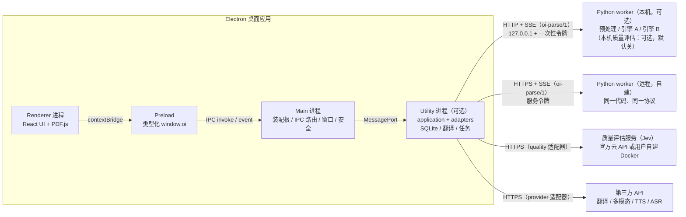
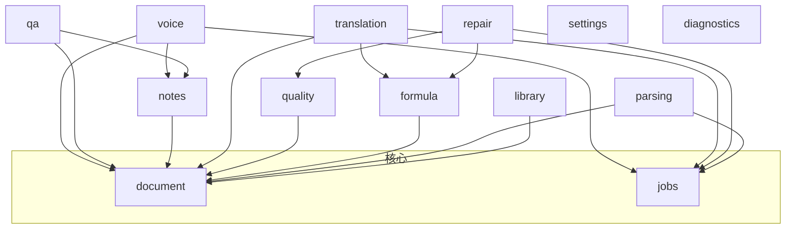
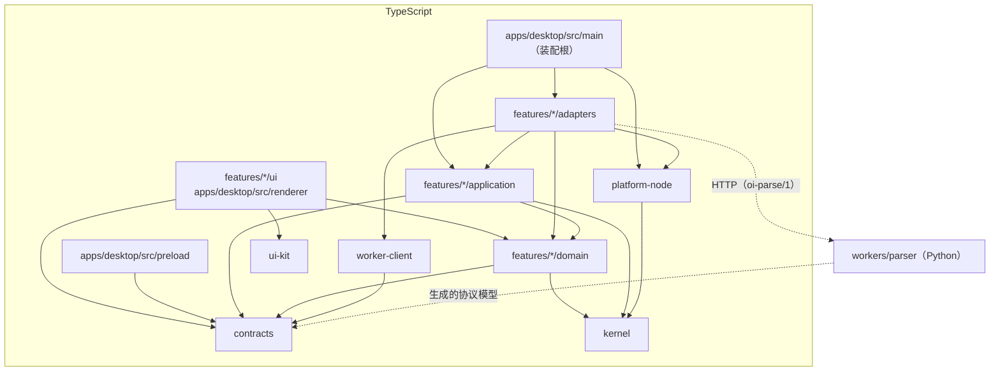
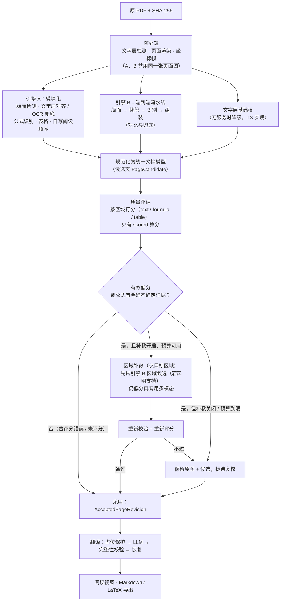

# open-immerse v2 架构规格（ARCHITECTURE）

状态：v0.1，规格基线（唯一真相源之一）。日期：2026-10-30（Asia/Shanghai）。
同级规格：[PRD.md](./PRD.md)（做什么）、[RULES.md](./RULES.md)（怎么协作）。视觉与交互：[DESIGN.md](./DESIGN.md)、[docs/design-principles.md](./docs/design-principles.md)，**两份均待 Loom 产出**；本文只规定 UI 代码放在哪、依赖谁，不规定长什么样。
本文与 `docs/architecture/0x_*_草案.md` 冲突时以本文为准，差异逐条列在 [docs/v2-gap-and-changes.md](./docs/v2-gap-and-changes.md)。本文中的目录、接口、协议均为**拟议设计**，M1 起按本文落地；落地前不代表已存在。

---

## 0. 设计目标

按优先级：

1. **可维护**：任何一个文件都能在一屏内看懂它为什么存在；改一个功能只动一个切片。
2. **可并行开发**：多个 Agent / 人同时改不同模块，不在同一文件上冲突；冲突面只剩「契约」和「装配」两处，且这两处由规则约束为小改动。
3. **可验证**：每个模块能在不启动 Electron、不加载模型、不联网的情况下独立测试。
4. **正确优先**：公式、来源、版本、费用相关的规则写在纯领域代码里，由程序校验，不靠提示词。
5. **可替换**：引擎、模型、服务商、存储都在端口（port）后面；换实现不改调用方。

## 1. 进程拓扑



- **Renderer** 只做展示与交互：React 组件、PDF.js 渲染、裁图显示。不碰文件系统、SQLite、密钥、Python 进程、网络 API。
- **Preload** 只暴露由契约生成的类型化命令与事件订阅，不暴露 `ipcRenderer`、任意通道、`fs`、`shell`。
- **Main** 是装配根（composition root）：创建适配器、注入用例、注册 IPC 处理器、管理窗口与 worker 生命周期。不写业务规则。
- **Utility 进程**：application 层与 adapters 默认在 main 进程装配；M3 起若长任务影响 main 响应（以实测为准），整体迁到 Electron `utilityProcess`，代码不改，只改装配位置。
- **Python worker**：无状态计算服务。不写用户文献库、不决定采用版本、不持有用户的第三方 API 密钥（本机模式）。本机与远程运行同一份代码、同一协议。

## 2. 分层

| 层 | 放什么 | 可以依赖 | 禁止依赖 |
| --- | --- | --- | --- |
| **domain** | 实体、值对象、纯规则（公式占位校验、阅读顺序几何、锚点匹配、状态转换、预算计算） | `contracts`、`kernel`、本切片 domain | Node 内置模块、Electron、React、DOM、PDF.js、数据库驱动、HTTP、任何厂商 SDK、其他切片的 domain |
| **application** | 用例（use case）、端口接口（ports）、编排、事务边界 | 本切片 domain、`contracts`、`kernel`、其他切片的**公开入口** `index.ts` | 任何 adapters、ui、Electron、Node IO |
| **adapters** | 端口实现：SQLite 仓储、文件资产、HTTP provider、worker 客户端、IPC 处理器 | 本切片 application（实现其 ports）与 domain、`platform-node`、`contracts`、`kernel` | ui、其他切片的 adapters |
| **ui** | React 组件、hooks、视图模型；通过 `window.oi` 调命令、订阅事件 | 本切片 domain（只用纯函数与类型）、`contracts`、`ui-kit`、React、PDF.js（仅 reader 切片） | application、adapters、`platform-node`、Electron、Node 内置模块、其他切片的 ui |
| **workers**（Python） | 预处理、引擎、质量评估的计算 | worker 内部分层（§10.3）与生成的协议模型 | 任何 TS 代码、用户文献库、桌面数据目录 |

**装配**只发生在 `apps/desktop/src/main/`（TS）和 `workers/parser/oi_worker/__main__.py`（Python）。只有装配根可以同时看到 application 与 adapters。

## 3. 目录结构

pnpm workspace + Python `uv` 项目。下面每个目录都是**可以独立测试、独立认领**的单位。

```text
open-immerse-v2/
├─ PRD.md  ARCHITECTURE.md  RULES.md
├─ DESIGN.md                          # 待 Loom 产出
├─ docs/
│  ├─ design-principles.md            # 待 Loom 产出
│  ├─ v1-review.md  v2-gap-and-changes.md
│  ├─ adr/                            # 架构决策记录：NNNN-标题.md
│  ├─ acceptance/                     # AC / QM 到测试用例的映射
│  └─ architecture/                   # 早期草案（历史输入，非权威）
├─ apps/
│  └─ desktop/
│     ├─ src/main/                    # 装配根、IPC 路由、窗口、安全、worker 监管
│     ├─ src/preload/                 # 由契约生成的 window.oi
│     ├─ src/renderer/                # 应用外壳：路由、布局插槽、全局 Provider
│     └─ e2e/                         # Playwright Electron 冒烟测试
├─ packages/
│  ├─ contracts/                      # 公共类型包（唯一跨进程 / 跨语言类型来源）
│  ├─ kernel/                         # 最小运行时无关原语：Result、AppError、Logger 接口、Clock、Id
│  ├─ platform-node/                  # Node 侧基础设施：SQLite、文件资产、safeStorage、HTTP 客户端、日志落盘
│  ├─ worker-client/                  # oi-parse/1 的 TS 客户端（本机 / 远程共用）
│  ├─ ui-kit/                         # 设计令牌与基础组件（按 Loom 的 DESIGN.md 实现）
│  └─ features/                       # 按功能切片，见 §4
│     ├─ library/  document/  parsing/  jobs/
│     ├─ formula/  quality/  repair/  translation/
│     ├─ reader/  notes/  qa/  voice/
│     └─ settings/  diagnostics/
├─ workers/
│  └─ parser/                         # Python worker（uv 项目），见 §10.3
├─ fixtures/
│  ├─ protocol/                       # TS 与 Python 共用的协议样例（合法 / 非法）
│  └─ corpus/                         # 基准论文清单（只存清单与 sha256，不存 PDF）
└─ tools/
   ├─ check-file-size/                # 行数门禁
   ├─ check-hotspots/                 # 热点文件登记校验
   └─ codegen/                        # 契约 → JSON Schema → Python 模型
```

### 3.1 每个功能切片的内部结构（统一模板）

```text
packages/features/<name>/
├─ package.json            # 名称 @oi/feature-<name>；依赖声明即依赖许可
├─ README.md               # 一段话职责 + 公开 API + 所有者 + 热点文件
├─ src/
│  ├─ index.ts             # 公开入口：只导出 application 的用例类型与工厂、domain 的公开类型
│  ├─ domain/              # 纯规则；一个概念一个文件
│  ├─ application/
│  │  ├─ ports/            # 每个端口一个文件（接口 + 简短契约注释）
│  │  └─ use-cases/        # 每个用例一个文件
│  ├─ adapters/            # 每个端口实现一个文件；ipc-handlers.ts 只做参数→用例的转接
│  ├─ ui/                  # 每个组件一个文件；hooks/ 与 view-models/ 分开
│  └─ testing/             # 本切片对外提供的 fake 与契约测试套件
├─ migrations/             # 本切片拥有的 SQLite 表迁移：NNNN_<描述>.sql
└─ test/                   # 单元 / 集成测试（与 src 结构镜像）
```

切片之间只通过 `index.ts` 交互；UI 之间不互相 import，由应用外壳通过「插槽」组合（§5.3）。

## 4. 模块清单与单文件职责

下表规定每个切片**应有哪些文件、每个文件只负责什么**。实现时可以增加文件，但新增文件同样只能有一个职责；不得把表中两个职责合进一个文件。

### 4.1 公共包

| 包 / 文件 | 唯一职责 |
| --- | --- |
| `contracts/src/ids.ts` | 品牌化 ID 类型（DocumentId、PageRevisionId、BlockId、JobId…）与构造校验 |
| `contracts/src/geometry.ts` | `NormalizedBBox`、`CoordinateFrame`、六元矩阵类型 |
| `contracts/src/document.ts` | `ContentBlock`、`AcceptedPageRevision`、`SourceAudit` |
| `contracts/src/formula.ts` | `FormulaCandidate`、`FormulaDecision` |
| `contracts/src/evaluation.ts` | `EvaluationResult`（scored / error / unavailable / not-run） |
| `contracts/src/translation.ts` | `TranslationRecord`、受保护片段表 |
| `contracts/src/anchor.ts` | `ContentAnchor`（笔记、问答、语音共用） |
| `contracts/src/jobs.ts` | 任务种类、状态、事件 |
| `contracts/src/provider-config.ts` | `ProviderConfig`（只含 `secretRef`，不含密钥） |
| `contracts/src/errors.ts` | 错误码枚举与 `{code, message, retryable}` 形状 |
| `contracts/src/diag-events.ts` | 诊断事件名与字段白名单 |
| `contracts/src/ipc/<feature>.ts` | 一个切片一个文件：该切片的 IPC 命令与事件定义 |
| `contracts/src/worker/*.ts` | `oi-parse/1` 协议消息（§10） |
| `kernel/src/result.ts` | `Result<T, E>` |
| `kernel/src/app-error.ts` | 错误基类与类型守卫 |
| `kernel/src/logger.ts` | `Logger` 接口（无实现） |
| `kernel/src/clock.ts`、`id.ts` | 可注入的时间与 ID 生成 |
| `platform-node/src/sqlite/connection.ts` | 打开数据库、WAL、单写者 |
| `platform-node/src/sqlite/migrate.ts` | 汇总各切片 `migrations/` 并按（切片, 版本）执行 |
| `platform-node/src/assets/file-asset-store.ts` | 暂存 → 校验摘要 → 提交引用 |
| `platform-node/src/secrets/safe-storage-secret-store.ts` | Electron `safeStorage` 加密存取 |
| `platform-node/src/http/http-client.ts` | 超时、有界重试、取消、按幂等性决定能否重发 |
| `platform-node/src/http/redact.ts` | 请求 / 响应日志脱敏 |
| `platform-node/src/logging/file-logger.ts` | JSON 行日志落盘、按天滚动、总量上限 |
| `worker-client/src/client.ts` | 提交、查询、取消、取产物 |
| `worker-client/src/sse.ts` | SSE 订阅与断线续传 |
| `worker-client/src/supervisor-protocol.ts` | 健康检查、能力协商、版本检查 |

`kernel` 有文件白名单；新增文件需要 ADR。**不存在** `utils`、`helpers`、`common`、`shared/state` 这类目录。

### 4.2 功能切片

| 切片 | 职责（一句话） | 关键文件（每个文件单一职责） |
| --- | --- | --- |
| `library` | 文献导入、身份（SHA-256）、元数据、列表、阅读进度 | `domain/document-identity.ts`（哈希身份与去重规则）· `domain/library-record.ts`（元数据校验）· `application/use-cases/import-pdf.ts` · `application/use-cases/list-library.ts` · `application/use-cases/update-progress.ts` · `application/ports/library-repository.ts` · `adapters/sqlite-library-repository.ts` · `adapters/v1-import/*`（只读 v1 导出包，先 dry-run 报告；待 Q8） · `ui/library-list.tsx` |
| `document` | 统一文档模型：解析运行、候选页、采用版本、来源审计、坐标帧 | `domain/accepted-revision.ts`（采用不变式）· `domain/source-audit.ts`（missing / duplicates）· `domain/coordinate-frame.ts`（矩阵与换算）· `domain/block-id.ts`（稳定块号）· `domain/adopt-policy.ts`（compare 与 adopt 区分）· `application/use-cases/adopt-page.ts`（乐观锁原子切换）· `application/ports/document-repository.ts` · `adapters/sqlite-document-repository.ts` |
| `parsing` | 解析任务编排、引擎选择、文字层基础档 | `domain/engine-capabilities.ts` · `domain/text-layer/`（阅读顺序、栏判定、跨页续接、页眉页脚剔除、字形清洗；每条规则一个文件，自 v1 移植）· `application/use-cases/submit-parse.ts` · `application/ports/parse-gateway.ts` · `adapters/worker-parse-gateway.ts` · `adapters/text-layer-engine.ts`（pdfjs-dist 提取 → domain 规则） |
| `jobs` | 持久任务记录、状态机、重启恢复、事件流 | `domain/job-state-machine.ts` · `domain/idempotency.ts` · `application/use-cases/resume-jobs.ts` · `application/ports/job-store.ts` · `adapters/sqlite-job-store.ts` |
| `formula` | 公式候选、校验、显示决策、兜底顺序 | `domain/formula-policy.ts`（兜底顺序与换层判据）· `domain/charset-check.ts` · `domain/equation-number.ts` · `domain/render-equivalence.ts` · `domain/crop-geometry.ts`（裁图外扩与 18px 参考字号）· `application/use-cases/decide-formula.ts` · `application/ports/latex-renderer.ts` · `adapters/katex-renderer.ts` · `adapters/arxiv-source-candidates.ts`（待 Q4） |
| `quality` | 质量评估端口与结果规范化 | `domain/evaluation-status.ts`（verdict → 规范状态）· `domain/low-score-routing.ts`（阈值按类别）· `application/ports/quality-evaluator.ts` · `adapters/worker-quality-evaluator.ts` · `adapters/remote-quality-evaluator.ts` |
| `repair` | 低分 / 不确定区域的多模态补救、预算账本 | `domain/repair-plan.ts` · `domain/budget-ledger.ts`（预留 / 结算 / 上限）· `domain/repair-limits.ts`（次数、并发、超时上限）· `application/use-cases/run-repair.ts` · `application/ports/multimodal-provider.ts` · `adapters/openai-compatible-multimodal.ts` |
| `translation` | 自然语言翻译、占位保护、完整性校验、润色、缓存 | `domain/placeholder.ts`（抽取与恢复）· `domain/integrity-check.ts`（公式 / 数字 / 引用）· `domain/cache-key.ts` · `domain/segmenter.ts` · `application/use-cases/translate-page.ts` · `application/use-cases/polish-translation.ts` · `application/ports/translation-provider.ts` · `adapters/providers/<vendor>.ts`（一家一个文件） |
| `reader` | PDF 显示、页面虚拟化、对照跳转、裁图显示（仅 renderer） | `domain/pairing.ts`（块配对与跟随）· `domain/scroll-sync.ts` · `domain/viewport-mapping.ts` · `ui/pdf-page-canvas.tsx` · `ui/page-virtualizer.ts` · `ui/readout-pane.tsx` · `ui/formula-view.tsx` · `ui/selection-toolbar.tsx` · `ui/hooks/use-document-session.ts` |
| `notes` | 笔记、锚点、重锚定、导入导出 | `domain/anchor-match.ts`（重锚定打分）· `domain/note.ts` · `domain/markdown-export.ts` · `application/use-cases/create-note.ts` · `application/use-cases/reanchor-notes.ts` · `adapters/sqlite-notes-repository.ts` · `ui/notes-panel.tsx` |
| `qa` | 论文问答、上下文选取、引用 | `domain/context-selection.ts` · `domain/citation.ts` · `application/use-cases/ask.ts` · `application/ports/chat-provider.ts` · `ui/ask-panel.tsx` |
| `voice` | TTS 朗读 / 讲解、ASR 语音笔记 | `domain/speech-script.ts` · `domain/audio-segment.ts` · `application/ports/tts-port.ts` · `application/ports/asr-port.ts` · `application/use-cases/generate-narration.ts` · `application/use-cases/transcribe-note.ts` |
| `settings` | 非密钥设置、provider 配置、密钥引用绑定、预算设置 | `domain/provider-config-validate.ts` · `domain/budget-settings.ts` · `domain/translation-fallback.ts`（未配置翻译时是否借用多模态服务，默认关；待 Q11） · `application/use-cases/save-provider.ts` · `application/use-cases/test-connection.ts` · `application/ports/secret-store.ts` · `ui/settings-pages/*.tsx`（一页一个文件） |
| `diagnostics` | 诊断事件记录、诊断包导出、脱敏 | `domain/redaction-rules.ts`（自 v1 移植）· `domain/retention.ts`（保留天数与体积上限）· `application/use-cases/export-bundle.ts` · `ui/diagnostics-page.tsx` |

### 4.3 切片之间的依赖（允许的方向）



- 箭头表示「可以 import 对方的 `index.ts`」。图上没有的边一律禁止，CI 用 dependency-cruiser 按此矩阵检查。
- `document` 与 `jobs` 不依赖任何其他切片。`settings`、`diagnostics` 不被业务切片 import：业务切片通过端口拿到配置与日志器，由装配根注入。
- `reader` 只有 ui 与纯 domain，不出现在图中：它通过 `window.oi` 调用其他切片的 IPC 命令，不 import 其他切片。
- 新增一条边需要 ADR，并在同一个 PR 里更新本图与 dependency-cruiser 配置。

## 5. 依赖方向与禁止事项

### 5.1 层间依赖图



只允许箭头方向。反方向（例如 domain → application、application → adapters、ui → application、platform-node → features）一律禁止。

### 5.2 禁止事项（CI 强制或评审一票否决）

| 编号 | 禁止 | 为什么（v1 证据见 §14） | 怎么拦 |
| --- | --- | --- | --- |
| F-01 | **多功能堆一个文件**：一个文件同时含状态管理、数据获取、渲染、持久化中的两种以上 | v1 `pdf/viewer.js` 同时管 UI、翻译调度、存储、公式、arXiv、测试钩子 | 行数门禁 + 评审清单 + 文件职责注册表（`README.md`） |
| F-02 | **巨型入口**：入口 / 装配文件写业务分支 | v1 `init()` 155 行、`onKey()` 243 行、`translateWholeDocument()` 611 行 | 入口文件硬上限 150 行；入口只允许 import、构造、注册 |
| F-03 | **跨层反向依赖**：domain 依赖 IO；application 依赖 adapters；ui 依赖 application / adapters | v1 `lib/pdf-blocks.js` 把 DOM 裁图混进块规则 | dependency-cruiser 规则 `layer-direction` |
| F-04 | 跨切片 import 内部文件（绕过 `index.ts`） | 内部改动会波及别的切片，并行开发冲突 | dependency-cruiser 规则 `no-cross-feature-internals` |
| F-05 | 切片 UI 互相 import | v1 阅读器与笔记、问答、文献库面板互相调用，改一处牵动全部 | dependency-cruiser + 插槽组合 |
| F-06 | 模块级可变状态（顶层 `let`、可变单例） | v1 `viewer.js` 有 154 个顶层 `let` | ESLint `no-restricted-syntax`（顶层 let）；状态放进用例或 React 状态 |
| F-07 | `utils` / `helpers` / `common` 等垃圾桶目录 | 职责不明的文件会无限增长 | 目录名黑名单检查 |
| F-08 | 测试读取源码字符串做断言 | v1 有 77 个测试 `readFileSync` 读 `viewer.js` 等源码断言；任何重构都打碎测试 | ESLint 测试目录规则：禁止 `readFileSync` 读 `src/` |
| F-09 | renderer 直接做 IO（文件、SQLite、网络 API、子进程） | 安全与可测性 | Electron 沙箱 + dependency-cruiser + ESLint `no-restricted-imports` |
| F-10 | 密钥进入 renderer、日志、任务 JSON、诊断包、仓库 | 安全 | 类型（`ProviderConfig` 只有 `secretRef`）+ 脱敏 + gitleaks + AC-09 测试 |
| F-11 | 手改生成文件（契约生成的 JSON Schema、Python 模型、preload API） | 两份定义漂移 | CI 重新生成并 `git diff --exit-code` |
| F-12 | `any`、`@ts-ignore`、`eslint-disable` 无理由 | 绕过类型与规则 | ESLint：必须带说明；`@ts-expect-error` 需描述 |
| F-13 | 引擎 / 模型 / 服务商名写死在 domain 或 application | 可替换性 | 名称只出现在 adapters 与配置 |

### 5.3 UI 组合：插槽而不是互相 import

- 应用外壳（`apps/desktop/src/renderer/`）定义布局插槽：`reader.main`、`reader.side`、`toolbar.document`、`settings.pages`。
- 每个切片的 `ui/index.ts` 导出 `contributions`（要放进哪个插槽、用哪个组件、排序权重）。外壳的 `slots.ts` 只是一个注册数组，**一行一个切片**，因此多人同时加入口只会各加一行。
- 切片间 UI 交互通过类型化事件总线（`contracts/src/ui-events.ts` 定义事件名与载荷），例如 reader 发出 `selection.changed`，notes 订阅。

## 6. 文件与函数大小

统计口径：物理行数（含空行与注释）。生成文件、协议样例、迁移 SQL、锁文件不计，但必须在 `tools/check-file-size/allowlist.json` 里登记路径模式与理由。

| 对象 | 建议上限 | 硬上限（CI 失败） |
| --- | --- | --- |
| 普通源文件（`.ts` / `.tsx` / `.py`） | 400 行 | **600 行** |
| 入口与装配文件（`main/index.ts`、`composition-root.ts`、`preload/index.ts`、`renderer/main.tsx`、`oi_worker/__main__.py`） | 100 行 | **150 行** |
| React 组件文件 | 250 行 | 400 行 |
| 测试文件 | 600 行 | 800 行 |
| 函数 / 方法 | 50 行 | **80 行**（ESLint `max-lines-per-function` / ruff `PLR0915` 等价配置） |
| 圈复杂度 | 10 | **15** |
| 函数参数 | 3 个 | 4 个（更多用对象参数） |

- 超过建议上限时，PR 描述必须写明「为什么不拆」；超过硬上限 CI 直接失败。
- 豁免只能通过 ADR 加入 allowlist，并写**到期里程碑**；到期未拆 CI 失败。
- 行数达标不等于职责单一：评审仍按 RULES.md 的评审清单检查职责数量与依赖扇出。

## 7. 引擎抽象接口

以下接口是本项目的**拟议契约**，不是 Paddle、MiniCPM 或任何上游已有 API。上游模型名称与能力的核实结论见 [docs/v2-gap-and-changes.md](./docs/v2-gap-and-changes.md) §2；接口刻意不含模型名。

### 7.1 总体流水线



流水线约束（上游核实结论见差异清单 §2）：

- **当前选型**（只写在 adapters 与配置里，F-13）：引擎 A = 版面模型（PP-DocLayoutV3 或 PP-DocLayout_plus-L，Q10）+ PP-FormulaNet 系列 + PaddleOCR 兜底 + 自写阅读顺序；引擎 B = MiniCPM-OCR 1.0 官方 SDK（`minicpm-ocr`，版面后端用 `ppdoclayout3_torch`，不依赖 PaddlePaddle）；质量评估 = MiniCPM-OCR Jev（部署见 §7.4）。型号、SDK 版本、上游提交与权重 sha256 记入 `EngineCapabilities.models[]` 与每次 `ParseRun`。
- **版面同源**：B 的 SDK 固定使用 PP-DocLayoutV3，阅读顺序也来自它，而不是来自 OCR 模型。A 若同样选 V3，A/B 的版面判断同源：对比视图必须标注「版面同源」，A/B 一致不能作为互相印证的证据。
- **页面图**：预处理统一渲染页面图并生成 `CoordinateFrame`；A、B 使用同一张图。B 以图片输入 SDK，不安装其 `pdf` extra（该 extra 依赖 PyMuPDF）。预处理默认用 pypdfium2，是否改用 PyMuPDF 见 Q6。
- **补救时序**：某区域的补救必须在该区域进入采用版本**之前**完成；已采用区域的翻译可以与其他区域的补救并行，但同一区域不能先用未核验内容翻译。
- **评分错误不是低分**：评分错误、未配置、未运行的区域照常进入采用版本并标「未评分」；公式仍按 `formula-policy` 默认显示原页裁图。它们不进入补救（PRD AC-05）。

### 7.2 Python 侧引擎接口（worker 内部）

```python
# workers/parser/oi_worker/engines/base.py —— 拟议
from typing import Protocol, Iterable
from oi_worker.protocol import (PageInput, PageCandidate, EngineCapabilities,
                                LayoutRegion, FormulaCandidate, TextSpan, CancelToken,
                                EvalItem, EvalOutcome)

class DocumentEngine(Protocol):
    """一个引擎 = 把一页预处理产物变成候选页。A、B 都实现它。"""
    def capabilities(self) -> EngineCapabilities: ...
    def parse_page(self, page: PageInput, cancel: CancelToken) -> PageCandidate: ...

# 引擎 A 由以下可替换部件组合，每个部件一个文件、一个实现类：
class LayoutDetector(Protocol):
    def detect(self, page: PageInput) -> list[LayoutRegion]: ...
class TextExtractor(Protocol):          # 文字层对齐优先，OCR 兜底
    def extract(self, page: PageInput, regions: list[LayoutRegion]) -> list[TextSpan]: ...
class FormulaRecognizer(Protocol):
    def recognize(self, page: PageInput, regions: list[LayoutRegion]) -> list[FormulaCandidate]: ...
class TableRecognizer(Protocol):
    def recognize(self, page: PageInput, regions: list[LayoutRegion]) -> list[LayoutRegion]: ...
class ReadingOrderer(Protocol):         # 自写算法；版本号进入产物
    version: str
    def order(self, regions: list[LayoutRegion]) -> list[str]: ...

# 可选：worker 本机托管的质量评估模型（默认不启用，见 §7.4、Q9）
class QualityEvaluatorModel(Protocol):
    max_batch: int                      # Jev 为 64
    def evaluate(self, items: list[EvalItem]) -> list[EvalOutcome]: ...
    # EvalItem: 原区域图 + 候选文本 + 类别（text / formula / table）+ 可选渲染图
    # EvalOutcome: 上游原始 verdict 与原始分，原样返回；规范化在 TS 的 quality/domain 完成
```

### 7.3 TS 侧端口（application 层）

```ts
// 拟议契约；类型来自 @oi/contracts
interface ParseGateway {                       // features/parsing/application/ports
  capabilities(target: ExecutionTarget): Promise<EngineCapabilities[]>;
  submit(cmd: ParseCommand): Promise<{ jobId: JobId }>;
  events(jobId: JobId, afterEventId?: string): AsyncIterable<ParseEvent>;
  cancel(jobId: JobId): Promise<CancelReceipt>;
  fetchCandidate(ref: ArtifactRef): Promise<PageCandidate>;
}
interface QualityEvaluator {                   // features/quality/application/ports
  evaluate(input: RegionEvaluationInput): Promise<EvaluationResult>; // 非 scored 状态不得带分数
}
interface MultimodalRepairProvider {           // features/repair/application/ports
  estimate(input: RepairInput): Promise<CostEstimate | 'unknown'>;
  repair(input: RepairInput, signal: AbortSignal): Promise<RepairResult>; // 只收目标区域裁片 + 必要上下文
}
interface TranslationProvider {                // features/translation/application/ports
  capabilities(): TranslationCapabilities;     // 是否流式、是否支持幂等、上下文长度
  translate(input: TranslationInput, signal: AbortSignal): AsyncIterable<TranslationChunk>;
}
interface LatexRenderer { check(latex: string): RenderCheck }   // 只证明语法可渲染，不证明正确
```

规则：

- `EngineId` 是配置值（如 `modular-a`、`e2e-b`、`text-layer`），模型名、权重版本记在 `EngineCapabilities.models[]` 与每次 `ParseRun` 中。
- 引擎不支持区域级解析时必须在 `capabilities` 里声明；用例据此拒绝或显示「需整页运行」及估算费用，不能隐式扩大收费范围。
- 质量评估的 `error` / `unavailable` / `not-run` 不得触发补救（AC-05）。
- 上游 verdict 的规范化只在 `quality/domain/evaluation-status.ts` 做，上游原值保存在 `providerVerdict`。以 Jev 为例：`scored` → `scored`（带 `rawScore`）；`precheck_reject` → `error/invalid_candidate`；`render_error` → `error/render_failed`；`missing_original_image` → `error/missing_image`；`encode_error` → `error/encode_failed`；`forward_error` → `error/service_failed`；其他任何值 → `error/unknown_verdict`。上游返回的 0.0 / -1.0 占位分一律丢弃。
- 阈值按（类别, `evaluatorVersion`）分别定标；`evaluatorVersion` 包含模型版本与部署方式（含渲染环境）。上游默认阈值 0.5 不使用（PRD QM-05）。
- 补救、翻译都经过 `budget-ledger` 预留；预留失败即进入 `waiting-budget`。

### 7.4 质量评估的部署（Q9）

| 部署 | 适配器 | 分数可比性 | 硬件（官方说法） |
| --- | --- | --- | --- |
| 官方云 API（默认候选） | `quality/adapters/remote-quality-evaluator.ts` | 与 Docker 镜像一致 | 本机无要求；开通条件与价格未核实 |
| 用户自建 Docker 服务（默认候选） | 同上，只换 Base URL 与 `secretRef` | 与云 API 一致，可与官方数值直接比较 | Linux + NVIDIA ≥ 12 GB、驱动 ≥ 535 |
| worker 本机 SDK 部署（可选，默认关） | `quality/adapters/worker-quality-evaluator.ts` → `oi_worker/quality/` | 排序稳定，绝对值可能与 Docker 有差异，须单独定标 | NVIDIA ≥ 8 GB 或 Apple M 系列 ≥ 16 GB 统一内存 |

- 最低目标设备（8 GB 核显 / M1 8 GB）不满足本机部署条件，设置界面只在能力探测通过后才提供本机选项。
- macOS 上官方只支持纯评分服务（渲染图由调用方提供），本机模式在 macOS 需要 worker 自己渲染候选文本，分数不能与官方数值比较；因此 macOS 本机模式排在 Linux / Windows 之后评估。
- 适配器在健康检查时记录服务返回的模板指纹（Jev Docker API 的 `template_md5`）；指纹变化视为新的 `evaluatorVersion`，旧阈值不再适用。
- 适配器按 64 项分批；单次请求失败只影响该批，按 `error/service_failed` 记录，不扩大为整页失败。

## 8. 数据模型与存储

### 8.1 权威数据

结构化 JSON 文档模型是权威；Markdown / LaTeX 是导出投影。核心类型沿用 [草案 02](./docs/architecture/02_数据协议与高精度规格迁移_草案.md) §3–§9 的 `ContentBlock`、`AcceptedPageRevision`、`FormulaCandidate`、`FormulaDecision`、`EvaluationResult`、`TranslationRecord`、`ContentAnchor`、`CoordinateFrame`，落入 `contracts`。坐标统一为「CropBox 经旋转后的可见页面，左上原点，0–1 归一化」。

### 8.2 桌面存储布局

```text
<userData>/
├─ db/oi.sqlite                 # WAL；单写者（main 或 utility 进程）
├─ library/<sha256>/source.pdf  # 原 PDF，只读
├─ assets/<sha256-prefix>/<assetId>   # 裁图、页面图、音频；内容寻址
├─ staging/                     # 暂存；提交成功后移动，失败由清理任务回收
├─ logs/YYYY-MM-DD.jsonl        # 结构化日志，保留天数与总量上限见 diagnostics
└─ secrets.bin                  # safeStorage 密文；不入 SQLite、不随导出
```

- 表按切片加前缀（`lib_`、`doc_`、`job_`、`tr_`、`note_`、`qa_`、`voice_`、`set_`、`diag_`），只有拥有该前缀的切片的 adapters 可以读写。跨切片查询走对方的用例，不跨前缀 JOIN。
- 迁移文件放在各切片 `migrations/`，运行器按（切片, 版本号）排序执行并记录在 `schema_migrations`；**两个切片的迁移永远不会改同一个文件**。
- 写入顺序：资产写暂存 → 校验摘要 → 事务内写引用 → 提交。失败不留半份文献。
- 采用版本切换使用乐观锁（比较旧 `revisionId`）；过期任务结果不能覆盖新版本。

### 8.3 配置与密钥隔离

| 类别 | 存哪 | 谁能读 | 能否导出 / 进日志 |
| --- | --- | --- | --- |
| 非密钥设置（语言、主题、开关、预算） | SQLite `set_*` | settings 用例 | 可导出；可进诊断摘要 |
| Provider 配置（厂商、Base URL、模型、能力） | SQLite `set_providers` | settings 用例 | 可导出；URL 中 token 脱敏 |
| 密钥（API key、服务令牌） | `secrets.bin`（safeStorage） | 仅 adapters 在发请求的瞬间通过 `SecretStore.read(secretRef)` 读取 | **永不**：不回传 renderer（只回「已设置 / 未设置」）、不进日志、不进任务 JSON、不进导出 |
| 本机 worker 令牌 | 进程内存 | main 与 worker-client | 永不落盘 |
| 开发 / 测试密钥 | 环境变量（`.env` 被 gitignore） | 本机与 CI secrets | 永不入库 |

`safeStorage` 不可用时（例如 Linux 无密钥环），要求用户每次会话输入或拒绝保存，**不得**静默明文落盘。

## 9. IPC 协议（renderer ↔ main）

- 通道命名：`<feature>.<command>`（invoke，请求 / 响应）与 `<feature>.on<Event>`（事件订阅）。一个切片的通道全部定义在 `contracts/src/ipc/<feature>.ts`。
- 每个定义包含：请求 schema、响应 schema、错误码集合、是否幂等。preload 由这些定义**生成**，不手写。
- main 端 `ipc-router.ts` 统一做：校验发送方（只接受本应用窗口的 frame）、按 schema 校验载荷、调用切片的 `adapters/ipc-handlers.ts`、把异常映射为 `{code, message, retryable}`。
- 返回给 renderer 的数据不含密钥、不含绝对文件路径（用 `assetId` 换取受控的 `oi-asset://` 协议 URL）。
- 长任务一律返回 `jobId`，进度走事件，不在一个 invoke 里等待整篇完成。
- Electron 安全基线：`contextIsolation: true`、`sandbox: true`、`nodeIntegration: false`、严格 CSP、禁止任意导航与 `window.open`、权限请求默认拒绝。具体以锁定版本的 [Electron 安全清单](https://www.electronjs.org/docs/latest/tutorial/security) 逐条验证。

## 10. Python worker 协议（oi-parse/1）

### 10.1 传输

本机与远程使用**同一套 HTTP + SSE 协议**，桌面端只有一个客户端实现（`packages/worker-client`）。

| 项 | 本机 worker | 远程 / 自建 worker |
| --- | --- | --- |
| 启动 | main 的 `worker-supervisor.ts` 拉起，退出时关闭 | 用户自行部署 |
| 地址 | `127.0.0.1` + 随机端口（worker 启动后在 stdout 打印一行 JSON 报告端口） | 用户配置的 HTTPS 地址 |
| 鉴权 | 每次启动生成的一次性 Bearer 令牌（经 stdin 传入，不进命令行参数） | 服务令牌（`secretRef`） |
| 资产 | 统一上传，不传本机路径 | 统一上传 |

备选方案（stdio JSON-RPC）及取舍见差异清单 Q7。

### 10.2 端点

| 方法与路径 | 作用 |
| --- | --- |
| `GET /v1/health` | 存活与协议版本 |
| `GET /v1/capabilities` | 可用引擎、模型清单（名称、版本、权重摘要）、是否支持区域解析、取消方式、资源限制 |
| `POST /v1/assets` | 上传 PDF / 页面图，返回 `ArtifactRef {id, sha256, mediaType}` |
| `POST /v1/jobs` | 提交 `parse` / `evaluate` / `render`，带 `idempotencyKey`、`engineId`、页范围、配置摘要；返回 `202 {jobId}` |
| `GET /v1/jobs/{id}` | 阶段、已完成页、错误、是否可重试 |
| `GET /v1/jobs/{id}/events` | SSE；支持 `Last-Event-ID` 断线续传 |
| `POST /v1/jobs/{id}/cancel` | 区分「已请求取消」与「已停止」 |
| `GET /v1/artifacts/{id}` | 取候选页 JSON、裁图等产物 |

- 请求头 `OI-Protocol: 1`；不兼容版本返回 `426`，桌面端提示升级 worker。
- 所有消息 schema 来自 `contracts`（TypeBox 定义 → JSON Schema → `datamodel-code-generator` 生成 pydantic 模型），CI 校验生成物无漂移；`fixtures/protocol/` 的合法 / 非法样例在 TS 与 Python 两侧都跑。
- worker 只在自己的工作目录写临时文件，任务结束按 TTL 清理；不访问桌面数据目录。

### 10.3 worker 内部结构

```text
workers/parser/
├─ pyproject.toml            # uv；重依赖放 optional extras：engine-a（Paddle）、engine-b（torch + minicpm-ocr，不含其 pdf extra）、jev-local
├─ oi_worker/
│  ├─ __main__.py            # 入口：读配置 → 装配 → 启动服务（≤150 行）
│  ├─ api/                   # FastAPI 路由：一个资源一个文件（health / jobs / assets / artifacts / auth / sse）
│  ├─ protocol/              # 生成的 pydantic 模型，禁止手改
│  ├─ jobs/                  # 任务注册、取消令牌、工作目录生命周期
│  ├─ preprocess/            # 打开 PDF、文字层、页面渲染、坐标帧：一个职责一个文件；默认 pypdfium2（Q6）
│  ├─ engines/
│  │  ├─ base.py             # §7.2 的 Protocol
│  │  ├─ modular_a/          # layout.py / text_align.py / ocr_fallback.py / formula.py / table.py / assemble.py
│  │  ├─ reading_order/      # columns.py / xy_cut.py / cross_column.py / continuation.py
│  │  └─ e2e_b/              # pipeline_adapter.py（以页面图调用 SDK）/ mapping.py（块级记录 → 候选页；block_id、order 只作运行内标识）
│  ├─ quality/               # 可选：本机 SDK 部署的 Jev 适配，原样返回 verdict（默认不启用，§7.4）
│  └─ runtime/               # 模型清单（含权重 sha256）、设备探测、内存限制
└─ tests/                    # pytest；与包结构镜像
```

Python 分层用 `import-linter` 强制：`api → jobs → engines | quality → preprocess → protocol`，不允许反向；`engines/modular_a` 与 `engines/e2e_b` 互不 import。不同引擎的重依赖可以拆成独立 venv / 容器，由 `runtime` 按引擎分别启动。

## 11. 可观测性

- **日志**：`kernel` 只定义 `Logger` 接口；`platform-node/logging/file-logger.ts` 输出 JSON 行。字段：`ts`、`level`、`event`（来自 `contracts/src/diag-events.ts` 白名单）、`feature`、`requestId`、`jobId`、`parseRunId`、`durationMs`、`errorCode`。不记录正文、译文、提示词、密钥。
- **关联**：每次 IPC 调用生成 `requestId`，透传到 worker（请求头 `OI-Request-Id`）与 provider 调用日志。
- **Python worker**：结构化 JSON 写 stderr，supervisor 收集并加上 `source: worker`。
- **诊断包**：保留天数与体积上限沿用 v1 起点（7 天、2 MB，见 v1 审查），可在设置调整；导出前统一走 `diagnostics/domain/redaction-rules.ts`；导出内容只含计数、哈希、阶段耗时、错误码、设置摘要（无密钥）。
- **用量**：每次付费调用记录 provider、模型、token / 次数、估算费用（未知则为 `unknown`）、`jobId`，供预算账本与界面显示。
- **崩溃**：只写本机；不自动上传。

## 12. 测试策略

| 层 | 工具 | 要求 |
| --- | --- | --- |
| domain | Vitest / pytest | 纯函数，无 IO；每条从 v1 移植的规则带原 v1 用例 |
| application | Vitest + `testing/` 里的 fake 端口 | 不启动 Electron、不联网、不加载模型 |
| adapters | 契约测试套件 | 每个端口在 `testing/` 提供一份共享契约测试，内存实现与 SQLite 实现都跑同一份 |
| 协议 | TS + Python 双侧 | `fixtures/protocol/` 合法样例通过、非法样例拒绝 |
| ui | Vitest + Testing Library | 组件只依赖 fake 的 `window.oi` |
| e2e | Playwright Electron | 只做少量冒烟：开窗、导入、阅读、重开 |
| 基准 | 独立脚本 | 不作为 CI 门禁；结果写入 `docs/acceptance/` |

- 测试只断言行为，不读取源码文本（F-08）。
- CI 不调用付费 API、不下载模型权重；需要真实模型的测试标记为 `@model`，只在手动或夜间任务运行。
- 运行纪律（每个提交 tip 全量只跑一次、失败只重跑失败项）见 RULES.md §4。

## 13. CI 门禁

每个 PR 必须全部通过；任何一项失败都不能合入。

| 门禁 | 工具 | 内容 |
| --- | --- | --- |
| G1 格式 | Prettier、ruff format | 格式一致 |
| G2 Lint | ESLint（typescript-eslint strict-type-checked）、ruff | 含 F-06、F-08、F-12、`max-lines-per-function`、`complexity`、`no-restricted-imports` |
| G3 类型检查 | `tsc -b`（strict）、mypy `--strict` 或 pyright strict | 0 错误 |
| G4 行数 | `tools/check-file-size` | §6 的硬上限；allowlist 必须有 ADR 与到期里程碑 |
| G5 依赖方向 | dependency-cruiser | `no-circular`、`layer-direction`、`no-cross-feature-internals`、`feature-dependency-matrix`（§4.3）、`renderer-isolation`、`electron-only-in-desktop`、`contracts-is-leaf` |
| G6 Python 分层 | import-linter | §10.3 的层次契约 |
| G7 生成物无漂移 | `pnpm codegen && git diff --exit-code` | 契约、preload、pydantic 模型 |
| G8 单元与契约测试 | Vitest、pytest | 按 RULES.md §4 的运行纪律 |
| G9 密钥扫描 | gitleaks | 0 命中 |
| G10 依赖许可证 | license-checker、pip-licenses；`runtime` 模型清单校验 | 拒绝未审批的 GPL / AGPL / 非商用 / 自定义许可证（如 PyMuPDF、MinerU Open Source License）；模型权重的许可证在模型清单登记并按同一白名单检查（RULES §1.5） |
| G11 热点文件 | `tools/check-hotspots` | 改动热点文件（装配根、`slots.ts`、契约）的 PR 必须在描述中声明，且单 PR 对每个热点文件的改动 ≤ 30 行 |
| G12 PR 体量 | 脚本 | 非生成代码改动 > 600 行时要求拆分或写明理由 |

## 14. v1 教训：一个 16,641 行的文件是怎么长出来的，v2 怎么从制度上防止

### 14.1 发生了什么（数据来自旧仓库只读审查，见 [v1 审查](./docs/v1-review.md) §3）

- `pdf/viewer.js` 从 2026-09-12 的 213 行，长到 10-05 的 6,143 行、10-18 的 12,319 行、10-29 的 **16,641 行**，七周增长约 78 倍。
- 仓库 435 个提交中有 **112 个**改过这个文件，是改动最频繁的文件；`pdf/viewer.css` 74 次、`lib/pdf-viewer.js` 51 次紧随其后。
- 文件内有 **782 个顶层函数、154 个顶层 `let` 可变状态**、90 条 import、167 处 `addEventListener`、278 处 DOM 查询。最长函数 `translateWholeDocument()` 611 行，`onKey()` 243 行，`ingestVendorLayout()` 223 行。
- 同一个文件里同时有：顶栏几何、字号与主题、分栏拖拽、缩放、笔记 / 文献库 / 抽屉 / 问答面板装配、arXiv 源码模式、公式裁图与高清重渲染、整页多模态替换、文字层版面注入、整篇翻译调度、重译、文献库持久化、选区工具条、测试钩子。
- 第二大文件 `lib/pdf-text-layer.js` 4,374 行、`lib/pdf-viewer.js` 2,765 行、`options/options.js` 2,506 行、`lib/library-store.js` 2,327 行、`lib/pdf-library.js` 2,143 行，同样是多职责。

### 14.2 造成的问题

1. **并行开发必冲突。** v1 自己的记录（`docs/parallel-work-and-merge-conflicts.md`）：翻译修复与多模态优先两条功能上互不依赖的线，都要改 `viewer.js` 里同一段翻译流程，只能串行；规定「两条线尽量不同时改 `pdf/viewer.js` 的同一区域」，等于整个阅读器只能一人一时改。
2. **改一处坏多处。** `viewer.js` 的提交中至少 45 个是修复类；例如 #160 记录 `init()` 因前一个 PR 引入 TDZ（暂时性死区）报错，原因是顶层状态与初始化顺序在万行文件里不可见。
3. **测试和实现一起僵化。** 77 个测试通过读取 `viewer.js` 等源码字符串做断言，35 个测试必须启动 Chrome；结构一改测试就碎，逼得人不敢拆文件。
4. **新功能只能往大文件里加。** 整页多模态替换（#189）直接改 `viewer.js` 的取数与状态，约 7 轮真机不收敛；因为「状态怎么判」「译文从哪来」「怎么显示」写在同一组函数里，无法单独回退其中一层。
5. **无法复用到桌面。** 业务规则与 Chrome API、DOM、IndexedDB 缠在一起，v1 的 `docs/desktop-plan.md` 为桌面版预留了 `lib/platform/` 却始终只能「命中数只减不增」地慢慢抽，v2 只能按职责重写而不是搬运。

### 14.3 根因

- 没有任何**机器检查**的大小或边界约束；「热点文件」名单只是文档约定。
- 入口文件同时是装配根和业务实现，新功能最省事的写法永远是「在 `init()` 里再加一段」。
- 状态是模块级可变变量，任何函数都能读写，模块边界无从谈起。
- 测试锁的是源码文本，而不是行为，拆分成本被人为抬高。

### 14.4 v2 的制度性防线

| 防线 | 机制 | 落在哪 |
| --- | --- | --- |
| 大小 | 单文件 400 / 600、入口 150、函数 80、复杂度 15，CI 失败而非提醒 | §6、G2、G4 |
| 边界 | 分层方向、切片矩阵、切片内部私有、renderer 隔离，全部由 dependency-cruiser 与 import-linter 强制 | §2、§4.3、§5、G5、G6 |
| 入口 | 入口只装配；业务分支一律进用例；`slots.ts` 一行一个切片 | F-02、§5.3 |
| 状态 | 禁止模块级可变状态；状态属于用例（持久）或组件（界面） | F-06 |
| 测试 | 禁止读源码断言；每个端口有共享契约测试；domain 测试不依赖任何运行时 | F-08、§12 |
| 并行 | 每个切片在 `README.md` 登记所有者与热点文件；契约改动先单独合入，再开实现 PR；热点文件单 PR 改动 ≤ 30 行 | G11、RULES.md §3 |
| 评审 | 评审清单逐项检查「这个文件承接几种变化」「新增依赖边是否在矩阵内」「是否有新的顶层状态」；不满足即退回 | RULES.md §5 |
| 豁免 | 只能通过 ADR，且带到期里程碑；到期未清 CI 失败 | §6 |

## 15. 开发环境

### 15.1 版本

| 工具 | 建议 | 说明 |
| --- | --- | --- |
| Node.js | 20.19.2（沿用仓库 `.nvmrc`），M1 评估升到 22 LTS | 仅用于构建与测试；Electron 自带运行时 |
| pnpm | 通过 `corepack enable` 启用，版本写进 `package.json` 的 `packageManager` | workspace |
| Electron | M1 锁定一个受支持主版本 | 锁定后逐条核对安全清单与 `safeStorage` 行为 |
| Python | 3.11（M1 实测 Paddle / MiniCPM 依赖后锁定，3.12 为候选） | 由 `uv` 管理；不要求最终用户自行安装 |
| uv | 最新稳定版 | `uv.lock` 入库 |

### 15.2 对 `.cursor/environment.json` 的建议（本 PR 不修改该文件）

当前文件只安装 Node 依赖、Chrome 与 CJK 字体。v2 进入 M1 后建议改为：

```json
{
  "install": "bash -lc 'source ~/.nvm/nvm.sh 2>/dev/null && nvm install && nvm use && corepack enable && if [ -f pnpm-lock.yaml ]; then pnpm install --frozen-lockfile; fi; command -v uv >/dev/null 2>&1 || curl -LsSf https://astral.sh/uv/install.sh | sh; export PATH=\"$HOME/.local/bin:$PATH\"; if [ -f workers/parser/pyproject.toml ]; then (cd workers/parser && uv sync --frozen --extra dev); fi; (fc-list :lang=zh | grep -q .) || (sudo apt-get update && sudo DEBIAN_FRONTEND=noninteractive apt-get install -y --no-install-recommends fonts-noto-cjk xvfb libnss3 libgbm1 libasound2t64) || true'",
  "terminals": []
}
```

要点：

- 增加 `uv` 与 worker 的 `dev` 依赖（pytest、ruff、mypy、FastAPI），**不**安装 Paddle / Torch 等重依赖与任何模型权重；这些在需要真实推理的手动任务中按引擎 extras 单独安装。
- 增加 Electron 在无头 Linux 运行所需的 `xvfb` 与系统库，供 Playwright Electron 冒烟测试。
- v2 不再需要单独安装 Chrome（v1 扩展测试用），可在 M1 确认无依赖后移除。
- 包名（如 `libasound2t64`）随镜像的 Ubuntu 版本调整，M1 实测后再定。

### 15.3 常用命令（M1 落地后）

| 命令 | 作用 |
| --- | --- |
| `pnpm check` | G1–G7、G9–G12 全部静态门禁 |
| `pnpm test` | 全部 TS 测试（按 RULES.md §4 纪律运行） |
| `pnpm test:failed` | 只重跑上一次失败的测试 |
| `uv run pytest` | worker 测试（在 `workers/parser/` 下） |
| `pnpm dev` | 启动桌面开发版与本机 worker |

## 16. 待决与变更

- 需要用户拍板的问题统一在 [docs/v2-gap-and-changes.md](./docs/v2-gap-and-changes.md) §6，本文按其中「本文假设」先行。直接影响本文的：Q2（文字层基础档，§7.1）、Q6（PDF 渲染库，§7.1、§10.3）、Q7（worker 传输，§10.1）、Q8（v1 导入器，`library` 切片）、Q9（质量评估部署，§7.4）、Q10（引擎 A 版面模型，§7.1）。
- 上游 SDK 与权重近期才发布（MiniCPM-OCR 仓库 2026-10-27 公开），M3 / M6 开工前各复核一次：锁定的提交、字段与部署方式是否仍然成立；不成立时先更新差异清单，再改本文。
- 本文的任何结构性修改（新增切片、新增依赖边、调整上限）都需要 ADR（`docs/adr/`），并在同一个 PR 更新本文与对应 CI 配置。
