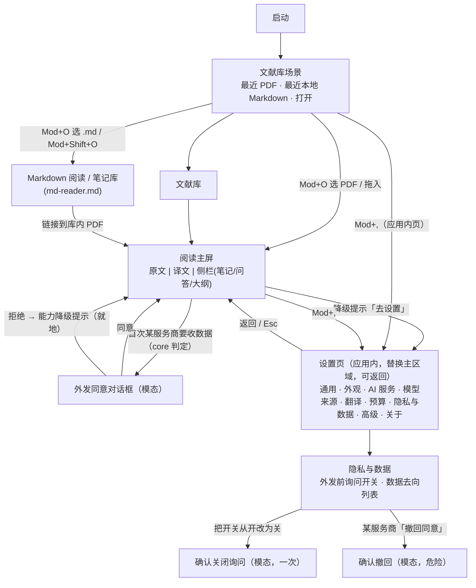
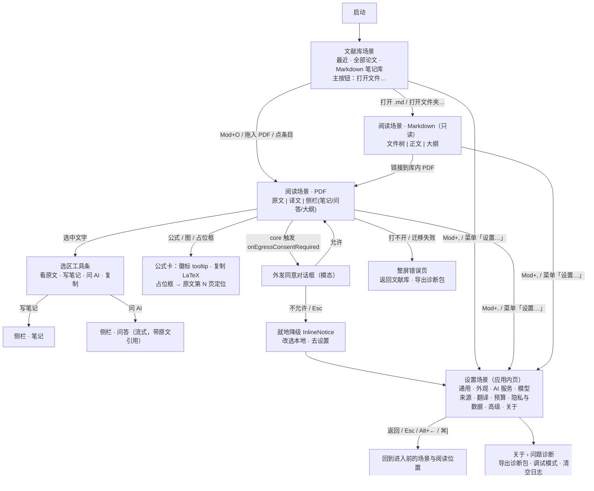

> **入库说明（Wisdom 2026-10-30 21:26 批准的 Loom 草案 v0.2；本 PR 入库）**
>
> - 来源：Loom 的视觉与交互规格草案 v0.2（上传附件）。本说明之后的正文为 Loom v0.2 加走查修正。本次没有需要改的链接或格式：正文指向 [docs/design-principles.md](./docs/design-principles.md)，相对链接对仓库根目录是对的。正文由 Loom 维护，其他人不改（[RULES](./RULES.md) N-10）。
> - 分工：界面细节以正文为准；需求、验收、里程碑以 [PRD](./PRD.md) 为准；切片、seam、外发同意的状态转移以 [ARCHITECTURE](./ARCHITECTURE.md) 为准。
> - DS-01–DS-31 与 PRD 验收的对照表在 [PRD §6.3](./PRD.md#63-视觉与交互验收对照)。PRD 里对应的 AC 回引本文件的 DS 编号。
> - 正文已按 Loom 2026-10-30 对 PR #9 @ a6830bf 的走查修正（Loom 走查记录 PR9-a6830bf-LOOM.md：公式裁图参考字号 18px、DS-20 不再引用 G17、`never_succeeded` 文案对齐 AC-56、外发同意的 `vendorId` / `granted: null` / 撤回与开关文案对齐 ARCHITECTURE §7.0 第 6 条、删除已解决的「待核对」与附注）。剩余说明：
>   1. **seam**：`settings.onEgressConsentRequired`、`settings.withdrawEgressConsent` 已写入 ARCHITECTURE §7.0 与 PRD §3.3 / AC-61，只有类型、没有实现；正文已改用契约字段名。
>   2. **人日**：§3.2a 的「+1 人日」是 Loom 的粗估，不进 PRD / ARCHITECTURE。
>
> 未作答（Esc、关闭弹窗、退出应用）下次再问、每个已同意的服务商可撤回、开关默认开且关闭后不再弹任何外发确认，已按 §6 的 21:26 决定写入 PRD 与 ARCHITECTURE。

> **v0.3 更新（Loom，2026-11-04，Asia/Shanghai；内容经 Wisdom 2026-11-04 02:04–04:22 逐项批准，见各节标注）**：并入 v2 桌面端全流程 UI 方案——信息架构（§2.1）、新增 token 与组件（§3.8）、逐屏规格（§4.5–§4.11，含单栏居中 §4.5.1a、术语 §4.8、数据存储位置 §4.9、HIG 基础补齐 §4.10、第二轮审查补齐 §4.11）、对话框改为单层卡片（R13，替换 D4 / DS-09）、验收 UIX-01–69（§5.1）、决策记录（§6.1）。仍标「待审批」的为视觉数值，「还没核实」的未改为已定。
>
> **文献库 ② 放置补丁（2026-11-05）**：下面点名的改动逐条来自 Loom `LOOM-PR-C-PLACEMENT.md` §3，不另写界面文案。DESIGN 正文待 Loom 确认。

>
> 编号对照（v0.3 并入时）：方案稿 §1→§2.1、§2→§2.1.x、§3→§3.8、§4.x→§4.5.x（单栏居中 §4.1a→§4.5.1a）、§7→§4.6、§9.x→§4.8.x、§10→§4.9、§11.x→§4.10 内 11.x、§12.x→§4.11 内 12.x、§5→§5.1、§6→§6.1。正文中沿用的「§11.4」「§9.7」等指方案稿编号，按此表换算。
---

# Open Immerse v2 视觉与交互规格（DESIGN）

状态：草案 v0.3（Loom，2026-11-04，Asia/Shanghai；v0.3 内容经 Wisdom 2026-11-04 02:04–04:22 逐项批准）。v0.2：2026-10-30。Wisdom 21:13 批准起草；21:26 对 §6 三项与若干空白作出决定，已并入本版。**所有视觉数值都是第一稿，标「待审批」**；结构与行为规则可以先按本文实现。
依据：`feature/v2-specs`（读取时 tip `d22b3f8`，包含 `bc66ec5`）的 PRD.md、ARCHITECTURE.md、docs/design/md-reader.md；原则见 [docs/design-principles.md](./docs/design-principles.md)（以下简称「原则」）。v1 参考：`wisdom-km/open-immerse` 只读浅克隆，v1 审查稿 `/workspace/oi-qa/` 下 AUDIT、AI-MODELS-SPEC、DIAG-UI-SPEC、FORMULA-REF-SIZE、black-frame SPEC。
面向读者：Cursor Cloud Agents 与开发者。机器可读约定：token 名用反引号；每条验收有 `DS-xx` 编号；「待审批」= 第一稿视觉值，「待定标」= 需实测的数值，「规格空白」= PRD/ARCHITECTURE 未写、本文暂定。

---

## 0 原则对齐说明

- **为什么**：v2 是 Windows / macOS 桌面应用（PRD §1），不是 v1 的浏览器扩展。用户在系统层已有习惯（菜单、快捷键、对话框、字体、深色模式），沿用它们比自创一套学习成本更低（原则 P4）。
- **目的**：给所有 UI 实现一份可执行的规格——token、组件状态、逐屏布局、键盘与平台差异、验收项——让多个 Agent 并行实现时界面一致。
- **遵循的约定**：
  - Apple HIG 的思想（清晰、顺从内容、层级、优先系统约定与原生控件、无障碍、浅深色）+ Windows 应用设计指南 / Fluent 的平台对应（原则 §3）。不使用任何 Apple 素材或原文。
  - **UI 与 core 解耦**（ARCHITECTURE §2.1、RULES §8）：本文每个「何时显示」都写成「当 seam 返回 X」；UI 不计算业务条件（原则 P7）。例：译文块用哪种样式只看 `getBlocks` 返回的 `display` 枚举；是否弹外发同意对话框只看 `settings` 的判定结果。
  - **token 作用域**：阅读器 UI 只用 `--oi-reader-*`（沿用 v1 规则 SET-41）；应用外壳、首页、设置、对话框用 `--oi-*`。两套不混用。

## 1 决策摘要

| # | 决策 | 理由（原则） |
| --- | --- | --- |
| D1 | 使用原生菜单栏、原生文件对话框、原生窗口控制按钮；不自绘系统已有控件 | P4；原生控件自带读屏与键盘支持 |
| D2 | 字体栈 `system-ui` 起头（mac SF + PingFang SC；Win Segoe UI Variable + Microsoft YaHei UI），不打包界面字体 | P4；中文与界面字体跟随系统 |
| D3 | 默认跟随系统浅/深色；每个颜色 token 都有浅深两值并标对比度 | 原则 §5、§4 |
| D4 | ~~对话框按钮按平台排序（Win 主操作在左）~~ → **由 R13 替换（Wisdom 2026-11-04 03:00）**：两平台对话框均为单层卡片，按钮在卡片内右下、无底部灰带与分隔线；次要 / 取消在左、主操作（含危险主操作）在最右；默认焦点仍在安全选项。有意偏离 WinUI ContentDialog 按钮栏。代码只声明角色 | P4 |
| D5 | 一屏一个主按钮；危险操作按钮写清后果，默认焦点在安全选项 | P3 |
| D6 | 阅读中的失败与完成都**就地**显示（`role=status`），不用 toast；只有需要用户决定的事用模态对话框（外发同意、危险确认） | P5；PRD US-28 |
| D7 | 译文块重译失败：保留上一版，2px `--oi-reader-warn` 左侧标记线，状态行按 `failureKind`：`check_failed`「重译未成功（校验没过），仍显示上一版 · 重试」、`network`「重译未成功（网络问题），仍显示上一版 · 重试」、`model_error`「重译未成功（模型出错），仍显示上一版 · 重试」；`null` 兜底「重译未成功，仍显示上一版 · 重试」，`role=status`（§4.1） | PRD US-28、AC-56；md-reader MD-27 |
| D8 | 「外发前询问」开关、「数据去向」列表、每个服务商的「撤回同意」都在设置 › **隐私与数据**页（Wisdom 21:26） | 危险类放置（原则 §2）；PRD §3.3 |
| D10 | **标题栏与工具栏合并**：mac `titleBarStyle: 'hiddenInset'`（红绿灯在左），Win `titleBarOverlay`（系统按钮在右，保留 Snap Layouts）（Wisdom 21:26） | P4；节省垂直空间给阅读区 |
| D11 | **强调色全部跟随系统**（含主按钮），前景色运行时计算保证可读；系统不可用时才回落品牌色（Wisdom 21:26；见 §3.2a） | P4 |
| D12 | **设置是应用内页面**（不是独立窗口），`Mod+,` 打开，两平台一致（Wisdom 21:26） | 单窗口心智；返回阅读位置简单 |
| D13 | 阅读主题 3 套：白、暖纸、深色（Wisdom 21:26） | 减少维护面 |
| D9 | 焦点：统一 `:focus-visible` 2px 实线 + 2px 偏移；整栏容器只用 1px 内缩发丝线（沿用 v1 黑框修复结论） | 原则 §4 第 3 条 |

### v1 借鉴与改变

| 保留 | 理由 |
| --- | --- |
| 阅读器 token 独立命名空间 `--oi-reader-*`，与设置 token 分开 | 阅读区可换纸色主题而不影响设置；v1 实践证明能防止串色 |
| 暖纸色系（浅色 `#F6F3EC` 底）作为应用浅色基调；`--oi-reader-focus` `#2F55D4` / `#8FA8FF` | 长时间阅读舒适；对比度已达标（见 §3） |
| 设置里 AI 连接集中一页（v1「AI 模型」页方案）：一个服务商填一次 Key，各能力只「选用」 | v1 审查发现同一 Key 填两遍是主要痛点；v2 面壁 Key 本来就由 Jev 与引擎 B 共用 |
| 行内状态 + `aria-live` 代替页底 toast（AUDIT 决策 4）；按钮忙碌态固定最小宽度避免跳宽（DIAG-UI） | 反馈在视线内（P5） |
| 卡片一种样式：面板底 + 1px 线 + 无阴影（AUDIT 决策 1） | 阴影不传达信息，顺从内容（P1） |
| 公式裁图固定参考字号 18px，不跟随正文字号滑杆；KaTeX 渲染的公式跟随（FORMULA-REF-SIZE §8，Wisdom 2026-10-24 12:06） | 公式原图清晰度与可读性优先；v2 中由 `--oi-reader-formula-ref-size` 表达 |
| 容器焦点用 1px 内缩发丝线，小控件用 2px 强焦点环（black-frame SPEC） | 鼠标阅读无框、键盘可见 |
| 诊断导出放「关于」、行内说明「包含 / 不包含」、不弹预览框 | 低频项放置（原则 §2） |

| 改变 | 原因 |
| --- | --- |
| 扩展 options 页 → 应用内设置页，`Mod+,` 打开，左侧分组导航（D12） | 桌面平台约定（P4） |
| v1 只做浅色 → v2 浅/深色都做，跟随系统 | 原则 §5 |
| v1 自定强调色 `#2A6670` → v2 应用外壳强调色全部跟随系统强调色，`#2A6670` 只作系统不可用时的回落（D11） | 平台约定（P4） |
| v1 阅读器 5 套纸色主题 + 大量 `--oi-reader-aa-*` 细粒度 token → v2 先做 3 套（白、暖纸、深色），token 只保留语义层（D13 已定） | 减少维护面；`aa-*` 是组件私有尺寸，不应进公共 token |
| v1 的 Aa 浮层承载大量设置 → v2 Aa 只放字号、行宽、主题；其余进设置 | 层级（P3） |
| v1 网页翻译、划词、字幕等浏览器能力全部移除（PRD §3.2） | 范围外 |
| v1 自定义快捷键（`o`/`f` 单键）→ v2 默认用带修饰键的平台快捷键，单键快捷键仅在阅读区获得焦点时生效且可在设置关闭 | 避免与读屏软件、输入法冲突（原则 §4） |

## 2 页面地图 / 用户路径



启动后的第一屏改为「文献库场景」（与 R5 一致）。来源：Loom `LOOM-PR-C-PLACEMENT.md` §3 第 3 条。

主路径：
1. **读论文**：文献库场景 → `Mod+O` 选 PDF → 阅读主屏（左原文、右译文）→ 点译文段落跳到原文 → 选中文字 → 「写笔记」/「问」。
2. **首次使用 API**：开始解析/翻译 → core 判定某服务商需要同意 → 弹外发同意对话框 → 同意后继续；拒绝则该能力就地显示降级提示（「需要同意才能使用 面壁开放平台 · 改选本地 · 去设置」）。
3. **单块重译**：悬停或聚焦译文块 → 「重译」→ 块显示上一版 +「正在重译…」→ 成功替换 / 失败按 D7 显示。

### 2.1 v2 桌面端信息架构与决策（Loom v0.3，2026-11-04 已批）

> 截图（`shots/…`、`C01` 等屏 ID）不入库，见方案包 `OpenImmerse-v2-桌面端UI方案-2026-11-04`（Loom 2026-11-04）的 FLOW.md；屏 ID 在本文中作为稳定引用。

#### 2.1.1 决策摘要

| # | 决策 | 来源 / 状态 | 原则 |
| --- | --- | --- | --- |
| R1 | **一个主窗口，三种「场景」切换主区域**：文献库（首页）· 阅读（PDF / Markdown）· 设置（应用内页）；不开第二个窗口 | 设置为应用内页 [已定 D12]；整体单窗口结构 [Loom 提议·待审批] | P3、P4 |
| R2 | 标题栏与工具栏合并：Win `titleBarOverlay`（系统按钮在右、保留 Snap Layouts），mac `hiddenInset`（红绿灯在左） | [已定 D10] | P4 |
| R3 | **Windows 用标题栏左端「☰」菜单按钮承载应用菜单**（文件 / 编辑 / 视图 / 帮助），按 Alt 或 F10 打开并显示访问键；mac 用系统菜单栏，窗口内无菜单按钮 | 「标题栏内菜单按钮」[已定 原则 §3]；Alt/F10 与访问键 [Loom 提议·待审批] | P4 |
| R4 | 合并标题栏高度：Win 44、mac 52 | [Loom 提议·待审批]；MS 标准 32，含搜索框/工具时建议 48，取中间值以容纳 30px 图标按钮 | P1 |
| R5 | 首页与文献库合并为「文献库」场景，左侧导航「最近 / 全部论文 / Markdown 笔记库」，主按钮「打开文件…」 | **已批（Wisdom 2026-11-04 02:04）**（原 Q1=A）；DESIGN.md 未改，入库时同步 §2 | P3 |
| R6 | 阅读主屏 = 原文 | 译文 | 侧栏（笔记 / 问答 / 大纲 标签，一次一个），对应插槽 `reader.main` 左右 + `reader.side` | 侧栏三标签 [已定 DESIGN §4.1]；「一次一个」沿用 v1 F6 Opt A（Wisdom 2026-10-17 10:24） | P1 |
| R7 | 选区工具条（深底浮层）：看原文 · 写笔记 · 问 AI · 复制 · ⋯；只显示 seam 声明可用的项，不放死按钮 | `selection-toolbar.tsx` 在 ARCHITECTURE reader 切片；按钮集沿用 v1 PR3b/F6；v2 可见项 [Loom 提议·待审批] | P2、P7 |
| R8 | 材质：Win 窗口底层可用 Mica（只外壳底与标题栏），mac 侧栏/导航可用 vibrancy；**阅读区、卡片、对话框始终不透明**；「减少透明度」/关闭透明效果时退回 `--oi-bg` | **已批（Wisdom 2026-11-04 02:04）**（原 Q2=A）；Mica 与 `titleBarOverlay` 同用的兼容性 **待实测** | P1、P4 |
| R13 | 对话框单层卡片：按钮在卡片内右下、无灰带；两平台主操作都在最右 | **Wisdom 2026-11-04 03:00 反馈**；替换 D4 / DS-09（本版已同步） | P4、P1 |
| R14 | **文献库左侧栏只放内容类别**（最近 / 全部论文 / Markdown 笔记库 / 术语库），**不放「设置」项**；设置入口只有 Win ☰「设置… Ctrl+,」、mac 应用菜单「设置… ⌘,」、空态 / 就地提示里的「去设置」链接。模态（含首次启动欢迎 A02/A03）打开时整个外壳变暗且 inert，不响应悬停与焦点 | **已批 Wisdom 2026-11-04 03:54** | P3、P4 |
| R9 | 反馈就地、不用 toast；只有「需要用户决定」才用模态（外发同意、危险确认） | [已定 D6、P5] | P5 |
| R10 | 文献库/设置导航：Win 用 NavigationView 视觉（选中项左侧 3px 强调色竖条 + 浅底），mac 用 Source List 视觉（选中整行强调色/灰底） | DESIGN §4.2「同一组件按平台变体渲染，待审批」；竖条细节 [Loom 提议·待审批] | P4 |
| R11 | 窄窗：可用宽 < 门槛（起点 1100，待实测）时侧栏变为覆盖层（盖在译文栏上，Esc 关闭），原文/译文不再被挤 | **已批（Wisdom 2026-11-04 02:04）**（原 Q3=A）；门槛起点 1100 **待实测** | P1 |
| R12 | 诊断放「设置 › 关于 › 问题诊断」，行内说明「包含 / 不包含」，不弹预览 | [已定 DESIGN v1 借鉴表]；PRD S10、AC-101 | P3 |

#### 2.1.2 信息架构 / 页面地图



上图去掉「（首页）」，第一屏只写「文献库场景」（与 R5 一致）。来源：Loom `LOOM-PR-C-PLACEMENT.md` §3 第 3 条。

#### 2.1.2.1 关键用户路径

1. **打开文档**：文献库 →「打开文件…」（Mod+O，原生文件对话框，D1）或拖入 → 进入阅读场景；> 200ms [待定标] 显示页骨架。同一 PDF 按 SHA-256 识别，重复导入不重解析（PRD S6），列表直接跳到已有条目。
2. **阅读 / 翻译**：默认「对照」栏位；译文块按 `display` 五态显示（DESIGN §4.1 [已定]）；点译文段落 → 原文定位高亮；工具栏摘要「解析 12/30 页 · 翻译 42/58 段」，点开任务列表可取消（`jobs.cancel`）。
3. **公式 / 图卡**：公式旁徽标「格式已核对 / 源码核对 / 未评分」，悬停/聚焦出 tooltip（§3.7 [已定]）；悬停公式出「复制 LaTeX」；裁图固定 18px 参考字号 [已定]；占位框「图见原文第 N 页（点击查看）」→ 左栏跳页定位（DS-31）。v2 不做矢量重绘：LaTeX → 裁图 → 占位框 [已定]。
4. **笔记 / 问 AI**：选中 → 工具条「写笔记」(Mod+Shift+N) 打开侧栏笔记并带引文；「问 AI」(Mod+Shift+A [待审批，DESIGN]) 打开侧栏问答，引文作为 chip；回答流式 `MarkdownView`，引用可点回原文（AC-15），未闭合公式不闪（AC-47）。首次发到某服务商前由 core 触发同意框。
5. **文献库**：返回（工具栏「‹」或 Alt+← / ⌘[）→ 列表保留滚动位置；条目状态文字来自 seam（读到第 N 页 / 解析中 / 无法解析）。
6. **设置**：Mod+, 从任意场景打开，替换主区域，返回原位置（DS-25）。
7. **诊断**：错误页或设置 › 关于 →「导出诊断包…」→ 原生保存对话框 → 行内状态「已导出到 …」（导出在 M2，日志骨架 M1，PRD S10）。

#### 2.1.2.2 功能分类与放置

| 功能 | 类别 | 放置 | 原则 |
| --- | --- | --- | --- |
| 打开文件 / 拖入 / 最近 | 主路径 | 文献库唯一主按钮；Mod+O；菜单「文件」 | P3 |
| 对照阅读、点段落定位原文 | 主路径 | 阅读主屏直接可见，无主按钮 | P1 |
| 选中 → 写笔记 / 问 AI | 主路径 | 选区工具条 + 快捷键 + 侧栏 | P3 |
| 栏位切换、Aa（字号/行宽/主题）、侧栏开关、大纲 | 支持 | 标题栏图标按钮（tooltip 含快捷键），也在「视图」菜单 | P3、P4 |
| 单块重译 / 重试、复制 LaTeX | 支持 | 块悬停/聚焦时出现；状态行文字按钮 | P5 |
| 重新解析、导出笔记、文档信息、为本文评分 | 低频 | 标题栏「⋯」菜单 | P3 |
| 服务商 / Key / 模型来源 / 预算 / 高级 worker | 低频 | 设置 | P3 |
| 诊断导出、调试模式 | 低频 | 设置 › 关于 | P3 |
| 外发同意、关闭「外发前询问」、撤回同意、清空日志、清除 Key、删除文献 | 危险 | 模态确认，写清后果，默认焦点安全项，按钮为动词，不在主按钮位 | 原则 §2 |

## 3 Token 与组件表

### 3.1 命名与作用域

- 应用外壳、首页、设置、对话框：`--oi-*`（定义在 `ui-kit/tokens/app.css`，作用域 `:root`）。
- 阅读区（原文栏、译文栏、阅读侧栏、Aa 浮层、MarkdownView 在阅读器内的实例）：只用 `--oi-reader-*`（`ui-kit/tokens/reader.css`，作用域 `.oi-reader`）。MarkdownView 在设置或首页以外不出现；在 `.md` 阅读器中也使用 reader token。
- 阅读主题固定 3 套（D13）。主题切换：`[data-theme="light|dark"]` 由外壳根据 `nativeTheme` 或用户选择设置；阅读主题另设 `[data-reader-theme="white|paper|dark"]`。
- 强制色：`@media (forced-colors: active)` 下所有颜色 token 映射到系统色（`Canvas`、`CanvasText`、`Highlight`、`LinkText`、`GrayText`、`ButtonText`），边框与焦点用 `Highlight`。

### 3.2 颜色 · 应用（`--oi-*`）—— 全部待审批

对比度按 WCAG 相对亮度计算，背景为 `--oi-bg`（浅 `#F6F3EC` / 深 `#1B1C1F`）；`--oi-on-accent` 以 `--oi-accent` 为背景。

| Token | 用途 | 浅色 | 对比 | 深色 | 对比 |
| --- | --- | --- | --- | --- | --- |
| `--oi-bg` | 窗口底色 | `#F6F3EC` | — | `#1B1C1F` | — |
| `--oi-surface` | 卡片 / 面板 | `#FCFAF6` | — | `#24262A` | — |
| `--oi-surface-raised` | 菜单、对话框 | `#FFFFFF` | — | `#2C2E33` | — |
| `--oi-text` | 正文 | `#22201C` | 14.7 | `#ECEAE6` | 14.2 |
| `--oi-text-2` | 次要文字 | `#4A463E` | 8.5 | `#C8C4BA` | 9.8 |
| `--oi-text-muted` | 说明、状态行 | `#655F54` | 5.7 | `#A8A49B` | 6.9 |
| `--oi-line` | 装饰分隔线（不承担信息） | `#E4DED2` | — | `#3A3C40` | — |
| `--oi-line-strong` | 输入框、开关边框 | `#8A806C` | 3.5 | `#8A8F98` | 5.2 |
| `--oi-accent` | 主按钮底、选中态（**跟随系统**，见 §3.2a；右列为回落值） | 回落 `#2A6670` | 5.9 | 回落 `#7FB8C0` | 7.7 |
| `--oi-on-accent` | 主按钮文字（运行时计算，见 §3.2a） | 回落 `#FFFFFF` | 6.5 | 回落 `#10282B` | 7.0 |
| `--oi-focus` | 焦点环（跟随系统强调色，过 3:1；回落值见右） | `#2F55D4` | 5.6 | `#8FA8FF` | 7.5 |
| `--oi-danger` | 危险按钮、错误文字 | `#B3261E` | 5.9 | `#F2B8B5` | 10.0 |
| `--oi-warn` | 警示文字、标记 | `#8A4B0F` | 6.1 | `#E8B36A` | 9.0 |
| `--oi-success` | 完成标记 | `#2E6B3A` | 5.8 | `#8FCB9B` | 9.1 |
| `--oi-hover` | 悬停底色叠加 | `rgb(34 32 28 / .06)` | — | `rgb(255 255 255 / .06)` | — |
| `--oi-pressed` | 按下叠加 | `rgb(34 32 28 / .10)` | — | `rgb(255 255 255 / .10)` | — |

### 3.2a 强调色跟随系统（D11，Wisdom 21:26）

- **来源**：main 进程读 `systemPreferences.getAccentColor()`（Win / mac 均可用），监听 `accent-color-changed`（Win）与 `nativeTheme` 的 `updated`（mac），把 `#RRGGBB` 作为普通数据经外壳设置到 `:root` 的 `--oi-accent-system`。CSS 端同时声明 `AccentColor` / `AccentColorText` 系统色作为第二来源（Chromium 支持时）。这是显示层取值，不是业务规则，不进 core。
- **派生**：
  - `--oi-accent` = 系统强调色；浅色模式与 `--oi-bg` 对比 < 3:1 时，按 OKLCH 降低明度直到 ≥ 3:1；深色模式同理提高明度。
  - `--oi-on-accent` = 在 `#FFFFFF` 与 `#111111` 中取与 `--oi-accent` 对比更高者；若仍 < 4.5:1，继续调整 `--oi-accent` 明度直到 ≥ 4.5:1。
  - `--oi-accent-hover` / `--oi-accent-pressed` = `--oi-accent` 明度 ±6% / ±12%（待审批）。
  - 计算放在 `ui-kit/theme/accent.ts` 纯函数（展示层，有单元测试），输入颜色、输出 token 值。
- **对比检查规则**：主按钮文字 ≥ 4.5:1；强调色作为边框、选中指示、开关底 ≥ 3:1（对 `--oi-bg` 与 `--oi-surface` 都检查）。不满足就调明度，不换色相。
- **回落**：仅当系统强调色取不到（API 报错或返回空）时用品牌色 `#2A6670`（浅）/ `#7FB8C0`（深）。
- **焦点环**：`--oi-focus` 也跟随强调色（同样过 3:1 检查）；Windows 高对比 / 强制色下改用系统 `Highlight`。
- **不影响阅读区**：`--oi-reader-*` 不跟随系统强调色（阅读区保持纸色主题稳定）；`--oi-reader-focus` 仍为固定值。
- **工作量**：比固定品牌色多约 **+1 人日**（取色与监听、派生纯函数与测试、浅深两模式与高对比截图）。

### 3.3 颜色 · 阅读区（`--oi-reader-*`）—— 全部待审批

背景为 `--oi-reader-surface`（浅/暖纸 `#FFFDF8`，深 `#1E1F22`）。「白」主题只把 surface 换成 `#FFFFFF`，其余同浅色（对比度只会更高）。

| Token | 用途 | 浅色 | 对比 | 深色 | 对比 |
| --- | --- | --- | --- | --- | --- |
| `--oi-reader-surface` | 阅读区底色 | `#FFFDF8` | — | `#1E1F22` | — |
| `--oi-reader-ink` | 译文正文 | `#1F1E1B` | 16.4 | `#E8E6E1` | 13.2 |
| `--oi-reader-ink-2` | 标题注、次要 | `#4A463E` | 9.2 | `#C8C4BA` | 9.5 |
| `--oi-reader-muted` | 块状态行、页码 | `#6B655A` | 5.7 | `#A8A49B` | 6.6 |
| `--oi-reader-line` | 装饰线 | `#E9E3D8` | — | `#3A3C40` | — |
| `--oi-reader-line-strong` | 容器焦点发丝线、分隔条 | `#8A806C` | 3.8 | `#8A8F98` | 5.1 |
| `--oi-reader-link` | 链接、引用跳转 | `#1F5F8B` | 6.7 | `#8CC4F0` | 8.8 |
| `--oi-reader-focus` | 小控件焦点环 | `#2F55D4` | 6.1 | `#8FA8FF` | 7.2 |
| `--oi-reader-warn` | 重译失败标记线与状态行强调 | `#9A5A12` | 5.4 | `#E8B36A` | 8.7 |
| `--oi-reader-danger` | 失效链接、渲染错误标记 | `#B3261E` | 6.4 | `#F2B8B5` | 9.7 |
| `--oi-reader-highlight` | 对照跳转后的目标段落底色（淡出） | `rgb(47 85 212 / .10)` | — | `rgb(143 168 255 / .14)` | — |
| `--oi-reader-selection` | 选中文字 | 系统 `Highlight` | — | 系统 `Highlight` | — |
| `--oi-reader-math-error-bg` | 公式渲染失败底 | `rgb(179 38 30 / .08)` | — | `rgb(242 184 181 / .12)` | — |
| `--oi-reader-code-bg` | 代码块底 | `#F3EFE7` | — | `#26282C` | — |

状态标记不只靠颜色：失败有文字；失效链接有虚线下划线 + 图标；公式错误显示原始 LaTeX。

### 3.4 字体与字号（待审批）

- `--oi-font-ui`: `system-ui, -apple-system, "Segoe UI Variable", "Segoe UI", "PingFang SC", "Microsoft YaHei UI", sans-serif`
- `--oi-font-mono`: `ui-monospace, "SF Mono", "Cascadia Mono", Consolas, monospace`
- `--oi-reader-font-body`: 默认同 `--oi-font-ui`；阅读设置可选衬线 `"Songti SC", "SimSun", serif`（低频）

| Token | 字号 / 行高 | 用途 |
| --- | --- | --- |
| `--oi-type-caption` | 12 / 16 | 状态行、辅助说明 |
| `--oi-type-body` | 13 / 20（mac）· 14 / 20（Win） | 界面正文（平台默认：mac 13pt、Win 14px） |
| `--oi-type-body-strong` | 同 body，600 | 行标题 |
| `--oi-type-subtitle` | 16 / 22，600 | 分组标题 |
| `--oi-type-title` | 20 / 28，600 | 页标题 |
| `--oi-type-display` | 28 / 36，600 | 首页标题（仅一处） |
| `--oi-reader-fs` | 默认 18，范围 14–28，步长 1 | 译文正文（用户可调） |
| `--oi-reader-line-height` | 随字号 1.9→1.5（沿用 v1 公式） | 译文行高 |
| `--oi-reader-measure` | 最大 38em（中文约 38 字） | 译文行宽上限 |
| `--oi-reader-status-fs` | 12 | 块状态行 |
| `--oi-reader-formula-ref-size` | **18**（固定，不随 Aa / `--oi-reader-fs`；Wisdom 2026-10-24 12:06，FORMULA-REF-SIZE §8；宽行间公式先等比缩到栏宽，下限 13.5，再放不下才横滚） | 公式**裁图**参考字号。arXiv 源码 / 已核验 LaTeX 用 KaTeX 渲染时**跟随** Aa（`--oi-reader-fs`） |

### 3.5 间距、圆角、阴影、动效、焦点（待审批）

- 间距：4px 网格。`--oi-space-1..8` = 4 / 8 / 12 / 16 / 20 / 24 / 32 / 48。阅读区另用 `--oi-reader-space-block`（块间距，默认 0.9em）。
- 圆角：`--oi-radius-sm` 4（标签、复选框）、`--oi-radius-md` 6（按钮、输入框）、`--oi-radius-lg` 10（卡片、对话框）。Win 11 控件默认 4，mac 约 6；统一用上述值，不区分平台（待审批）。
- 阴影 / 层级：只有浮起层用阴影。`--oi-elev-0` 无；`--oi-elev-1`（菜单、浮层）`0 4px 12px rgb(0 0 0 / .12)`；`--oi-elev-2`（对话框）`0 12px 32px rgb(0 0 0 / .20)`。深色下阴影加深并加 1px `--oi-line` 描边。卡片无阴影。
- 动效：`--oi-motion-fast` 100ms（悬停、按下）、`--oi-motion-base` 180ms（展开、淡入）、`--oi-motion-slow` 280ms（对话框出现）；曲线 `cubic-bezier(.2,0,0,1)`。`prefers-reduced-motion: reduce` 时：位移/缩放改为不动画，透明度渐变 ≤ 100ms；对照跳转用瞬时定位，目标段落高亮直接出现后 1s 去掉（不渐隐）。
- 焦点：`--oi-focus-width` 2px、`--oi-focus-offset` 2px、实线；阅读区用 `--oi-reader-focus`。整栏容器（原文栏、译文栏、侧栏）获焦时只显示 1px 内缩 `--oi-reader-line-strong`（`--oi-reader-focus-pane-soft`）。

### 3.6 组件表（状态全集）

状态列：默认 / 悬停 / 按下 / 禁用 / 加载 / 空 / 错误 / 成功。「—」表示该组件不存在此状态。所有「禁用」与「是否显示」由 seam 数据决定（例如 `canRetranslate`、`display`），UI 不计算。

| 组件 | 所属 | 默认 | 悬停 | 按下 | 禁用 | 加载 | 空 | 错误 | 成功 |
| --- | --- | --- | --- | --- | --- | --- | --- | --- | --- |
| `Button`（主） | ui-kit | `--oi-accent` 底 + `--oi-on-accent` 字，高 28（待审批） | 叠加 `--oi-hover` | 叠加 `--oi-pressed` | 不透明度 .45，`aria-disabled` | 文字换「正在…」+ 旋转指示，宽度不变，`aria-busy` | — | 按钮恢复默认，错误显示在旁边状态行 | 恢复默认；结果在状态行 |
| `Button`（次） | ui-kit | `--oi-surface` 底 + 1px `--oi-line-strong` | 同上 | 同上 | 同上 | 同上 | — | 同上 | 同上 |
| `Button`（危险） | ui-kit | 文字 `--oi-danger`，边框同色 | 同上 | 同上 | 同上 | 同上 | — | 同上 | 同上 |
| `IconButton` | ui-kit | 透明底，图标 `--oi-text-2`，28×28 | 底 `--oi-hover` + tooltip（含快捷键） | `--oi-pressed` | .45 | 图标换指示 | — | — | — |
| `Switch` | ui-kit（mac 风格开关 / Win ToggleSwitch 同形） | 关：边框 `--oi-line-strong`；开：底 `--oi-accent` | 叠加 hover | — | .45 | 旋钮处指示（保存中） | — | 回到原值 + 行内错误 | — |
| `TextField` / `SecretField` | ui-kit | 1px `--oi-line-strong`，高 28 | 边框 `--oi-text-muted` | — | 底 `--oi-bg` | 右侧指示（测试中） | 占位符 `--oi-text-muted` | 边框 `--oi-danger` + 下方错误文字 + `aria-invalid` | 下方「已设置」✓ |
| `Select` | ui-kit（原生 `<select>` 或自绘 listbox，待 §6） | 同 TextField | 同 | — | 同 | — | 「未选择」 | 同 | — |
| `SettingsRow` | settings ui | 左标题+说明，右控件 | — | — | 整行 .45 + 原因说明 | 控件加载 | — | 行下方错误 | 行内状态 ✓ |
| `StatusLine` | ui-kit | 12px `--oi-text-muted`，`role=status` | — | — | — | 「正在…」 | 不渲染 | 文字 `--oi-warn`/`--oi-danger` + 图标 | `--oi-success` ✓ + 文字 |
| `Dialog` | ui-kit | `--oi-surface-raised`，`--oi-elev-2`，最大宽 480 | — | — | — | 主按钮加载态 | — | 对话框内错误行（`role=alert`） | 关闭 |
| `Sidebar`（文献库左导航） | app-shell | 只放内容类别：最近 / 全部论文 / Markdown 笔记库 / 术语库；**不放「设置」项**（Wisdom 2026-11-04 03:54 已批）。设置入口只有：Win ☰「设置… Ctrl+,」、mac 应用菜单「设置… ⌘,」、空态 / 就地提示里的「去设置」链接。模态（含首次启动欢迎 A02/A03）打开时整个外壳变暗且 inert，不响应悬停与焦点 | — | — | — | — | — | — | — |
| `DialogActions` | ui-kit | 两平台同序：次要在左、主操作最右；与正文同底色、无分隔（R13） | — | — | — | — | — | — | — |
| `TranslationBlock` | reader ui | 见 §4.1 `display` 五态 | 显示块操作（重译、复制、写笔记） | — | 块操作按 seam 能力隐藏 | `pending`：骨架；`retranslating`：上一版 + 状态行 | — | `previous_with_failure` / `never_succeeded` | `current` |
| `MarkdownView` | ui-kit | 渲染 `MdDocument` | 链接下划线 | — | — | 流式：未闭合尾部按原文样式 | 宿主负责 | 单公式错误：原始 LaTeX + `--oi-reader-math-error-bg` | — |
| `MathInline` / `MathBlock` | ui-kit | KaTeX 输出（含 MathML） | 显示「复制 LaTeX」 | — | — | — | — | 同上 | — |
| `FormulaCrop` | reader ui | 原页裁图，固定参考字号 | 显示来源与核验状态 | — | — | 骨架 | — | 「图片不可用」占位 + 原因 | — |
| `EmptyState` | ui-kit | 图标 + 一句说明 + 至多 1 个主按钮 | — | — | — | — | — | — | — |
| `InlineNotice` | ui-kit | 降级提示条（能力不可用），左图标 + 文字 + 链接按钮 | — | — | — | — | — | 本身即错误/警示 | — |
| `ListItem`（数据去向等） | ui-kit | 名称 + 状态徽标（文字） | 底 hover | — | — | — | 列表空态文案 | — | — |

### 3.7 公式状态徽标（Wisdom 2026-10-31 07:45 指示起草；视觉值全部待审批）

用途：用文字告诉读者这一处公式（或区域）的 LaTeX / 原图是否经过核验，以及经过哪种核对，不只靠颜色（原则 P2）。

出现位置：阅读区内，公式（行内、行间）旁与对比视图里；正文与表格区域只出现「未评分」。组件只按 core 给出的数据选样式，不自己判断（DS-20）：「格式已核对」「源码核对」按 `getBlocks` 的标记 `format_checked` / `source_checked`（PRD AC-04）；「未评分」按评估记录 `not-run/disabled`（PRD AC-18、AC-84 ④）；占位框按 `getBlocks` 插入的 `kind: 'page_link'` 节点，即显示决定 `page-placeholder`（ARCHITECTURE §8.1.1；PRD AC-04、AC-89 ③）。

| 状态 | 徽标文字（暂定，来自 PRD） | 何时出现（规格原文摘要） | 悬停 / 聚焦提示（tooltip，待审批） |
| --- | --- | --- | --- |
| 格式已核对 | 「格式已核对」 | `format-checked-latex`，标记 `format_checked`：评估记录为 `not-run/disabled`（评分开关关闭，或开着但路线不含 Jev），非 arXiv 候选的五项程序核对全过；不算已核验（D-A 01:14 修订；PRD AC-89 ②、§10） | 「程序核对通过（可渲染、字符集、编号、位置、与文字层或邻近内容一致），未经质量评分，不算已核验」 |
| 源码核对 | 「源码核对」 | `source-checked-latex`，标记 `source_checked`：记录为 `not-run/disabled` 时 arXiv 源码候选整篇覆盖率 ≥ 0.85 且逐公式核对全过；当前不算已核验（PRD AC-87） | 「与 arXiv 作者源码核对一致，未经质量评分，不算已核验」 |
| 未评分 | 「未评分」 | 界面标记：评估记录 `not-run/disabled`，用于正文、表格与没通过程序核对的公式；不算已核验，不自动补救、不自动补评（PRD §10、§3.4） | 「质量评分未运行。可在本文菜单「为本文评分」」 |
| 占位框 | 「图见原文第 N 页（点击查看）」（文字暂定） | `page-placeholder`：没有候选通过且裁图拿不到时（AC-89 ③）；它本身就是占位块，不再叠加徽标 | 无单独 tooltip；点击跳到左侧原文第 N 页并定位该区域 |

- Token（只用 `--oi-reader-*`）：文字 `--oi-reader-muted`（浅 5.7 / 深 6.6，过 4.5:1）；描边 1px `--oi-reader-line-strong`；底色 `--oi-reader-surface`（不填强调色）；焦点环 `--oi-reader-focus`。三种徽标（格式已核对 / 源码核对 / 未评分）同用 `--oi-reader-muted`，只靠文字区分。占位框是例外：它是可点击的占位块、不是徽标，因为是链接，用文字 `--oi-reader-link` + 1px 虚线 `--oi-reader-line-strong`；不靠颜色也能区分（虚线描边 + 「（点击查看）」文字）。
- 形状 / 尺寸：胶囊式标签，字号 `--oi-reader-status-fs`（12），高 18，左右内边距 6，圆角 `--oi-radius-sm`（4）；行间公式放在公式右上，行内公式不内联插入，只在悬停 / 聚焦公式时显示；可点击目标仍 ≥ 24×24（DS-19，用外扩命中区）。占位框：块级，最小高 48，圆角 `--oi-radius-sm`。
- 图标：无。三种徽标只靠文字区分；占位框另靠虚线描边与「（点击查看）」文字区分。
- 状态：默认（文字 + 细描边）；悬停或键盘聚焦显示上表 tooltip（`--oi-motion-fast`，不遮挡公式）；徽标不可操作，无按下 / 禁用态。占位框悬停底色叠加 `--oi-reader-highlight`，按下 / Enter 执行跳转。
- 无障碍：文字对比 ≥ 4.5:1；不只靠颜色（三种徽标同用 `--oi-reader-muted`，只靠文字区分；占位框例外，用 `--oi-reader-link` + 虚线描边，不靠颜色也可由虚线描边 + 「（点击查看）」文字区分；`forced-colors` 下描边改 `CanvasText`）；徽标 `aria-label` 为「公式状态：格式已核对，未核验」等完整句；占位框为 `role=link`，`aria-label`「图见原文第 N 页，点击查看」。
- 浅色 / 深色 / 白：都用上述 token 的对应值，不另加颜色。

### 3.8 v2 桌面端新增 token 与组件（Loom v0.3）


**沿用**：DESIGN §3.2–3.5 的全部 `--oi-*` / `--oi-reader-*` token 与数值 [已定为第一稿，视觉值仍待审批]，作用域规则不变（阅读区只用 `--oi-reader-*`，DS-02）。本稿**只新增**下表，全部 **待审批**：

| 新 Token | 用途 | 浅色 | 深色 | 说明 |
| --- | --- | --- | --- | --- |
| `--oi-titlebar-h` | 合并标题栏高 | Win 44 / mac 52 | 同 | R4 |
| `--oi-titlebar-bg` | 标题栏底 | Mica 可用：`transparent`；否则 `--oi-bg` | 同 | R8 |
| `--oi-titlebar-fg-inactive` | 窗口非活动时标题栏文字/图标 | `--oi-text-muted` | 同 | MS：非活动半透明；改用已过 4.5:1 的 muted 色而非降透明度（对比度可控） |
| `--oi-nav-w` | 文献库/设置左导航宽 | 240（200–320 可拖） | 同 | |
| `--oi-nav-indicator` | Win 导航选中竖条 3×16，圆角 2 | `--oi-accent` | `--oi-accent` | mac 变体不用 |
| `--oi-layer` | 内容层（Mica 上的面板） | `--oi-surface` 不透明 | 同 | 不引入半透明 `LayerFill`，避免阅读区透底 |
| `--oi-seltb-bg` / `--oi-seltb-fg` | 选区工具条深底浮层 | `#2B2A28` / `#FFFFFF`（15.0） | `#3A3C40` / `#FFFFFF`（11.0） | v1 PR3b 深底工具条迁入；对比度为 Loom 计算 |
| `--oi-reader-side-w` | 侧栏宽 | 340（300–480） | 同 | v1 笔记栏 360 / 320–480，取 340 以适配 1280 宽 |
| `--oi-split-hit` | 分隔条命中宽 | 8（视觉 1px 线） | 同 | v1 LAYOUT-THREE-PANE 分隔条 8 |

#### 3.8.1 新增 / 补全组件（状态全集；已在 DESIGN §3.6 的组件不重复）

| 组件 | 默认 | 悬停 | 按下 | 禁用 | 加载 | 空 | 错误 | 成功 |
| --- | --- | --- | --- | --- | --- | --- | --- | --- |
| `TitleBar`（外壳） | 图标按钮 + 标题 + 拖拽空白；Win 右侧留 overlay 宽度 | 按钮 `--oi-hover` | `--oi-pressed` | 窗口非活动：`--oi-titlebar-fg-inactive` | 任务摘要 chip 显示进度 | — | 摘要 chip「解析失败 · 查看」（`--oi-warn` 文字） | 摘要 chip「✓ 解析完成」 |
| `AppMenuButton`（Win 专用 ☰） | 图标 | hover | 打开原生菜单 | — | — | — | — | — |
| `NavList`（文献库/设置） | 文字行 32 高 | hover 底 | pressed | .45 + 原因 | 行骨架 | — | — | — |
| `LibraryTable` | 行：图标·标题·作者·状态·时间 | 行 hover；右侧出现「⋯」 | 选中行 `--oi-accent` 浅底（≥3:1 指示条） | — | 行内「解析中 n/N 页」+ 进度 | `EmptyState`「把论文 PDF 拖到这里」+ 主按钮 | 行状态「无法解析 · 查看原因」 | 「译完」 |
| `DropZone` | 1px 虚线提示行 | 拖入时整窗 2px 强调色描边 + 「松开即可打开」 | — | — | — | — | 非支持格式：② 行内「只支持 PDF」。markdown 接线后改回「只支持 PDF 和 .md」（#166 决定 6。Loom `LOOM-PR-C-PLACEMENT.md` §3 第 4 条） | — |
| `SelectionToolbar` | 深底胶囊，只渲染 seam 可用项 | 项底 15% 白 | 25% 白 | 不渲染（不放死按钮） | 「问 AI」发起后变为指示 | — | — | — |
| `SidePanelTabs` | 笔记 / 问答 / 大纲 | hover | — | — | 各面板自理 | 各面板空态（见 §4） | — | — |
| `AskComposer` | 多行输入 + 引文 chip + 模型 chip（只读：服务商·模型·来源，v1 F6 D3） | — | Enter 发送 | 无服务：禁用 + 「去设置」 | 发送中 → 「停止」 | 占位「问这篇论文…」 | 行内「预算已用完」「需要同意…」等 seam 原因 | — |
| `TaskPopover`（解析/翻译任务） | 列表：步骤·进度·「取消」 | — | — | — | 进度 | 「没有进行中的任务」 | 每条失败原因 + 重试 | ✓ |
| `ErrorPage` | 图标 + 标题 + 一句原因 + 「原文件没有被修改」类安心句 + 次按钮 | — | — | — | — | — | 本身 | — |

`LibraryTable` 在 M2 ②：无 hover「⋯」、无右键菜单、无多选；选中行用于导入 / 重复导入反馈；行点击仅选中不打开（Wisdom 2026-11-05 13:58）。来源：Loom `LOOM-PR-C-PLACEMENT.md` §3 第 5 条。

#### 3.8.2 表格与列表排版规则（Wisdom 2026-11-04 02:06 反馈后新增；**已批 Wisdom 2026-11-04 04:17**）

1. 一格一主信息；次要信息（数量、年份页数、进度明细）放第二行，`--oi-type-caption` + `--oi-text-muted`。
2. 带单位的短语（「86 个文件」「12 / 25 页」「¥12.40」）整体 `white-space:nowrap`，不在单位内部断行。
3. 列间距 `column-gap ≥ 16px`，单元格左右内边距 ≥ 4px；文字列 `min-width:0; overflow:hidden; text-overflow:ellipsis`，悬停 / 聚焦显示全文 tooltip（`title` 或 Tooltip 组件）。
4. 适用全部表格、列表、设置行、网格卡片标题。验收 UIX-21。

## 4 逐屏规格

### 4.1 阅读主屏

- **目的**：让用户左右对照读一篇论文，公式可信，随手写笔记与提问。
- **布局分区**（从左到右，分隔条可拖，宽度记忆由 reader 设置保存）：
  1. 标题栏 / 工具栏（`toolbar.document` 插槽）：返回文献库、文档标题、页码、Aa（字号/行宽/主题）、栏位切换（原文 / 对照 / 译文）、侧栏开关、解析与翻译状态摘要。
  2. 原文栏（`reader.main` 左）：PDF.js 页面。
  3. 译文栏（`reader.main` 右）：按阅读顺序的译文块列表，每块 `TranslationBlock`，按 `sourceBlockId` 与原文对齐。
  4. 侧栏（`reader.side`，可收起）：标签「笔记 / 问答 / 大纲」。
- **组件**：`IconButton`、Aa 浮层、`TranslationBlock`、`MarkdownView`、`MathInline/Block`、`FormulaCrop`、`StatusLine`、`InlineNotice`、笔记列表、问答输入。
- **译文块显示**（只按 `getBlocks` 每块的 `display` 选样式，ARCHITECTURE §8.1.1）：

| `display` | 正文 | 左侧标记 | 状态行（`--oi-reader-status-fs`，`role=status`） | 操作 |
| --- | --- | --- | --- | --- |
| `current` | 当前版本 `MarkdownView` | 无 | 无 | 悬停/聚焦出现：重译、复制、写笔记 |
| `retranslating` | 上一版 | 无 | 「正在重译…」+ 小型指示 | 重译按钮禁用（`aria-disabled`） |
| `previous_with_failure` | **上一版（保留）** | **2px `--oi-reader-warn` 左边线** | 按 `failureKind` 三选一（见下表「失败原因文案」），`role=status`；「重试」是文字按钮，可聚焦，焦点环 `--oi-reader-focus`；悬停或键盘聚焦状态行显示详情 | 重试 |
| `never_succeeded` | 原文（英文，`--oi-reader-ink-2`） | 2px `--oi-reader-warn` | 按 `failureKind` 三选一（见下表），`role=status`；文字按钮「重译」；悬停或聚焦显示详情 | 重译 |
| `pending` | 骨架（3 行灰条，reduced-motion 下不闪动） | 无 | 无 | — |

  **失败原因文案**（Wisdom 2026-10-30 22:02：按原因分三种）。UI 只把 `failureKind`（`getBlocks` 每块 `latest.failureKind`，`onBlockChanged` 同字段，ARCHITECTURE §8.1.1）映射成文案，不从错误信息、计时或 HTTP 状态推断原因。

| `failureKind` | `previous_with_failure` 状态行（保留上一版） | `never_succeeded` 状态行（显示原文） | 悬停 / 聚焦详情 |
| --- | --- | --- | --- |
| `check_failed` | 重译未成功（校验没过），仍显示上一版 · 重试 | 未翻译（校验没过）· 重译 | 新译文里的公式、数字或引用编号和原文对不上，已丢弃。可以再试一次。 |
| `network` | 重译未成功（网络问题），仍显示上一版 · 重试 | 未翻译（网络问题）· 重译 | 没连上翻译服务或超时。请检查网络后重试。 |
| `model_error` | 重译未成功（模型出错），仍显示上一版 · 重试 | 未翻译（模型出错）· 重译 | 翻译服务返回了错误或看不懂的结果。可以重试，或到设置 › 模型来源 换一个翻译服务 / 改选本地。 |
| `null`（防御，core 不应在失败时给出） | 重译未成功，仍显示上一版 · 重试 | 未翻译 · 重译 | 无 |

  「设置 › 模型来源」入口来自 PRD §3.3（翻译的「本地 / API」与服务商选择），不是新功能。详情只说明原因与下一步，不显示原始错误文本、Key 或请求内容。
  **不使用 toast，不弹对话框**（US-28）。失败原因文案映射是展示层（允许在 UI），但「是否失败、显示哪一版」只来自 `display`。
- **Markdown/KaTeX**：译文、笔记、问答回答都用同一 `MarkdownView`（ARCHITECTURE §4.5.4）；KaTeX 渲染失败显示原始 LaTeX + 错误底；流式回答中未闭合的尾部按原文（等宽、`--oi-reader-muted`）显示，闭合后替换，不闪烁。公式裁图使用 `--oi-reader-formula-ref-size`，不跟随正文字号。
- **空态**：未解析且无服务 →译文栏 `EmptyState`「这篇论文还没有译文。可以先读原文文字层 · 去设置翻译服务」（US-16）；侧栏笔记空「选中文字后按 Mod+Shift+N 写笔记」。
- **错态**：PDF 打不开 → 整屏 `EmptyState`「无法打开此文件」+ 原因 + 次按钮「返回」。能力不可用（无 Key / 未同意外发 / API 不可用）→ 译文栏顶部 `InlineNotice`，文案来自 seam 原因码（如 `consent_required`：「需要同意向 {服务商} 发送数据 · 查看」），按钮「去设置」打开对应设置页。
- **加载**：打开文档 > 200ms（待定标）显示页面骨架；解析/翻译进度在工具栏摘要（「解析 12/30 页」），可点开看任务并取消（`jobs.cancel`）。
- **主次按钮层级**：本屏无常驻主按钮（阅读为主，P1）；支持：Aa、栏位切换、侧栏；块级：重试（文字按钮）；低频：⋯ 菜单（重新解析、导出笔记、文档信息）。
- **Win / mac 差异**：标题栏与工具栏合并（D10）——mac 红绿灯在左、工具栏紧随其后，Win 系统按钮在右、工具栏在左侧到系统按钮之间；工具栏空白处为拖拽区，按钮区不可拖；双击空白处最大化（Win）/ 按系统设置缩放（mac）；快捷键符号；mac 侧栏可用半透明材质（vibrancy）——待审批，Win 11 可用 Mica——待审批，均在「减少透明度」时关闭。
- **键盘**：

| 操作 | mac | Win |
| --- | --- | --- |
| 打开 | ⌘O | Ctrl+O |
| 在三栏间移动焦点 | F6 / ⇧F6 | F6 / Shift+F6 |
| 译文块间移动 | ↑ / ↓（译文栏获焦时）| 同 |
| 跳到对应原文 | ⏎ | Enter |
| 重译当前块 | ⌘R（待审批） | Ctrl+R（待审批） |
| 写笔记 | ⌘⇧N | Ctrl+Shift+N |
| 问答 | ⌘⇧A（待审批） | Ctrl+Shift+A（待审批） |
| 字号 ± | ⌘= / ⌘- | Ctrl+= / Ctrl+- |
| 切换侧栏 | ⌘\ | Ctrl+\ |
| 关闭浮层 | Esc | Esc |

### 4.2 设置

- **目的**：让用户一次配好服务、来源、预算与隐私，并随时看清数据去了哪里。
- **布局分区**：左侧分组导航（`settings.pages` 插槽，一页一个文件）＋右侧内容（最大宽 720，待审批）；顶部搜索框（低频）。页面：通用 · 外观 · AI 服务（服务商与 Key，集中管理）· 模型来源（每个能力「本地 / API」）· 翻译 · 预算 · **隐私与数据** · 高级（自建 worker / Jev Docker）· 关于（版本、诊断导出）。
  - 两平台一致：**应用内页面**（D12），`Mod+,` 或菜单「设置…」（mac 在应用菜单，Win 在「文件」菜单）打开，替换主区域；左上「返回」回到进入前的屏幕与阅读位置；标题栏合并样式与阅读屏相同。
  - 即时生效，无「保存」按钮（两平台现代设置的约定）；需要验证的字段（Key）用「测试连接」。
- **隐私与数据页**（PRD §3.3 数据外发同意；ARCHITECTURE §7.0 第 6 条）：
  - 第 1 组「数据外发」：
    - 行「外发前询问」— `Switch`。**默认：开**（由 core 保证，UI 不写默认值）。
      - **(a) 开关对外发的作用**：**开** = 外发前要确认——任何服务商第一次收到数据前、以及已同意的服务商新增一项能力前，都会弹出外发同意对话框，用户同意后才发送；**关** = 不再弹出任何外发确认，数据照常发送。行内说明文案：「开：发送数据前先问你。关：不再询问，直接发送。」
      - **(b) 拨动开关本身是否要确认**：**从开改为关**时弹一次确认对话框（因为降低保护）；**从关改为开**不需要确认，立即生效。确认框标题「关闭外发前询问？」正文「关闭后，发送数据前不再询问你；此前选了「不允许」或还没同意的功能也会照常发送。你仍可在下方「数据去向」查看。」按钮：次「保持开启」（默认焦点）、危险「关闭询问」。取消则开关保持「开」。调用 `setEgressPromptEnabled`。
      - 注（Loom 建议）：(b) 中「关时确认一次、开时不确认」是 Loom 的建议，Wisdom 21:26 保留此做法。
  - 第 2 组「数据去向」（`listEgressDestinations`，开关任何状态都显示）：每个服务商一项：名称；下列能力，每项「发送内容」（如「区域裁图与候选文本」「我们渲染的页面图」「待翻译文本」「问答上下文」）+ 状态徽标「已同意 / 询问已关闭 / 已拒绝」（文字徽标，不只靠颜色）。固定说明一行「不会上传原 PDF 文件」。空态：「还没有服务商收到过数据」。
  - **撤回同意**（Wisdom 21:26）：「数据去向」中徽标为「已同意」的服务商行（开关为开时才会出现该徽标），右侧有危险类文字按钮「撤回同意」（不放在主按钮位置；危险类放置，原则 §2）。开关为关时徽标为「询问已关闭」，不显示此按钮。点击弹确认对话框：标题「撤回对 {服务商} 的同意？」正文列出受影响能力，并说明「撤回后，这些功能下次要向 {服务商} 发送数据前会重新询问你；在你重新同意之前不会发送。」按钮：次「取消」（默认焦点）、危险「撤回同意」。调用 `settings.withdrawEgressConsent({ vendorId })`；成功后状态行 `role=status` 显示「已撤回」；返回 `consent_not_granted` 时状态行说明「该服务商没有已同意的记录」。撤回只清除已同意记录、不记为已拒绝，在途请求不取消——规则全部在 core（ARCHITECTURE §7.0 第 6 条）。
- **AI 服务 / 模型来源页**：每个能力一行 `Segmented`「API / 本地」；「本地」旁显示 core 给的可行性标注（「达到官方要求 / 不在官方要求内 / 未评估」）；Key 只显示「已设置 / 未设置」（AC-59 ⑤），`SecretField` 不回显。
- **空态**：未配置任何服务 → AI 服务页顶部 `EmptyState`「填一个 API Key 就能开始翻译和评估」+ 主按钮「添加服务商」。
- **错态**：测试连接失败 → 行内 `StatusLine` 错误 + 原因（`auth`「Key 无效」、`quota`「额度不足」、网络）；保存失败回滚控件并说明。
- **加载**：页面数据 > 200ms 显示行骨架；测试连接按钮加载态。
- **主次按钮层级**：每页至多 1 个主按钮（如「添加服务商」）；「测试连接」为次；「清除 Key」「恢复默认」为危险（确认）。
- **Win / mac 差异**：两平台都是应用内页、即时生效、无「应用/确定」按钮；菜单入口位置不同（mac 应用菜单「设置…」，Win「文件 › 设置」）；分组导航 mac 用侧栏列表样式，Win 用 NavigationView 样式（都由同一组件按平台变体渲染，待审批）。
- **键盘**：`Mod+,`（⌘, / Ctrl+,）打开设置页；`Mod+F` 聚焦搜索；↑↓ 在左导航切页；Tab 进入内容；Esc 或 `Mod+[`（mac）/ Alt+←（Win）返回上一屏（两平台都可用 Esc）。

### 4.3 首次外发同意对话框（按服务商）

- **目的**：在数据第一次发给某个服务商前，让用户清楚「发给谁、发什么、不发什么」并作决定。
- **触发**：只由 core 判定（`egress-consent.ts`），经事件 `settings.onEgressConsentRequired` 通知 UI，载荷为 `EgressConsentRequired`（ARCHITECTURE §7.0 第 6 条，以契约为准；服务商标识字段名是 `vendorId`）。同一服务商已有未结束的询问时 core 不发第二条，UI 不做去重判断。
- **布局**：模态 `Dialog`（宽 480，待审批）。
  1. 标题：首次「允许向 {服务商} 发送数据？」；追加告知「{服务商} 还需要接收以下数据」。
  2. 正文：一句「以下功能会把数据发送到 {服务商}：」
  3. 能力列表（来自载荷，首次列全部、追加只列新增——由 core 决定列哪些）：每项「能力名 — 发送内容」。
  4. 固定声明：「不会上传你的原 PDF 文件。」
  5. 说明链接（次）：「可以在设置 › 隐私与数据 查看或关闭询问」。
  6. 操作：主「允许」，次「不允许」。按 R13：「不允许」在左（默认焦点）、「允许」在最右；单层卡片。
- **默认焦点**：「不允许」（Wisdom 21:26 决定；危险类：外发数据，原则 §2）。误按 Enter 不会外发。
- **行为**：「允许」= `answerEgressConsent({ requestId, granted: true })`；「不允许」= `granted: false`（记为已拒绝）；Esc、关闭按钮 = `granted: null`（**未作答**：本次请求为 0、该能力就地降级，**下次需要发送时再问**，Wisdom 21:26）；应用退出来不及回传时 core 视同 `null`。以上判定全部在 core，UI 只回传用户的动作。
- **空态**：无（无能力则 core 不触发）。**错态**：提交失败 → 对话框内 `role=alert` 错误行 + 保持打开。**加载**：主按钮加载态。
- **拒绝后**：对话框关闭；相关能力所在位置显示 `InlineNotice`（降级提示 + 「改选本地」「去设置」）；不弹第二个对话框。
- **Win / mac 差异**：无按钮顺序差异（R13 两平台一致）；两平台均为窗口内居中模态（设置是应用内页，不用 mac sheet 以保持一致，待审批）。
- **键盘**：Tab 在列表说明链接与两个按钮间循环；Enter 激活焦点按钮；Esc = 关闭（未作答）。读屏：`role=dialog`、`aria-labelledby` 标题、`aria-describedby` 正文与声明。

### 4.4 其他屏（简要，待后续展开）

- **文献库场景**：目的「一步打开或继续读」。主按钮「打开文件…」，次「打开文件夹…」；最近列表（PDF / 本地 Markdown 两组）；空态「把 PDF 或 .md 拖到这里」（② 只写 PDF，见 §4.5.3）。来源：Loom `LOOM-PR-C-PLACEMENT.md` §3 第 3 条（两组不再写 `home.recent`）。
- **Markdown 阅读 / 笔记库**：见 `docs/design/md-reader.md` §4，token 换成本文 `--oi-reader-*`。
- **借用多模态翻译确认（Q11）**：开启时对话框「会消耗多模态服务的额度」，主「开启」次「取消」。

### 4.5 v2 桌面端逐屏规格（Loom v0.3）

> 截图（`shots/…`、`C01` 等屏 ID）不入库，见方案包 `OpenImmerse-v2-桌面端UI方案-2026-11-04`（Loom 2026-11-04）的 FLOW.md；屏 ID 在本文中作为稳定引用。


#### 4.5.1 阅读主屏（PDF）——见 `shots/01`、`shots/02`

- **目的**：左右对照读一篇论文，公式可信，随手写笔记与提问。
- **分区**：① 合并标题栏（`toolbar.document`）：[Win ☰] ‹返回 · 大纲开关 · 标题·页码 ·（弹性空白=拖拽区）· 任务摘要 chip · 栏位分段（原文/对照/译文）· Aa · 侧栏开关 · ⋯ ·[Win 系统按钮]；② 原文栏 PDF.js；③ 译文栏（行宽 ≤ 38em，[已定]）；④ 侧栏 340。
- **组件**：`TitleBar`、`SegmentedControl`、`TranslationBlock`（五态 [已定]）、公式徽标/占位框（§3.7 [已定]）、`FormulaCrop`（18px [已定]）、`SelectionToolbar`、`SidePanelTabs`、`AskComposer`、`InlineNotice`。
- **空 / 错 / 加载**：见 `shots/07` B/C/D/E/F；文案沿用 DESIGN §4.1。
- **按钮层级**：无常驻主按钮（P1）；块级「重试/重译」为文字按钮。
- **Win vs mac**：

| 项 | Windows | macOS |
| --- | --- | --- |
| 窗口按钮 | 右侧系统按钮（overlay），Snap Layouts 悬停可用 | 左侧红绿灯，工具栏左缩进 84 |
| 菜单 | 标题栏 ☰（Alt/F10 打开）[提议] | 系统菜单栏 |
| 标题栏空白 | 可拖；右键系统菜单；双击最大化/还原（MS） | 可拖；双击按系统「双击标题栏」设置 |
| 非活动窗口 | 标题栏文字/图标转 muted；Mica 退纯色 | 红绿灯变灰（系统） |
| 材质 | Mica 仅外壳底（R8 已批） | vibrancy 仅侧栏/导航（R8 已批） |
| 焦点环 | 2px 实线 + 2px 偏移（Fluent 双环风格可选） | 强调色焦点环 |
| 快捷键显示 | Ctrl+Shift+N | ⌘⇧N |
| 字体 | Segoe UI Variable + Microsoft YaHei UI，界面 14px | SF + PingFang SC，界面 13pt |

#### 4.5.1a 单栏模式排版（**Wisdom 2026-11-04 02:54 反馈**：「只看译文时都在左上角，应该居中排版比较好」）—— 截图 C23、C23b、C23c、C23d
- 适用：「译文」单栏与「原文」单栏（原文为 PDF 页面；以后若做原文重排也同此规则）。**「对照」模式不变。**
- **Markdown 阅读（Wisdom 2026-11-04 02:57 反馈）**：D01 / D02 / MD01 同样适用——正文栏复用 `--oi-reader-measure`，在「文件树」与「大纲」之间的正文区内水平居中，最小边距 24px，内容从顶部开始；窗口变宽只增加两侧边距，栏宽不再变宽；文件树（左）与大纲（右）保持停靠。参考：Obsidian 的「Readable line length」（可读行宽）行为（Wisdom 提供的截图：窄窗与宽窗两张）；Obsidian 的具体像素值**还没核实**，本稿不引用其数值。
- **水平居中**：阅读栏在内容区内水平居中，左右边距相等。
- **栏宽**：`--oi-reader-measure` 随字号推导，每行约 20–40 个汉字（下限 20 沿用现有规则，上限约 40，默认字号 18 时约 720px）；= `clamp(20em, 可用宽 − 2×边距, 40em)`，与已定的 38em 上限取较小者【数值待审批】。公式、图卡、占位框、页面图都放在同一栏内、同宽对齐。
- **侧栏打开**（笔记 / 问答 / 术语 / 大纲）：在剩余宽度内居中，不贴左。
- **窄窗**：先把两侧边距缩到最小 24px，再缩栏宽；栏宽低于 20 字时字号不变、允许每行少于 20 字（不横向滚动）。
- **垂直方向**：内容**从顶部开始**，按正常阅读流向下排列，**不做垂直居中**；顶部留舒适内边距 40px【待审批】。

#### 4.5.2 阅读主屏（Markdown，只读）

- 目的：用同一套公式渲染读自己的笔记（PRD S13）。分区：文件树（笔记库时）| 正文 `MarkdownView`（**居中栏，见 §4.1a，Wisdom 02:57 反馈**）| 大纲；无译文栏、无选区「问 AI」（v2 只读，问答针对论文）[Loom 提议·待审批]。失效链接虚线 + 图标；外部修改自动重载，就地一行「已重新载入」（`reload-toast` 组件名沿用 ARCHITECTURE，但表现为行内状态，不浮出——[Loom 提议·待审批]，与 P5 对齐）。细节以 docs/design/md-reader.md 为准。

#### 4.5.3 文献库场景——见 `shots/03`、`shots/07` A

- 目的：一步打开或继续读。分区：左 NavList（最近 / 全部论文 / Markdown 笔记库 / 术语库；只放内容类别，见 R14。PR-C 只画前两项）+ 右内容（页标题 + 主「打开文件…」次「打开文件夹…」+ DropZone 提示 + LibraryTable）；标题栏中部搜索框（MS：有全局搜索时居中，Mod+F）。来源：Loom `LOOM-PR-C-PLACEMENT.md` §3 第 1 条。
- 空：`EmptyState`「把论文 PDF 拖到这里」+ 主按钮。错：库打不开 → ErrorPage（AC-66 ①：迁移失败原数据不变，可导出诊断包）。加载：行骨架。来源：Loom `LOOM-PR-C-PLACEMENT.md` §3 第 2 条（去掉「· 或打开一个本地 .md 笔记文件夹」）。
- 行操作「⋯」：打开、在资源管理器/访达中显示、删除文献（危险，确认）。删除是否存在以 seam 能力为准。M2 ② 不渲染「⋯」、右键菜单与多选；选中行用于导入 / 重复导入反馈；行点击仅选中不打开（Wisdom 2026-11-05 13:58）。来源：Loom `LOOM-PR-C-PLACEMENT.md` §3 第 5 条。
- Win vs mac：「在资源管理器中显示」/「在访达中显示」；导航变体 R10。

#### 4.5.4 设置——见 `shots/04`
沿用 DESIGN §4.2 [已定]（应用内页、即时生效、无保存键、9 个分组、隐私与数据页文案逐字）。本稿只补：左导航顶部搜索（Mod+F）；Win 标题栏显示「← 设置」（MS back button 位置：最左、16px），mac 用工具栏「‹」；页宽 ≤ 720 [待审批]。

#### 4.5.5 外发同意对话框——见 `shots/05`
沿用 DESIGN §4.3 [已定]：默认焦点「不允许」；Esc/关闭 = 未作答；窗口内居中模态。

**全部对话框统一为单层卡片（Wisdom 2026-11-04 03:00 反馈：「它应该与这个图一致，而不是弹窗的界面和按钮分层」，参照他的 macOS 外发同意截图）**：
- 一张白色卡片（`--oi-surface-raised`），标题 / 正文 / 链接 / 按钮都在同一层；按钮在卡片内右下角，**无底部灰带、无分隔线**。两平台一致。
- 按钮顺序两平台统一：次要 / 取消在左，**主操作在最右**；危险对话框的主操作为危险按钮（仍在最右），默认焦点仍在安全选项。
- **有意偏离**：WinUI ContentDialog 的灰色按钮栏与 DESIGN D4「Win 主操作在左」。这是 Wisdom 03:00 的决定；DESIGN v0.3 已同步修改 D4 / DS-09。
- 自查结果（改前）：Windows 侧 13 个对话框使用了分层灰底按钮栏 —— A02、A03、B11、C29、F01、F03、F04、F05、F06、F07、F08、F09 与初稿 05 左半；macOS 的 F02 与 05 右半本来就是单层。

#### 4.5.6 诊断（设置 › 关于 › 问题诊断）——见 `shots/06`
- 目的：出问题时一键给出可发给开发者的诊断包，确信无密钥与正文（US-14）。
- 行：导出诊断包…（次按钮，加载态宽度固定「正在打包…」，v1 DIAG-UI）；调试模式开关（说明「最多保留 7 天、总量 50 MB，先到先清」，PRD S10）；关闭调试模式时询问是否删除（AC-101 ②，确认框：次「保留」默认焦点、危险「删除调试日志」[文案待审批]）；日志位置 +「在资源管理器中显示」；「清空日志…」危险，确认。
- 成功：行内 `✓ 已导出到 …`；失败：行内原因。导出入口在 M2 前隐藏（不放死按钮）。

#### 4.5.7 空态 / 错态 / 加载 ——见 `shots/07`
六格：A 文献库空；B 未配置翻译（`InlineNotice` + 去设置）；C 打不开文件（整屏，含「原文件没有被修改」）；D 拒绝外发后就地降级 + 「未评分」徽标 + `never_succeeded`；E 打开中骨架（reduced-motion 下不闪）；F 笔记空。

### 4.6 v1 借鉴与重构

| 类 | 项 | 理由 |
| --- | --- | --- |
| 保留 | 对照阅读两栏 + 第三栏（笔记/问 AI 共用，一次一个，F6 Opt A） | Wisdom 2026-10-17 已验证的心智 |
| 保留 | 选区深底工具条（PR3b）+ 引文 chip 进侧栏（F6 D1） | 主路径一步到位 |
| 保留 | 问答面板头只读模型 chip，不放模型选择器（F6 D3） | 选择属于设置（低频） |
| 保留 | 占位框虚线 + 点击跳原文（PLACEHOLDER-SPEC），文案改为 v2 §3.7 | v2 已定文案 |
| 保留 | 公式裁图固定参考字号 18px（FORMULA-REF-SIZE） | [已定] |
| 保留 | 诊断在「关于」、行内包含/不包含、按钮忙碌态定宽（DIAG-UI-SPEC） | 低频放置 |
| 保留 | 就地状态、`aria-live`，不用 toast（AUDIT 决策 4） | P5 |
| 保留 | 链接用 `--oi-reader-link` 而非焦点色（LIBRARY-PANEL R3 教训） | 语义 token |
| 改变 | 文献库从阅读页侧槽面板 → 独立场景（首页） | 桌面应用有窗口，不必挤在阅读页里；侧槽留给笔记/问答 |
| 改变 | 扩展 options 页 → 应用内设置（D12） | [已定] |
| 改变 | v1 单键快捷键（o/q/n）→ 带修饰键，单键仅阅读区聚焦时、可关 | [已定 DESIGN 改变表] |
| 改变 | 自定强调色 #2A6670 → 跟随系统（D11） | [已定] |
| 改变 | 5 套纸色 → 3 套（D13） | [已定] |
| 改变 | 存储迁移小标签/提示卡（F4）→ v2 不做 v1 迁移（PRD Q8），只保留「库打不开」错误页 | PRD |
| 改变 | 公式 7 级状态（v1）→ v2 三徽标 + 占位框，无矢量重绘 | [已定] |
| 放弃 | 网页双语、划词、字幕、popup、右键菜单等浏览器能力 | PRD §3.2 |
| 放弃 | 持久存储权限提示卡、Web Lock 单标签进度（F4 D3/D6） | 浏览器专属 |
| 放弃 | 文献库侧栏宽度借用笔记栏宽（LIBRARY-PANEL R2 问题根源） | 场景化后不存在 |
| 放弃 | 自绘 tooltip 式「下载完成」提示、浏览器下载 | 用原生保存对话框（D1） |

### 4.8 新功能：论文术语页（Wisdom 2026-11-04 02:20 要求设计；Q-T1 选 B、Q-T2 选 A、Q-T3 选 A **已批（Wisdom 2026-11-04 02:27）**；视觉数值仍待审批）

截图：`shots/C24-terms-extracting@2x.png`、`C25-terms-list`、`C26-term-detail`、`C26b-term-explaining`、`C27-term-hovercard`、`C28-terms-empty-failed`、`MC24-terms-mac`（均 @2x）。示例术语与频次为虚构样例。

#### 4.8.1 目的
读《Attention Is All You Need》这类论文时，先把专业术语列出来，每个术语有译名、在文中的位置与 AI 解释，降低读论文的门槛。

#### 4.8.2 与现有文档的关系（已核对）
- ARCHITECTURE §7.11 / PRD AC-74：已有 `GlossaryEntry`（原文术语、译名、可选备注）与端口 `GlossaryProvider.entriesFor(documentId)`；翻译时只把本块命中的条目放进提示词，命中条目进缓存键（术语摘要）。原规定（没有录入界面、装配只注入空实现、LLM 抽取请求为 0）已由 [ADR 0001](./docs/adr/0001-m4-desktop-ui.md) 取代：术语抽取改为模型能力 `term-extraction`（M4），需外发同意与预算；PRD AC-74 与 ARCHITECTURE §7.11 已按该 ADR 改写。
- 本功能改变两条已定规则：① 翻译页「术语表」行（02:20 已批）就是录入界面；② 用 LLM 抽取术语（Q-T1=B，02:27 已批）。ARCHITECTURE §7.11 / PRD AC-74 的修改已经 [ADR 0001](./docs/adr/0001-m4-desktop-ui.md) 采纳（状态：采纳，2026-11-04）。
- 关系（Q-T3=A，02:27 已批）：**本文术语**（每篇自动抽取，只读、可多）≠ **我的术语表**（用户维护、跨论文、进翻译提示词）。本文术语中点「加入术语表」把「原文 + 译名」写入术语表；之后翻译按现有规则命中、进缓存键，保持译名一致。已有译文不自动重译，就地提示「重译本文以统一译名」。

#### 4.8.3 入口
1. 阅读器侧栏新增标签「术语」（笔记 / 问答 / **术语** / 大纲，一次一个，沿用 R6），快捷键 Ctrl+Shift+T / ⌘⇧T【待审批】。
2. 译文中的术语虚线下划线 → 悬停 / 聚焦卡片 →「在术语栏打开」。
3. 「视图」菜单「术语」；选中文字的工具条 ⋯ 里「加入术语表」。
4. 设置 › 翻译 ›「术语表」→ 编辑…（用户术语表，跨论文）。

#### 4.8.4 布局（侧栏 340）
- 头部：「本文术语 · N 个」+「AI 抽取 · {服务商}」说明；筛选框；分段「全部 / 未入表 / 已入表」；排序「频次 / 出现顺序 / 字母」。
- 列表行（两行排版，遵守 §3.2）：第 1 行 **原文术语** + 「已在术语表」文字徽标；第 2 行 译名（muted）· 首次 p.N · N 次（单位不断行）。
- 详情（点行进入，「‹ 全部术语」返回）：术语、译名、首次出现、次数；按钮「跳到首次出现」「下一处 ↓」「加入术语表」（每屏无主按钮，P1）；「原文定义」卡（core 找到定义句时显示，带页与节）；「AI 解释」区。
- 译名来源：本文译文中该术语的译法（core 对齐给出），没有时显示「（未译）」；BLEU 等保留原文显示「（不译）」。

#### 4.8.4a AI 抽取术语：确认、预算与状态（Q-T1=B，02:27 已批）—— 截图 C29、C30、E06、E05
- **抽取走 AI**：经服务商适配层调用设置里选定的「术语抽取」服务（设置 › 模型来源 新增能力行「术语抽取」；设置 › 翻译 新增「术语抽取（AI）」组）。
- **每篇第一次抽取前的确认**（C29，模态，core 判定何时需要）：
  - 写清发什么：**只发文字层文本**，不上传原 PDF；发给谁：所选服务商 · 模型。
  - 预计：请求次数、tokens 与费用（core 按论文长度估算，标「估算」）；每篇上限 / 本月剩余（来自设置）。
  - 按钮：「本次同意」（主）·「以后都同意此服务商」（次）·「取消」（默认焦点，P 危险类：外发 + 花钱）。按平台排序（D4）。
  - 与现有外发同意的关系（已批 Wisdom 2026-11-04 02:35）：本确认框同时满足该服务商「术语抽取」能力的外发同意，不再叠加第二个对话框；「以后都同意此服务商」记为该服务商术语抽取的长期同意，可在 设置 › 翻译 撤销，也出现在 隐私与数据 › 数据去向。
- **预算**：设置 › 翻译 ›「每篇上限」「每月上限」（科目「服务商 + 术语抽取」，与 PRD 受限预算同一套预留规则）。预计会超出时**不发请求**，侧栏就地说明（C30）：「这篇预计约 ¥X，超过每篇上限 ¥Y，没有抽取 · 调整上限」；本月用完：「本月术语抽取预算已用完 · 去设置」。
- **未配置服务**：侧栏空态「还没有选术语抽取服务 · 去 AI 模型设置」（C30 第三条），跳 设置 › 模型来源。
- **加载 / 错误 / 重试**：抽取中显示进度与已用金额（C24）；已抽到的边出边显示；失败就地「术语抽取没完成（网络问题 / 模型出错 / 预算已用完），已抽到的保留 · 重试」（C28）；重试不重复收已完成的部分（core 保证）。
- 取消确认 = 不抽取，侧栏显示「还没有抽取术语 · 抽取术语…」按钮，可再次发起。

#### 4.8.4b 术语库（文献库级，**已批（Wisdom 2026-11-04 02:29）**；Wisdom 原话「加术语库，按领域自动分组，可手动改」）—— 截图 B12、B13、B14、MB12
- **入口**：文献库左导航第 4 项「术语库」（最近 / 全部论文 / Markdown 笔记库 / 术语库）。它就是 Q-T3 的「跨论文用户术语表」的界面；设置 › 翻译 ›「术语表 · 编辑…」也跳到这里。
- **三栏**：① 分组列表（全部术语 · 人工智能 · 机器人 · 公共卫生 · … · 未分组，各带数量；「＋ 新建分组」；说明「分组由 AI 抽取时给出，可手动修改」）② 术语列表（第 1 行术语，第 2 行 译名 muted ·「N 篇论文」；顶部搜索，搜原文与译名）③ 详情。
- **领域**：AI 抽取时为每个术语给出领域；用户可「移动到分组」（右键 / 详情里的分组下拉，B14）、重命名或新建分组。用户改过的以用户为准，之后再抽取不覆盖。
- **详情**：译名（可编辑；改后只影响之后的翻译，就地提示「已译的 N 篇可以重译以统一译名 · 重译这 N 篇…」）；分组下拉；AI 解释（按需、缓存，同 §9.5）；「出现在 N 篇论文」列表，每篇「打开到首次出现」；底部危险按钮「从术语库删除…」。
- **删除**（危险）：确认框「从术语库删除「{术语}」？之后的翻译不再统一这个译名；已有译文不变。」按钮 危险「删除」/ 取消（默认焦点）。
- **状态**：空（B14 右：「术语库还是空的 · 在论文『术语』栏完成 AI 抽取后会按领域自动分组到这里」）；加载（行骨架）；错误（「术语库没有读出来 · 重试」+ 导出诊断包）；分组为空（「这个分组没有术语」）；搜索无结果（「没有找到『xx』」）。
- **键盘**：↑↓ 在列表间移动，Tab 进详情；F2 改译名；Del 删除（弹确认）；Ctrl/⌘+F 聚焦搜索。

#### 4.8.5 AI 解释：按需，不预生成（Q-T2 推荐 A）
- 默认不生成。详情里按钮「AI 解释」；悬停卡里有简短解释时直接显示，没有时显示「解释」按钮。
- 走「问答」能力的服务商（同一 `ChatProvider`），上下文只发：术语、定义句、首次出现所在段落；**不上传原 PDF**。首次发给某服务商前由 core 触发外发同意（DESIGN §4.3 不变）；每次请求先预留预算（AC-06）。
- 结果标「未核验」、带原文引用，可「重新生成 / 复制 / 存为笔记」；缓存到本文，重开不重发。
- 状态：未生成（按钮）· 生成中（流式，未闭合公式按原文，「停止」）· 已生成 · 失败（就地「解释没有生成（网络问题 / 模型出错 / 预算已用完）· 重试」）· 不可用（未选问答服务：InlineNotice「去设置」，术语列表照常可用）。
- 成本说明：按钮旁 tooltip「会向 {服务商} 发送这段上下文，计入问答预算」。

#### 4.8.6 状态全集
| 状态 | 表现 |
| --- | --- |
| 待确认 | 拿到文字层后弹 C29（未选「以后都同意」时每篇一次） |
| 预算拦截 | C30，不发请求 |
| 抽取中 | 确认后开始；进度「正在从文字层抽取术语 · 第 6 / 15 页」+ 行骨架；已抽到的边出边显示 |
| 列表 | §9.4 |
| 空 | 「没有找到术语」+「可以选中文字后『加入术语表』」 |
| 无文字层 | 「这一页没有可用的文字层（扫描件），无法抽取术语」（按 `PageTextLayer` = `none`） |
| 抽取失败 | 「术语抽取没完成（{原因}）· 重试」 |
| AI 不可用 | InlineNotice，列表仍可用 |
| 解释中 / 已解释 / 失败 | §9.5 |

#### 4.8.7 键盘、无障碍、平台
- 侧栏内：↑↓ 选术语，Enter 进详情，Esc / Backspace 返回列表；Ctrl/⌘+F 在侧栏获焦时聚焦筛选框（否则仍为页内查找）。F6 在三栏间循环不变。
- 下划线为虚线（不只靠颜色），`forced-colors` 下用 `CanvasText`；悬停卡也可由键盘聚焦术语触发，`role=dialog` 非模态，Esc 关闭并还焦点；术语下划线可在设置 › 外观关闭【提议】。
- 状态用 `role=status`；徽标「已在术语表」「未核验」为文字。
- Win / mac：仅快捷键符号、「在资源管理器 / 访达」差异；macOS 截图 MC24。

#### 4.8.8 需要 Forge 补的 core / seam（提议的数据形状）
核实：ARCHITECTURE 中只有 `GlossaryEntry` 与 `GlossaryProvider`（空实现），并规定「LLM 抽取请求为 0」；**没有术语抽取用例、没有 per-document 术语 seam、没有术语解释能力**。Q-T1=B 后，抽取改为 **经服务商适配层的 LLM 调用**，外发确认与预算闸门都在 core。ARCHITECTURE §7.11 / AC-74 已按 [ADR 0001](./docs/adr/0001-m4-desktop-ui.md) 改写；§9.1 的接口名与类型仍是提议（ADR 0001 决定 5）。
```ts
// contracts/src/terms.ts（提议，命名待 Forge 定）
type DocTerm = {
  termId: string; surface: string; variants: string[];
  translation: string | null; keepOriginal: boolean;
  firstOccurrence: { page: number; blockId: string; sourceBlockId: string };
  occurrences: number;
  definition?: { page: number; blockId: string; text: string };
  inGlossary: boolean;
  domain: { id: string; name: string; source: 'llm' | 'user' } | null; // LLM 抽取时给出；用户改后 source='user'，再抽取不覆盖
};
type TermExtractionQuote = {          // C29 用，core 估算
  vendorId: string; model: string;
  sends: 'text_layer_only';
  estRequests: number; estTokens: number; estCost: Money | 'unknown';
  perPaperCap: Money | null; monthRemaining: Money | null;
  wouldExceed: null | 'per_paper' | 'monthly';
};
type TermsState =
  | { status: 'not_configured' }                         // 未选服务 → 去 AI 模型设置
  | { status: 'needs_consent'; quote: TermExtractionQuote } // 弹 C29
  | { status: 'blocked_budget'; quote: TermExtractionQuote } // C30
  | { status: 'declined' }                                // 用户取消
  | { status: 'extracting'; pagesDone: number; pagesTotal: number; spent: Money; terms: DocTerm[] }
  | { status: 'ready'; terms: DocTerm[]; extractorVersion: string }
  | { status: 'no_text_layer' }
  | { status: 'failed'; failureKind: 'network' | 'model_error' | 'budget_exhausted'; terms: DocTerm[] };
type TermExplanation =
  | { status: 'none' } | { status: 'streaming'; partial: string }
  | { status: 'done'; markdown: string; citations: Citation[]; vendorId: string; model: string; unverified: true }
  | { status: 'failed'; failureKind: 'network' | 'model_error' | 'budget_exhausted' | 'consent_required' | 'not_configured' };
// seam（提议）：
// terms.get(documentId) → TermsState；terms.onChanged
// terms.answerExtractionConsent({ documentId, decision: 'cancel' | 'once' | 'always_vendor' })
// terms.retry(documentId)；terms.explain / cancelExplain / getExplanation（按需，结果缓存）
// glossary.list({ domainId?, query? }) / add / remove / update({ entryId, translation?, domainId? })（替换空实现）
// glossary.domains.list / create / rename / delete（删除分组 = 其术语移到「未分组」）
// glossary.usage(entryId) → { documentId, title, firstPage, occurrences }[]；改译名后返回 affectedDocuments 供「重译这 N 篇」；glossary 变化后 translation 返回 `glossaryOutdated: true` → UI 提示「重译本文以统一译名」
// settings：termExtraction.{vendorId, model, perPaperCap, monthlyCap, alwaysConsentVendors[]}
```
规则全部在 core（P7）：估算、是否超预算、是否需要确认、预留与结算、失败原因都由 seam 返回，UI 只显示。

#### 4.8.9 决定（**已批（Wisdom 2026-11-04 02:27）**）
- **Q-T1 术语怎么抽取？→ B：用大模型抽取**，先过外发确认与预算（§9.4a）。ARCHITECTURE §7.11 与 AC-74 已按 [ADR 0001](./docs/adr/0001-m4-desktop-ui.md) 改写。
- **Q-T2 AI 解释何时生成？→ A：按需**，用户点「AI 解释」才请求，结果缓存（§9.5）。
- **术语库**（02:29 已批）：文献库级、按领域自动分组、可手动改（§9.4b）。
- **Q-T3 用户术语表与翻译的关系？→ A：跨论文的用户术语表**，之后的翻译统一译名；已有译文不自动重译，只提示「重译本文以统一译名」。需改 ARCHITECTURE「v2 没有录入界面」。

当前没有待拍板事项。

### 4.9 数据存储位置（**已批 Wisdom 2026-11-04 03:02**：「加数据存储位置，能看路径也能更改位置并迁移」）

> 注：标题里「能看路径」是 Wisdom 03:02 原话；03:28 已定界面只显示名称 +「在资源管理器 / 访达中显示」，不显示完整路径。

**依据（仓库 ARCHITECTURE §8.2）**：`<userData>/` 下有 `db/oi.sqlite`（译文按块存在 tr_ 表）、`library/<sha256>/source.pdf`（导入时复制的 PDF）、`assets/`、`staging/`、`logs/`、`secrets.bin`；Markdown 笔记库不复制，不在 `<userData>` 内。数据目录**可以迁移**（不再固定为 `<userData>`；ARCHITECTURE §8.2，[ADR 0001](./docs/adr/0001-m4-desktop-ui.md) 决定 3）。Windows / macOS 默认文件夹的确切名称 **还没核实**，截图中的名称是示例。

**位置**：设置 › 隐私与数据，新增分组「数据存储位置」（E08 / ME08）。
- 只显示数据文件夹**名称**（如「Open Immerse」），不显示完整路径；路径由「在资源管理器 / 访达中显示」在 main 进程打开（**已批 Wisdom 2026-11-04 03:28**，ARCH §9「renderer 不拿绝对路径」保持不变）；说明存放内容「论文 PDF、译文与笔记数据库、裁图」与总大小；注明 Markdown 笔记库不在这里、不受影响。
- 按钮：「在资源管理器中显示」（Win）/「在访达中显示」（mac）；「更改位置…」。

**更改流程**：
1. 「更改位置…」打开系统文件夹选择器（main 进程原生对话框，renderer 只拿到不透明句柄与文件夹名称，03:28）。
2. 检查（不通过则就地在设置行下显示原因，不开确认框）：目标文件夹为空；可写入；可用空间 ≥ 要移动大小的 1.2 倍（**已批 Wisdom 2026-11-04 03:21**）；不在 Markdown 笔记库内、不在系统目录内、不是当前位置或其子目录。
3. 确认框 F11（单层卡片，主操作「移动并重启」在最右，焦点「取消」）：显示新位置、要移动的大小、目标盘可用空间、检查结果；说明移动期间不能使用应用、完成后重启。
4. 进度 F12：模态，应用其他部分不可用；显示已复制 / 总量与当前文件；在「切换到新位置」之前可「取消移动」（取消 = 清理新位置已复制部分，留在旧位置）；切换之后不可取消。
5. 成功：先复制 → 逐个校验 → 记录新位置 → 重启到新位置；旧位置的文件在校验通过前不动；迁移成功并重启后**询问是否删除旧位置的文件**（删除 / 保留），**已批 Wisdom 2026-11-04 03:21**。
6. 失败 F13：留在旧位置，旧文件未改动，新位置已复制部分清理，不出现「一半在新、一半在旧」。错误原因：空间不足、没有写入权限、目标文件夹不为空、设备已移除（移动中拔出 U 盘等）。按钮「选择其他位置…」「好」（主操作最右）。

**给 Forge 的说明（接缝，需改 ARCHITECTURE）**：
- 数据目录可迁移已由 [ADR 0001](./docs/adr/0001-m4-desktop-ui.md) 采纳（决定 3、4）：目标盘可用空间 ≥ 1.2 倍数据大小；迁移成功并重启后询问是否删除旧文件；界面只显示名称，加「在资源管理器中显示」（Win）/「在访达中显示」（mac），走 `shell.revealItem`，renderer 不拿绝对路径（ARCHITECTURE §9）。批准：Wisdom 2026-11-04 03:02、03:21、03:28。接口 `settings.dataDir.*` / `shell.revealItem` 的名字与类型仍是提议（ARCHITECTURE §9.1，ADR 0001 决定 5）；指针文件的文件名与位置**还没核实**。
- `secrets.bin`：Electron safeStorage 加密结果可能绑定本机 / 当前用户（**还没核实**）。同机迁移理论上可直接复制；请 Forge 核实，若有风险则迁移后重新加密或提示重填 Key。
- `staging/`、`logs/` 是否需要迁移（或直接清空）由 Forge 定；有进行中的翻译 / 解析任务时应先要求结束（复用 F06 的口径）。

### 4.10 HIG 基础补齐（来源：HIG-GAP-AUDIT.md「必须补」10 项；Wisdom 2026-11-04 03:08 拍板三项）

**三项决定（已批 Wisdom 2026-11-04 03:08）**：
- 「深色跟系统，去掉应用内开关」：外壳（文献库、设置、对话框、菜单）跟随系统浅色 / 深色，E02 去掉「颜色模式」开关，只显示当前外观与「在系统设置中更改」。
- 「保持单窗口，加全屏和窗口菜单」：R1 / UIX-01 单窗口不变；补全屏与窗口菜单。
- 「删除保留确认框」：从文献库删除仍走确认框（B11 / F05），不提供撤销。

**11.1 完整菜单（G03 mac、G04 Win）**
- mac 菜单栏：Open Immerse（关于、检查更新…、设置… ⌘,、服务、隐藏 ⌘H、隐藏其他 ⌥⌘H、全部显示、退出 ⌘Q）· 文件（打开… ⌘O、打开文件夹… ⇧⌘O、打开最近使用、关闭 ⌘W、导出笔记…、在访达中显示、从文献库删除… ⌘⌫）· 编辑（见 11.2）· 显示（原文 / 对照 / 译文、放大 / 缩小 / 实际大小 / 适合宽度、显示侧栏 ⌃⌘S、进入全屏幕 ⌃⌘F）· 窗口（11.6）· 帮助（11.10）。
- Win ☰：文件(F) / 编辑(E) / 视图(V) / 帮助(H) 子菜单，带访问键与快捷键；全屏 F11；退出 Alt+F4；查找下一个 F3。
- 所有右键菜单与工具栏命令都必须在菜单里有对应项（HIG：右键菜单是隐藏的）。
- 以下快捷键**已批 Wisdom 2026-11-04 03:21**：原文 / 对照 / 译文 ⌘1/2/3（Ctrl+1/2/3）、适合宽度 ⌥⌘0（Ctrl+Alt+0）、键盘快捷键 ⌘/（Ctrl+/）。
- 不可用的项置灰而不是隐藏（如没有打开文档时的「关闭」「放大」）。

**11.2 编辑菜单与撤销 / 重做**
- 撤销范围：笔记正文编辑（输入框内用系统文本撤销）、笔记的新建 / 删除、术语译名修改（C26 / B13）、术语移动分组（B14）。菜单项写成「撤销 + 动作名」，如「撤销 写笔记」。
- 不在撤销范围：从文献库删除（保留确认框，已批 03:08）、外发同意 / 撤回、设置项（即时生效，可直接改回）、数据迁移。
- 撤销栈按「当前场景」：阅读器内一篇论文一个栈，术语库一个栈；切换文档不清栈但不跨文档撤销；关闭应用后清空。
- 快捷键：mac ⌘Z / ⇧⌘Z；Win Ctrl+Z / Ctrl+Y（Ctrl+Shift+Z 同样有效）。
- 编辑菜单还有剪切 / 拷贝 / 粘贴 / 全选、查找…、查找下一个 ⌘G（F3）、查找上一个、用所选内容查找 ⌘E；mac 加系统的「开始听写」「表情与符号」（Electron 默认 role）。

**11.3 PDF 原文缩放（C31）**
- 放大 ⌘+ / 缩小 ⌘− / 实际大小 ⌘0 / 适合宽度 ⌥⌘0（已批 03:21）/ 适合页面；工具栏「− 125% +」，点百分比打开菜单。Win 用 Ctrl。触控板捏合、Ctrl+滚轮同样缩放 PDF 栏。
- 只缩放 PDF 原文栏；译文字号走 Aa（C13）；**界面不提供应用内缩放**，跟随系统缩放（Win 显示缩放 / 文本大小，mac 系统设置）。Electron 默认的 zoomIn/zoomOut 菜单 role 会缩放整个界面，需改成调 PDF 缩放（给 Forge）。
- 范围 25%–400%（已批 03:21）；按文档记住缩放级别（随 11.4 恢复）。

**11.4 启动时恢复状态**
- 恢复：窗口大小与位置（屏幕已不存在时回到主屏居中）、是否最大化 / 全屏、上次场景（文献库 / 某篇论文 / Markdown 文件）、阅读位置（页 + 块）、视图（原文 / 对照 / 译文）、PDF 缩放、侧栏开关与标签。
- E01「启动时打开」保留：「上次关闭时的文档」（默认）/「文献库」。
- 上次文档已删除或打不开：回到文献库，就地一行说明，不弹框。
- 崩溃后重启同样恢复（不额外询问）。

**11.5 从系统打开文件**
- 文件关联：安装时注册 .pdf、.md 的「打开方式」项，**不抢默认程序**（提议）。
- 双击 / 打开方式 / 拖到 Dock 或任务栏图标 / 拖到窗口：统一走「打开文件」路径（与 Ctrl+O 相同，导入并打开）。
- 单实例：应用已运行时，第二次启动把文件交给已有窗口并置前，不开第二个进程。
- 最近打开：mac「文件 › 打开最近使用」与 Dock 菜单使用系统最近文档列表；Win「最近打开」子菜单与任务栏跳转列表（跳转列表 Fluent 规格还没核实）。「清除菜单」项在末尾。

**11.6 全屏与窗口菜单（单窗口，已批 03:08）**
- mac：显示 › 进入全屏幕 ⌃⌘F，绿灯同效；窗口菜单：最小化 ⌘M、缩放、全部置于前面、当前文档名（✓）。Win：F11 全屏，Esc 不退出全屏（Esc 已用于关浮层）——再按 F11 或从 ☰ 退出（已批 03:21）。
- 全屏下布局与普通窗口相同：阅读列居中规则（§4.1a）不变；窄于 1100 时侧栏覆盖层规则不变；mac 全屏工具栏随菜单栏自动隐藏（系统行为）。
- 不做多窗口、不做标签页（R1）。

**11.7 右键菜单（G05、G06）**
- 阅读区（译文 / 原文选中文字时）：拷贝、全选、写笔记…、问 AI…、在页内查找所选；在公式上加「复制 LaTeX」，在图表上加「复制图片」。没有选中时只显示全选、查找。
- 笔记 / 问答：拷贝、全选、跳到引用位置、复制为 Markdown；笔记条目另有编辑笔记、删除笔记…（可撤销，11.2）。
- 术语列表沿用 §9 已有菜单。
- 键盘：Shift+F10 / 菜单键（Win），mac 用 ⌃+点按；VoiceOver 用 VO+Shift+M。

**11.8 焦点顺序与读屏标签（按屏）**

| 屏 | Tab / F6 顺序 | 方向键 | 读屏标签要点 |
|---|---|---|---|
| 文献库 B01–B03 | 标题栏菜单 → 搜索 → 左导航 → 打开按钮 → 列表 | 列表 ↑↓ 选行，Enter 打开，Delete 删除（确认框） | 行读「标题，作者，状态，打开时间」；状态图标有文字等价 |
| 阅读器 C01 | F6：工具栏 → PDF 栏 → 译文栏 → 侧栏 | 译文栏 ↑↓ 按块移动 | 公式徽标读「公式，格式已核对」；术语下划线读「术语：xx，译名 yy」；失败块读原因 |
| 侧栏 C07–C12 | 标签 → 列表 → 输入框 | 标签 ←→ | 引用链接读「跳到第 4 页 3.2.1 节」 |
| 设置 E01–E11 | 搜索 → 左导航 → 内容 | 导航 ↑↓ | 开关读名称 + 说明 + 状态 |
| 对话框 F01–F13 | 焦点限制在框内，默认焦点见各屏；关闭后焦点回到触发控件 | ←→ 在按钮间 | 对话框以标题为名称，正文为描述 |
| 菜单 G01–G06 | — | 系统菜单行为 | 快捷键随项朗读 |

所有只有图标的按钮（☰、‹、▤、Aa、◨、⋯、✕、缩放 − / +）必须有可读名称与 tooltip（含快捷键）。

**11.9 外壳深色（已批 03:08）**
- 外壳跟随系统 `prefers-color-scheme` / nativeTheme，实时切换不重启；E02 去掉「颜色模式」开关（新 E02）。截图 B01-dark、E01-dark、E02-dark、F05-dark。
- 阅读主题（白 / 暖纸 / 深色）仍按自己的规格独立选择，不随外壳自动改（阅读主题规格原文不变）。
- 与 PRD DS-03「跟随系统浅 / 深」一致；与之前「设置 v1 只做浅色」的旧决定冲突，以 03:08 为准。
- **深色截图是滤镜近似**（反色 + 色相旋转），用于看层次；正式色值按 §3 token 表的深色列，需另出精确稿（待做）。

**11.10 帮助菜单**
- 内容：使用说明（打开项目网站或内置页面，二选一待审批，网址还没核实）、键盘快捷键（打开 E10）、导出诊断包…（同 E11）、反馈问题…（打开反馈页面，地址还没核实）；Win 帮助子菜单另有检查更新、关于。
- mac 帮助菜单顶部的搜索框由系统提供，能搜到所有菜单项。

**给 Forge（与 PRD / ARCHITECTURE 的冲突或缺口）**：
- 文件关联、单实例（`requestSingleInstanceLock`、mac `open-file` 事件）、Dock / 任务栏拖放：ARCH 没写，需在 main 进程新增接缝 `shell.openFile(path)`，UI 只调接缝（P7）。
- 状态恢复：需新增 `session.save/restore`（窗口几何、场景、阅读位置、缩放、侧栏），存在数据目录（可迁移，§4.9）；接口为 ARCHITECTURE §9.1 的提议。
- 菜单：Electron 默认 zoom role 缩放整个界面，需改为 PDF 缩放；撤销栈需 core 提供命令式接口（笔记、译名、分组的 do/undo）。
- 「删除不可撤销」与 HIG 的撤销预期不同，属有意决定（03:08）。
- 还没核实：HIG 菜单表格逐条内容、PDF 缩放的 HIG 条目、Windows Fluent 全部条目（跳转列表、F11 全屏惯例）、safeStorage 迁移（§10）。

### 4.11 第二轮审查补齐（来源：AUDIT-ROUND2.md「必须补」5 项；Wisdom 2026-11-04 03:14「审查有缺就补上」）

**三项决定（已批 Wisdom 2026-11-04 03:18）**：「v2 不做高亮」——PDF 高亮 / 标注不进 v2，摘录由笔记承担；「用 ⌘[ / ⌘]」——mac 阅读位置后退 / 前进；「批量删除保留确认框」——批量删除走确认框（F05b），不可撤销。

**12.1 阅读位置后退 / 前进（主路径，C32）**
- 记录「跳转」产生的位置：大纲点击（C06）、问答引用跳转（C11）、术语「首次出现 / 下一处」、PDF 内部链接、转到页码。普通滚动不入栈。
- 快捷键：Win Alt+← / Alt+→、鼠标侧键；mac ⌘[ / ⌘]（**已批 03:18**）、触控板左右滑动（系统设置允许时）。
- 入口：工具栏 ← / →（无历史时置灰）；长按或右键 ← 显示最近位置列表；显示（视图）菜单「后退 / 前进」（G03 / G04 已更新）。
- 每篇论文一个历史栈，最多 50 条（已批 03:21），切换论文不跨文档；随 §11.4 不持久化（已批 03:21）。
- 工具栏「‹」仍是回到文献库，与位置历史分开；tooltip 写清。

**12.2 转到页码（主路径，C32）**
- 点击标题栏「第 N / M 页」变为输入框（或 ⌥⌘G / Ctrl+G，已批 03:21），输入数字 Enter 跳转并入后退栈；Esc 取消；超出范围就地提示「共 M 页」。
- 焦点在阅读区时：PageUp / PageDown 翻一屏，Home / End 到首页 / 末页；Space / Shift+Space 同 PageDown / PageUp。输入框内这些键按文本行为。

**12.3 文献库多选与批量操作（支持；删除部分为危险，B15、F05b）**
- 多选：Ctrl(⌘)+点击切换、Shift+点击连续、Ctrl(⌘)+A 全选、Esc 取消；读屏朗读「已选 3 项」。
- 选中 ≥2 项时列表上方出现批量操作条：已选数量、导出笔记…、删除…、取消选择。
- 批量删除：F05b 单层卡片确认框，标题写数量，主操作「删除 3 篇」（危险样式）在最右，焦点在「取消」（**保留确认框已批 03:18**）。
- 批量导出笔记：一次选文件夹，每篇一个文件。
- 多选后可一起拖出（拖到资源管理器 / 访达得到原 PDF 文件副本，已批 03:21）。

**12.4 列表按列排序（支持，B02）**
- 可排序列：标题、状态、打开时间（默认「最近打开」降序）、添加时间（列表右上排序菜单中）。列头显示 ↑ / ↓，再点一次反转。
- 读屏：列头 `aria-sort=ascending/descending/none`。
- 排序选择随 §11.4 记住（按视图）。

**12.5 原文件丢失 / 被移动（支持，B16）**
- 打开或列表刷新时检测原 PDF 路径不存在：行状态「找不到文件 · 原文件已移动或删除」，图标 ⚠。
- 行内只显示原文件**名称**（如「attention.pdf」）与「在资源管理器 / 访达中显示」（若原所在文件夹仍在，由 main 打开该文件夹；否则按钮置灰），不显示完整路径（**已批 Wisdom 2026-11-04 03:28**）。
- 就地恢复（不弹通用错误框）：「重新定位…」打开文件选择器，选中后按内容哈希核对是同一文件才接上；不同文件就地提示并不接上。「从文献库移除…」走 F05 确认框。
- 译文、笔记与问答都保留（存在 `<userData>`，与原 PDF 位置无关，见 ARCH §8.2）。导入时已复制一份 `library/<sha256>/source.pdf`（ARCH §8.2），若该副本仍在则直接用副本打开、只提示原位置变了——具体以 Forge 核实为准（**还没核实**两者的关系）。

**不做**：PDF 高亮 / 标注（**已批 03:18：v2 不做**）。可延后项（命令面板、元数据编辑、拖选文字到笔记、Win 标题栏拖拽区逐屏标注）见 AUDIT-ROUND2 第二节。

**给 Forge**：位置历史为纯 UI 状态；丢失文件检测需 core 提供 `library.checkSource(id)` 与 `library.relocate(id)`（哈希核对，以 ARCHITECTURE §9.1 为准）。B16 的重新定位界面另开 issue，不在本屏规格。排序需 core 列表查询支持排序字段。来源：Loom `LOOM-PR-C-PLACEMENT.md` §3 第 6 条。

## 5 验收清单（草案）

| ID | 标准 | 检查方式 |
| --- | --- | --- |
| DS-01 | 每个颜色 token 浅深两值都存在，文字类 ≥ 4.5:1、控件/焦点类 ≥ 3:1（脚本按本文 §3 计算） | 自动 |
| DS-02 | 阅读区组件只引用 `--oi-reader-*`，外壳/设置只引用 `--oi-*`（stylelint 规则） | 自动 |
| DS-03 | 系统切换浅/深色时，应用在 1 秒内跟随（设置为「跟随系统」时） | e2e |
| DS-04 | `forced-colors: active` 下所有文字、边框、焦点可见；状态不只靠颜色 | 手动（Win 高对比） |
| DS-05 | 全部主路径可只用键盘完成；F6 在三栏间循环；对话框焦点循环、Esc 还焦点 | e2e + 手动 |
| DS-06 | 不存在全局 `outline:none`；`:focus-visible` 2px 环在所有可聚焦控件上可见；整栏容器为 1px 发丝线 | 自动（lint）+ 截图 |
| DS-07 | `prefers-reduced-motion: reduce` 下无位移/缩放动画，跳转为瞬时 | e2e |
| DS-08 | 所有 `IconButton` 有 `aria-label`；状态变化有 `role=status` | axe 自动 |
| DS-09 | 对话框为单层卡片（无按钮灰带 / 分隔线）；两平台主操作都在最右，次要 / 取消在左；代码只声明角色（R13，Wisdom 2026-11-04 03:00） | 组件测试（两平台快照） |
| DS-10 | 快捷键显示随平台（⌘ / Ctrl） | 组件测试 |
| DS-11 | 每屏主按钮 ≤ 1 | 走查 |
| DS-12 | 译文块五种 `display` 各有对应样式；UI 不读 `status` 推断显示（代码检查：组件只分支于 `display`） | 组件测试 + 评审 |
| DS-13 | `previous_with_failure`：显示上一版、2px `--oi-reader-warn` 左边线、状态行按 `failureKind` 显示 §4.1「失败原因文案」对应一句（三种原因各注入一次断言）、`role=status`、「重试」可键盘聚焦；整个过程 toast 与对话框出现 0 次 | e2e |
| DS-14 | 公式裁图显示尺寸不随正文字号变化；KaTeX 失败显示原 LaTeX + 错误底 | 组件测试 |
| DS-15 | 「隐私与数据」页含「外发前询问」开关，新安装为**开**；开时首个服务商/新增能力发送前出现同意对话框，关时出现 0 次；开→关弹一次确认（取消则保持开），关→开不弹确认；「数据去向」在开关任何状态下都显示，状态用文字徽标 | e2e（假 core） |
| DS-21 | 标题栏与工具栏合并：mac 红绿灯在左、Win 系统按钮在右且 Snap Layouts 可用；工具栏空白可拖动窗口，按钮不可拖 | 手动两平台 |
| DS-22 | 强调色跟随系统：切换系统强调色后应用内主按钮、选中态、焦点环 1 秒内更新；任取 12 种系统强调色（含黄、浅绿），主按钮文字 ≥ 4.5:1、强调色边框 ≥ 3:1（浅深两模式）；取色失败时显示回落品牌色；阅读区颜色不变 | 单元测试（派生函数）+ e2e |
| DS-23 | 外发同意对话框打开时焦点在「不允许」；Esc/关闭 = 未作答，下次需要发送时对话框再次出现；点「不允许」记为已拒绝 | e2e（假 core） |
| DS-24 | 「数据去向」中每个「已同意」服务商有「撤回同意」危险按钮；点击弹确认，默认焦点「取消」；确认后状态变为 core 返回的新状态并有 `role=status` 提示 | e2e（假 core） |
| DS-25 | 设置为应用内页：`Mod+,` 从任意屏打开，返回后回到原屏与原阅读位置；不创建新窗口 | e2e |
| DS-26 | 阅读主题恰好 3 套（白、暖纸、深色），每套 reader token 对比度满足 DS-01 | 自动 |
| DS-27 | `never_succeeded`：显示原文 + 2px 标记线 + 按 `failureKind` 的「未翻译（校验没过 / 网络问题 / 模型出错）· 重译」；悬停或聚焦显示对应详情；组件只按 `failureKind` 选文案（`null` 用通用句），不解析错误文本 | 组件测试 + e2e |
| DS-16 | 外发同意对话框只在 core 触发事件时出现；内容逐项来自载荷；包含「不会上传你的原 PDF 文件」；拒绝后对话框不再连环出现，降级提示就地显示 | e2e（假 core） |
| DS-17 | Key 输入框不回显已保存值，只显示「已设置 / 未设置」 | e2e |
| DS-18 | 界面放大 200% 不丢内容 | 手动 |
| DS-19 | 所有可点击目标 ≥ 24×24 | 自动（axe target-size） |
| DS-20 | 组件里无业务条件判断（Q3 执行规则 1–3）：依赖方向与 core 测试由 CI G13–G16 检查，「改 UI 不改 core」由评审清单 RULES §5 第 11 条与 §8 交接说明检查（原 G17 已于 2026-10-30 19:57 删除，ARCHITECTURE §13） | CI + 评审 |
| DS-28 | 「格式已核对」「源码核对」「未评分」徽标与占位框文字逐字等于 §3.7；组件只按来源选择、不自行判断：「格式已核对」「源码核对」按 `getBlocks` 标记 `format_checked` / `source_checked`；「未评分」按评估记录 `not-run/disabled`；占位框按 `getBlocks` 的 `page_link` 节点（显示决定 `page-placeholder`） | 组件测试 |
| DS-29 | 徽标与占位框只引用 `--oi-reader-*`；三套阅读主题下文字 ≥ 4.5:1；无图标。三种徽标（格式已核对 / 源码核对 / 未评分）同用 `--oi-reader-muted`，只靠文字区分；占位框是例外，用 `--oi-reader-link` + 虚线描边（它是链接），不靠颜色也可由虚线描边 + 「（点击查看）」文字区分；色盲模拟与 `forced-colors` 下仍可区分 | 自动 + 手动 |
| DS-30 | 徽标悬停与键盘聚焦都显示 §3.7 的 tooltip；每个徽标有完整 `aria-label`（含「未核验」）。问答中「未核验」由 AC-87 ④ / AC-89 ④ 覆盖。 | axe + e2e |
| DS-31 | 点击或回车占位框，左侧原文跳到第 N 页并定位该区域（AC-89 ③） | e2e |

### 5.1 UIX-01–UIX-69（v2 桌面端，补充 DS-01–DS-31，不替代）


| ID | 标准 | 检查 |
| --- | --- | --- |
| UIX-01 | 全应用只有一个主窗口；文献库/阅读/设置切换不新建窗口 | e2e |
| UIX-02 | Win：标题栏空白处可拖、右键出系统菜单、双击最大化/还原；按钮区不可拖；Snap Layouts 悬停可用 | 手动 Win11 |
| UIX-03 | Win：Alt 或 F10 打开 ☰ 应用菜单并显示访问键；mac 窗口内无 ☰ | 手动 |
| UIX-04 | 窗口非活动时标题栏文字/图标切到 muted 色，仍 ≥ 4.5:1 | 截图 |
| UIX-05 | 开 Mica/vibrancy 时阅读区、卡片、对话框背景不透明；系统关透明效果后 1 秒内退纯色 | 手动两平台 |
| UIX-06 | 每屏主按钮 ≤ 1：文献库=「打开文件…」，阅读=0，设置每页 ≤ 1 | 走查 |
| UIX-07 | 选区工具条只渲染 seam 声明可用的项；不可用项 0 个渲染 | 组件测试 |
| UIX-08 | 写笔记/问 AI 从选区发起时，侧栏切到对应标签并带引文 chip；侧栏一次只显示一个面板 | e2e |
| UIX-09 | 问答回答中的引用点击后原文栏定位到页与块 | e2e |
| UIX-10 | 窄窗（门槛待定标）侧栏为覆盖层，Esc 关闭并还焦点；原文/译文宽度不变 | e2e |
| UIX-11 | 文献库空态、加载骨架、错误页三种都存在且文案逐字等于本稿 | 组件测试 |
| UIX-12 | 重复导入同一 PDF：不出现第二行，跳到已有条目 | e2e（假 core） |
| UIX-13 | ②：拖入非 PDF：行内提示，不弹对话框。.md 与 PDF 并列的表述挪到 markdown 接线后。来源：Loom `LOOM-PR-C-PLACEMENT.md` §3 第 7 条 | e2e |
| UIX-14 | 诊断导出：按钮加载态宽度不变；成功/失败都是行内 `role=status`；M2 前入口不渲染 | e2e |
| UIX-15 | 关闭调试模式时出现删除询问，默认焦点「保留」 | e2e |
| UIX-16 | 「返回」：工具栏 ‹、Alt+←（Win）、⌘[（mac）、设置内 Esc 均回到上一场景与原滚动位置 | e2e |
| UIX-17 | 所有快捷键在菜单中可见（mac 菜单栏、Win ☰ 菜单）并按平台显示符号 | 组件测试 |
| UIX-18 | 1280×800 下对照 + 侧栏三栏同时可见，译文栏 ≥ 38em 或按比例；1024 宽触发覆盖层 | 截图 |
| UIX-19 | 文献库/设置导航：Win 变体有选中竖条，mac 变体无；同一组件 | 快照 |
| UIX-21 | 表格 / 列表排版：次要信息另起第二行（muted 12px），如「Markdown 笔记库」/「86 个文件」；计量单位整体不断行（`white-space:nowrap`）；列间距 ≥ 16px 且单元格有内边距，文字不贴下一列；溢出用省略号 + tooltip 显示全文。1280 与 1040 宽下走查所有列表无违例 | 截图 + 组件测试 |
| UIX-22 | 拿到文字层后，未同意时先出 C29，确认前对术语服务的请求为 0；确认后侧栏「术语」显示进度与已用金额 | e2e（假 core）+ 网络计数 |
| UIX-29 | C29 写明「只发文字层文本」「不会上传原 PDF」、服务商与模型、预计请求 / tokens / 费用、每篇上限 / 本月剩余；默认焦点「取消」；三个按钮按平台排序 | 组件测试 + e2e |
| UIX-30 | 「取消」后请求为 0，侧栏显示「抽取术语…」可再发起；「本次同意」只对本篇有效；「以后都同意此服务商」后其他论文不再弹 C29，且可在 设置 › 翻译 撤销、撤销后再次弹出 | e2e（假 core） |
| UIX-31 | core 估算超出每篇或每月上限时：请求为 0，侧栏就地显示超限金额与「调整上限 / 去设置」；不弹第二个对话框 | e2e（假 core） |
| UIX-32 | 未选术语抽取服务：侧栏空态「去 AI 模型设置」，点击打开 设置 › 模型来源 并聚焦「术语抽取」行 | e2e |
| UIX-33 | 抽取失败按 `failureKind` 显示原因 + 重试，已抽到的术语保留；重试不重发已完成部分（假 core 计数） | e2e |
| UIX-34 | 设置 › 翻译 有「术语抽取（AI）」组：服务、每篇上限、每月上限（含本月已用）、以后都同意的服务商（可撤销）；设置 › 模型来源 有「术语抽取」能力行 | 截图 + 组件测试 |
| UIX-23 | 术语列表每项含原文术语、译名、首次出现页、频次；可按 频次 / 出现顺序 / 字母 排序；可按「全部 / 未入表 / 已入表」筛选；筛选框即时过滤 | 组件测试 |
| UIX-24 | 「跳到首次出现」「下一处」定位原文与译文并高亮；键盘 Enter 可达 | e2e |
| UIX-25 | AI 解释只在用户点击（Q-T2=A，结果缓存，重开不重发）（或打开悬停卡后点「解释」）时请求；首次发给某服务商前出现外发同意框；预算不足显示「预算已用完」；生成中可停止；失败就地显示原因 + 重试；结果标「未核验」并带原文引用 | e2e（假 core） |
| UIX-26 | 译文中的术语用虚线下划线（不只靠颜色），悬停 / 键盘聚焦出卡片，Esc 关闭；设置可关闭术语下划线 | e2e + axe |
| UIX-27 | 「加入术语表」后该条显示「已在术语表」，并只影响之后的翻译（已有译文不自动重译，提示「重译本文以统一译名」） | e2e（假 core） |
| UIX-28 | 空 / 抽取失败 / 扫描件无文字层 / AI 不可用 四种状态各有文案；术语列表在 AI 不可用时仍可用 | 组件测试 |
| UIX-35 | 文献库左导航有「术语库」；分组列表含各组数量与「未分组」；分组来自 core（LLM 给出或用户改过），UI 不自己归类。② 不验术语库入口（项未渲染）。来源：Loom `LOOM-PR-C-PLACEMENT.md` §3 第 9 条 | 组件测试 |
| UIX-36 | 移动到分组 / 新建 / 重命名分组后数量即时更新；用户改过的分组在重新抽取后保持不变（假 core） | e2e |
| UIX-37 | 改译名后就地提示受影响论文数与「重译这 N 篇…」；已有译文不自动重译；之后的新翻译使用新译名 | e2e（假 core） |
| UIX-38 | 「从术语库删除」为危险确认，默认焦点「取消」，写清后果 | e2e |
| UIX-39 | 「出现在 N 篇论文」每项可打开到首次出现位置 | e2e |
| UIX-40 | 术语库空 / 加载 / 错误 / 分组为空 / 搜索无结果五种状态都有文案 | 组件测试 |
| UIX-41 | 「译文」单栏：阅读栏水平居中，左右边距差 ≤ 1px；1280 / 1600 / 1920 宽下截图检查 | e2e 截图 |
| UIX-42 | 默认字号下每行 20–40 个汉字；改字号后栏宽随之变化；公式、图卡、占位框与正文同栏同宽 | 组件测试 |
| UIX-43 | 打开侧栏后阅读栏在剩余宽度内居中 | e2e 截图 |
| UIX-44 | 窄窗：边距先缩到 24px，再缩栏宽；不出现横向滚动 | e2e |
| UIX-45 | 单栏模式内容从顶部开始（顶部内边距 40px），不垂直居中；「对照」模式布局不变 | 截图 |
| UIX-46 | Markdown 阅读：正文栏在文件树与大纲之间的区域内水平居中，左右边距差 ≤ 1px；1280 与 1920 宽下栏宽相同，只是边距变大 | e2e 截图 |
| UIX-47 | Markdown 阅读：收起文件树或大纲后，正文栏在新的正文区内重新居中；最小边距 24px；内容从顶部开始 | e2e 截图 |
| UIX-48 | 所有对话框为单层卡片：按钮区与正文同底色、无分隔线 / 灰带；两平台主操作在最右，危险主操作为危险样式；默认焦点仍在安全选项（外发同意「不允许」、删除「取消」等） | 截图 + 组件快照（两平台） |
| UIX-49 | 设置 › 隐私与数据 显示数据文件夹名称（不显示完整路径）、存放内容与大小；「在资源管理器 / 访达中显示」打开该文件夹 | 截图 + 手测（两平台） |
| UIX-50 | 「更改位置…」对非空 / 不可写 / 空间不足 / 位于笔记库或系统目录的目标就地拒绝并说明原因 | 用例逐条 |
| UIX-51 | 迁移确认框为单层卡片，显示要移动大小与「会重启」，焦点在「取消」 | 截图 |
| UIX-52 | 迁移中可取消直到切换点；取消或失败后应用仍用旧位置、旧文件未改动、新位置无残留 | 故障注入（拔盘、写满、无权限） |
| UIX-53 | 迁移成功后重启到新位置；文献、译文、笔记、Key 均可用；旧副本仅在校验通过后删除（或按选择保留）；Markdown 笔记库未被触碰 | 端到端 |
| UIX-54 | mac 菜单栏六个菜单、Win ☰ 四个子菜单内容与 G03/G04 一致；所有右键与工具栏命令在菜单中有对应项；不可用项置灰 | 截图 + 逐项清单 |
| UIX-55 | 撤销 / 重做覆盖笔记、译名、分组移动，菜单项显示动作名；删除论文不出现在撤销中而走确认框 | 用例 |
| UIX-56 | PDF 缩放 ⌘+ ⌘− ⌘0 / 适合宽度只影响 PDF 栏；界面与译文字号不变；按文档记住 | 手测 + 截图 |
| UIX-57 | 重启后恢复窗口几何、场景、阅读位置、视图、缩放、侧栏；上次文档缺失时回到文献库并就地说明 | 端到端 |
| UIX-58 | 双击 .pdf/.md、打开方式、拖到 Dock/任务栏图标都在已运行的唯一窗口中打开；不抢默认程序 | 两平台手测 |
| UIX-59 | mac ⌃⌘F / 绿灯、Win F11 全屏；窗口菜单含最小化、缩放、全部置于前面；全屏下布局规则不变 | 截图 |
| UIX-60 | 阅读区、笔记、问答右键菜单内容与 G05/G06 一致；Shift+F10 / 菜单键可打开 | 手测 |
| UIX-61 | 按 §11.8 表逐屏检查焦点顺序、对话框焦点限制与返回、图标按钮可读名称（讲述人 + VoiceOver） | 读屏手测 |
| UIX-62 | 系统切换浅 / 深色时外壳实时切换；E02 无应用内颜色模式开关；阅读主题不受影响 | 截图两种外观 |
| UIX-63 | 帮助菜单含使用说明、键盘快捷键、导出诊断包、反馈问题；mac 帮助搜索能找到菜单项 | 手测 |
| UIX-64 | 跳转（大纲、引用、术语、页码）后 Alt+← / ⌘[ 回到原位置，Alt+→ / ⌘] 前进；普通滚动不入栈；无历史时按钮置灰 | 用例 |
| UIX-65 | 点页码可输入跳转；PageUp/Down、Home/End、Space 在阅读区按规格翻页；输入框内不被劫持 | 手测 |
| UIX-66 | Ctrl/⌘/Shift 多选、全选、Esc 取消；批量条显示数量；批量删除走 F05b 确认框（焦点取消）；批量导出笔记 | 用例 + 截图 |
| UIX-67 | ② 验列头排序、箭头、`aria-sort` 与默认序（默认序见 ARCHITECTURE §9.1）。「排序被记住」② 不验。来源：Loom `LOOM-PR-C-PLACEMENT.md` §3 第 8 条 | 手测 + 读屏 |
| UIX-68 | 原 PDF 被移动 / 删除时行显示「找不到文件」，就地可重新定位（哈希核对）或移除；译文与笔记保留 | 故障注入 |
| UIX-69 | 所有文献库 / 术语库 / Markdown 笔记库场景的左侧栏没有「设置」项（两平台、浅深色）；Ctrl+, / ⌘, 与 ☰ / 应用菜单可打开设置；模态打开时背后外壳不可悬停、不可聚焦 | 截图 + 手测 |
| UIX-20 | 所有屏 200% 缩放、forced-colors、深色下截图无丢失（扩展 DS-04/18 到新屏） | 手动 |

## 6 需要 Wisdom 拍板的事 —— **已决定（Wisdom，2026-10-30 21:26 Asia/Shanghai，经 Forge 转达）**

| 问题 | 决定 | 落到本文 |
| --- | --- | --- |
| Q1 标题栏 | **合并**：mac `hiddenInset`、Win `titleBarOverlay`（原方案 B） | D10；§4.1；DS-21 |
| Q2 强调色 | **全部跟随系统强调色**（含主按钮），可读前景色运行时计算，系统不可用才回落品牌色；约 +1 人日（原方案 B） | D11；§3.2、§3.2a；DS-22 |
| Q3 同意对话框默认焦点 | **「不允许」**（原方案 A） | §4.3；DS-23 |
| 同批决定 | 未作答 = 下次再问；设置「隐私与数据」增加每服务商「撤回同意」；阅读主题 3 套；设置为应用内页 | D8、D12、D13；§4.2、§4.3；DS-23–DS-26 |

当前无待拍板事项。「外发前询问」按 PRD：每个服务商问一次、新增能力再问一次（不是每次发送都问）；拨动确认按 Loom 建议（开→关确认一次，关→开不确认）——均已于 PR #9 定稿。

### 6.1 v2 桌面端决策记录（2026-11-04）

批准记录见 [docs/approvals.md](./docs/approvals.md)。


原 Q1–Q3 均已于 2026-11-04 02:04 由 Wisdom 批准（均选 A），已并入 §1：
- R5 首页并入「文献库」场景（最近 / 全部论文 / Markdown 笔记库）—— **已批（Wisdom 2026-11-04 02:04）**
- R8 Mica / vibrancy 只用于外壳底层、标题栏与导航；阅读区、卡片、对话框不透明；关透明 / 省电 / 非活动退纯色 —— **已批（Wisdom 2026-11-04 02:04）**；Mica + `titleBarOverlay` 兼容性 **待实测**
- R11 窄窗侧栏变覆盖层，Esc 关闭，门槛起点 1100 —— **已批（Wisdom 2026-11-04 02:04）**；1100 **待实测**

第二批 3 项（FLOW.md §4）也已于 2026-11-04 02:16 由 Wisdom 批准（均选 A）：
- 首次启动欢迎引导（两步、可跳过、不预选服务商）—— **已批（Wisdom 2026-11-04 02:16）**
- 只读「快捷键」设置页 +「关于」里检查更新、重启前询问 —— **已批（Wisdom 2026-11-04 02:16）**。更新怎么发布 PRD 还没定，检查更新先只做界面。
- Ctrl+F 查当前文档，可切译文 / 原文 —— **已批（Wisdom 2026-11-04 02:16）**

第三批：剩余 4 项【提议】—— 退出时有任务的提示（F06）、删除论文文案（B11/F05）、通用页「启动时打开」「语言」、翻译页「不翻译作者名」「术语表」—— 全部 **已批（Wisdom 2026-11-04 02:20）**。

术语功能 §9.9：Q-T1–Q-T3 已批（02:27），术语库已批（02:29）。当前没有待拍板事项。

---

- 03:00 对话框单层卡片、两平台主操作最右（R13，替换 D4 / DS-09）。
- 03:02 数据存储位置可看路径、更改并迁移（§4.9）。
- 03:08 外壳深色跟随系统、去掉应用内颜色模式开关；保持单窗口，加全屏与窗口菜单；删除论文保留确认框（§4.10）。
- 03:14 第二轮审查补齐（§4.11）。
- 03:18 v2 不做 PDF 高亮；mac 后退 / 前进 ⌘[ / ⌘]；批量删除保留确认框（§4.11）。
- 03:21 迁移后询问是否删除旧文件；目标盘可用空间 ≥ 1.2 倍；全部提议快捷键与数值（⌘1/2/3、缩放 25–400%、⌥⌘G / Ctrl+G、⌥⌘0、⌘/、历史 50 条不持久化、拖出为副本、Win Esc 不退出全屏）。
- 03:22 ⌥⌘0、⌘/、历史不持久化、拖出为副本、Win Esc 不退出全屏。
- 03:28 数据目录与原文件丢失只显示名称 +「在资源管理器 / 访达中显示」，不显示完整路径；ARCH §9 不变。
- 03:54 文献库左侧栏不放「设置」项（见 §3.6 `Sidebar`）；设置入口只走菜单与「去设置」链接。
- 04:17 补记：Wisdom 本人确认 02:20、02:29、02:35、02:54、02:57、03:00 六项均已批准；§3.8.2 表格与列表排版规则四条已批。
- 04:19 建立 docs/approvals.md。
- 04:22 术语抽取放 M4，单独 PR，排在翻译接入之后。

**还没核实（保留）**：深色截图为滤镜近似，正式色值以 §3 深色列为准；原 PDF 丢失时 `library/<sha256>/source.pdf` 副本能否直接打开；safeStorage 密文迁移；Electron Mica 与 `titleBarOverlay` 同用；Apple HIG 菜单表格逐条、PDF 缩放条目、Preview/Skim「前往页面 / ⌘[」官方条目；Windows Fluent 跳转列表与 F11 惯例；Adobe Spectrum 表格页、Zotero 丢失附件页、Obsidian 命令面板正文；Windows / macOS 默认数据文件夹确切名称。

### 附：与 PRD / ARCHITECTURE 的对齐（PR #9 @ a6830bf）

1. 外发同意事件 `settings.onEgressConsentRequired`、撤回命令 `settings.withdrawEgressConsent`、`granted: boolean | null`、`vendorId` 已在 ARCHITECTURE §7.0 第 6 条定义（只有类型）；本稿 §4.2、§4.3 已按契约写。
2. 重新打开「外发前询问」后的语义已由 Wisdom 2026-10-30 20:57 确认（PRD AC-61 ⑦g）；UI 只显示 core 给的徽标。
3. `--oi-reader-warn` 与状态行 token 在 ARCHITECTURE §8.1.1 写「由 Loom 定义」——本稿 §3.3、§3.4 已给出。
4. 公式裁图参考字号 18px 与 ARCHITECTURE `formula/domain/crop-geometry.ts`（18px 参考字号）一致。
