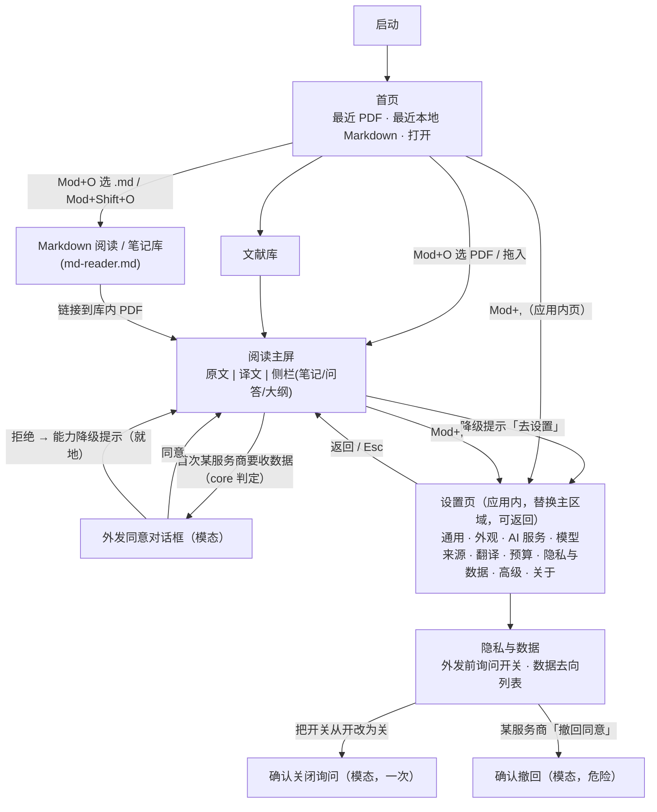

> **入库说明（Wisdom 2026-10-30 21:26 批准的 Loom 草案 v0.2；本 PR 入库）**
>
> - 来源：Loom 的视觉与交互规格草案 v0.2（上传附件）。本说明之后的正文为 Loom v0.2 加走查修正。本次没有需要改的链接或格式：正文指向 [docs/design-principles.md](./docs/design-principles.md)，相对链接对仓库根目录是对的。正文由 Loom 维护，其他人不改（[RULES](./RULES.md) N-10）。
> - 分工：界面细节以正文为准；需求、验收、里程碑以 [PRD](./PRD.md) 为准；切片、seam、外发同意的状态转移以 [ARCHITECTURE](./ARCHITECTURE.md) 为准。
> - DS-01–DS-27 与 PRD 验收的对照表在 [PRD §6.3](./PRD.md#63-视觉与交互验收对照)。PRD 里对应的 AC 回引本文件的 DS 编号。
> - 正文已按 Loom 2026-10-30 对 PR #9 @ a6830bf 的走查修正（Loom 走查记录 PR9-a6830bf-LOOM.md：公式裁图参考字号 18px、DS-20 不再引用 G17、`never_succeeded` 文案对齐 AC-56、外发同意的 `vendorId` / `granted: null` / 撤回与开关文案对齐 ARCHITECTURE §7.0 第 6 条、删除已解决的「待核对」与附注）。剩余说明：
>   1. **seam**：`settings.onEgressConsentRequired`、`settings.withdrawEgressConsent` 已写入 ARCHITECTURE §7.0 与 PRD §3.3 / AC-61，只有类型、没有实现；正文已改用契约字段名。
>   2. **人日**：§3.2a 的「+1 人日」是 Loom 的粗估，不进 PRD / ARCHITECTURE。
>
> 未作答（Esc、关闭弹窗、退出应用）下次再问、每个已同意的服务商可撤回、开关默认开且关闭后不再弹任何外发确认，已按 §6 的 21:26 决定写入 PRD 与 ARCHITECTURE。

---

# Open Immerse v2 视觉与交互规格（DESIGN）

状态：草案 v0.2（Loom，2026-10-30，Asia/Shanghai）。Wisdom 21:13 批准起草；21:26 对 §6 三项与若干空白作出决定，已并入本版。**所有视觉数值都是第一稿，标「待审批」**；结构与行为规则可以先按本文实现（RULES：Loom 交付前 UI 只搭结构、不定视觉）。
依据：`feature/v2-specs`（读取时 tip `d22b3f8`，包含 `bc66ec5`）的 PRD.md、ARCHITECTURE.md、docs/design/md-reader.md；原则见 [docs/design-principles.md](./docs/design-principles.md)（以下简称「原则」）。v1 参考：`wisdom-km/open-immerse` 只读浅克隆，v1 审查稿 `/workspace/oi-qa/` 下 AUDIT、AI-MODELS-SPEC、DIAG-UI-SPEC、FORMULA-REF-SIZE、black-frame SPEC。
面向读者：Cursor Cloud Agents 与开发者。机器可读约定：token 名用反引号；每条验收有 `DS-xx` 编号；「待审批」= 第一稿视觉值，「待定标」= 需实测的数值，「规格空白」= PRD/ARCHITECTURE 未写、本文暂定。

---

## 0 原则对齐说明

- **为什么**：v2 是 Windows / macOS 桌面应用（PRD §1），不是 v1 的浏览器扩展。用户在系统层已有习惯（菜单、快捷键、对话框、字体、深色模式），沿用它们比自创一套学习成本更低（原则 P4）。
- **目的**：给所有 UI 实现一份可执行的规格——token、组件状态、逐屏布局、键盘与平台差异、验收项——让多个 Agent 并行实现时界面一致。
- **遵循的约定**：
  - Apple HIG 的思想（清晰、顺从内容、层级、优先系统约定与原生控件、无障碍、浅深色）+ Windows 应用设计指南 / Fluent 的平台对应（原则 §3）。不使用任何 Apple 素材或原文。
  - **UI 与 core 解耦**（ARCHITECTURE §2.1、RULES §8）：本文每个「何时显示」都写成「当 seam 返回 X」；UI 不计算业务条件（原则 P7）。例：译文块用哪种样式只看 `getBlocks` 返回的 `display` 枚举；是否弹外发同意对话框只看 `settings` 的判定结果。
  - **token 作用域**：阅读器 UI 只用 `--oi-reader-*`（沿用 v1 规则 SET-41）；应用外壳、首页、设置、对话框用 `--oi-*`。两套不混用。

## 1 决策摘要

| # | 决策 | 理由（原则） |
| --- | --- | --- |
| D1 | 使用原生菜单栏、原生文件对话框、原生窗口控制按钮；不自绘系统已有控件 | P4；原生控件自带读屏与键盘支持 |
| D2 | 字体栈 `system-ui` 起头（mac SF + PingFang SC；Win Segoe UI Variable + Microsoft YaHei UI），不打包界面字体 | P4；中文与界面字体跟随系统 |
| D3 | 默认跟随系统浅/深色；每个颜色 token 都有浅深两值并标对比度 | 原则 §5、§4 |
| D4 | 对话框按钮按平台排序：mac「取消 … 主操作（最右）」；Win「主操作 … 取消（右）」；代码只声明角色 | P4 |
| D5 | 一屏一个主按钮；危险操作按钮写清后果，默认焦点在安全选项 | P3 |
| D6 | 阅读中的失败与完成都**就地**显示（`role=status`），不用 toast；只有需要用户决定的事用模态对话框（外发同意、危险确认） | P5；PRD US-28 |
| D7 | 译文块重译失败：保留上一版，2px `--oi-reader-warn` 左侧标记线，状态行按 `failureKind`：`check_failed`「重译未成功（校验没过），仍显示上一版 · 重试」、`network`「重译未成功（网络问题），仍显示上一版 · 重试」、`model_error`「重译未成功（模型出错），仍显示上一版 · 重试」；`null` 兜底「重译未成功，仍显示上一版 · 重试」，`role=status`（§4.1） | PRD US-28、AC-56；md-reader MD-27 |
| D8 | 「外发前询问」开关、「数据去向」列表、每个服务商的「撤回同意」都在设置 › **隐私与数据**页（Wisdom 21:26） | 危险类放置（原则 §2）；PRD §3.3 |
| D10 | **标题栏与工具栏合并**：mac `titleBarStyle: 'hiddenInset'`（红绿灯在左），Win `titleBarOverlay`（系统按钮在右，保留 Snap Layouts）（Wisdom 21:26） | P4；节省垂直空间给阅读区 |
| D11 | **强调色全部跟随系统**（含主按钮），前景色运行时计算保证可读；系统不可用时才回落品牌色（Wisdom 21:26；见 §3.2a） | P4 |
| D12 | **设置是应用内页面**（不是独立窗口），`Mod+,` 打开，两平台一致（Wisdom 21:26） | 单窗口心智；返回阅读位置简单 |
| D13 | 阅读主题 3 套：白、暖纸、深色（Wisdom 21:26） | 减少维护面 |
| D9 | 焦点：统一 `:focus-visible` 2px 实线 + 2px 偏移；整栏容器只用 1px 内缩发丝线（沿用 v1 黑框修复结论） | 原则 §4 第 3 条 |

### v1 借鉴与改变

| 保留 | 理由 |
| --- | --- |
| 阅读器 token 独立命名空间 `--oi-reader-*`，与设置 token 分开 | 阅读区可换纸色主题而不影响设置；v1 实践证明能防止串色 |
| 暖纸色系（浅色 `#F6F3EC` 底）作为应用浅色基调；`--oi-reader-focus` `#2F55D4` / `#8FA8FF` | 长时间阅读舒适；对比度已达标（见 §3） |
| 设置里 AI 连接集中一页（v1「AI 模型」页方案）：一个服务商填一次 Key，各能力只「选用」 | v1 审查发现同一 Key 填两遍是主要痛点；v2 面壁 Key 本来就由 Jev 与引擎 B 共用 |
| 行内状态 + `aria-live` 代替页底 toast（AUDIT 决策 4）；按钮忙碌态固定最小宽度避免跳宽（DIAG-UI） | 反馈在视线内（P5） |
| 卡片一种样式：面板底 + 1px 线 + 无阴影（AUDIT 决策 1） | 阴影不传达信息，顺从内容（P1） |
| 公式裁图固定参考字号 18px，不跟随正文字号滑杆；KaTeX 渲染的公式跟随（FORMULA-REF-SIZE §8，Wisdom 2026-10-24 12:06） | 公式原图清晰度与可读性优先；v2 中由 `--oi-reader-formula-ref-size` 表达 |
| 容器焦点用 1px 内缩发丝线，小控件用 2px 强焦点环（black-frame SPEC） | 鼠标阅读无框、键盘可见 |
| 诊断导出放「关于」、行内说明「包含 / 不包含」、不弹预览框 | 低频项放置（原则 §2） |

| 改变 | 原因 |
| --- | --- |
| 扩展 options 页 → 应用内设置页，`Mod+,` 打开，左侧分组导航（D12） | 桌面平台约定（P4） |
| v1 只做浅色 → v2 浅/深色都做，跟随系统 | 原则 §5 |
| v1 自定强调色 `#2A6670` → v2 应用外壳强调色全部跟随系统强调色，`#2A6670` 只作系统不可用时的回落（D11） | 平台约定（P4） |
| v1 阅读器 5 套纸色主题 + 大量 `--oi-reader-aa-*` 细粒度 token → v2 先做 3 套（白、暖纸、深色），token 只保留语义层（D13 已定） | 减少维护面；`aa-*` 是组件私有尺寸，不应进公共 token |
| v1 的 Aa 浮层承载大量设置 → v2 Aa 只放字号、行宽、主题；其余进设置 | 层级（P3） |
| v1 网页翻译、划词、字幕等浏览器能力全部移除（PRD §3.2） | 范围外 |
| v1 自定义快捷键（`o`/`f` 单键）→ v2 默认用带修饰键的平台快捷键，单键快捷键仅在阅读区获得焦点时生效且可在设置关闭 | 避免与读屏软件、输入法冲突（原则 §4） |

## 2 页面地图 / 用户路径

主路径：
1. **读论文**：首页 → `Mod+O` 选 PDF → 阅读主屏（左原文、右译文）→ 点译文段落跳到原文 → 选中文字 → 「写笔记」/「问」。
2. **首次使用 API**：开始解析/翻译 → core 判定某服务商需要同意 → 弹外发同意对话框 → 同意后继续；拒绝则该能力就地显示降级提示（「需要同意才能使用 面壁开放平台 · 改选本地 · 去设置」）。
3. **单块重译**：悬停或聚焦译文块 → 「重译」→ 块显示上一版 +「正在重译…」→ 成功替换 / 失败按 D7 显示。

## 3 Token 与组件表

### 3.1 命名与作用域

- 应用外壳、首页、设置、对话框：`--oi-*`（定义在 `ui-kit/tokens/app.css`，作用域 `:root`）。
- 阅读区（原文栏、译文栏、阅读侧栏、Aa 浮层、MarkdownView 在阅读器内的实例）：只用 `--oi-reader-*`（`ui-kit/tokens/reader.css`，作用域 `.oi-reader`）。MarkdownView 在设置或首页以外不出现；在 `.md` 阅读器中也使用 reader token。
- 阅读主题固定 3 套（D13）。主题切换：`[data-theme="light|dark"]` 由外壳根据 `nativeTheme` 或用户选择设置；阅读主题另设 `[data-reader-theme="white|paper|dark"]`。
- 强制色：`@media (forced-colors: active)` 下所有颜色 token 映射到系统色（`Canvas`、`CanvasText`、`Highlight`、`LinkText`、`GrayText`、`ButtonText`），边框与焦点用 `Highlight`。

### 3.2 颜色 · 应用（`--oi-*`）—— 全部待审批

对比度按 WCAG 相对亮度计算，背景为 `--oi-bg`（浅 `#F6F3EC` / 深 `#1B1C1F`）；`--oi-on-accent` 以 `--oi-accent` 为背景。

| Token | 用途 | 浅色 | 对比 | 深色 | 对比 |
| --- | --- | --- | --- | --- | --- |
| `--oi-bg` | 窗口底色 | `#F6F3EC` | — | `#1B1C1F` | — |
| `--oi-surface` | 卡片 / 面板 | `#FCFAF6` | — | `#24262A` | — |
| `--oi-surface-raised` | 菜单、对话框 | `#FFFFFF` | — | `#2C2E33` | — |
| `--oi-text` | 正文 | `#22201C` | 14.7 | `#ECEAE6` | 14.2 |
| `--oi-text-2` | 次要文字 | `#4A463E` | 8.5 | `#C8C4BA` | 9.8 |
| `--oi-text-muted` | 说明、状态行 | `#655F54` | 5.7 | `#A8A49B` | 6.9 |
| `--oi-line` | 装饰分隔线（不承担信息） | `#E4DED2` | — | `#3A3C40` | — |
| `--oi-line-strong` | 输入框、开关边框 | `#8A806C` | 3.5 | `#8A8F98` | 5.2 |
| `--oi-accent` | 主按钮底、选中态（**跟随系统**，见 §3.2a；右列为回落值） | 回落 `#2A6670` | 5.9 | 回落 `#7FB8C0` | 7.7 |
| `--oi-on-accent` | 主按钮文字（运行时计算，见 §3.2a） | 回落 `#FFFFFF` | 6.5 | 回落 `#10282B` | 7.0 |
| `--oi-focus` | 焦点环（跟随系统强调色，过 3:1；回落值见右） | `#2F55D4` | 5.6 | `#8FA8FF` | 7.5 |
| `--oi-danger` | 危险按钮、错误文字 | `#B3261E` | 5.9 | `#F2B8B5` | 10.0 |
| `--oi-warn` | 警示文字、标记 | `#8A4B0F` | 6.1 | `#E8B36A` | 9.0 |
| `--oi-success` | 完成标记 | `#2E6B3A` | 5.8 | `#8FCB9B` | 9.1 |
| `--oi-hover` | 悬停底色叠加 | `rgb(34 32 28 / .06)` | — | `rgb(255 255 255 / .06)` | — |
| `--oi-pressed` | 按下叠加 | `rgb(34 32 28 / .10)` | — | `rgb(255 255 255 / .10)` | — |

### 3.2a 强调色跟随系统（D11，Wisdom 21:26）

- **来源**：main 进程读 `systemPreferences.getAccentColor()`（Win / mac 均可用），监听 `accent-color-changed`（Win）与 `nativeTheme` 的 `updated`（mac），把 `#RRGGBB` 作为普通数据经外壳设置到 `:root` 的 `--oi-accent-system`。CSS 端同时声明 `AccentColor` / `AccentColorText` 系统色作为第二来源（Chromium 支持时）。这是显示层取值，不是业务规则，不进 core。
- **派生**：
  - `--oi-accent` = 系统强调色；浅色模式与 `--oi-bg` 对比 < 3:1 时，按 OKLCH 降低明度直到 ≥ 3:1；深色模式同理提高明度。
  - `--oi-on-accent` = 在 `#FFFFFF` 与 `#111111` 中取与 `--oi-accent` 对比更高者；若仍 < 4.5:1，继续调整 `--oi-accent` 明度直到 ≥ 4.5:1。
  - `--oi-accent-hover` / `--oi-accent-pressed` = `--oi-accent` 明度 ±6% / ±12%（待审批）。
  - 计算放在 `ui-kit/theme/accent.ts` 纯函数（展示层，有单元测试），输入颜色、输出 token 值。
- **对比检查规则**：主按钮文字 ≥ 4.5:1；强调色作为边框、选中指示、开关底 ≥ 3:1（对 `--oi-bg` 与 `--oi-surface` 都检查）。不满足就调明度，不换色相。
- **回落**：仅当系统强调色取不到（API 报错或返回空）时用品牌色 `#2A6670`（浅）/ `#7FB8C0`（深）。
- **焦点环**：`--oi-focus` 也跟随强调色（同样过 3:1 检查）；Windows 高对比 / 强制色下改用系统 `Highlight`。
- **不影响阅读区**：`--oi-reader-*` 不跟随系统强调色（阅读区保持纸色主题稳定）；`--oi-reader-focus` 仍为固定值。
- **工作量**：比固定品牌色多约 **+1 人日**（取色与监听、派生纯函数与测试、浅深两模式与高对比截图）。

### 3.3 颜色 · 阅读区（`--oi-reader-*`）—— 全部待审批

背景为 `--oi-reader-surface`（浅/暖纸 `#FFFDF8`，深 `#1E1F22`）。「白」主题只把 surface 换成 `#FFFFFF`，其余同浅色（对比度只会更高）。

| Token | 用途 | 浅色 | 对比 | 深色 | 对比 |
| --- | --- | --- | --- | --- | --- |
| `--oi-reader-surface` | 阅读区底色 | `#FFFDF8` | — | `#1E1F22` | — |
| `--oi-reader-ink` | 译文正文 | `#1F1E1B` | 16.4 | `#E8E6E1` | 13.2 |
| `--oi-reader-ink-2` | 标题注、次要 | `#4A463E` | 9.2 | `#C8C4BA` | 9.5 |
| `--oi-reader-muted` | 块状态行、页码 | `#6B655A` | 5.7 | `#A8A49B` | 6.6 |
| `--oi-reader-line` | 装饰线 | `#E9E3D8` | — | `#3A3C40` | — |
| `--oi-reader-line-strong` | 容器焦点发丝线、分隔条 | `#8A806C` | 3.8 | `#8A8F98` | 5.1 |
| `--oi-reader-link` | 链接、引用跳转 | `#1F5F8B` | 6.7 | `#8CC4F0` | 8.8 |
| `--oi-reader-focus` | 小控件焦点环 | `#2F55D4` | 6.1 | `#8FA8FF` | 7.2 |
| `--oi-reader-warn` | 重译失败标记线与状态行强调 | `#9A5A12` | 5.4 | `#E8B36A` | 8.7 |
| `--oi-reader-danger` | 失效链接、渲染错误标记 | `#B3261E` | 6.4 | `#F2B8B5` | 9.7 |
| `--oi-reader-highlight` | 对照跳转后的目标段落底色（淡出） | `rgb(47 85 212 / .10)` | — | `rgb(143 168 255 / .14)` | — |
| `--oi-reader-selection` | 选中文字 | 系统 `Highlight` | — | 系统 `Highlight` | — |
| `--oi-reader-math-error-bg` | 公式渲染失败底 | `rgb(179 38 30 / .08)` | — | `rgb(242 184 181 / .12)` | — |
| `--oi-reader-code-bg` | 代码块底 | `#F3EFE7` | — | `#26282C` | — |

状态标记不只靠颜色：失败有文字；失效链接有虚线下划线 + 图标；公式错误显示原始 LaTeX。

### 3.4 字体与字号（待审批）

- `--oi-font-ui`: `system-ui, -apple-system, "Segoe UI Variable", "Segoe UI", "PingFang SC", "Microsoft YaHei UI", sans-serif`
- `--oi-font-mono`: `ui-monospace, "SF Mono", "Cascadia Mono", Consolas, monospace`
- `--oi-reader-font-body`: 默认同 `--oi-font-ui`；阅读设置可选衬线 `"Songti SC", "SimSun", serif`（低频）

| Token | 字号 / 行高 | 用途 |
| --- | --- | --- |
| `--oi-type-caption` | 12 / 16 | 状态行、辅助说明 |
| `--oi-type-body` | 13 / 20（mac）· 14 / 20（Win） | 界面正文（平台默认：mac 13pt、Win 14px） |
| `--oi-type-body-strong` | 同 body，600 | 行标题 |
| `--oi-type-subtitle` | 16 / 22，600 | 分组标题 |
| `--oi-type-title` | 20 / 28，600 | 页标题 |
| `--oi-type-display` | 28 / 36，600 | 首页标题（仅一处） |
| `--oi-reader-fs` | 默认 18，范围 14–28，步长 1 | 译文正文（用户可调） |
| `--oi-reader-line-height` | 随字号 1.9→1.5（沿用 v1 公式） | 译文行高 |
| `--oi-reader-measure` | 最大 38em（中文约 38 字） | 译文行宽上限 |
| `--oi-reader-status-fs` | 12 | 块状态行 |
| `--oi-reader-formula-ref-size` | **18**（固定，不随 Aa / `--oi-reader-fs`；Wisdom 2026-10-24 12:06，FORMULA-REF-SIZE §8；宽行间公式先等比缩到栏宽，下限 13.5，再放不下才横滚） | 公式**裁图**参考字号。arXiv 源码 / 已核验 LaTeX 用 KaTeX 渲染时**跟随** Aa（`--oi-reader-fs`） |

### 3.5 间距、圆角、阴影、动效、焦点（待审批）

- 间距：4px 网格。`--oi-space-1..8` = 4 / 8 / 12 / 16 / 20 / 24 / 32 / 48。阅读区另用 `--oi-reader-space-block`（块间距，默认 0.9em）。
- 圆角：`--oi-radius-sm` 4（标签、复选框）、`--oi-radius-md` 6（按钮、输入框）、`--oi-radius-lg` 10（卡片、对话框）。Win 11 控件默认 4，mac 约 6；统一用上述值，不区分平台（待审批）。
- 阴影 / 层级：只有浮起层用阴影。`--oi-elev-0` 无；`--oi-elev-1`（菜单、浮层）`0 4px 12px rgb(0 0 0 / .12)`；`--oi-elev-2`（对话框）`0 12px 32px rgb(0 0 0 / .20)`。深色下阴影加深并加 1px `--oi-line` 描边。卡片无阴影。
- 动效：`--oi-motion-fast` 100ms（悬停、按下）、`--oi-motion-base` 180ms（展开、淡入）、`--oi-motion-slow` 280ms（对话框出现）；曲线 `cubic-bezier(.2,0,0,1)`。`prefers-reduced-motion: reduce` 时：位移/缩放改为不动画，透明度渐变 ≤ 100ms；对照跳转用瞬时定位，目标段落高亮直接出现后 1s 去掉（不渐隐）。
- 焦点：`--oi-focus-width` 2px、`--oi-focus-offset` 2px、实线；阅读区用 `--oi-reader-focus`。整栏容器（原文栏、译文栏、侧栏）获焦时只显示 1px 内缩 `--oi-reader-line-strong`（`--oi-reader-focus-pane-soft`）。

### 3.6 组件表（状态全集）

状态列：默认 / 悬停 / 按下 / 禁用 / 加载 / 空 / 错误 / 成功。「—」表示该组件不存在此状态。所有「禁用」与「是否显示」由 seam 数据决定（例如 `canRetranslate`、`display`），UI 不计算。

| 组件 | 所属 | 默认 | 悬停 | 按下 | 禁用 | 加载 | 空 | 错误 | 成功 |
| --- | --- | --- | --- | --- | --- | --- | --- | --- | --- |
| `Button`（主） | ui-kit | `--oi-accent` 底 + `--oi-on-accent` 字，高 28（待审批） | 叠加 `--oi-hover` | 叠加 `--oi-pressed` | 不透明度 .45，`aria-disabled` | 文字换「正在…」+ 旋转指示，宽度不变，`aria-busy` | — | 按钮恢复默认，错误显示在旁边状态行 | 恢复默认；结果在状态行 |
| `Button`（次） | ui-kit | `--oi-surface` 底 + 1px `--oi-line-strong` | 同上 | 同上 | 同上 | 同上 | — | 同上 | 同上 |
| `Button`（危险） | ui-kit | 文字 `--oi-danger`，边框同色 | 同上 | 同上 | 同上 | 同上 | — | 同上 | 同上 |
| `IconButton` | ui-kit | 透明底，图标 `--oi-text-2`，28×28 | 底 `--oi-hover` + tooltip（含快捷键） | `--oi-pressed` | .45 | 图标换指示 | — | — | — |
| `Switch` | ui-kit（mac 风格开关 / Win ToggleSwitch 同形） | 关：边框 `--oi-line-strong`；开：底 `--oi-accent` | 叠加 hover | — | .45 | 旋钮处指示（保存中） | — | 回到原值 + 行内错误 | — |
| `TextField` / `SecretField` | ui-kit | 1px `--oi-line-strong`，高 28 | 边框 `--oi-text-muted` | — | 底 `--oi-bg` | 右侧指示（测试中） | 占位符 `--oi-text-muted` | 边框 `--oi-danger` + 下方错误文字 + `aria-invalid` | 下方「已设置」✓ |
| `Select` | ui-kit（原生 `<select>` 或自绘 listbox，待 §6） | 同 TextField | 同 | — | 同 | — | 「未选择」 | 同 | — |
| `SettingsRow` | settings ui | 左标题+说明，右控件 | — | — | 整行 .45 + 原因说明 | 控件加载 | — | 行下方错误 | 行内状态 ✓ |
| `StatusLine` | ui-kit | 12px `--oi-text-muted`，`role=status` | — | — | — | 「正在…」 | 不渲染 | 文字 `--oi-warn`/`--oi-danger` + 图标 | `--oi-success` ✓ + 文字 |
| `Dialog` | ui-kit | `--oi-surface-raised`，`--oi-elev-2`，最大宽 480 | — | — | — | 主按钮加载态 | — | 对话框内错误行（`role=alert`） | 关闭 |
| `DialogActions` | ui-kit | 按平台排序（D4） | — | — | — | — | — | — | — |
| `TranslationBlock` | reader ui | 见 §4.1 `display` 五态 | 显示块操作（重译、复制、写笔记） | — | 块操作按 seam 能力隐藏 | `pending`：骨架；`retranslating`：上一版 + 状态行 | — | `previous_with_failure` / `never_succeeded` | `current` |
| `MarkdownView` | ui-kit | 渲染 `MdDocument` | 链接下划线 | — | — | 流式：未闭合尾部按原文样式 | 宿主负责 | 单公式错误：原始 LaTeX + `--oi-reader-math-error-bg` | — |
| `MathInline` / `MathBlock` | ui-kit | KaTeX 输出（含 MathML） | 显示「复制 LaTeX」 | — | — | — | — | 同上 | — |
| `FormulaCrop` | reader ui | 原页裁图，固定参考字号 | 显示来源与核验状态 | — | — | 骨架 | — | 「图片不可用」占位 + 原因 | — |
| `EmptyState` | ui-kit | 图标 + 一句说明 + 至多 1 个主按钮 | — | — | — | — | — | — | — |
| `InlineNotice` | ui-kit | 降级提示条（能力不可用），左图标 + 文字 + 链接按钮 | — | — | — | — | — | 本身即错误/警示 | — |
| `ListItem`（数据去向等） | ui-kit | 名称 + 状态徽标（文字） | 底 hover | — | — | — | 列表空态文案 | — | — |

## 4 逐屏规格

### 4.1 阅读主屏

- **目的**：让用户左右对照读一篇论文，公式可信，随手写笔记与提问。
- **布局分区**（从左到右，分隔条可拖，宽度记忆由 reader 设置保存）：
  1. 标题栏 / 工具栏（`toolbar.document` 插槽）：返回文献库、文档标题、页码、Aa（字号/行宽/主题）、栏位切换（原文 / 对照 / 译文）、侧栏开关、解析与翻译状态摘要。
  2. 原文栏（`reader.main` 左）：PDF.js 页面。
  3. 译文栏（`reader.main` 右）：按阅读顺序的译文块列表，每块 `TranslationBlock`，按 `sourceBlockId` 与原文对齐。
  4. 侧栏（`reader.side`，可收起）：标签「笔记 / 问答 / 大纲」。
- **组件**：`IconButton`、Aa 浮层、`TranslationBlock`、`MarkdownView`、`MathInline/Block`、`FormulaCrop`、`StatusLine`、`InlineNotice`、笔记列表、问答输入。
- **译文块显示**（只按 `getBlocks` 每块的 `display` 选样式，ARCHITECTURE §8.1.1）：

| `display` | 正文 | 左侧标记 | 状态行（`--oi-reader-status-fs`，`role=status`） | 操作 |
| --- | --- | --- | --- | --- |
| `current` | 当前版本 `MarkdownView` | 无 | 无 | 悬停/聚焦出现：重译、复制、写笔记 |
| `retranslating` | 上一版 | 无 | 「正在重译…」+ 小型指示 | 重译按钮禁用（`aria-disabled`） |
| `previous_with_failure` | **上一版（保留）** | **2px `--oi-reader-warn` 左边线** | 按 `failureKind` 三选一（见下表「失败原因文案」），`role=status`；「重试」是文字按钮，可聚焦，焦点环 `--oi-reader-focus`；悬停或键盘聚焦状态行显示详情 | 重试 |
| `never_succeeded` | 原文（英文，`--oi-reader-ink-2`） | 2px `--oi-reader-warn` | 按 `failureKind` 三选一（见下表），`role=status`；文字按钮「重译」；悬停或聚焦显示详情 | 重译 |
| `pending` | 骨架（3 行灰条，reduced-motion 下不闪动） | 无 | 无 | — |

  **失败原因文案**（Wisdom 2026-10-30 22:02：按原因分三种）。UI 只把 `failureKind`（`getBlocks` 每块 `latest.failureKind`，`onBlockChanged` 同字段，ARCHITECTURE §8.1.1）映射成文案，不从错误信息、计时或 HTTP 状态推断原因。

| `failureKind` | `previous_with_failure` 状态行（保留上一版） | `never_succeeded` 状态行（显示原文） | 悬停 / 聚焦详情 |
| --- | --- | --- | --- |
| `check_failed` | 重译未成功（校验没过），仍显示上一版 · 重试 | 未翻译（校验没过）· 重译 | 新译文里的公式、数字或引用编号和原文对不上，已丢弃。可以再试一次。 |
| `network` | 重译未成功（网络问题），仍显示上一版 · 重试 | 未翻译（网络问题）· 重译 | 没连上翻译服务或超时。请检查网络后重试。 |
| `model_error` | 重译未成功（模型出错），仍显示上一版 · 重试 | 未翻译（模型出错）· 重译 | 翻译服务返回了错误或看不懂的结果。可以重试，或到设置 › 模型来源 换一个翻译服务 / 改选本地。 |
| `null`（防御，core 不应在失败时给出） | 重译未成功，仍显示上一版 · 重试 | 未翻译 · 重译 | 无 |

  「设置 › 模型来源」入口来自 PRD §3.3（翻译的「本地 / API」与服务商选择），不是新功能。详情只说明原因与下一步，不显示原始错误文本、Key 或请求内容。
  **不使用 toast，不弹对话框**（US-28）。失败原因文案映射是展示层（允许在 UI），但「是否失败、显示哪一版」只来自 `display`。
- **Markdown/KaTeX**：译文、笔记、问答回答都用同一 `MarkdownView`（ARCHITECTURE §4.5.4）；KaTeX 渲染失败显示原始 LaTeX + 错误底；流式回答中未闭合的尾部按原文（等宽、`--oi-reader-muted`）显示，闭合后替换，不闪烁。公式裁图使用 `--oi-reader-formula-ref-size`，不跟随正文字号。
- **空态**：未解析且无服务 →译文栏 `EmptyState`「这篇论文还没有译文。可以先读原文文字层 · 去设置翻译服务」（US-16）；侧栏笔记空「选中文字后按 Mod+Shift+N 写笔记」。
- **错态**：PDF 打不开 → 整屏 `EmptyState`「无法打开此文件」+ 原因 + 次按钮「返回」。能力不可用（无 Key / 未同意外发 / API 不可用）→ 译文栏顶部 `InlineNotice`，文案来自 seam 原因码（如 `consent_required`：「需要同意向 {服务商} 发送数据 · 查看」），按钮「去设置」打开对应设置页。
- **加载**：打开文档 > 200ms（待定标）显示页面骨架；解析/翻译进度在工具栏摘要（「解析 12/30 页」），可点开看任务并取消（`jobs.cancel`）。
- **主次按钮层级**：本屏无常驻主按钮（阅读为主，P1）；支持：Aa、栏位切换、侧栏；块级：重试（文字按钮）；低频：⋯ 菜单（重新解析、导出笔记、文档信息）。
- **Win / mac 差异**：标题栏与工具栏合并（D10）——mac 红绿灯在左、工具栏紧随其后，Win 系统按钮在右、工具栏在左侧到系统按钮之间；工具栏空白处为拖拽区，按钮区不可拖；双击空白处最大化（Win）/ 按系统设置缩放（mac）；快捷键符号；mac 侧栏可用半透明材质（vibrancy）——待审批，Win 11 可用 Mica——待审批，均在「减少透明度」时关闭。
- **键盘**：

| 操作 | mac | Win |
| --- | --- | --- |
| 打开 | ⌘O | Ctrl+O |
| 在三栏间移动焦点 | F6 / ⇧F6 | F6 / Shift+F6 |
| 译文块间移动 | ↑ / ↓（译文栏获焦时）| 同 |
| 跳到对应原文 | ⏎ | Enter |
| 重译当前块 | ⌘R（待审批） | Ctrl+R（待审批） |
| 写笔记 | ⌘⇧N | Ctrl+Shift+N |
| 问答 | ⌘⇧A（待审批） | Ctrl+Shift+A（待审批） |
| 字号 ± | ⌘= / ⌘- | Ctrl+= / Ctrl+- |
| 切换侧栏 | ⌘\ | Ctrl+\ |
| 关闭浮层 | Esc | Esc |

### 4.2 设置

- **目的**：让用户一次配好服务、来源、预算与隐私，并随时看清数据去了哪里。
- **布局分区**：左侧分组导航（`settings.pages` 插槽，一页一个文件）＋右侧内容（最大宽 720，待审批）；顶部搜索框（低频）。页面：通用 · 外观 · AI 服务（服务商与 Key，集中管理）· 模型来源（每个能力「本地 / API」）· 翻译 · 预算 · **隐私与数据** · 高级（自建 worker / Jev Docker）· 关于（版本、诊断导出）。
  - 两平台一致：**应用内页面**（D12），`Mod+,` 或菜单「设置…」（mac 在应用菜单，Win 在「文件」菜单）打开，替换主区域；左上「返回」回到进入前的屏幕与阅读位置；标题栏合并样式与阅读屏相同。
  - 即时生效，无「保存」按钮（两平台现代设置的约定）；需要验证的字段（Key）用「测试连接」。
- **隐私与数据页**（PRD §3.3 数据外发同意；ARCHITECTURE §7.0 第 6 条）：
  - 第 1 组「数据外发」：
    - 行「外发前询问」— `Switch`。**默认：开**（由 core 保证，UI 不写默认值）。
      - **(a) 开关对外发的作用**：**开** = 外发前要确认——任何服务商第一次收到数据前、以及已同意的服务商新增一项能力前，都会弹出外发同意对话框，用户同意后才发送；**关** = 不再弹出任何外发确认，数据照常发送。行内说明文案：「开：发送数据前先问你。关：不再询问，直接发送。」
      - **(b) 拨动开关本身是否要确认**：**从开改为关**时弹一次确认对话框（因为降低保护）；**从关改为开**不需要确认，立即生效。确认框标题「关闭外发前询问？」正文「关闭后，发送数据前不再询问你；此前选了「不允许」或还没同意的功能也会照常发送。你仍可在下方「数据去向」查看。」按钮：次「保持开启」（默认焦点）、危险「关闭询问」。取消则开关保持「开」。调用 `setEgressPromptEnabled`。
      - 注（Loom 建议）：(b) 中「关时确认一次、开时不确认」是 Loom 的建议，Wisdom 21:26 保留此做法。
  - 第 2 组「数据去向」（`listEgressDestinations`，开关任何状态都显示）：每个服务商一项：名称；下列能力，每项「发送内容」（如「区域裁图与候选文本」「我们渲染的页面图」「待翻译文本」「问答上下文」）+ 状态徽标「已同意 / 询问已关闭 / 已拒绝」（文字徽标，不只靠颜色）。固定说明一行「不会上传原 PDF 文件」。空态：「还没有服务商收到过数据」。
  - **撤回同意**（Wisdom 21:26）：「数据去向」中徽标为「已同意」的服务商行（开关为开时才会出现该徽标），右侧有危险类文字按钮「撤回同意」（不放在主按钮位置；危险类放置，原则 §2）。开关为关时徽标为「询问已关闭」，不显示此按钮。点击弹确认对话框：标题「撤回对 {服务商} 的同意？」正文列出受影响能力，并说明「撤回后，这些功能下次要向 {服务商} 发送数据前会重新询问你；在你重新同意之前不会发送。」按钮：次「取消」（默认焦点）、危险「撤回同意」。调用 `settings.withdrawEgressConsent({ vendorId })`；成功后状态行 `role=status` 显示「已撤回」；返回 `consent_not_granted` 时状态行说明「该服务商没有已同意的记录」。撤回只清除已同意记录、不记为已拒绝，在途请求不取消——规则全部在 core（ARCHITECTURE §7.0 第 6 条）。
- **AI 服务 / 模型来源页**：每个能力一行 `Segmented`「API / 本地」；「本地」旁显示 core 给的可行性标注（「达到官方要求 / 不在官方要求内 / 未评估」）；Key 只显示「已设置 / 未设置」（AC-59 ⑤），`SecretField` 不回显。
- **空态**：未配置任何服务 → AI 服务页顶部 `EmptyState`「填一个 API Key 就能开始翻译和评估」+ 主按钮「添加服务商」。
- **错态**：测试连接失败 → 行内 `StatusLine` 错误 + 原因（`auth`「Key 无效」、`quota`「额度不足」、网络）；保存失败回滚控件并说明。
- **加载**：页面数据 > 200ms 显示行骨架；测试连接按钮加载态。
- **主次按钮层级**：每页至多 1 个主按钮（如「添加服务商」）；「测试连接」为次；「清除 Key」「恢复默认」为危险（确认）。
- **Win / mac 差异**：两平台都是应用内页、即时生效、无「应用/确定」按钮；菜单入口位置不同（mac 应用菜单「设置…」，Win「文件 › 设置」）；分组导航 mac 用侧栏列表样式，Win 用 NavigationView 样式（都由同一组件按平台变体渲染，待审批）。
- **键盘**：`Mod+,`（⌘, / Ctrl+,）打开设置页；`Mod+F` 聚焦搜索；↑↓ 在左导航切页；Tab 进入内容；Esc 或 `Mod+[`（mac）/ Alt+←（Win）返回上一屏（两平台都可用 Esc）。

### 4.3 首次外发同意对话框（按服务商）

- **目的**：在数据第一次发给某个服务商前，让用户清楚「发给谁、发什么、不发什么」并作决定。
- **触发**：只由 core 判定（`egress-consent.ts`），经事件 `settings.onEgressConsentRequired` 通知 UI，载荷为 `EgressConsentRequired`（ARCHITECTURE §7.0 第 6 条，以契约为准；服务商标识字段名是 `vendorId`）。同一服务商已有未结束的询问时 core 不发第二条，UI 不做去重判断。
- **布局**：模态 `Dialog`（宽 480，待审批）。
  1. 标题：首次「允许向 {服务商} 发送数据？」；追加告知「{服务商} 还需要接收以下数据」。
  2. 正文：一句「以下功能会把数据发送到 {服务商}：」
  3. 能力列表（来自载荷，首次列全部、追加只列新增——由 core 决定列哪些）：每项「能力名 — 发送内容」。
  4. 固定声明：「不会上传你的原 PDF 文件。」
  5. 说明链接（次）：「可以在设置 › 隐私与数据 查看或关闭询问」。
  6. 操作：主「允许」，次「不允许」。按平台排序（D4）。
- **默认焦点**：「不允许」（Wisdom 21:26 决定；危险类：外发数据，原则 §2）。误按 Enter 不会外发。
- **行为**：「允许」= `answerEgressConsent({ requestId, granted: true })`；「不允许」= `granted: false`（记为已拒绝）；Esc、关闭按钮 = `granted: null`（**未作答**：本次请求为 0、该能力就地降级，**下次需要发送时再问**，Wisdom 21:26）；应用退出来不及回传时 core 视同 `null`。以上判定全部在 core，UI 只回传用户的动作。
- **空态**：无（无能力则 core 不触发）。**错态**：提交失败 → 对话框内 `role=alert` 错误行 + 保持打开。**加载**：主按钮加载态。
- **拒绝后**：对话框关闭；相关能力所在位置显示 `InlineNotice`（降级提示 + 「改选本地」「去设置」）；不弹第二个对话框。
- **Win / mac 差异**：按钮顺序（D4）；两平台均为窗口内居中模态（设置是应用内页，不用 mac sheet 以保持一致，待审批）。
- **键盘**：Tab 在列表说明链接与两个按钮间循环；Enter 激活焦点按钮；Esc = 关闭（未作答）。读屏：`role=dialog`、`aria-labelledby` 标题、`aria-describedby` 正文与声明。

### 4.4 其他屏（简要，待后续展开）

- **首页**：目的「一步打开或继续读」。主按钮「打开文件…」，次「打开文件夹…」；最近列表（PDF / 本地 Markdown 两组，`home.recent`）；空态「把 PDF 或 .md 拖到这里」。
- **Markdown 阅读 / 笔记库**：见 `docs/design/md-reader.md` §4，token 换成本文 `--oi-reader-*`。
- **借用多模态翻译确认（Q11）**：开启时对话框「会消耗多模态服务的额度」，主「开启」次「取消」。

## 5 验收清单（草案）

| ID | 标准 | 检查方式 |
| --- | --- | --- |
| DS-01 | 每个颜色 token 浅深两值都存在，文字类 ≥ 4.5:1、控件/焦点类 ≥ 3:1（脚本按本文 §3 计算） | 自动 |
| DS-02 | 阅读区组件只引用 `--oi-reader-*`，外壳/设置只引用 `--oi-*`（stylelint 规则） | 自动 |
| DS-03 | 系统切换浅/深色时，应用在 1 秒内跟随（设置为「跟随系统」时） | e2e |
| DS-04 | `forced-colors: active` 下所有文字、边框、焦点可见；状态不只靠颜色 | 手动（Win 高对比） |
| DS-05 | 全部主路径可只用键盘完成；F6 在三栏间循环；对话框焦点循环、Esc 还焦点 | e2e + 手动 |
| DS-06 | 不存在全局 `outline:none`；`:focus-visible` 2px 环在所有可聚焦控件上可见；整栏容器为 1px 发丝线 | 自动（lint）+ 截图 |
| DS-07 | `prefers-reduced-motion: reduce` 下无位移/缩放动画，跳转为瞬时 | e2e |
| DS-08 | 所有 `IconButton` 有 `aria-label`；状态变化有 `role=status` | axe 自动 |
| DS-09 | 对话框按钮顺序：mac 主操作最右，Win 主操作在左；代码只声明角色 | 组件测试（两平台快照） |
| DS-10 | 快捷键显示随平台（⌘ / Ctrl） | 组件测试 |
| DS-11 | 每屏主按钮 ≤ 1 | 走查 |
| DS-12 | 译文块五种 `display` 各有对应样式；UI 不读 `status` 推断显示（代码检查：组件只分支于 `display`） | 组件测试 + 评审 |
| DS-13 | `previous_with_failure`：显示上一版、2px `--oi-reader-warn` 左边线、状态行按 `failureKind` 显示 §4.1「失败原因文案」对应一句（三种原因各注入一次断言）、`role=status`、「重试」可键盘聚焦；整个过程 toast 与对话框出现 0 次 | e2e |
| DS-14 | 公式裁图显示尺寸不随正文字号变化；KaTeX 失败显示原 LaTeX + 错误底 | 组件测试 |
| DS-15 | 「隐私与数据」页含「外发前询问」开关，新安装为**开**；开时首个服务商/新增能力发送前出现同意对话框，关时出现 0 次；开→关弹一次确认（取消则保持开），关→开不弹确认；「数据去向」在开关任何状态下都显示，状态用文字徽标 | e2e（假 core） |
| DS-21 | 标题栏与工具栏合并：mac 红绿灯在左、Win 系统按钮在右且 Snap Layouts 可用；工具栏空白可拖动窗口，按钮不可拖 | 手动两平台 |
| DS-22 | 强调色跟随系统：切换系统强调色后应用内主按钮、选中态、焦点环 1 秒内更新；任取 12 种系统强调色（含黄、浅绿），主按钮文字 ≥ 4.5:1、强调色边框 ≥ 3:1（浅深两模式）；取色失败时显示回落品牌色；阅读区颜色不变 | 单元测试（派生函数）+ e2e |
| DS-23 | 外发同意对话框打开时焦点在「不允许」；Esc/关闭 = 未作答，下次需要发送时对话框再次出现；点「不允许」记为已拒绝 | e2e（假 core） |
| DS-24 | 「数据去向」中每个「已同意」服务商有「撤回同意」危险按钮；点击弹确认，默认焦点「取消」；确认后状态变为 core 返回的新状态并有 `role=status` 提示 | e2e（假 core） |
| DS-25 | 设置为应用内页：`Mod+,` 从任意屏打开，返回后回到原屏与原阅读位置；不创建新窗口 | e2e |
| DS-26 | 阅读主题恰好 3 套（白、暖纸、深色），每套 reader token 对比度满足 DS-01 | 自动 |
| DS-27 | `never_succeeded`：显示原文 + 2px 标记线 + 按 `failureKind` 的「未翻译（校验没过 / 网络问题 / 模型出错）· 重译」；悬停或聚焦显示对应详情；组件只按 `failureKind` 选文案（`null` 用通用句），不解析错误文本 | 组件测试 + e2e |
| DS-16 | 外发同意对话框只在 core 触发事件时出现；内容逐项来自载荷；包含「不会上传你的原 PDF 文件」；拒绝后对话框不再连环出现，降级提示就地显示 | e2e（假 core） |
| DS-17 | Key 输入框不回显已保存值，只显示「已设置 / 未设置」 | e2e |
| DS-18 | 界面放大 200% 不丢内容 | 手动 |
| DS-19 | 所有可点击目标 ≥ 24×24 | 自动（axe target-size） |
| DS-20 | 组件里无业务条件判断（Q3 执行规则 1–3）：依赖方向与 core 测试由 CI G13–G16 检查，「改 UI 不改 core」由评审清单 RULES §5 第 11 条与 §8 交接说明检查（原 G17 已于 2026-10-30 19:57 删除，ARCHITECTURE §13） | CI + 评审 |

## 6 需要 Wisdom 拍板的事 —— **已决定（Wisdom，2026-10-30 21:26 Asia/Shanghai，经 Forge 转达）**

| 问题 | 决定 | 落到本文 |
| --- | --- | --- |
| Q1 标题栏 | **合并**：mac `hiddenInset`、Win `titleBarOverlay`（原方案 B） | D10；§4.1；DS-21 |
| Q2 强调色 | **全部跟随系统强调色**（含主按钮），可读前景色运行时计算，系统不可用才回落品牌色；约 +1 人日（原方案 B） | D11；§3.2、§3.2a；DS-22 |
| Q3 同意对话框默认焦点 | **「不允许」**（原方案 A） | §4.3；DS-23 |
| 同批决定 | 未作答 = 下次再问；设置「隐私与数据」增加每服务商「撤回同意」；阅读主题 3 套；设置为应用内页 | D8、D12、D13；§4.2、§4.3；DS-23–DS-26 |

当前无待拍板事项。「外发前询问」按 PRD：每个服务商问一次、新增能力再问一次（不是每次发送都问）；拨动确认按 Loom 建议（开→关确认一次，关→开不确认）——均已于 PR #9 定稿。

### 附：与 PRD / ARCHITECTURE 的对齐（PR #9 @ a6830bf）

1. 外发同意事件 `settings.onEgressConsentRequired`、撤回命令 `settings.withdrawEgressConsent`、`granted: boolean | null`、`vendorId` 已在 ARCHITECTURE §7.0 第 6 条定义（只有类型）；本稿 §4.2、§4.3 已按契约写。
2. 重新打开「外发前询问」后的语义已由 Wisdom 2026-10-30 20:57 确认（PRD AC-61 ⑦g）；UI 只显示 core 给的徽标。
3. `--oi-reader-warn` 与状态行 token 在 ARCHITECTURE §8.1.1 写「由 Loom 定义」——本稿 §3.3、§3.4 已给出。
4. 公式裁图参考字号 18px 与 ARCHITECTURE `formula/domain/crop-geometry.ts`（18px 参考字号）一致。
