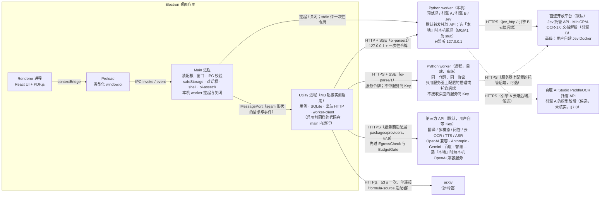

<!-- oi-split-header -->
状态：现行。规格版本仍是 v0.6。本文件是原文切片。
<!-- /oi-split-header -->
## 1. 进程拓扑

- **Renderer** 只做展示与交互：React 组件、PDF.js 渲染、裁图显示。不碰文件系统、SQLite、密钥、Python 进程、网络 API。
- **Preload** 只暴露由契约生成的类型化命令与事件订阅，不暴露 `ipcRenderer`、任意通道、`fs`、`shell`。
- **Main** 是装配根（composition root），不写业务规则。下列职责固定在 main，因为对应的 Electron 能力只在 main 提供（`safeStorage`、`dialog`、`protocol` 只在 main；`shell` 只在 main 与非沙箱 renderer；`utilityProcess` 是只带 Node.js 与 MessagePort 的子进程，stdin 只能是 `ignore`；依据 Electron 文档 `docs/api/*.md` 的 Process 标注，2026-10-30 查阅 main 分支，M1 按锁定版本复核）：
  - 窗口、菜单、preload；IPC 发送方校验与 schema 校验（§9）；
  - `SecretStore` 的唯一实现（`safeStorage`，§8.3）；
  - 系统对话框（`path-picker`）、`shell.openExternal` 与「在文件管理器中显示」（`external-opener`）；
  - `oi-asset://` 协议处理器（§9）；
  - 本机 worker 的拉起与关闭（`worker-supervisor`），一次性令牌由 main 生成、经 stdin 传给 worker。
- **Utility 进程**：可以搬出 main 的部分是用例（domain + application）、SQLite 仓储、出站 HTTP 的服务商适配层（`packages/providers`，§7.9）、`worker-client`、文件资产，以及 `.md` 文件的读取、扫描与监视。M1–M2 这些仍在 main 内装配运行；M3 起若长任务影响 main 的响应（以实测为准，阈值待定标），把这一组整体搬到 Electron `utilityProcess`，main 只转发 seam 形状的请求与事件（§2.4 的普通数据规则保证它们可以跨进程）。M1 起目录与端口就按这条边界放：可搬迁的代码只经端口使用 main 的能力（`SecretStore` 授权、`PathPicker`、`ExternalOpener`、资产路径解析），搬迁时换的是这些端口的注入方式（同进程调用改为 MessagePort 代理），不改用例，也不改适配器的业务逻辑。
- **密钥明文只在 main 的内存里。** utility 里的适配器要发带凭据的请求时，经 MessagePort 向 main 要「本次调用」的授权：main 核对目标主机与该服务商配置里登记的主机一致，再返回请求头的值；适配器只用于这一次请求，不缓存、不写日志、不放进任务记录。契约测试：同一适配器发两次请求，向 main 要两次授权；目标主机与登记不符时 main 拒绝。
- **资产**：`oi-asset://` 的处理器在 main；资产登记表在 SQLite（随用例搬到 utility）。utility 启用后，main 收到请求时经 MessagePort 用 `assetId` 换取登记的路径与允许的根目录，再自己做真实路径检查（§9）。

| 组件 | M1–M2 | utility 启用后 |
| --- | --- | --- |
| 窗口、preload、IPC 校验、`SecretStore`（`safeStorage`）、对话框、`shell`、`oi-asset://` 处理器、`worker-supervisor` | main | main（不搬） |
| 用例（全部切片的 domain + application）、SQLite 仓储、服务商适配层（`packages/providers`）、`worker-client`、文件资产、`.md` 读取 / 扫描 / 监视 | main | utility |
- **Python worker**：无状态计算服务。不写用户文献库、不决定采用版本、不持久化用户的第三方 API 密钥（本机 worker 由 main 拉起、只监听 127.0.0.1；它转发托管 API 时，面壁 API Key 等凭据由 main 按次授权，随作业请求头经回环地址传入，worker 只在内存中使用，不落盘、不进日志、不进产物。远程 worker 一律不接收桌面的服务商 Key，只用服务器上自己配置的后端，§10.1）。本机与远程运行同一份代码、同一协议（Q7）。
- **API 优先**（Wisdom 2026-10-30 18:44，§7.0；2026-11-02 本地改为第二路线）：每个由模型提供的能力，有托管 API 时默认用托管 API。面壁已经写明的能力走面壁 API。「本地」仍在设置里，与 API 同一个接口，但只留端口与 stub，M0/M1 不实现、不下载模型。
- **外发检查**（架构评审 P1-2，§7.0 第 6 条）：任何连接发出前，由 `contracts` 的 `EgressCheck` 端口按「服务商 + 能力 + 目的主机」判定能否发送。回环地址之外的主机一律算外发，包括标为「本地」但不在回环地址上的服务，以及远程 worker 本身。
- **质量评估一律经 worker**（Q9）：桌面端只通过 `oi-parse/1` 的 `evaluate` 作业请求评分，无论 Jev 在本机推理、在远程 worker 所在服务器推理，还是由 worker 转发给面壁 API / 用户 Docker 服务。桌面端没有第二条评分通路（§7.4）。

