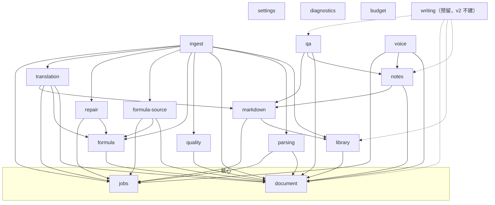

<!-- oi-split-header -->
状态：现行。规格版本仍是 v0.6。本文件是原文切片。
<!-- /oi-split-header -->
### 4.3 切片之间的依赖（允许的方向）

- 箭头表示「可以 import 对方的 `index.ts`」。图上没有的边一律禁止，CI 用 dependency-cruiser 按此矩阵检查。虚线是 `writing` 的预留边（§4.4），v2 不进 dependency-cruiser 矩阵。
- `formula-source` 依赖 `formula` 的公开核对函数（字符集、编号、可渲染性），而不是反过来：`formula` 只从 `document` 读取候选，不知道候选来自 arXiv 还是引擎。
- `ingest` 是唯一同时看得到 `library`、`parsing`、`document`、`quality`、`formula`、`formula-source`、`repair`、`translation`、`jobs` 的切片，只做编排；分支规则写在 `ingest/domain/ingest-policy.ts`。任何切片都不依赖 `ingest`。编排不放进 `jobs`（它只管任务状态机）、`document`（它不依赖任何切片）、装配根（F-02）或 UI（§2.1）。`repair` 不再依赖 `quality`：补救只产出候选，重新评分由 `ingest` 调用。
- `document` 与 `jobs` 不依赖任何其他切片。`settings`、`diagnostics`、`budget` 不被业务切片 import：业务切片通过端口拿到配置、日志器、外发检查（`contracts` 的 `EgressCheck`，§7.0 第 6 条）与预算闸门（`contracts` 的 `BudgetGate`，§7.8），由装配根注入。`packages/providers` 不是切片，只被切片的 adapters 与装配根使用（§7.9.2）。
- `markdown`（§4.5）被 `translation`、`notes`、`qa` 依赖：它们在 core 里调用 `markdown` 的 seam 把正文解析成 `MdDocument`，随自己的 seam 结果一起返回，UI 拿到的已经是解析好的普通数据。`markdown` 依赖 `library`（只用于「链接指向库内 PDF」的匹配，Markdown 文件本身不进文献库，D5）与 `jobs`（大文件夹扫描可取消）；它不依赖 `document`、`formula`：KaTeX 安全选项来自 `contracts/src/latex-policy.ts`，不经 `formula` 的 seam。
- `reader` 只有 ui 与纯 domain，不出现在图中：它通过 `window.oi` 调用其他切片的 IPC 命令，不 import 其他切片。译文块的 `MdDocument` 由 `translation.getBlocks` 返回，reader 不 import `markdown`。
- **借用多模态翻译（Q11）是装配期复用，不是依赖边**（架构评审 P1-6）：`translation` 只依赖自己的 `TranslationProvider` 端口。开关打开时，装配根把补救所用的同一个服务商绑定（`@oi/providers` 的 `ChatTransport` 与模型）也交给 `translation` 的 `llm-translation-provider`，预留记在多模态科目（§7.8，PRD AC-29）。图上没有、也不得加 `translation → repair` 的边；`translation` 不 import `repair` 的任何东西（PRD AC-78）。
- **UI 事件不是依赖边，但同样登记**（架构评审 P2-2）：切片间的 UI 事件（§5.3）在 `contracts/src/ui-events.ts` 写明每个事件的发布方与订阅方；它们不进 dependency-cruiser 矩阵，由 G5 的事件检查核对（PRD AC-82）。
- 新增一条边需要 ADR，并在同一个 PR 里更新本图与 dependency-cruiser 配置。新增 UI 事件，或给事件新增发布方、订阅方，同样需要 ADR。`ingest` 的九条边与删除 `repair → quality` 已登记为 [ADR 0002](../../docs/adr/0002-ingest-edges.md) 与 [ADR 0003](../../docs/adr/0003-repair-quality-removed.md)（§16）。

