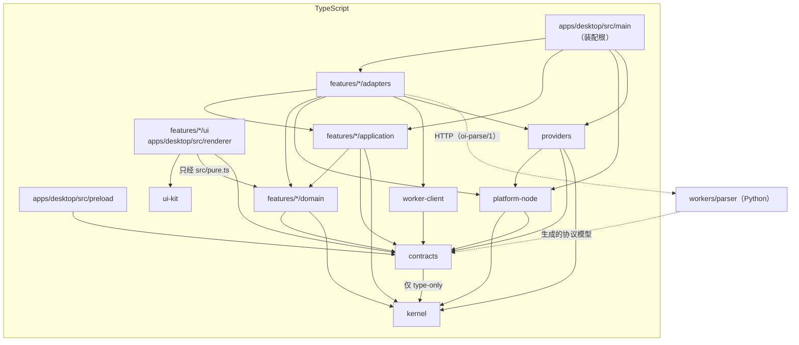

<!-- oi-split-header -->
状态：现行。规格版本仍是 v0.6。本文件是原文切片。
<!-- /oi-split-header -->
### 5.1 层间依赖图

只允许箭头方向。`contracts` 到 `kernel` 只允许 type-only import（Wisdom 2026-11-02 17:58）。反方向（例如 domain → application、application → adapters、ui → application、platform-node → features、providers → features）一律禁止。ui 到 domain 的箭头只能经过本切片的 `src/pure.ts`（§2.4），不得 import domain 内部文件。`platform-node` 可以值导入 `contracts`（Wisdom 2026-11-03 10:40）。`contracts` 仍是叶子（G5 `contracts-is-leaf` 不变），`contracts` → `kernel` 仍只允许 type-only import。

