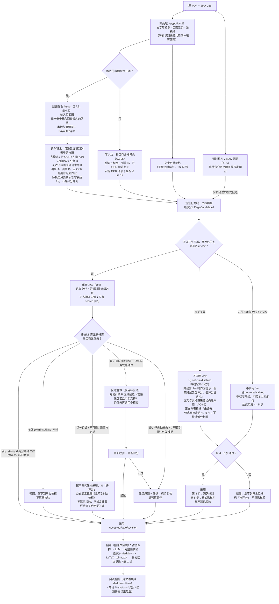

<!-- oi-split-header -->
状态：现行。规格版本仍是 v0.6。本文件是原文切片。
<!-- /oi-split-header -->
### 7.1 总体流水线

流水线约束（上游核实结论见差异清单 §2）：

- **编排归属**：上图从入库到翻译的整条流水线由 `ingest` 切片编排（§4.2、§4.3）：`ingest/domain/ingest-policy.ts` 按已保存的事实算出下一步，`open-document` / `resume-ingest` 依次调用各切片的 seam。各切片只做自己那一步，不调用下一步。
- **预算闸门**：图中每个发往外部服务商的模型调用（引擎 A 的托管 API、引擎 B 文档解析、云 OCR、Jev 评分、多模态识别与补救、翻译）发出前都经 `BudgetGate` 预留，被拒时按 §7.8 的规则处理：Jev 记 `unavailable`（原因码 `budget`）并标「待评分」，不触发补救，不改用别的服务商。

- **当前选型**（只写在 adapters 与配置里，F-13）：版面是独立的 `layout` 作业（PP-DocLayout，§7.2）。引擎 A 的识别阶段是另一次 `parse` 作业：PP-FormulaNet 系列 + PaddleOCR 兜底。阅读顺序由版面模型给出，`engines/reading_order/` 校验与兜底（§7.10）。预设「OCR+版面」与「OCR+版面+Jev」把这两次作业配在一起，不是写死的唯一路线，也不是过渡默认，更不是正式全局默认。过渡默认是 `multimodal-layout`；正式全局默认仍等 M0（§7.12，W-4）。引擎 B = MiniCPM-OCR 1.0（来源是面壁文档解析 API，见下条；「本地」用官方 SDK `minicpm-ocr`，版面后端用 `ppdoclayout3_torch`，不依赖 PaddlePaddle）；版面开着时是否调用由路线决定，版面关掉时不调用（D-E）。各能力的默认来源见 §7.0；质量评估 = MiniCPM-OCR Jev（部署见 §7.4）。按 Q1，MiniCPM-OCR 1.0 与 Jev 照用，当前锁是提交 `1269e4f`（§7.4「锁定版本」）：复核只记差异，更换须先对比并单独开 PR。权重 sha256 未核实，不填写。版本记入 `EngineCapabilities.models[]` 与每次 `ParseRun`。
- **引擎 B 的云端来源（Wisdom 2026-10-30 18:37、18:44；23:55 起是否调用由路线决定）**：引擎 B 用面壁开放平台的 MiniCPM-OCR-1.0 文档解析 API，本机 SDK 是同一接口后的「本地」选项。文档解析 API（`POST https://api.modelbest.ai/v1/document-parse`，Bearer `MODELBEST_API_KEY`，与 Jev 共用同一个面壁 Key；[文档](https://platform.modelbest.ai/console/docs/api/document-parse)，2026-10-30 查阅，页面标注更新于 2026-10-27）。「外发前询问」开着时，第一次使用前须确认数据外发（§7.0 第 6 条）；开关关闭后不再确认；可在设置中改选「本地」（PRD §3.3；验收 AC-60）。版面开着时，是否调用只看当前路线的识别列表：列表含引擎 B 才提交作业；不含则请求为 0。版面关掉时不提交引擎 B（含面壁文档解析 API 与本机 SDK）：本机 SDK 内部会跑 PP-DocLayoutV3，跑它等于悄悄把版面加回来（D-E，Wisdom 2026-10-31 11:14）。识别列表含引擎 B 且版面关着时，路线校验失败，不静默跳过（§7.12）。预设「OCR+版面」与「OCR+版面+Jev」把它用作对比；「多模态+版面」与「仅多模态」不含它（PRD AC-92 ①②）。「对比与兜底」不是全路线的不变式。AC-60 只测「来源为 API 时怎么请求」，不要求每条路线都跑 B。
  - 输入是预处理渲染好的页面图（同步接口，`image` 用 data URI），**不上传原 PDF**，所有来源仍共用同一张页面图与 `CoordinateFrame`（Q6）。
  - 请求带 `upright: false`（平台默认 `true`，会自适应旋转并把坐标改到旋转后的页面上），让坐标直接落在我们的页面图上；页面方向由预处理负责。
  - 输出的 `ocr.blocks[]`（`order`、`label`、`bbox` / `regions`，像素坐标、左上原点，相对 `image_width` / `image_height`）经 `engines/e2e_b/mapping.py` 转成候选页，与本机 SDK 走同一套映射。防御：若仍返回 `rotation.applied = true`，按 `total_angle`（逆时针为正）换回我们的页面坐标，换算不了的页不产生候选；`image_width` / `image_height` 与我们发出的图不一致时同样不产生候选。块的 `status` 不是 `ok`（`failed` / `skipped_no_vlm` / `skipped_seal`）时只保留版面框，不产生文字候选。
  - 错误处理沿用 §7.4「面壁 API」表，差别两处：413（`too_large`）表示单张图过大，没有批可拆，不重试，记 `error/too_large`；409 只出现在异步作业的幂等键冲突，v2 不用异步作业。5xx 时把响应头 `X-Request-Id` 记入诊断事件（它不是凭据）。
  - `EngineId` 仍是 `e2e-b`；`ParseRun` 记录后端（`sdk-local` / `modelbest-api`）与返回的模型名。Jev 应当运行时（评分开关为开，且路线的判定列表含 Jev）候选送评。开关关闭时记 `not-run/disabled`，标「未评分」。开关开着但路线不含 Jev 时也记 `not-run/disabled`，不送评；公式按 §7.5 第 4、5 步，通过标「格式已核对」或「源码核对」，不算已核验（§7.4，Wisdom 2026-10-31 01:14）。
  - 平台显示限时免费；长期价格**未核实**。计价不写死：按平台返回的用量记账，单价来自用户配置，否则记「未知」（PRD QM-10）。
  - 托管 API 背后的版本与流水线是否与锁定的 SDK（`1269e4f`，版面用 PP-DocLayoutV3）一致**未核实**，对比视图按「版面可能同源」标注。文档页自己声明「描述的是已实现的契约，不证明生产部署或线上连通」，真实可用性在 M6b 冒烟时确认（PRD §8 M6b）。
- **引擎 A 的版面档位（Q10）**：标准档 = PP-DocLayoutV3，M3 起步即用；基准集另跑 PP-DocLayout_plus-L 对照。plus-L 若在阅读顺序与版面指标上「明显更好」（判据待基准定标，PRD QM-13），作为「高质量档」在设置中供用户选择；否则不开放。档位是配置值，记入 `ParseRun`，切换只影响新的解析，不改已采用版本。本机 CPU 上的冷启动、单页耗时、峰值内存与是否 OOM 不是 M0 项（Wisdom 2026-11-02），不改变本条已经决定的档位（§7.12）。
- **版面同源**：B 的 SDK 固定使用 PP-DocLayoutV3，阅读顺序也来自它，而不是来自 OCR 模型。A 用标准档（V3）时，A/B 的版面判断同源，采用模型顺序时顺序也同源：对比视图必须标注「版面同源」，A/B 一致不能作为互相印证的证据。A 用高质量档（plus-L）时版面不同源；plus-L 不输出阅读顺序，这一档的顺序由 §7.10 的 XY-cut 兜底给出（来源记 `xy_cut`）。
- **页面图（Q6）**：预处理统一用 pypdfium2 渲染页面图并生成 `CoordinateFrame`；所有识别来源使用同一张图。B 以图片输入 SDK，不安装其 `pdf` extra（该 extra 依赖 PyMuPDF）。PyMuPDF 禁止引入（AGPL，与本项目 Apache-2.0 许可证政策冲突，RULES §1.5）。
- **全路径评估记录（Q1；Wisdom 2026-10-30 22:15 收窄为「都必须有评估记录」，23:55 再改口径）**：所有产出识别结果的路径——引擎 A 的识别阶段、引擎 B、云 OCR（百度、智谱等）、arXiv 源码对齐、多模态（识别与补救）、手动重新识别——产出的候选都必须有评估记录，写入候选的 `EvaluationResult`。多模态是普通识别来源：路线的识别列表含它就运行，评分开、关都一样。Jev 开启时（评分开关为开，且当前路线的判定列表含 Jev），这些候选都经过评分；有效高分并且程序核对通过，才标已核验，来源之间没有例外（§7.5 第 2 步）。评分开关为关时（即使路线含 Jev）不调用 Jev，一律记 `not-run/disabled`。正文与表格标「未评分」。公式由程序核对把关：通过标「格式已核对」，不算已核验。开关开着但路线不含 Jev 时也不调用 Jev，同样记 `not-run/disabled`；公式走 §7.5 第 4、5 步，第 5 步通过标「格式已核对」，第 4 步通过标「源码核对」，都不算已核验（Wisdom 2026-10-31 01:14），正文与表格仍标「未评分」。`quality/domain/scoring-coverage.ts` 是唯一判定处：没有评估记录的识别候选不能进入采用版本（RULES N-17）。文字层基础档的文字直接取自 PDF 文字层，不是识别结果，不在此列；但其公式区域不产生 LaTeX 候选，只显示原页裁图。
- **评估状态与界面标记（规格补充，统一 PRD AC-18、AC-84 与 `contracts/src/evaluation.ts`）**：规范状态只有 `scored`、`error`、`unavailable`、`not-run` 四种；候选在评估之前没有记录，没有记录就不能进入采用版本。界面标记由记录算出，不是状态：`error`、`unavailable`，以及分数还不能用的 `scored`（阈值未定标、`fake/`）标「待评分」，可以采用用于阅读，不算已核验、不触发补救，评分恢复后由 `reevaluate-pending` 自动补评；`not-run/disabled` 可以采用、不触发补救、不自动补评。开关关闭，或开关开着且路线不含 Jev 时：正文与表格，以及没通过程序核对的公式，标「未评分」，不算已核验。公式第 5 步通过标「格式已核对」，第 4 步通过标「源码核对」，都不算已核验（Wisdom 2026-10-31 01:14）。只有用户的「为本文评分」会重新评它，且仅当那时路线含 Jev（PRD AC-85）。补评写新记录，旧记录不改写。
- **评分分期（架构评审 P1-12）**：评分状态机（含 `not-run/disabled` 与评分开关的 core 规则）、`scoring-coverage` 与 `reevaluate-pending` 在 M3 就位，后端是假评估器（`quality/testing/`，经同一个 `evaluate` 作业返回录制或合成样例，`evaluatorVersion` 以 `fake/` 开头）。假评估器的结果永远不使候选成为「已核验」，也不触发补救（PRD AC-84）。M6a 只把后端换成真实 Jev，加上开关的设置项与提示，并做真机冒烟。
- **没有有效分数时的采用（规格补充；正文与表格，PRD AC-86）**：规则在 `document/domain/region-selection.ts`，`ingest` 把候选与评估记录作为普通数据传入。公式区域的显示决定按 §7.5，多个来源都通过核对时用本条第 3 步的同一个列表。
  1. 可信文字层（`textLayer = trusted`，§7.11）页上的正文用文字层，不被识别候选替换。
  2. 区域有已核验候选时，按（评分、来源权重）选，与 §7.5 第 2 步相同。
  3. 区域里所有候选都没有有效分数（`error`、`unavailable`、`not-run`、阈值未定标或 `fake/`）时，按来源优先级选。被选中的候选按记录标「待评分」或「未评分」，不算已核验。
     - 优先级是设置里可调的一个列表（Wisdom 2026-10-30 22:23），默认值、校验与合并只在 `document/domain/source-priority.ts` 一处，其他代码只读它给出的列表。
     - 默认顺序（规格提议，待 Wisdom 确认）：引擎 A → 引擎 B → 云 OCR（多个时按设置里的启用顺序）→ 多模态。引擎 A 是主引擎、B 是对比与兜底；云 OCR 只发区域裁片；多模态最贵，放最后。
     - 新安装与恢复默认时用默认顺序，升级保留用户的顺序；列表缺的来源按默认顺序补在末尾，未知来源忽略。arXiv 源码（只用于公式，§7.5）与可信文字层（第 1 步）不在列表里，位置固定。
     - 用户手动「重新识别」某个区域后（§7.4「评分开关」），这个区域用用户的选择，不用列表。
  4. 区域里有任何一个有效低分的候选时，按下一条「低分再补」处理，不用第 3 步。
  - 版面开着时，多模态、引擎 A 的识别、引擎 B、云 OCR 是否请求看路线的识别列表，与评分开关无关（多模态的范围见 §7.12；整页时的坐标见同节）。没有版面作业时，引擎 A 的识别、引擎 B、云 OCR 请求都为 0，不发整页；整页只走多模态。识别列表含这三项之一且版面关着时，路线校验失败，不静默跳过（§7.7、§7.12，D-E，Wisdom 2026-10-31 11:14）。每次允许发出的请求照常经 `EgressCheck` 与 `BudgetGate`（§7.0 第 6 条、§7.8）；被拒时该来源在这些区域不产生候选，其他来源照常。
  - 「采用」仍是页级操作（`adopt-policy`，PRD AC-13）；本条只决定页内每个区域用哪个候选，「对比」视图照常列出全部候选。
- **低分再补**：只有经 §7.5 优先级链或上一条选出、且有效低分（`scored` 且低于该类别、该 `evaluatorVersion` 的阈值）的区域才进入多模态补救；补救结果是新的识别候选，同样重新校验、重新评分。「明确不确定证据」（已被取代的[草案 03](../../docs/architecture/03_双引擎与质量评估_草案.md)列过公式结构校验失败、候选间实质差异等；差异清单 §3 记录了用户当时的确认）在 v2 规格里还没有定义，定义证据清单与验收之前不作为补救入口（规格补充，按最保守的读法统一 PRD S5 与 M6c）。
- **补救时序**：只有要补救的区域（有效低分，且补救开启、预算可用）受这一条约束：它的补救必须在进入采用版本**之前**完成，补救结束之前不翻译。其他区域的翻译可以与补救并行。「待评分」「未评分」的区域不补救，按当前采用的候选照常翻译，公式按显示决定写进译文（LaTeX、裁图或占位框，§8.1.1），与上图「采用 → 翻译」一致。
- **评分错误不是低分**：评分错误、未配置、未运行（含 `not-run/disabled`）、阈值未定标的区域不进入补救（PRD AC-05）。自动补救是独立设置，默认开，只对有效低分触发，并受预算闸门与外发同意约束，超预算即停（§7.8，PRD §3.3、AC-98）。评分关闭期间没有有效分数，自动补救请求为 0；这不改写自动补救开关。用户可以对单个区域手动「重新识别」，它不是补救（§7.4「评分开关」，待 Wisdom 确认）。正文与表格仍标「未评分」；公式通过程序核对时标「格式已核对」。没有有效分数时，公式按 §7.5：第 4 步通过是 arXiv「源码核对」，第 5 步通过是 `format-checked-latex`（徽标暂定「格式已核对」），否则裁图再到占位框。不论开关开或关，这两步都不标已核验（Wisdom 2026-10-31 01:14）。

