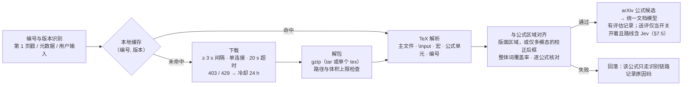

<!-- oi-split-header -->
状态：现行。规格版本仍是 v0.6。本文件是原文切片。
<!-- /oi-split-header -->
### 7.6 公式来源模块 `formula-source`（Q4）

决定：做，arXiv 源码校准公式进入 M0–M8（PRD §8：M4 交付模块，M6a 接入评分与优先级链）。v1 已有完整实现，可复用的规则与测试见 [v1 审查](../../docs/v1-review.md) §4.17。

| 子能力 | 规则（domain，纯函数） | 实现（adapters） | v1 来源（`96f1dfe`） |
| --- | --- | --- | --- |
| 编号与版本识别 | 新格式 `NNNN.NNNNN` 与旧格式 `archive/NNNNNNN`，可带 `vN`；来源优先级：第 1 页 arXiv 戳 → PDF 元数据与文件名 → 用户输入。没有版本时取最新版并标「版本未知」：对齐门槛不放松，逐公式核对决定是否采用，界面注明来源版本未确认 | — | `lib/arxiv-id.js:5-8`、`:34-49`、`:84-113` |
| 下载 | 两次请求间隔 ≥ 3 s、同一时刻单连接、超时 20 s；403 / 429 进入 24 h 冷却并持久化；离线、超时、HTTP 错误、解包失败各有原因码；不得为绕过限流使用多连接或多机 | `arxiv-http-client.ts` 经 `platform-node/http`；端点沿用 v1 的 `https://arxiv.org/src/<编号><版本>`，是否改用 arXiv 为程序访问推荐的 `export.arxiv.org` **未核实**，M4 开工前确认 | `background/arxiv-source.js:8-10`、`:17-24`、`:178`、`:237-267` |
| 缓存 | 源码缓存键 =（编号, 版本）；对齐结果另存，键 =（编号, 版本, PDF sha256, 对齐算法版本）；二次打开不下载、不重算；「只有 PDF、没有源码」也缓存，避免重复请求；清缓存不清冷却记录 | `sqlite-source-cache.ts`（表前缀 `fsrc_`）+ 文件资产 | `background/arxiv-source.js:26-33`、`:312-339`、`:378-384`；`lib/formula-arxiv-gate.js:31-45` |
| 解包 | 只接受 gzip（tar 或单个 tex）；拒绝路径穿越、绝对路径、符号链接与硬链接、设备文件；文件数 ≤ 2000、解压后 ≤ 50 MB、单个资源 ≤ 30 MB；只写缓存目录 | `node-gunzip.ts`（Node `zlib`，带解压输出上限）；tar 读取是 domain 纯函数 `tar-reader.ts`（与 v1 相同，gunzip 注入），不引入新依赖 | `lib/arxiv-src-unpack.js:18`、`:262-302` |
| TeX 解析 | 找主文件；跟随 `\input` / `\include`（只在包内、有深度上限）；数学环境与 `$…$`、`\[…\]` 抽成公式单元，带行内 / 行间、编号、所在节；导言区 `\newcommand` / `\def` 转成 KaTeX `macros`，展开次数受 `maxExpand` 限制 | — | `lib/latex-units.js:6-18`、`:40-75`、`:145-163` |
| 与版面区域对齐 | n-gram 锚点分段的词序列对齐；整体词覆盖率 < 0.85 则整篇不用源码；逐公式核对：位置（版面开着时落在版面公式区域内；仅多模态路线落在 §7.12 校正后的公式区块框内，没有这个框则位置不过）、字符集、编号、可渲染，任一不过则该公式回落 | — | `lib/source-align.js:7-13`、`:17`；`lib/formula-tiers/arxiv.js:35-75`；`lib/formula-arxiv-gate.js:18-30` |
| KaTeX 安全渲染 | `throwOnError: true`、`trust: false`、`maxSize: 20`、`maxExpand: 1000`、单个公式 ≤ 8000 字符；`\href`、`\url`、`\includegraphics`、`\html*` 一律判为不可渲染（KaTeX 在 `trust: false` 下不抛错，而是用错误色绘制，所以必须显式检查）；显示时只挂载 KaTeX 生成的 DOM，不把 HTML 字符串赋给节点 | `formula/adapters/katex-renderer.ts`（核对）与 ui-kit 的 `MathInline` / `MathBlock`（显示；`reader/ui/formula-view.tsx` 与 `MarkdownView` 都用它）共用 `contracts/src/latex-policy.ts` 的同一份选项常量（§4.5.5） | `lib/formula-katex.js:1-30`、`:40-77` |
| 回落 | 对齐失败、版本不符、超时、冷却中、解包被拒、KaTeX 不可渲染、Jev 低分：只让该公式（或整篇）回到识别链路，记录原因码；不弹错、不打断阅读 | — | `lib/formula-tiers/arxiv.js:66-75` |

- **使用条款**：arXiv API 使用条款允许为个人使用或研究检索、存储、使用 e-print 内容，禁止在自己的服务器上存储并对外提供（[Terms of Use for arXiv APIs](https://info.arxiv.org/help/api/tou.html)，2026-10-30 查阅）。因此源码只缓存在用户本机：不上传远程 worker、不进诊断包、不随导出分发；导出的 Markdown 只含采用的公式 LaTeX。
- **速率**：同一条款对旧版 API 的限制是「每三秒不超过一次请求、同一时间单连接，适用于用户控制的全部机器」。源码下载不在该条列举范围内，本项目仍按同一口径执行（v1 同为 3 s）。
- **分层**：判断「现在能不能发请求」的规则在 `domain/fetch-policy.ts`，用可注入时钟测试；网络、文件与 SQLite 属于 shell。

