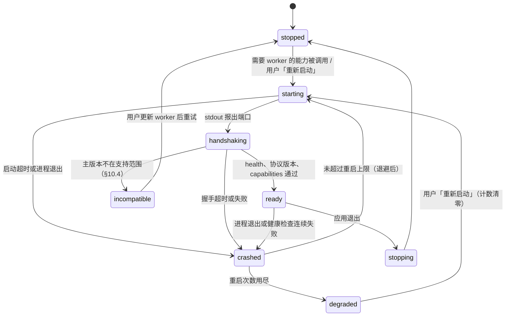

<!-- oi-split-header -->
状态：现行。规格版本仍是 v0.6。本文件是原文切片。
<!-- /oi-split-header -->
### 10.5 本机 worker 的监管状态机（架构评审 P2-6）

状态转移是纯函数 `worker-client/src/supervisor-state.ts`（Node 环境测试）；拉起进程、计时与读写 pid 文件在 main 的 `worker-supervisor.ts`。两者都不在装配根里。验收 PRD AC-81。

- **单实例。** 应用用单实例锁，一个应用实例最多一个本机 worker。pid 与启动时间写在应用数据目录的 `runtime/worker.pid`；启动时发现上次遗留、且可执行路径属于本应用 worker 的进程，先结束它再拉起。
- **令牌。** 每次进入 `starting` 都生成新的一次性令牌（§10.1），经 stdin 传给本次进程，旧令牌立即作废。
- **端口。** `worker-supervisor` 不传 `--port`，也不设置 `OI_WORKER_PORT`。这两个名字只给开发时指定端口（§10.1）。监管进程使用端口 `0`，从 stdout 读取分配到的端口。
- **崩溃与在途作业。** 进入 `crashed` 时，在途作业记为中断，由 `ingest` 从已落库的事实续跑（§4.2）；已发出的付费请求按 §7.8 结算，不自动重发不幂等的请求（PRD AC-07）。
- **退避与上限。** 重启间隔指数退避；时间窗内的重启上限与各超时是配置值，默认值随 M3 的 supervisor 实现 PR 提出。
- **降级。** `degraded` 与 `incompatible` 时，依赖本机 worker 的能力记「不可用」（原因 `worker_stopped` / `worker_incompatible`），阅读回落到文字层基础档（Q2，PRD AC-11）；界面给出「重新启动」入口。
- **退出。** 应用退出时先取消在途作业，再请求 worker 结束，超时后强制结束；退出后本机 worker 进程数为 0。
- **正常停止。** 本机 worker 收到 `SIGINT`、`SIGTERM` 或 Windows 的 `SIGBREAK` 而停止时，退出码是 0。这包括读令牌、尚未听，以及已经在听（§10.1）。监管进程把这个 0 当成正常停止，不把 130 或 143 当成正常停止的约定。

