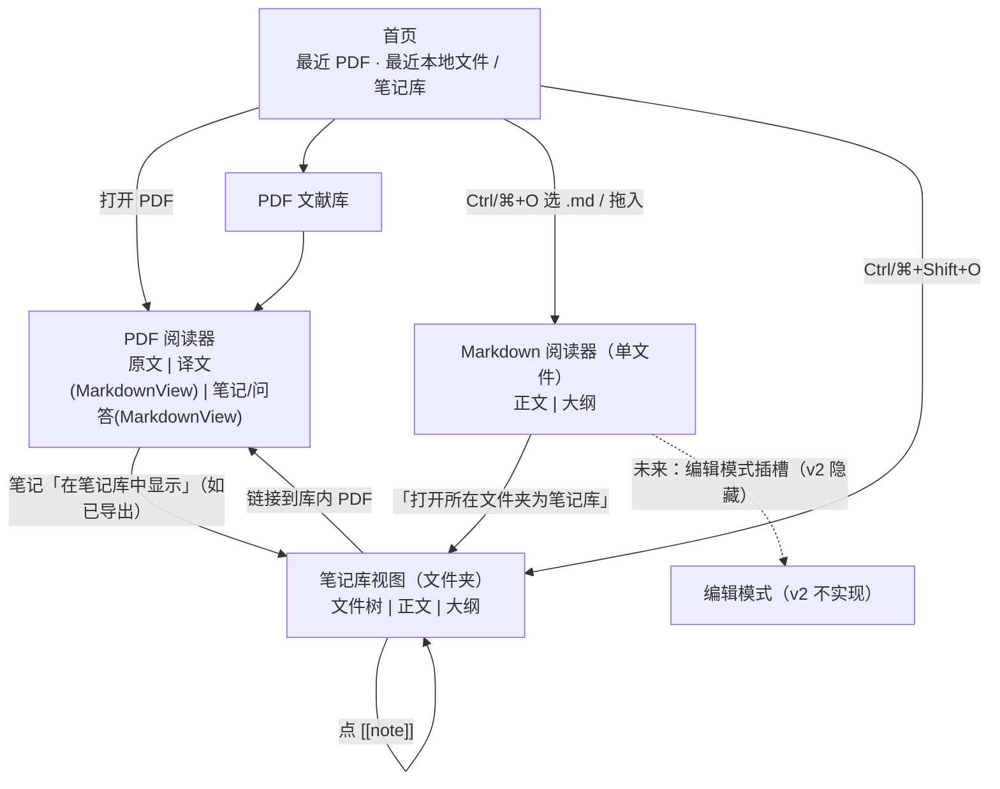

> **入库说明（Wisdom 2026-10-30 17:32 批准并入 v2 M0–M8）**
>
> - 来源：Loom 的方案草案 v0.2（上传附件 `PLAN.md`）。本说明之后的正文**逐字未改**；线框图原样放在 [wireframe-vault.svg](./wireframe-vault.svg)（正文 §4 末尾提到的 S-D 线框图）。正文由 Loom 维护，其他人不改（[RULES](../../RULES.md) N-10）。
> - 分工：布局、组件拆分、文案、空 / 错 / 加载态、Token 这类**设计细节以本文为准**；需求、验收、里程碑以 [PRD](../../PRD.md) 为准（S13、US-23–US-28、AC-30–AC-55、QM-15–QM-16、§8）；切片、seam、存储、安全以 [ARCHITECTURE](../../ARCHITECTURE.md) 为准（§4.5、§8、§9）。
> - 规格对本文做的校正（不影响 Loom 的界面设计；正文仍保留原写法以便追溯）：
>   1. **KaTeX 选项**：D2 写 `throwOnError:false`。按 Wisdom「与 formula 同一份安全选项」，规格只保留一份选项，即公式闸门用的 `throwOnError:true`，放在 `contracts/src/latex-policy.ts`。渲染组件捕获异常后显示原始 LaTeX 加错误标记，用户看到的效果与 D2 相同。§3.2 说的「core 的 `pure.ts` 导出常量 `KATEX_OPTIONS`」也改为从 `contracts` 读取。
>   2. **组件归属**：§3.2 把 `MarkdownView`、`MathInline`/`MathBlock`、`CodeBlock`、`MdImage`、`MdLink`、`BlockedHtml` 放在 `features/markdown/src/ui`。但切片 UI 不能 import 其他切片的 UI（ARCHITECTURE §2 分层表、F-05、G15），笔记、译文、问答又都要用，所以这几个共享组件放到 `packages/ui-kit/src/markdown/`。`FileTree`、`OutlinePanel`、`ReloadToast`、`EditorSlot` 和两个阅读页仍在 `features/markdown/src/ui`。
>   3. **文件适配器**：正文里说的「`platform-node` 的文件适配器」，在规格中是 `features/markdown/src/adapters/*`（用 `platform-node` 的基础能力）。`platform-node` 本身不带业务规则。
>   4. **里程碑**：「笔记 M2」改为 M5，因为 notes 切片在 M5 才建；「问答 M5/M6」定为 M5，因为 S8 在 M5；D7「M2–M3」定为 M2，因为源码区间和写入契约随 core 一起做。完整安排见 PRD §8。
>   5. **编号**：本文 §6 的 Q1–Q3 只在本文内有效，和 PRD §9 的 Q1–Q12 不是一套。规格中引用时写「Markdown 方案 D1–D7」。§5 的 MD-01–MD-26 已按编号并入 PRD，成为 AC-30–AC-55（AC 号 = 29 + MD 号；原文 MD-18 排在最后，并入时按编号排序）。
>   6. **工作量**：「推荐范围」表里的人日是 Loom 的粗估，不进规格（PRD §8 不估时间）。
>   7. **阈值**：去抖 300 ms、外部修改后 1 秒内更新、1 万个文件确认、单文件 5 MB 截断，都是 Loom 的建议值，没有实测。规格中全部标「待定标」（ARCHITECTURE §4.5.6、PRD QM-15–QM-17）。200 ms 骨架、3 秒提示这类界面节奏属于设计细节，留在本文。
>   8. **谁调用解析**：§2 主路径 0 写的「translation core 返回已存储的 Markdown → `markdown.render` → `MarkdownView`」，规格中改为 `translation.getBlocks` 在 core 里经 `markdown` 的 seam 解析，随结果返回每块的 `MdDocument`；笔记、问答同理。其他切片的 UI 不调用 Markdown 解析，reader 也不依赖 `markdown`（ARCHITECTURE §4.3、§4.5.4）。
>   9. **契约补充**：公式节点加 `blocked` 字段；失效链接原因加 `unsupported_scheme`；`openVault` 改为返回 `jobId`（扫描是长任务），树另用 `getVaultTree` 取；新增 `openExternal`、`revealInFolder` 两条命令；`StoredTranslationBlock` 补 `revisionId`、`targetLang`（ARCHITECTURE §4.5.3、§8.1.1）。
>   10. **调研表**：Logseq 与 VS Code 两栏有一部分来自已有的产品知识（正文已注明）。其他条目虽然附了来源，本 PR 也没有逐条复核，规格里一律视为「未核实」（[v2-gap-and-changes](../v2-gap-and-changes.md) §7）。

---

# Open Immerse v2 · Markdown 阅读（渲染 / 单文件 / 文件夹）设计计划 · 草案

作者：Loom（UI 设计）｜日期：2026-10-30（Asia/Shanghai）｜状态：草案 v0.2；第 6 节三项已由 Wisdom 于 2026-10-30 17:27 决定并并入正文
依据：`wisdom-km/open-immerse-v2` 分支 `feature/v2-specs` 提交 `e8b60da`（PRD / ARCHITECTURE / RULES v0.2）。本文只读仓库，未改任何文件。
范围（Wisdom 2026-10-30 批准并入 M0–M8）：
1. 笔记、译文、AI 回答内渲染 Markdown + LaTeX；
2. 打开单个本地 `.md` 阅读；
3. 打开整个 `.md` 文件夹（类 Obsidian vault）。

---

## 0 原则对齐说明

**为什么做**：v2 的核心承诺是「公式不走样、可追溯」（PRD §1）。目前公式只在 PDF 译文里受保护，但笔记导出就是 Markdown（S7），AI 回答（S8）和 arXiv 源码（S4）也都是 LaTeX，用户自己的读书笔记多半放在 Obsidian 这类 Markdown 文件夹里。只要有一处把 `$\alpha$` 显示成原始字符，前面守住的公式就白费了。

**目的**：让同一套「Markdown + 公式」渲染出现在应用里所有显示文字的地方，并让用户不离开应用就能读自己的 `.md` 笔记和笔记库。**不做第二个 Obsidian**：v2 只读，编辑、反链图谱、插件都不做。

**遵循的系统约定**：
- **UI–core 解耦（ARCHITECTURE §2.1、RULES §8）**：Markdown 解析、wikilink / 相对路径解析、文件监视与去抖、路径越界与安全校验、LaTeX 的安全白名单，全部写在 core（新切片 `markdown` 的 domain / application，加 `platform-node` 的文件适配器）。renderer 只拿到**结构化克隆安全的普通数据**（第 3.3 节）把它画出来，不读文件系统、不自己解析链接。
- **Electron 安全**：renderer 不碰 `fs`；图片只传 `assetId`，经已有资产协议取（ARCHITECTURE §2.4 第 4 条），不给 renderer 用 `file://`。
- **桌面平台约定**：用「文件 → 打开文件… / 打开文件夹…」菜单，快捷键 Ctrl/⌘+O、Ctrl/⌘+Shift+O；支持把文件拖进窗口；最近打开列表；侧栏文件树 + 正文 + 大纲，跟 VS Code、Typora、Obsidian 用户的习惯一致。
- **许可证（RULES §1.5）**：候选库 markdown-it（MIT）或 micromark / remark（MIT）、KaTeX（MIT）、chokidar（MIT）或 Node `fs.watch`、Shiki（MIT）或 highlight.js（BSD-3）都在白名单内；MathJax 是 Apache-2.0，也可以用。
- **视觉**：DESIGN.md 还没交付，本文所有颜色、字号、间距都标为「待审批」，只定结构。

## 1 决策摘要

| # | 决策 | 理由 |
| --- | --- | --- |
| D1 | 一个共享渲染组件 `MarkdownView`：吃 core 给的 `MdDocument`（块级 AST，普通数据），用在笔记、译文、问答、`.md` 阅读器四处 | 一套规则，四处表现一致；改样式只改一个组件 |
| D2 | 公式统一用 **KaTeX**（**已定 Q1**），选项 `trust:false`、`throwOnError:false`、`maxExpand`/`maxSize` 设上限；渲染失败时显示**原始 LaTeX 加错误标记**，不能留空白 | 与 v1 和 formula-source 的「KaTeX 闸门」（v2-gap §0 第 10 条）保持同一引擎；KaTeX 速度快、可以同步渲染；官方文档有不可信输入的安全指引 |
| D3 | `.md` 阅读器 v2 **只读**；文件在外部被改后自动重新加载（文件是只读的，没有冲突可言），保留滚动位置 | 避免做编辑器的成本；Zettlr 3.0 起默认「总是载入外部修改」，Typora 也自动刷新文件树 |
| D4 | 文件夹即「笔记库」：左侧文件树，支持 `[[wikilink]]`、`![[embed]]` 图片、`[[x#标题]]`；链接解析在 core 完成，交给 UI 时已经是解析好的目标 ID | 兼容 Obsidian 用户已有的 vault，又不用 renderer 去扫磁盘 |
| D5 | Markdown 文件**不进 PDF 文献库**，是独立入口；只链接到库内 PDF（**已定 Q2**） | 文献库按 PDF SHA-256 管理（S6），塞进 md 会把模型搞乱 |
| D6 | **译文按区块结构化存储，正文字段为 Markdown**（Q2 补充，Wisdom 2026-10-30 17:27；17:32 修订）：不存成一个整篇 .md，而是每个原文区块一条记录——原文区块 ID（对照与滚动同步）、译文 Markdown 文本（公式保留为 `$…$`/`$$…$$`）、模型、版本、校验结果、状态（成功 / 失败 / 重译中）。显示时逐块经 `markdown.render` → `MarkdownView`。整篇「导出译文为 .md」属低频，延后到 v2 之后 | 区块级记录才能左右对照、点击互跳、单块重译和缓存；Markdown 字段让译文与笔记共用同一渲染器；公式占位校验仍在 translation core，**通过后**才把占位符还原为 LaTeX |
| D7 | **v2 只读，但预留编辑接口**（**已定 Q3**）：文档模型带源码区间（可往返）；seam 中设计 `markdown.writeFile` 的契约类型但不实现、不注册；写文件能力由 core 端口 `MdFileWriter` 控制，v2 装配根不注入；UI 预留编辑模式插槽 | 后续做编辑不用改 seam 形状，也不用重写阅读器 |

## 调研结论

调研时间 2026-10-30。

| 维度 | Obsidian | Typora | Logseq | VS Code 预览 | Zettlr | **本项目取舍** |
| --- | --- | --- | --- | --- | --- | --- |
| 文件树 | vault 根下的文件树，可排除文件 | 文件树 / 文件列表 / 大纲三种侧栏，只显示支持的格式 | 以页面 / 日记为主，文件树弱 | Explorer，全部文件 | 文件夹树、文件列表、二者合并三种模式；可显示 YAML title 或 H1 作为名字 | 文件树（只显示 .md 和目录，可切换显示附件），名字显示可选「文件名 / 标题」 |
| wikilink `[[ ]]` | 原生支持，也有 `[[x#标题]]`、`[[x#^块]]`、别名 `\|`；重命名时自动改链接 | 不支持（只有标准链接） | 原生支持 `[[page]]` 与块引用 | 不原生支持，靠扩展 | 支持 `[[ ]]`，按文件名或 ID 链接 | 支持 `[[x]]`、`[[x\|别名]]`、`[[x#标题]]`；块引用 `^id` 延后；不改写文件 |
| 嵌入图片 | `![[img.png]]`、`![[x.pdf#page=3]]`、嵌入笔记 | 标准 ``，相对路径 | 支持 | 标准语法，相对路径 | 标准语法 | 标准语法和 `![[img]]` 都支持；嵌入笔记 / PDF 延后 |
| LaTeX | MathJax，`$…$` / `$$…$$` | MathJax（v4），可自动编号 | KaTeX | KaTeX（内置） | KaTeX | KaTeX，与 formula-source 共用 |
| 代码块 | 语法高亮 | 高亮 + Mermaid | 高亮 | 高亮 | 高亮 | 高亮 + 复制按钮；Mermaid 延后 |
| 只读 / 编辑 | 编辑 + 阅读视图 | 所见即所得，有只读模式 | 大纲编辑 | 源码编辑 + 旁边预览 | 编辑器 | **只读** |
| 外部修改 | 自动同步 | 自动监视文件夹，必要时手动刷新 | 监视并重新解析 | 预览随文件更新 | 设置项「总是载入外部修改」，3.0 起默认开 | core 监视，去抖后推送 `changed` 事件；当前文件自动重载并保持位置 |
| 与 PDF / 笔记的关系 | PDF 是 vault 里的附件，可嵌入 | 无 | 内置 PDF 标注 | 无 | 引用管理（Zotero / CSL） | md 可链接到库内 PDF（按路径或 SHA 匹配）；应用内笔记可「在笔记库中显示」导出文件 |

来源：
- Obsidian：[Internal links](https://obsidian.md/help/links)、[Embed files](https://obsidian.md/help/embeds)、[Advanced formatting syntax（MathJax）](https://obsidian.md/help/advanced-syntax)、[论坛：KaTeX 选项不可配](https://forum.obsidian.md/t/setting-options-for-katex-rendering/75190)
- Typora：[File Management（侧栏、监视、刷新）](https://support.typora.io/File-Management/)、[Math（MathJax、编号）](https://support.typora.io/Math/)、[Stable releases（只读模式、外部重载修复）](https://www.typora.io/releases/stable.html)
- Logseq：[Logseq 文档](https://docs.logseq.com/)
- VS Code：[Markdown and VS Code（预览、KaTeX 公式、链接校验）](https://code.visualstudio.com/docs/languages/markdown)
- Zettlr：[Settings（显示模式、外部修改）](https://docs.zettlr.com/en/reference/settings/)、[Discussion #4488 「load remote changes」](https://github.com/Zettlr/Zettlr/discussions/4488)
- KaTeX：[Handling untrusted input / Security](https://katex.org/docs/security)、[Options](https://katex.org/docs/options)
- 说明：Logseq 与 VS Code 一栏有部分来自已有的产品知识，本次只核实了主文档入口；实现前应逐条复核。

## 功能分类

| 类别 | 功能 | 放在哪 | 原则理由（目的 / 用户在哪找 / 平台约定） |
| --- | --- | --- | --- |
| **主路径** | 笔记、译文、AI 回答里的 Markdown + 公式 | 原位，内联渲染 | 目的是公式不走样；用户本来就在这些地方读；不需要额外操作 |
| 主路径 | 打开 .md 文件 | 「文件」菜单、Ctrl/⌘+O（与 PDF 共用，按扩展名分流）、拖入窗口、首页「打开」 | 桌面应用打开文件的标准位置；一个入口比两个好记 |
| 主路径 | 打开文件夹 | 「文件 → 打开文件夹…」Ctrl/⌘+Shift+O；首页「本地笔记库」区 | VS Code / Typora 约定 |
| 主路径 | 文件树 + 正文阅读 + 大纲 | 左栏树 / 中间正文 / 右栏大纲（可收起） | 三栏布局与 PDF 阅读器一致，减少学习成本 |
| 主路径 | 点 `[[链接]]` 跳转、返回 | 正文内；后退 / 前进 Alt+←/→ | 浏览器式导航是通用习惯 |
| **支持** | 最近打开的文件 / 文件夹 | 首页列表、「文件 → 最近打开」 | 平台约定 |
| 支持 | 文件夹内搜索文件名 | 文件树顶部过滤框、Ctrl/⌘+P 快速打开 | VS Code / Obsidian 约定 |
| 支持 | 代码块复制 | 代码块右上角悬停出现 | 只在需要时出现，不干扰阅读 |
| 支持 | 字号 / 主题跟随阅读器设置 | 共用阅读器设置 | 一处设置全局生效 |
| 支持 | 公式右键「复制 LaTeX」 | 公式上的右键菜单 | 跟 PDF 译文里的公式操作一致 |
| **低频** | 显示名称用标题而非文件名、显示隐藏文件 / 附件 | 文件树「…」菜单 | 很少改，收进菜单 |
| 低频 | 在系统文件管理器中显示、用默认应用打开 | 文件右键菜单 | 平台约定（Finder / 资源管理器） |
| 低频 | 失效链接列表 | 大纲面板底部折叠区 | 只有整理笔记库时才需要 |
| **危险** | 打开文件里的外部 http 链接 | 点击后弹确认框，显示完整 URL，然后交给系统浏览器 | 防钓鱼；Electron 安全建议外链不在应用内打开 |
| 危险 | 原始 HTML / `<script>` / `<iframe>` | **不渲染**，按文字显示并标「已屏蔽 HTML」 | 本地文件可能不可信；renderer 不能执行任意内容 |
| 危险 | 指向文件夹外的路径（`../../`、绝对路径、符号链接） | core 拒绝，UI 显示「链接超出笔记库」 | 防路径穿越 |
| 危险 | 打开很大的文件夹（如整个用户目录、> 1 万文件） | 打开前由 core 计数，超过阈值给出确认框 | 防止卡死和误扫 |
| 危险 | 删除 / 重命名 / 写文件 | v2 **不提供** | 只读，避免损坏用户数据 |

## 推荐范围

| 档 | 内容 | 粗估工作量（人日，含 core 测试） | 里程碑建议 |
| --- | --- | --- | --- |
| **v2 必做** | `markdown` core：解析为 `MdDocument`、KaTeX 安全参数、HTML 屏蔽 | 4 | M2 |
| 必做 | 共享 `MarkdownView` 组件，接入笔记 / 译文 / 问答（问答流式时按块增量渲染） | 4 | M2（笔记）、M4（译文）、M5/M6（问答，按 S8 所在里程碑） |
| 必做 | 打开单个 .md：菜单、拖入、最近打开、相对路径图片、外部修改自动重载 | 3 | M2 |
| 必做 | 打开文件夹：文件树、过滤、wikilink / 标题链接解析、`![[img]]`、失效链接标记、监视、前进后退、大纲 | 7 | M3 |
| 必做 | 安全：路径越界、外链确认、大文件夹阈值、大文件（> 5 MB）截断提示 | 2 | 随上面 |
| **可延后** | 全文搜索、反向链接面板、块引用 `^id`、嵌入笔记 / 嵌入 PDF 页、Mermaid、front-matter 属性面板、标签 | 各 2–5 | v2 之后 |
| 可延后 | 整篇「导出译文为 .md」（由区块拼接） | 1–2 | v2 之后 |
| 可延后 | 编辑 / 保存（接口已预留，实现另立项）、关系图谱、Obsidian 插件语法（callout 可以先按引用块显示） | 10+ | 另立项 |

| 必做（新增，D6） | 译文区块记录：字段与状态转移、占位还原、HTML 转义、右栏逐块接入 MarkdownView 与滚动同步对齐（整篇导出不做） | 3 | M4 |
| 必做（新增，D7） | 源码区间 + 往返序列化与属性测试；写入契约类型、能力查询、`write_disabled` 用例、`EditorSlot` | 3 | M2–M3 |

合计必做约 **26 人日**（原 20 + 译文 Markdown 3 + 编辑预留 3）。编辑器本身仍在 v2 之外。

## 2 页面地图 / 用户路径



主路径：
0. **读译文**：PDF 阅读器右栏 → translation core 返回已存储的 Markdown → `markdown.render` → `MarkdownView`（与笔记同一组件）。
1. **读笔记里的公式**：PDF 阅读器 → 笔记面板 → 公式直接渲染（无操作）。
2. **读一个 .md**：Ctrl/⌘+O → 选文件 → Markdown 阅读器（标签页）。
3. **读笔记库**：Ctrl/⌘+Shift+O → 选文件夹 → 文件树（默认打开 `README.md` / `index.md`，没有就显示空态）→ 点文件 → 点 `[[链接]]` → Alt+← 返回。

## 3 Token 与组件表（草案，结构优先）

### 3.1 Token（**视觉值全部待审批**，以 DESIGN.md 为准）

| Token | 用途 | 值 |
| --- | --- | --- |
| `md.font.body` / `md.font.code` / `md.font.math-scale` | 正文 / 代码 / 公式相对字号 | 待审批 |
| `md.measure.max` | 正文最大行宽 | 待审批（建议 70–80 字符量级） |
| `md.space.block` | 块间距 | 待审批 |
| `md.color.link` / `link-broken` / `link-external` | 三种链接状态 | 待审批（失效链接必须能不靠颜色区分，加虚线或图标） |
| `md.color.math-error-bg` | 公式渲染失败 | 待审批 |
| `md.color.code-bg` | 代码块底色 | 待审批 |
| `tree.indent` / `tree.row-height` | 文件树 | 待审批 |
| `layout.sidebar.width` / `outline.width` | 侧栏宽度（可拖） | 待审批 |

### 3.2 组件

| 组件 | 所属 | 输入（只来自 seam 数据） | 说明 |
| --- | --- | --- | --- |
| `MarkdownView` | `features/markdown/src/ui` | `MdDocument`、`onLink(target)` | 遍历块渲染；不解析字符串 |
| `MathInline` / `MathBlock` | ui-kit 或 markdown/ui | `{ tex, display }` | 调 KaTeX 渲染；参数由 core 的 `pure.ts` 导出常量 `KATEX_OPTIONS` |
| `CodeBlock` | markdown/ui | `{ lang, code }` | 高亮 + 复制 |
| `MdImage` | markdown/ui | `{ assetId \| null, alt, reason }` | 没有 assetId 时显示占位 + 原因 |
| `MdLink` | markdown/ui | `ResolvedLink` | 内部 / 外部 / 失效 / 越界 四种状态 |
| `BlockedHtml` | markdown/ui | `{ raw }` | 显示「已屏蔽 HTML」可展开看源码 |
| `FileTree` | markdown/ui | `VaultTree` | 虚拟列表；只显示数据，不排序（排序在 core） |
| `OutlinePanel` | markdown/ui | `MdHeading[]` + `brokenLinks` | 点标题滚动 |
| `ReloadToast` | markdown/ui | `MdFileEvent` | 「文件已在外部更新」，非阻塞 |
| `EditorSlot` | markdown/ui | `MdCapabilities` | 阅读器正文区的插槽；`canWrite:false` 时渲染为空（v2 永远为空） |
| `OpenTargetDialog` | app shell | — | 系统对话框，由 main 弹出，renderer 只发命令 |

### 3.3 Seam 数据形状（core ↔ UI，全部可结构化克隆）

```ts
// packages/contracts/src/ipc/markdown.ts（拟议）
type Result<T> = { ok: true; value: T } | { ok: false; error: MdError };
type MdError = { code:
  'not_found' | 'not_markdown' | 'too_large' | 'outside_vault' |
  'permission_denied' | 'vault_too_big' | 'decode_failed'; message: string; path?: string };

type VaultId = string; type FileId = string;            // core 生成的不透明 ID，不暴露绝对路径给业务分支
type MdSource = { kind: 'file'; fileId: FileId } | { kind: 'vault'; vaultId: VaultId; fileId: FileId };

// 文档：块级 AST，叶子是纯文本，不含 HTML 字符串
type MdDocument = {
  fileId: FileId | null;                 // 笔记 / 译文 / 回答渲染时为 null
  title: string; revision: string;       // revision = 内容哈希，用于重载判断
  blocks: MdBlock[]; headings: MdHeading[];
  links: ResolvedLink[];                 // 与 inline 中 linkIndex 对应
  truncated: boolean;                    // 超过大小上限时为 true
};
type MdBlock =
  | { t: 'heading'; level: 1|2|3|4|5|6; id: string; inline: MdInline[] }
  | { t: 'paragraph'; inline: MdInline[] }
  | { t: 'list'; ordered: boolean; start?: number; items: { checked?: boolean; blocks: MdBlock[] }[] }
  | { t: 'quote'; blocks: MdBlock[]; callout?: string }
  | { t: 'code'; lang: string | null; code: string }
  | { t: 'math'; tex: string }
  | { t: 'table'; align: ('l'|'c'|'r'|null)[]; head: MdInline[][]; rows: MdInline[][][] }
  | { t: 'image'; image: MdImageRef }
  | { t: 'hr' }
  | { t: 'html_blocked'; raw: string };
type MdInline =
  | { t: 'text'; v: string } | { t: 'em' | 'strong' | 'del'; c: MdInline[] }
  | { t: 'code'; v: string } | { t: 'math'; tex: string }
  | { t: 'link'; linkIndex: number; c: MdInline[] }
  | { t: 'image'; image: MdImageRef } | { t: 'br' }
  | { t: 'citation'; anchor: string }    // 问答引用，沿用 S8 的 Citation 锚点
  | { t: 'html_blocked'; raw: string };
type MdHeading = { id: string; level: number; text: string };
type MdImageRef = { alt: string; assetId: string | null;
  reason?: 'missing' | 'outside_vault' | 'remote_blocked' | 'unsupported' };
type ResolvedLink =
  | { kind: 'note'; fileId: FileId; headingId?: string; raw: string }
  | { kind: 'pdf'; documentId: string; page?: number; raw: string }  // 命中 PDF 文献库
  | { kind: 'external'; url: string; raw: string }                    // http/https/mailto，需确认
  | { kind: 'anchor'; headingId: string; raw: string }
  | { kind: 'broken'; raw: string; reason: 'not_found' | 'ambiguous' | 'outside_vault' };

type VaultTree = { vaultId: VaultId; name: string; root: TreeNode; fileCount: number };
type TreeNode = { id: FileId; name: string; displayTitle: string; kind: 'dir' | 'md' | 'asset'; children?: TreeNode[] };
type MdFileEvent = { vaultId?: VaultId; fileId: FileId;
  change: 'modified' | 'deleted' | 'renamed' | 'created'; revision?: string };
```

命令（每条命令一个方法，返回 `Result`）：

| 命令 | 输入 | 输出 | core 规则 |
| --- | --- | --- | --- |
| `markdown.render` | `{ text: string, context: 'note'\|'translation'\|'answer' }` | `MdDocument` | 解析、HTML 屏蔽、公式抽取；纯函数，也从 `pure.ts` 导出供同步使用 |
| `markdown.openFile` | `{}`（main 弹对话框）或 `{ recentId }` | `{ source: MdSource, doc: MdDocument }` | 扩展名、大小、编码检测 |
| `markdown.openVault` | `{}` 或 `{ recentId }`, `confirmLarge?: boolean` | `VaultTree` | 计数阈值、忽略 `.git`/`.obsidian`/`node_modules`、排序 |
| `markdown.readFile` | `{ source: MdSource }` | `MdDocument` | 链接解析（同名多个时最短路径优先，否则 `ambiguous`）、越界检查 |
| `markdown.listRecent` | `{}` | `{ id, kind, name, lastOpenedAt }[]` | — |
| `markdown.close` | `{ vaultId \| fileId }` | `void` | 停止监视 |
| `markdown.getCapabilities` | `{}` | `MdCapabilities` | v2 恒为 `canWrite:false` |
| （预留）`markdown.writeFile` | `WriteFileInput` | `WriteFileResult` | v2 不注册；见 3.3.3 |
| 事件 `markdown.onFileEvent` | — | `MdFileEvent` | 去抖 300 ms（待定标）、合并重命名 |

#### 3.3.1 源码区间（为将来编辑预留，v2 就要产出）

每个 `MdBlock` 与 `MdInline` 增加可选字段 `src?: { start: number; end: number }`（UTF-16 偏移，相对 `MdDocument.revision` 对应的原文）。core 保证：`serialize(parse(text)) === text`（往返不变，core 属性测试），并从 `pure.ts` 导出 `sliceSource(text, src)`。v2 UI 不使用 `src`，只透传。

#### 3.3.2 译文区块记录（D6，2026-10-30 17:32 修订）

```ts
// translation 切片（拟议，归 translation core）；一条记录 = 一个原文区块的一个译文版本
type StoredTranslationBlock = {
  sourceBlockId: string;                 // 原文区块 ID：左右对照、点击互跳、滚动同步的对齐键
  documentId: string;
  markdown: string | null;               // 译文正文，Markdown + $…$/$$…$$；status≠'success' 时可为 null
  formatVersion: 'oi-md/1';              // 方言：CommonMark + GFM 表格/删除线 + $ 公式；不含 HTML、wikilink
  model: { providerId: string; modelId: string };
  version: number;                       // 同一区块的译文版本号，重译 +1；采用哪个版本由 core 决定
  cacheKey: string;
  check: { result: 'passed' | 'failed' | 'not_run'; codes: string[] };  // 占位 / 完整性校验，codes 为错误码
  status: 'success' | 'failed' | 'retranslating';
  updatedAt: string;                     // ISO 8601
};
// reader 取译文：translation.getBlocks({ documentId, sourceBlockIds? }) → StoredTranslationBlock[]
//   → 每块 markdown.render({ text: markdown, context:'translation' }) → MarkdownView
// 状态变化：事件 translation.onBlockChanged → { sourceBlockId, status, version }
```
规则（全在 core）：模型输出先过占位校验，通过后把占位符还原为 `$…$` 写入 `markdown` 并置 `success`；失败置 `failed`、`markdown` 不写入；重译时旧的成功版本继续显示，新版本 `retranslating`；译文中模型生成的 HTML 被转义。状态转移只在 core。v2 不提供整篇导出（低频，延后）；将来导出时由 core 按阅读顺序拼接各块 `markdown`。

#### 3.3.3 预留的写入接口（v2 只定义类型，不实现）

```ts
// contracts/src/ipc/markdown.ts —— 类型存在、有契约测试；v2 preload 不暴露、main 不注册处理器
type MdEdit = { src: { start: number; end: number }; insert: string };
type WriteFileInput = {
  source: MdSource;
  baseRevision: string;                  // 乐观并发：与磁盘 revision 不一致则拒绝
  edits: MdEdit[];                       // 基于源码区间的文本补丁，非整文件覆盖
};
type WriteFileResult = Result<{ revision: string; doc: MdDocument }>;
// 新增错误码（v2 只返回第一个）
type MdWriteErrorCode = 'write_disabled' | 'revision_conflict' | 'outside_vault' | 'read_only_fs';

// core 端口（application/ports）
interface MdFileWriter { write(path: string, text: string, signal: AbortSignal): Promise<Result<void>> }
type MdCapabilities = { canWrite: boolean };   // markdown.getCapabilities；v2 恒为 { canWrite:false }
```

**v2 必须不做**：不在 preload 暴露 `writeFile`；装配根不注入 `MdFileWriter`（用例收到写请求返回 `write_disabled`）；`platform-node` 不为 markdown 实现写入适配器；UI 不显示「编辑」按钮或快捷键；任何代码不得以「保存译文」「导出」等名义写入用户笔记库文件夹（应用自有数据目录除外）。

UI 不得：拼路径、判断链接是否存在、决定是否重载、读取 front-matter。缺字段时按 RULES §8.1 第 3 条先停下提 seam PR。

## 4 逐屏规格草案

### 4.1 S-A 内联 Markdown（笔记 / 译文 / 问答）
- **目的**：在原位把文字和公式按作者意图显示出来。
- **布局分区**：沿用宿主面板；`MarkdownView` 填满内容区，行宽受 `md.measure.max` 限制。
- **组件**：MarkdownView、MathInline/Block、CodeBlock、MdLink（问答里的 citation 沿用 S8 的引用组件）。
- **译文栏（PDF 阅读器右栏）**：按 `sourceBlockId` 与左侧原文区块一一对齐，点击互跳、滚动同步以该 ID 为键。每块是一个 `MarkdownView`；块状态：`success` 正常显示；`failed` 显示原文 + 「翻译未通过校验」标记 + 次按钮「重译」；`retranslating` 继续显示上一成功版本并加加载指示（无旧版本时显示骨架）。块的悬停菜单（低频）：模型、版本、校验结果。没有「导出整篇」按钮。
- **空态**：宿主面板负责（如「还没有笔记」）。**错态**：单个公式失败显示原始 LaTeX + 错误底色 + 悬停说明，不影响整段；整段解析失败退回纯文本。**加载**：问答流式时，未闭合的 `$$` 块先按代码样式显示原文，闭合后再渲染，避免闪烁。
- **按钮层级**：无主按钮；次级：公式右键「复制 LaTeX」、代码「复制」。

### 4.2 S-B 首页「打开」区
- **目的**：让用户一步打开 PDF、.md 或文件夹。
- **布局**：首页顶部操作行 + 下方「最近」列表（PDF 与本地 Markdown 分两组）。
- **组件**：主按钮「打开文件…」，次按钮「打开文件夹…」，最近列表项（图标区分文件 / 笔记库）。
- **空态**：「把 PDF 或 .md 文件拖到这里」。**错态**：最近项已不存在 → 行内灰显 +「从列表移除」。**加载**：无。
- **按钮层级**：主「打开文件…」＞次「打开文件夹…」＞文字链接「从列表移除」。

### 4.3 S-C Markdown 阅读器（单文件）
- **目的**：安静地读一个 .md 文件。
- **布局**：标签页标题栏（文件名 + 「只读」标记）｜正文｜右侧大纲（可收）。
- **组件**：MarkdownView、OutlinePanel、ReloadToast、面包屑（路径，可复制）。
- **空态**：空文件 →「此文件没有内容」。**错态**：`not_found`/`permission_denied`/`decode_failed`/`too_large`（显示前 N KB 并提示截断）。**加载**：> 200 ms 显示骨架。外部修改：自动重载，保持滚动，右下角轻提示 3 秒；文件被删除 → 顶部横幅「文件已被移动或删除」，保留最后内容。
- **编辑预留**：标题栏右侧和正文区各留 `EditorSlot`；v2 只显示「只读」标记，不出现编辑入口。
- **按钮层级**：次级「打开所在文件夹为笔记库」；低频「在文件管理器中显示」放 ⋯ 菜单。

### 4.4 S-D 笔记库视图（文件夹）
- **目的**：像在 Obsidian 里一样浏览、跳转自己的笔记库，但只读。
- **布局**：左 文件树（顶部：库名 + 过滤框 + ⋯）｜中 正文（顶部：后退 / 前进 + 面包屑）｜右 大纲 + 失效链接折叠区。
- **组件**：FileTree、MarkdownView、OutlinePanel、ReloadToast、确认框（外链 / 大文件夹）。
- **空态**：库里没有 .md →「这个文件夹里没有 Markdown 文件」+ 次按钮「换个文件夹」；未选文件 →「从左侧选择一篇笔记」。**错态**：`vault_too_big` → 确认框「约 N 个文件，继续？」（主：继续，次：取消）；链接失效 → 虚线 + 图标，点击显示「找不到 xxx」；`ambiguous` → 列出候选让用户选；`outside_vault` → 不跳转并说明。**加载**：扫描时文件树显示进度「已找到 N 个文件」，可以取消（经 `jobs.cancel`）。
- **按钮层级**：本屏无常驻主按钮（阅读为主）；次：后退 / 前进；低频：⋯ 菜单（显示名称方式、显示附件、刷新、关闭笔记库）。

### 4.5 S-E 外链确认框
- **目的**：防止用户被本地文件里的链接带去意外网址。
- **内容**：完整 URL（域名加粗）；主按钮「在浏览器中打开」，次按钮「复制链接」，取消。勾选「本次会话不再询问此域名」（低频）。

线框图：`wireframe-vault.svg`（S-D）。

## 5 验收清单（草案）

| ID | 验收标准 |
| --- | --- |
| MD-01 | 笔记、译文、问答回答中 `$…$` 和 `$$…$$` 均渲染为公式；同一 LaTeX 在三处与 .md 阅读器中输出一致（core 快照测试） |
| MD-02 | 非法 LaTeX 显示原文 + 错误标记，同段其他内容正常；不出现空白 |
| MD-03 | KaTeX 以 `trust:false` 运行，`\href{javascript:…}`、`\url`、`\includegraphics` 不产生可执行链接（core 测试 + 一条 e2e） |
| MD-04 | `<script>`、`<iframe>`、`on*` 属性等原始 HTML 一律变为 `html_blocked`，renderer 中 0 处 `dangerouslySetInnerHTML` 接收来自文件的字符串（lint 检查） |
| MD-05 | Ctrl/⌘+O 选 .md、拖入 .md、最近列表三种方式都能打开；非 .md 返回 `not_markdown` |
| MD-06 | 相对路径图片与 `![[img.png]]` 经 `assetId` 显示；renderer 中没有 `file://` |
| MD-07 | 外部修改已打开文件后 1 秒内（待定标）自动更新，滚动位置偏差不超过一屏；删除后显示横幅 |
| MD-08 | 打开文件夹得到只含目录与 .md 的树，默认忽略 `.git`、`.obsidian`、`node_modules`；> 阈值（待定标）先确认 |
| MD-09 | `[[x]]`、`[[x\|别名]]`、`[[x#标题]]`、`[x](x.md)` 解析为 `note` 并能跳转；同名冲突返回 `ambiguous` |
| MD-10 | `../` 越界、绝对路径、指向库外的符号链接返回 `outside_vault`，不读取内容 |
| MD-11 | 失效链接在正文中不靠颜色也能区分，并在大纲失效链接区列出 |
| MD-12 | 后退 / 前进（Alt+←/→、鼠标侧键）在笔记间正确导航 |
| MD-13 | 外部 http 链接点击后先确认，确认后由系统浏览器打开，应用内不导航 |
| MD-14 | 链接到文献库内 PDF（按文件名或 SHA-256 匹配）返回 `pdf` 并在 PDF 阅读器中打开 |
| MD-15 | 1 万个文件的笔记库，扫描在 8 GB 基准机上不阻塞 UI，可取消（时长待定标） |
| MD-16 | 解耦：解析、链接解析、监视去抖、越界、阈值规则都有经 seam 的 core 测试（`pnpm test:core`），组件中无上述判断（AC-21、G13–G17） |
| MD-17 | v2 不提供任何写入 / 删除 / 重命名 .md 的入口（e2e 断言） |
| MD-19 | 译文按区块存为 `StoredTranslationBlock`（含 `sourceBlockId`、`markdown`、`formatVersion:'oi-md/1'`、模型、版本、校验结果、状态）；重开文档不重发请求，读出与写入逐字节一致（core 测试） |
| MD-20 | `success` 块中公式与原文 LaTeX 一致；校验失败的块为 `failed` 且不写 `markdown`；重译中旧成功版本仍可读；状态转移只经 core（core 测试，对应 AC-02/AC-03） |
| MD-21 | 译文栏逐块经 `MarkdownView` 渲染，与笔记中同一段 Markdown 输出一致（快照）；每个译文块按 `sourceBlockId` 与原文对齐，点击互跳与滚动同步正确（e2e） |
| MD-22 | 译文 Markdown 中模型生成的 HTML 被转义、不执行；`failed` / `retranslating` 块按 4.1 显示；v2 无整篇导出入口 |
| MD-23 | `MdDocument` 的所有块带 `src` 区间，`serialize(parse(t)) === t` 对语料与随机生成文本成立（core 属性测试） |
| MD-24 | 契约中存在 `WriteFileInput`/`WriteFileResult`/`MdFileWriter`/`MdCapabilities` 类型且有契约测试；v2 preload 中没有 `writeFile`，main 未注册其处理器 |
| MD-25 | 调用写入用例返回 `write_disabled`；`getCapabilities` 返回 `canWrite:false`；platform-node 中没有 markdown 写入适配器（依赖检查） |
| MD-26 | `EditorSlot` 存在且在 v2 渲染为空；UI 中无编辑按钮或快捷键（e2e） |
| MD-18 | 问答流式输出过程中未闭合公式不闪烁，闭合后渲染 |

## 6 需要 Wisdom 拍板的事 —— **已决定（Wisdom，2026-10-30 17:27 Asia/Shanghai）**

| 问题 | 决定 | 落到本文 |
| --- | --- | --- |
| Q1 公式引擎 | **KaTeX**（原方案 A） | D2；MD-01–03 |
| Q2 .md 与文献库 | **单独入口，只链接文献库 PDF**（原方案 A）；另加：**译文按区块结构化存储，正文字段为 Markdown，并经 MarkdownView 渲染**（17:32 修订：不存整篇 .md；整篇导出延后） | D5、D6；3.3.2；4.1；MD-14、MD-19–22 |
| Q3 只读还是编辑 | **v2 只读，但留后续编辑接口**（原方案 A + 预留） | D7；3.3.1、3.3.3；4.3；MD-23–26 |

原选项与代价保留如下，供追溯。


**Q1 公式引擎：KaTeX 还是 MathJax？**
- A（推荐）KaTeX：快、同步渲染、与 formula-source 闸门一致；代价：少数宏不支持（`\begin{align}` 编号、部分 AMS 宏），Obsidian 用户的个别笔记会显示错误标记。
- B MathJax v4：覆盖更全，与 Obsidian / Typora 一致；代价：体积大、异步渲染，与 formula-source 的「KaTeX 能渲染 = 通过」规则不一致，要么两套引擎，要么改 Q4 已定的闸门。
- C 默认 KaTeX，失败的公式回落 MathJax：显示最好；代价：两套依赖，约多 2 人日，测试面翻倍。

**Q2 .md 与 PDF 文献库 / 应用内笔记的关系**
- A（推荐）独立入口，只做链接互跳：工作量最小（已在必做内），文献库模型不变。
- B 把 .md 也收进文献库（按内容哈希）：搜索、进度统一；代价：改 library 切片与 S6 数据模型，约 +5 人日，并触及已定规格。
- C 应用内笔记可指定一个笔记库文件夹，自动导出为 .md（类似 Obsidian 同步）：对 Obsidian 用户最有用；代价：变成「写文件」，违背 v2 只读，约 +6 人日，需要处理冲突。

**Q3 只读是否足够？**
- A（推荐）v2 只读；编辑放到 writing 阶段一起考虑。
- B 加最小编辑（源码模式 + 保存 + 外部修改冲突提示）：约 +8 人日，需要冲突处理与撤销，验收面明显增大。
